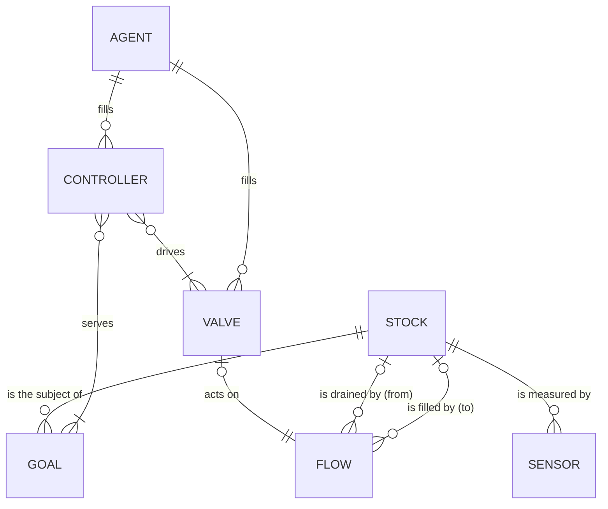

# Concepts: a software factory as a control system

ergostat treats the work around a software system as a factory, and the factory as a control
system. This document says what the parts of that control system are, what each is for, how they
relate, and how AI agents, programs and people fit in as the machines that do the productive
work. It is the reference the configuration format is designed from.

Where ergostat does not yet do what is described, this document says so (look for **Not yet**).

## 1. The factory

A factory turns inputs into outputs through stations, with work piling up between them. A
software organisation is the same: requests, alerts, pull requests, dependency updates, stale
docs, disk, queues, tickets. Things arrive, accumulate, are worked on, and leave.

What makes a factory run well is not any one machine. It is the control around the machines:
knowing how much is piled up where, deciding what to do about it, and acting, again and again,
so that nothing accumulates until it fails. Production systems fail the same way: a disk fills,
a queue backs up, a backlog of reviews grows until releases stop, certificates quietly approach
expiry. These are accumulating failures, and the defence against them is feedback.

Agents (AI agents, programs, scripts, and people) are the machines on this factory floor. They
do the productive work: they let a flow of work happen. ergostat's job is to make the control
around them explicit, measured and maintained.

## 2. The parts, and what each is supposed to do

```
            disturbance (what the world does)
                         │
 goal (r) ──▶(compare)─▶ controller ─▶ valve ─▶ flow ─▶ stock ─▶ its value (y)
                ▲        decides       acts                         │
                │                                                   │
                └──────────────────── sensor (measures) ◀───────────┘
```

| Part | What it is | What it does | Software example |
|---|---|---|---|
| **Stock** | What accumulates; the state of the system | Nothing on purpose. It is what it is, and it is the truth everything is judged against | Open pull requests; files in a queue; disk used; stale pages |
| **Flow** | What changes a stock: into it, out of it, or from one stock to another | Carries change, at a rate | PRs opened; PRs merged; files processed |
| **Sensor** | An instrument on a stock (or a flow) | Measures, faithfully, and nothing else. It never acts or decides | `ls inbox \| wc -l`; a Prometheus query; a person reading a dashboard |
| **Goal** | What we want a stock (or a flow's rate) to be: the reference, r | Is compared with the measurement; defines holding and off | "≤ 20 open PRs"; "disk ≤ 80%"; "error rate ≤ 1%" |
| **Controller** | The decision | Turns the error (goal minus measurement), and whatever else it reads, into a command: how hard to act. Its only effect is through valves | "Over 20 open: assign two reviews"; an autoscaler; a triage agent choosing what to work on |
| **Valve (actuator)** | What acts on a flow | Carries out the command, within its limits, and is the only part that changes the world | A merge bot; a cleanup job; an AI agent rewriting pages; a person reviewing |
| **Disturbance** | A flow nobody of ours controls | Nothing on purpose. It is why control is needed | Releases upstream making dependencies stale; users filing tickets |
| **Feedback** | The path from sensor back to the decision | Lets the next decision see the result of the last action | The next count of open PRs, after the reviews |

Two variants matter for scheduled work:

- **Open loop:** the controller acts without reading the result: a cron job that deletes files
  older than a day, whatever the count. Cheap, and blind to disturbances.
- **Feedforward:** the controller also measures the disturbance and acts before the error shows:
  scaling up when the request rate rises, before the queue grows.

In one line: the sensor reports, the controller decides, the valve acts, and the stock is the
truth they are all judged by.

## 3. How the parts relate



Read each line's ends as counts: `||` exactly one, `|o` zero or one, `|{` one or more, `o{` zero or
more. So a goal is about exactly one stock and a stock has any number of goals; a controller
serves one or more goals and a goal may be served by none (missing feedback); a flow has at most
one valve; a flow leaves at most one stock and enters at most one (none: outside the system). A
goal can also be about a flow's rate (an error rate, a throughput), and a controller's "agent" can
be ergostat itself, for a rule; the diagram leaves both out to stay readable.

| Relation | How many | Meaning |
|---|---|---|
| goal → stock | exactly one (sometimes a flow's rate) | What the goal is about |
| stock → goals | 0 or more | None: only watched. Several: a floor and a ceiling, or soft and hard |
| stock → sensors | 0 or more | None: a goal on it cannot be judged, a finding in itself |
| sensor → stock | exactly one (or one flow) | Instruments, not actors |
| controller → goals | 1 or more | What it works toward; an autoscaler may balance wait time against cost |
| goal → controllers | 0 or more | None: **missing feedback**. Several: shared, needing coordination, or they may fight |
| controller → flows it drives | 1 or more | Where its decisions take effect, through each flow's valve |
| flow → valve | 0 or 1 | None: a disturbance. One: something can change it on command |
| valve → controllers | 0 or more | None: it acts on its own (a timer, someone else's mechanism). Several: competing commands, needing arbitration |
| valve → goal | none | A valve never knows a goal; it takes commands |
| valve, controller → agent | exactly one machine each (or ergostat itself, for a rule) | Who does it |
| agent → roles | 0 or more | One machine can do several jobs |

A **loop** is derived, not declared: a goal, the sensors of its stock, the controllers serving it,
and the valves those controllers drive on flows of that stock. It is **closed** when that whole
path exists; when part is missing, the gap says which.

### Stocks, goals and controllers are three layers

- **Stocks are what is.** Measured and trusted. Their only intrinsic property besides their
  measurement is a physical limit: the disk is full at 100%.
- **Goals are what we want.** A decision people made: a requirement, an SLO. They have owners
  and criticality, and they are what is judged holding or off. A goal exists whether or not
  anything serves it.
- **Controllers are how we try.** They serve goals by driving flows.

Keeping goals apart from controllers is what makes missing feedback visible (a goal no
controller serves), lets several controllers share a goal without copies of the setpoint that
drift apart, lets one controller serve several goals, and keeps judging independent of the thing
being judged.

### Sensors are instruments, not agents

A sensor looks like an agent, because it is also a command on a schedule, but it only observes.
It never decides or acts, so it is not a role an agent fills: it belongs to the stock it
measures. Whatever produces a reading (a command, a metrics query, a person reading a gauge) is
part of the sensor's description.

### Why controllers and valves are separate

See `docs/controllers-and-valves.md`. In short: mathematically every block is just a function,
and the role names say what each block is for. **The controller is the block you design**, where
intent is written down; everything else is given, to be accepted and modelled. A controller is not
necessarily simple (model predictive control solves an optimisation every step) and not
necessarily linear (a thermostat is on/off); linearity is what analysis wants, so known
nonlinearities are kept outside the designed block. The valve is the mechanism the controller
commands, with its own dynamics, state and flaws, kept separate so they are contained, and so the
boundary between them (command in, achievement out) can be measured.

An AI agent can be either. As a valve it changes the world and is judged by the stocks. As a
controller its output is only a decision, and what we want from it is good behaviour at the level
of the loop (monotone, bounded, consistent), not linearity: triage is a routing controller of this
kind.

An AI agent session is more than a plain valve: it is a **servo**, an actuator with its own
feedback, given a target and correcting itself until it gets there. Putting it under another
controller is **cascade control**: an outer loop decides what and how much against stocks it can
measure, the inner loop inside the session decides how. The common multi-agent patterns read
this way are in `docs/patterns.md`.

## 4. Machines and roles

Control theory says nothing about the machines that do the work. A factory cannot ignore them.
A CNC machine or a drill press does many kinds of work and fills many roles; so does an AI agent,
a CI runner or an on-call engineer.

ergostat separates the **logical** design from the **physical** machines:

- **Roles** are the control system's parts that need someone to do them: controllers (decide)
  and valves (act).
- **Agents** are the machines: what kind they are (person, ai, narrow-ai, decision, program,
  rule), how many jobs they can do at once, what they cost. They describe themselves, never what
  they are used for.
- **The binding** is on the role, which in the format is a block: what to run for this role
  (`run:`, `prompt:`), the program loaded into the CNC machine for this part, and, when the
  machine is shared or has facts of its own (limits, a host, a person, an external system), which
  machine it is (`agent:`). A block with no agent simply runs locally, under ergostat.

Roles name their machine; machines never list their roles (that is looked up), so nothing is
written twice.

Consequences:

- **The ladder.** Every role is expected to move to cheaper, more predictable machines over time:
  a person, then a general AI agent, then a narrow one, then a fixed decision, then a program,
  then a rule, then nothing (the work designed out). Moving down the ladder is changing one
  block's type and what it runs (an `ai` block's prompt becomes a `program` block's command, or a
  built-in block); the goal and the rest of the loop stay put.
- **Machines are shared, and sharing is measurable.** Two roles on one busy machine compete for
  it; a valve can be limited by its machine rather than its design. ergostat sees jobs waiting
  for a machine, and can name the bottleneck.
- **Machines may be external.** An autoscaler, a Kubernetes controller or an on-call rotation
  already does work ergostat does not run. It is still a machine filling a role; ergostat
  observes it.

## 5. What ergostat does

ergostat (with an `ergostat.yaml`, docs/SPEC.md):

- **closes the loops.** It reads the sensors (commands, Prometheus queries, a person's readings),
  works out each goal's error and status (with its hysteresis), computes the built-in blocks
  (on/off, proportional, limits, delays, schedules, lookups, expressions) and commands the blocks
  that act. A commanded block runs once per fresh reading while its command holds, never twice at
  once (a command that arrives meanwhile is held, not queued: anti-windup), its command clamped to
  its `max`; right after it moves a flow, that flow's stocks are read again. What was commanded and
  what was moved are both recorded, so saturation is direct evidence, not an inference. When the
  decision needs judgment, the controller is an `ai` block, given the readings and goals, answering
  with commands; when it needs a person, a `person` block asks and waits for their report.
- **observes what it does not run.** `external` blocks (an autoscaler, a Kubernetes controller, a
  team) are declared for the structure and judged by the sensors on what they move.
- **finds missing feedback.** `check` names goals nothing serves, goals nothing can measure,
  blocks with no visible effect, open loops, competing commands, a controller that is its own
  disturbance, and limits nothing guards; `findings` adds what needs the record: a stock heading
  for its limit (with the time left), blocks saturating or failing, a person not answering, a
  sensor gone quiet, a goal off that nothing answers.
- **finds the feedback that exists.** `discover loops` looks in the record for flows that follow
  their stock's level after a delay (a balancing loop acting) and proposes the ones nobody wrote
  down as a goal and an external block; `discover prometheus` drafts a model from a Prometheus's
  series.
- **keeps critical loops healthy.** A goal marked `critical` is watched for decay: recovering more
  slowly than it did, owned by nobody.
- **explains itself**, to people and to AI agents: `explain` says any part in sentences, and
  `ergostat mcp` serves the model, its checks and its state to an agent.
- **draws it**, in the terminal and the web page, as stocks and flows and as block diagrams.

**Not yet:** a sensor or block on a remote host (`host:` on an agent is recorded, not used);
budgets counted across an agent's blocks (`cost:`); arbitration other than the largest command
when several controllers command one block (put a `select` in front to say how); the page drawing
blocks as blocks (it draws the model through the older parts: controllers, valves, sensors).

## 6. Two ways to draw it

The same model is drawn two ways, and they are complementary.

- **Stock and flow** (system dynamics, with a little of the process engineer's piping diagram):
  tanks, pipes, valves on the pipes, clouds at the boundary. It shows what the system is made of
  and how work moves: conservation, and the coupling between loops, such as one loop's outflow
  being the next loop's load, or two loops sharing a tank. This is where accumulating failures
  and cascades are visible.
- **Block diagrams** (control engineering): r, Σ, the error e, the controller C, the command u,
  the actuator, the plant, the measurement fed back through H. One loop at a time. It shows how
  each loop decides: whether it is closed, open or feedforward, and which way each input pushes.

People tend to think in loops (block diagrams); the trouble tends to live in the coupling between
them (stock and flow). ergostat lets people write in loops and shows them the stocks and flows
they produce, announcing the coupling it finds.

A third view, **wiring**, draws the machines and how one's output reaches another: who
implements the control system, rather than the control system itself.

## 7. The software factory

Examples of loops in a software organisation, and the machines that fill their roles:

| Stock | Goal | Disturbance | Controller | Valve |
|---|---|---|---|---|
| Open pull requests | ≤ 20 | Developers opening them | Assigns reviews when over | Reviewers (people), a merge bot for trivial ones |
| Outdated dependencies | ≤ 5 | Upstream releases | Picks which to update | A bot opening update PRs, at most two a run |
| Stale documentation pages | ≤ 3 | Code changes | Picks the page that matters most (an AI agent, or a rule) | An AI agent rewriting a page, as a PR to review |
| Jobs waiting in a queue | ≤ 500 | Requests arriving | An autoscaler (external) | The worker pool |
| Disk used | ≤ 80% | Logs and data written | A rule: over 80%, clean until 65% | A cleanup job; log rotation |
| Unacknowledged alerts | ≤ 2 | Production | A triage agent | The on-call engineer; an AI agent for known patterns |
| Days to certificate expiry | ≥ 14 | Time passing | Renews when under | A renewal job |

What the control view adds to ordinary automation:

- **Every agent is held to the same discipline:** measured, bounded, and acting only through the
  valves it is granted. An AI agent is not trusted because it is clever; its effect on a stock is
  measured, the same as a script's.
- **Effects are judged by the stock, not by the agent's report.** If the docs agent says it
  rewrote three pages and the stale count did not fall, the stock is right. What the known flows
  cannot explain is shown as a residual.
- **Missing loops are named.** Many production incidents are a stock that grew for weeks with no
  feedback at all.
- **Critical loops are maintained.** The loops that stop cascades are found, marked, and watched
  for decay, rather than being discovered when they fail.
- **Machines move down the ladder.** An AI agent is the right first machine for an unclear job;
  once its decisions repeat, a cheaper machine can take the role, and ergostat can say when.
