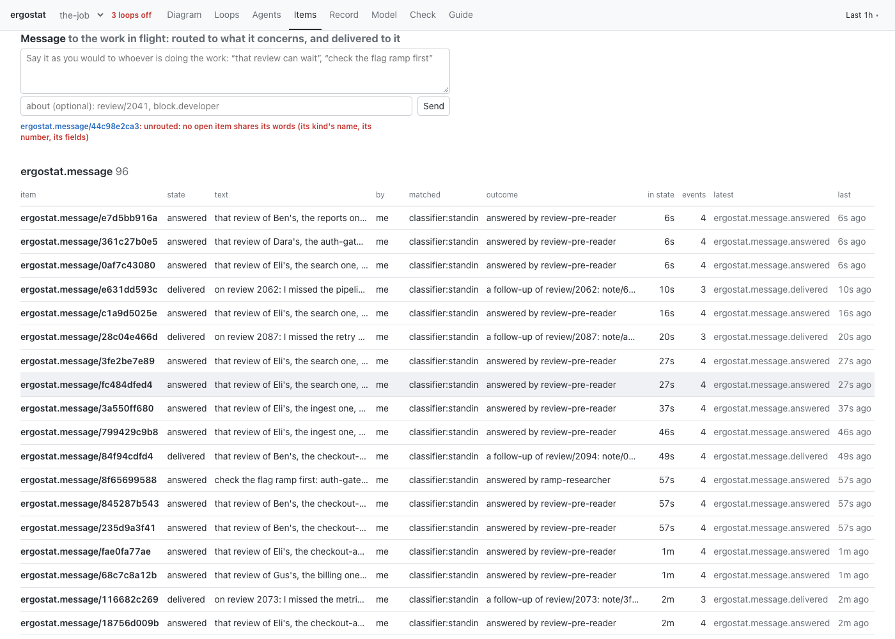
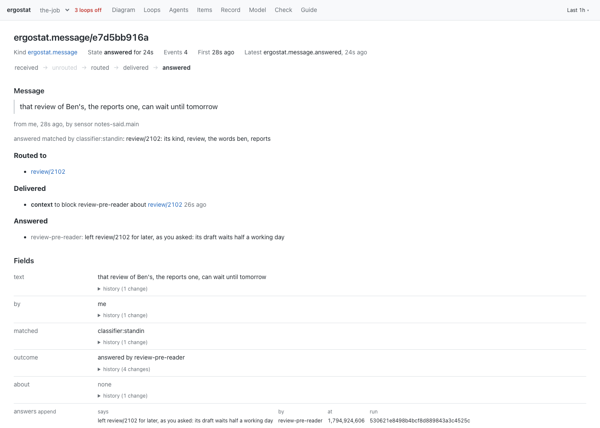
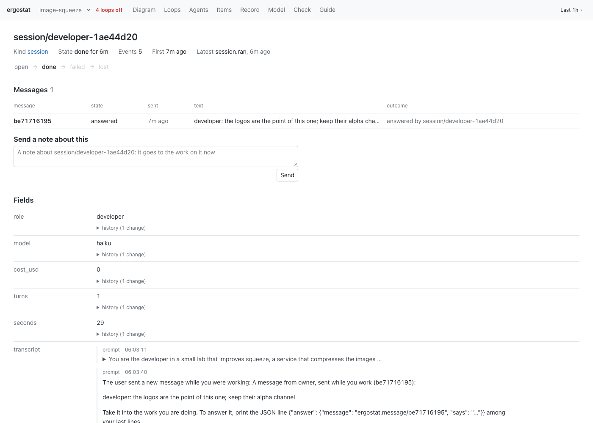
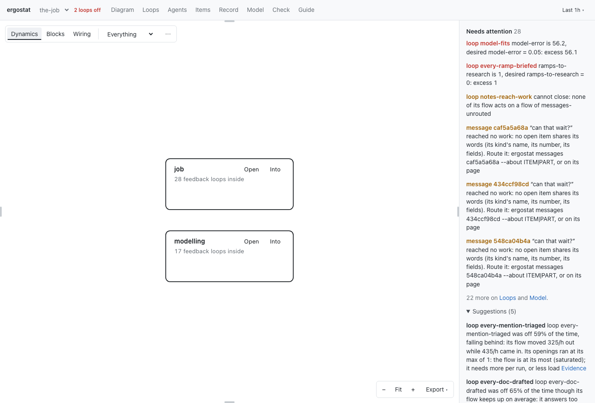

# Messages and interruptions

A person working with one long session says things while the work is under way, and the session folds them in:
"that review can wait", "check the flag ramp first", "on review 2041: I missed the migration". When ergostat runs the
work as many runs and sessions, nothing hears those words unless ergostat carries them. So in ergostat the owner's
words are a **message**: recorded verbatim, **routed** to the work in flight they concern, and **delivered** to it, a
running Claude Code session as its next turn, a block in its next run, finished work as a follow-up. A message that
reaches no work is raised, and how messages reach the work is measured. The format is in `docs/SPEC.md` §12h
(`ergostat help spec`); this page is how to use it. The screenshots are from `examples/the-job`, whose simulated owner
says things mid-work, and `examples/image-squeeze`, whose developer's session takes a note while it builds.

| Your question | Where |
|---|---|
| [How do I say something to the work?](#sending-a-message) | `ergostat message`, the Items page, an item's page, MCP |
| [Where does it go?](#how-it-is-routed) | what you named, ids and names in it, the classifier |
| [How does running work get it?](#how-it-is-delivered) | a session's next turn, a run's input, a follow-up |
| [Does a running `claude -p` session really take it mid-run?](#into-a-running-session) | yes: live, or resumed |
| [What if it reached nothing, or too late?](#unrouted-and-missed) | needs attention; missed |
| [How do I hold the system to it?](#as-measures-and-a-model) | `ergostat.messages.*`, item sensors, a goal |

## Sending a message

```bash
ergostat message "that review can wait until tomorrow"
ergostat message "keep the alpha channel for the logos" --about developer
ergostat message "on review 2041: I missed the migration in it"
ergostat messages                      # each one: state, what it matched, where it went
ergostat messages 1a2b3c4d5e           # one: routed to, delivered (how, to which run or session), the answer
```

On the page: **Items → `ergostat.message`** has a Message box (an optional "about"), and every item's page has
**Send a note about this**, with the messages about that item listed above it. An AI front-end relays the owner's
words with the MCP tool `message` (`text`, `about`, `by`): verbatim, not summarised. A program that hears the owner
somewhere else (a chat, the-job's simulated owner) relays them as a sensor's observation line,
`{"message": {"text": "...", "by": "me"}}`.



## How it is routed

At once, the first of these that finds anything:

1. **What you named**: `--about review/2041`, `--about block.developer`, or a part's bare name (`--about developer`).
2. **What its words name**: an item id (`hypothesis/3`), a part (`stock.queue`), a block's name as a word ("the
   developer should...").
3. **The classifier**: by default ergostat's free stand-in, which scores the items by the words they share with the
   message (the kind's name, the number in the id, the words of the item's shown fields) and takes the best. "That
   review of Ben's, the search one" is the open review whose author is Ben and whose title says search. A project can
   name a block to do this instead, typically an `ai` block on a cheap model:

```yaml
messages:
  classifier: router
blocks:
  router:
    type: ai
    model: haiku
    prompt: prompts/message-router.md     # "which of these items, if any, does this message concern?"
```

It is run once per message nothing else placed, given the message and the open items, and answers
`{"route": {"message": ID, "to": ["review/2041"], "why": "..."}}`. If it fails, the stand-in decides.

The message then goes to each **open item** it concerns and to each **block run working on it now** (a run works on an
item when an event about the item was caused by the run, the way `ergostat event --add` inside a run records it, or
when its command named the item), with that run's session.

## How it is delivered

- **A running session** (a block whose run is `ergostat session ...`, below) gets it as its next turn, while it works.
- **A block that is no session, or that is not running now**, gets it in its next run's input, under `messages`:
  each with its `id`, `text`, `by`, `sent` and the `items` it is about. The messages it gets are those routed to it
  and those about open items of the kinds it works on (the kinds its flows' and goals' sensors count). the-job's
  preparers read them: "can wait" puts a review off half a working day, "first" briefs that ramp first, anything else
  goes into the draft.
- **Finished work**, by the project's policy (`messages: {finished: ...}`): a **follow-up** (the default: a new item
  linked to the finished one, in its kind's first state, so whatever does that kind of work takes it up; the-job makes
  them `note/...` items its morning brief lists), a **reopen** (the item moves back: image-squeeze reopens a dropped
  hypothesis to `proposed`), or **attention** (left to you).
- **Answers.** Any block may print `{"answer": {"message": ID, "says": "..."}}`; a resumed session's reply answers the
  message it was given. The message's page shows them.



## Into a running session

A Claude Code session that a block runs through ergostat's helper takes messages **while it works**:

```yaml
blocks:
  developer:
    type: ai
    prompt: prompts/developer.md
    run: $ERGOSTAT_CMD session developer --model haiku -- --permission-mode acceptEdits --allowedTools Read Edit
```

`ergostat session ROLE` runs `claude -p` with a session id it chose, records the session as an item
(`session/developer-<run>`, its transcript copied as it grows; declare a `session` kind with `formats: {transcript:
claude-session}` to see the conversation live), and keeps the session's input open (`--input-format stream-json`).
A message routed to the run, its session, its block or an item it works on is written into that input. **This works
mid-run**: Claude Code queues a message that arrives while it is working and gives it to the model at its next step,
after the tool call under way ("The user sent a new message while you were working: ..."), so the same turn takes it
into account. Tested with Claude Code 2.1 and Haiku: a note sent five seconds into a ten-second tool call was in the
reply of that same turn. The delivery is recorded (`delivered`, how `live`, with the run and the session).

When a session cannot keep its input open (`--no-live`: the prompt is given whole), a message that arrives mid-run is
**queued**, and as soon as the turn ends ergostat **resumes** the session, `claude -p --resume ID`, with the message as
its input: its next turn, in the same conversation (`delivered`, how `resume`; the reply is the answer). A live
session's input is closed three seconds after a result with nothing more to say; a message that comes after that is
delivered the same way, by resuming.

To see it without spending tokens, `ERGOSTAT_CLAUDE=echo` runs ergostat's stand-in session, which echoes what it
receives (and folds a message that arrives mid-turn into the turn, as Claude Code does); `ERGOSTAT_ECHO_RUN` gives it
a program to run as its work. image-squeeze in AI mode, with its stand-ins doing the work:

```bash
FACTORY_AI=claude ERGOSTAT_CLAUDE=echo ERGOSTAT_ECHO_RUN='bin/py bin/standin_{role}.py' ergostat run
ergostat message "developer: keep the alpha channel for the logos"
```



## Unrouted and missed

A message nothing took (too vague, "hold that one for now", or about nothing open) is **unrouted**: it needs
attention, on the status and the page's list, until you route it (`ergostat messages ID --about review/2049`, or the
Route box on its page). the-job's morning brief also lists what you said that reached no work.

A message routed to work that then **finished without it** (the review you said to look at again was answered before
anything read your note) is **missed**: ergostat sweeps for these every few seconds, handles them by the finished
policy (the work reopened, or followed up) and records `missed`. That is work redone because a message did not reach
it in time, the number this function exists to keep at zero.



## As measures and a model

| Measure | What |
|---|---|
| `ergostat.messages.unrouted` | messages that reached no work, now |
| `ergostat.messages.awaiting` | routed and not yet delivered, now |
| `ergostat.messages.received`, `.routed`, `.delivered`, `.answered`, `.missed` | over the last week |
| `ergostat.messages.reached` | the share of last week's messages delivered |

They are built-in measures: a sensor reads one (`builtin: ergostat.messages.unrouted`) on a stock or an auxiliary, and
item sensors count messages like any items (`items: ergostat.message, state: routed`, `entering: delivered`). Both
examples model them as a system of their own (`examples/the-job/job/messages.yaml`,
`examples/image-squeeze/messages.yaml`): unrouted and awaiting as stocks, routed, delivered, unrouted and missed as
flows, and a goal holding the unrouted at zero, which nothing but the owner answers.

```yaml
stocks:
  messages-unrouted:
    sensor: {builtin: ergostat.messages.unrouted, every: 10s}
  messages-awaiting:
    sensor: {items: ergostat.message, state: routed, every: 10s}
flows:
  messages-delivered:
    from: messages-awaiting
    sensor: {items: ergostat.message, entering: delivered, over: 30m}
goals:
  messages-reach-work:
    stock: messages-unrouted
    hold: "<= 0"
```

`ergostat measure` prints them all; the MCP tool `messages` lists the messages with these counts.
