# Model tools

Everything ergostat can do with a model once it has a record: test it, improve it, run it ahead, and
read and tune its loops. Each tool says what it is, what you get from it, where it shows up (the exact
clicks), what it needs before it appears, and how to use it. The screenshots are from a 20-minute run
of `examples/image-squeeze` with its stand-in researcher and developer.

Start on the **Model** page (the header's **Model**, `#/model`; it was called Fit). Its first section,
**What's available**, lists for this project each loop and whether it can be analysed yet, each
parameter to estimate and whether the record is long enough yet, and a link into the panel where each
tool lives: a link chooses the part, opens the diagram in the view the tool lives in, and opens the
part's panel.

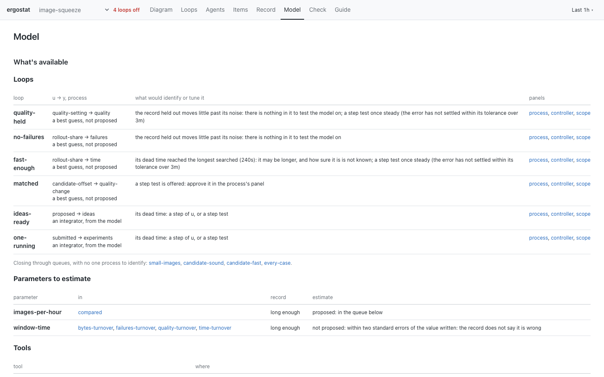

The rule behind every "needs": a number is shown only when the record can support it, and otherwise
the panel says why in one line and what would change that (for example "33 readings fitted (at least
40)"). Nothing changes the model by itself: every change is a proposal you accept or dismiss.

| Your question | Tools | Where |
|---|---|---|
| [Is my model right?](#is-my-model-right) | fit, residuals, structure checks, equation signs, extreme conditions | Model page, a part's panel, Check page |
| [What should I change?](#what-should-i-change) | the review queue, calibration, parameter, equation and structural proposals, fit history | Model page, a valve's or auxiliary's panel |
| [What will happen?](#what-will-happen) | replay, projection, sensitivity fan, what-if, leverage, loop dominance | a part's panel in the Dynamics view, a feedback loop's panel, a proposal's effect |
| [How we know the improver works](#how-we-know-the-improver-works) | the pipeline tests, the judge's error rates, the recovery benchmark, the prediction check, the loop's own measures | `ergostat bench`, `ergostat verify`, the test suite |
| [How do my loops behave, and how should they be tuned?](#how-do-my-loops-behave-and-how-should-they-be-tuned) | identification, process step response and Bode, margins, closed-loop step and Bode, monitoring, SIMC tuning, detuning, step tests | Blocks view: the process block, the controller, the summing junction; Loops page |

Where a tool's numbers and thresholds come from is in `docs/SPEC.md` §12b (fit, calibration,
proposals, the review queue), §12c (what-if, sensitivity, extreme conditions, loop dominance) and §12d
(control); how to act on what they say is in `docs/MODELLING.md`.

## Is my model right?

### Fit

**What it is.** The model run over the record (the replay), compared with what was measured, series by
series: R², MAPE, and Theil's split of the error into bias (U_M), unequal variation (U_S) and unequal
covariation (U_C).

**What you get.** Whether the model explains what happened, and what kind of wrong it is when it does
not: "runs high" (a constant or a missing flow), "swings less than the record" (a gain or a missing
delay), or point-by-point noise (U_C, where a good fit's error should be). A total, the **scaled
error**, to compare versions and proposals on.

**Where.** Model page → **How well the model fits**: **Model fit** (the stocks an equation moves, and
the total), **Equations, inputs as measured** (each equation alone, the sharpest test of it),
**Equations, replayed**, **Accounting** (stocks moved only by measured flows: they test no equation).
For one part: Diagram → **Dynamics** → click a valve or an auxiliary with an equation → under its
equation, "Inputs as measured (the partial-model test): R² …" (or, for a flow measured only by its
stock's changes, "Measured from its stock's changes, so judged by quality's replay: R² 0.32, …").
Command line: `ergostat fit`.

**Needs.** An equation (`equation:` on a flow or an auxiliary) or a stock with flows, so the replay
works something out. A series is judged on ten points or more spanning three of the slowest time
constant the replay met; before that its row says "too little record: …". The fit always looks at the
last day of record at most, whatever window the header shows.

**How.** On image-squeeze after 17 minutes, `ergostat fit` lists `quality`, `bytes-per-mp`, `time`,
`failures` and `paired` under MODEL FIT; `paired` "runs high" (R² 0.93, but U_M 0.80: a constant is
wrong), `time` is "out of step with the record". The calibration below finds the constant. Click
`time-turnover` in the Dynamics view to see its equation and read its fit beside it.

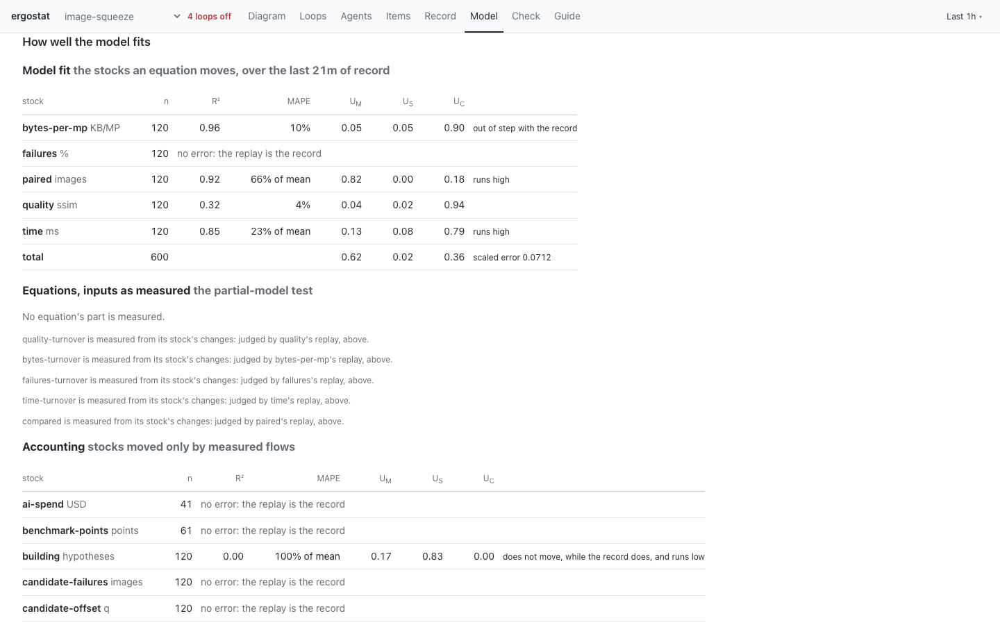

### Residuals

**What it is.** For each stock, the change its readings show minus the change its known flows explain.

**What you get.** Where a flow or a stock is missing: a persistent positive residual is a missing
inflow, a negative one a missing outflow; one that jumps once is usually a wrong reading.

**Where.** Model page → **Residuals** (the last table); `ergostat residual`. An unexplained one is also
said under Diagram → **Needs attention**.

**Needs.** Two readings of the stock in the window.

**How.** Read the "unexplained" rows; `docs/MODELLING.md`, "Reading the residuals", says what each
pattern points at.

### Structure checks

**What it is.** `ergostat check`'s findings about the model's structure: a rate driven by a rate (a
missing stock), a stock nothing drains, an outflow that ignores its stock, units that do not agree, an
auxiliary with no causes, a stock no flow moves.

**What you get.** Each finding names the part, its file and line, what is wrong in plain words, and the
YAML that fixes it; most also come back as a structural proposal in the review queue, ready to accept.

**Where.** The **Check** page; `ergostat check` (`--json` for scripts). Fixes that ergostat can write
are in Model page → **Changes to review**.

**Needs.** Only the model; no record.

**How.** `ergostat check`, then answer each finding by a change or by a word with a reason
(`instant: true`, `cumulative: true`, `exogenous: true`).

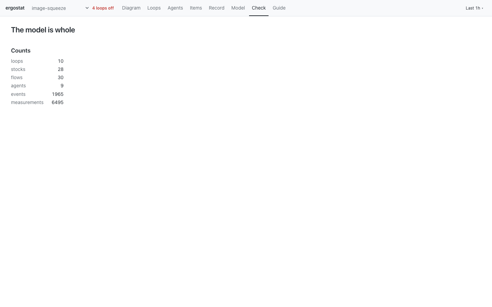

### Equation signs

**What it is.** A comparison of the sign drawn on each link (`driven-by: [+stock.x]`) with the way the
equation actually moves its effect, and of the declared sign with a least-squares fit of the flow on its
causes.

**What you get.** Loops whose polarity (reinforcing or balancing) is right. A wrong sign makes every
loop through the link wrong.

**Where.** **Check** page (`equation-sign`, `unsigned-link`); `ergostat check`; the fix (the sign
flipped, or taken off where the equation changes sign) as a structural proposal in Model page →
**Changes to review**. A sign the record contradicts is proposed flipped there too.

**Needs.** An equation that names the cause (the equation check); for the record's check, a flow with
declared causes whose fit on them explains half its variation (R² ≥ 0.5).

**How.** Try it: in a copy of image-squeeze, change `quality-turnover`'s
`driven-by: [+auxiliary.batch-quality, -stock.quality]` to `[-auxiliary.batch-quality, …]`; `ergostat
check` names it, and the Model page offers "A link's sign flipped" with Show on diagram.

### Extreme conditions

**What it is.** The equations alone, pushed to the extremes with no record: every stock empty with
nothing coming in, nothing coming in, each input alone at 0 and at a hundred times its largest, and each
estimated or timed parameter alone at its range's ends (else a hundredth and a hundred times its value).

**What you get.** The places an equation is wrong where it was never tested: a queue held below
nothing, a one-way flow running backwards, a division by an empty stock, a blow-up. Each failure names
the input or parameter that caused it.

**Where.** **Check** page (`extreme-conditions`); `ergostat check`. A guard that fixes it (`MAX(0, …)`,
`ZIDZ(a, b)`) is offered in Model page → **Changes to review**. A what-if that fails one is proposed
with that said.

**Needs.** Equations. What a block would do is not simulated.

**How.** `ergostat check`; image-squeeze passes. A failure is said once when the model fails with
everything as usual, and otherwise names the input or parameter that caused it, and what went wrong
(a stock drained below empty, a one-way flow gone negative, a division by 0, a blow-up).

## What should I change?

### The review queue

**What it is.** Every change to the model waiting for you, each read like a pull request: **what** kind
of change, **where** (its parts, files and lines), **why** (the evidence in words), **how found** (the
method, its span of record and points, how sure), its **benefit** (the fit before and after), its
**conflicts** with others waiting, and, opened, its **effect** (each part's record, the model as it is
dashed, with the change in blue, and the projections) and the exact **diff** Accept writes.

**What you get.** One place to review every improvement ergostat found, tested in memory before
anything is written.

**Where.** Model page → **Changes to review**. Per entry: **Show on diagram** (chooses its parts and
opens the Dynamics view with the Blocks view beside it), **Effect and diff**, **Accept** (then **Write
it**, beside the diff), **Dismiss** (with an optional reason). **Simulate all pending** applies every
change together in memory and shows their combined effect. A parameter's or an equation's proposal is
also shown in its valve's or auxiliary's panel, with Accept. Command line: `ergostat proposals` (lists
and refreshes), `ergostat proposals --show ID`, `ergostat accept ID`, `ergostat proposals --dismiss ID
--reason TEXT`.

**Needs.** A proposal: from Calibrate, a what-if you propose, a check finding with a concrete fix, an
estimate that says a term has no effect, SD Lab's simplify rules (looked for when the model changes and
every ten minutes), or a loop's identification or tuning. "Nothing waiting." otherwise; **What ergostat
can propose**, beneath, lists what can and cannot be proposed yet.

**How.** `ergostat proposals --show ID` prints one in full; `ergostat accept ID` writes it (refused,
and the file put back, if `check` would then find an error). Accepting records the fit before and after
in the **History**.

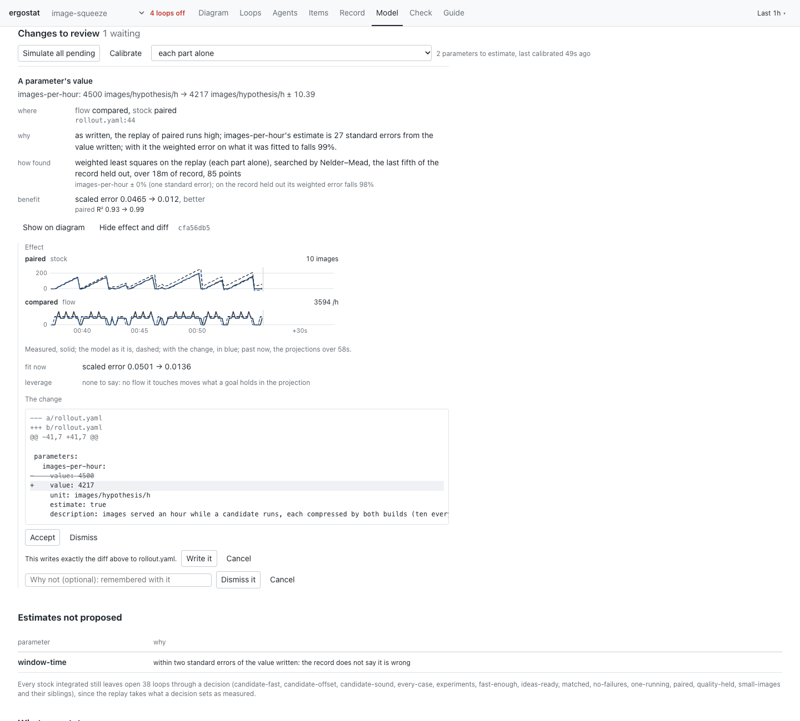

### Calibration

**What it is.** Every parameter marked `estimate: true` given the value that makes the replay fit the
record best (weighted least squares over the replay), with a standard error, on the record but its last
fifth, which is held out to test it. Three ways: **each part alone** (each equation with its inputs as
measured), **each system alone** (a system's stocks integrated, what comes in from outside as measured),
**every stock integrated** (what decisions set still taken as measured, so loops through a decision stay
open, and the page lists them).

**What you get.** Numbers the record supports, with how sure they are; values that agree across the
three ways are believable, and a value the whole model wants and its part alone does not points at the
structure between them.

**Where.** Model page → **Changes to review** → the **Calibrate** button, with the way chosen beside it
(it reads **Estimate now** when no parameter is marked). Each parameter's calibrations, side by side:
Diagram → **Dynamics** → click a valve or auxiliary whose equation uses it → the table under its
parameters ("calibrated / estimate / n"). Model page → **What's available** → **Parameters to
estimate** says, per parameter, the parts it is in, whether the record is long enough, and its state.
Command line: `ergostat proposals --calibrate parts|systems|whole`.

**Needs.** `estimate: true` on a parameter (and a `range:` when you know one). A proposal from it needs
forty points fitted spanning three of the slowest time constant the parameter touches, at least ten
independent errors, the estimate inside its range and off its bound, more than two standard errors and
2% from the value written, and a better fit on the record held out; otherwise the parameter's row (and
**Estimates not proposed**) says which of these failed.

**How.** On image-squeeze, `window-time` and `images-per-hour` are marked. **What's available** shows
"long enough" once the record is (`window-time` touches the 19.2 s window: 58 s of record and 40
points; `images-per-hour` the 67 s `paired` holds things for: 3m22s); click **Calibrate** (or
`ergostat proposals --calibrate parts`). After 17 minutes, `images-per-hour` came out at 4217 ± 10
against the 4500 written, 27 standard errors off, and was proposed (scaled error 0.0465 → 0.012);
`window-time` was "within two standard errors of the value written: the record does not say it is
wrong", and not proposed. Open `quality-turnover` (Diagram → Dynamics, or the link in the parameters
table) to see its calibration beside its parameter.

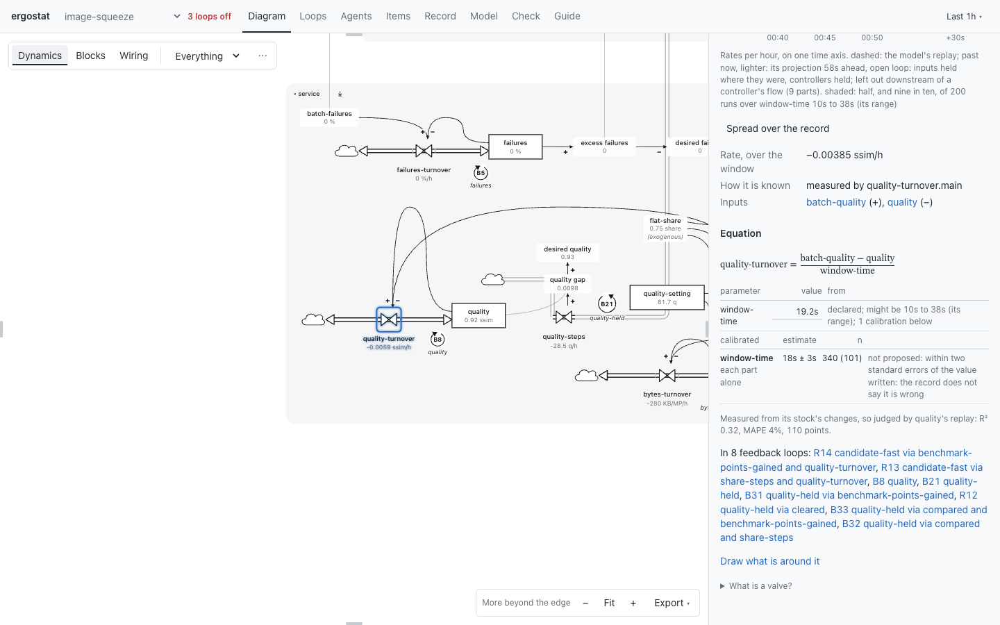

### Parameter and equation proposals

**What it is.** A parameter set to its estimate; an equation for a measured flow that has declared
causes and no equation (a coefficient per cause by least squares, an outflow first-order in its stock).

**What you get.** The edit, its reason, and the fit before and after, as a review entry.

**Where.** Model page → **Changes to review**; the valve's or auxiliary's panel ("Proposed value",
"Proposed equation", with Accept).

**Needs.** For a value, the calibration's conditions above. For an equation, a measured flow with
declared causes (`driven-by`) that explain half its variation (R² ≥ 0.5) with every declared sign; an
outflow must name its stock among its causes. A flow and cause inside a loop a controller closes carry a
warning that the regression is biased. A valve with no equation says, in its panel, which of these it
lacks.

**How.** `ergostat proposals` (it calibrates each part alone first, then lists).

### Structural proposals

**What it is.** A change to what moves what: a stock between a rate and the rate that follows it, an
outflow for a stock nothing drains (sized by Little's law) or `cumulative: true`, a converting
auxiliary, a sign flipped, a guard, an auxiliary marked exogenous, a term with no effect removed with its
link, and SD Lab's simplifications (a dead flow removed, two flows merged, a pass-through stock joined, a
still, empty, twin or lone stock removed).

**What you get.** The structure `check` and the record say is wrong, fixed as a diff you can read and
simulate before accepting.

**Where.** Model page → **Changes to review**; **Found, and not proposed** (under **What ergostat can
propose**) lists what was found but would have left an error.

**Needs.** A check finding with a concrete fix, or record: a dead flow needs half an hour of record, a
stock judged empty or still needs 20 readings. Not yet: a missing stock, flow or delay found from the
residuals' pattern.

**How.** `ergostat proposals` lists them with the rest.

### Fit history

**What it is.** The scaled error of each version of the model (a hash of its structure and numbers),
with the span it covered, and each accepted change with its fit before and after.

**What you get.** Whether the model is getting better.

**Where.** Model page → **History**.

**Needs.** A fit recorded (at most every five minutes a version, while the page or `ergostat run` is
up).

## What will happen?

### Replay and projection

**What it is.** The replay is the model run over the record: each stock integrated from its flows from
its first reading, each equation worked out, every other input as measured. The projection runs on from
now, open loop: the inputs held where they were, the controllers held, for three of the slowest time
constant the replay met (within a twentieth and a quarter of the window).

**What you get.** Whether the model follows the part over time, and where the part goes next if nothing
changes: a level ahead, a time to a limit.

**Where.** Diagram → **Dynamics** → click a stock, a valve or an auxiliary: its panel opens with its
**causes strip** (the part, then what drives it, on one time axis). The replay is dashed over the
measured line; past now, lighter, the projection. The strip's foot says how the projection holds its
inputs. Choosing parts (Shift-click) charts them in the side panel too.

**Needs.** An equation on the part, or (for a stock) flows in the model. A part the replay takes as
measured says so under its chart ("no replay, projection or fan: no equation works it out"). What a
flow a block sets moves is left out of the projection (the blocks are not simulated), and the foot says
so.

**How.** On image-squeeze, click `quality` or `time` in the Dynamics view (or **What's available** →
**Tools** → its link).

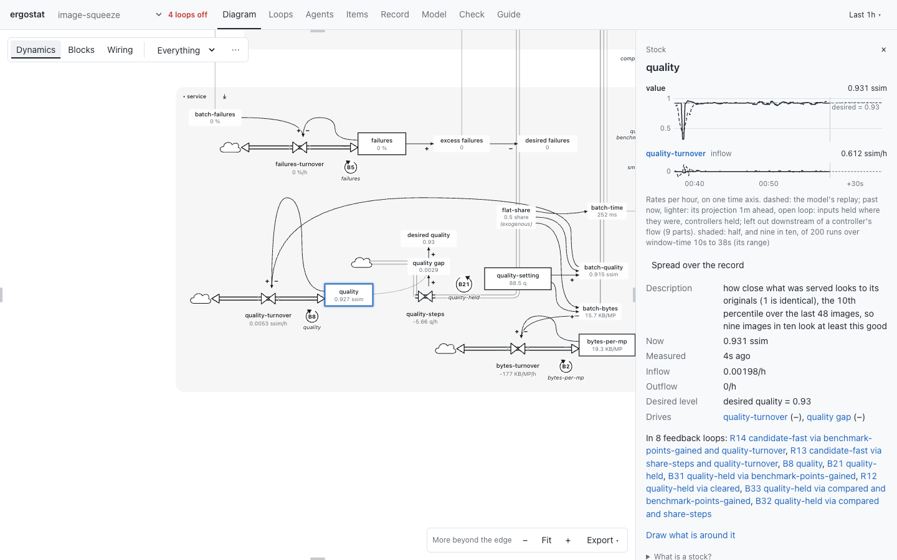

### Sensitivity fan

**What it is.** The projection run two hundred times over what the model says is uncertain (a
parameter's `range:`, else an estimate's standard error), estimates fitted together drawn together.

**What you get.** How much of the projection depends on what is not known: where half the runs fall,
and nine in ten, shaded under the projection. A wide fan says measure that number before acting on the
projection.

**Where.** The causes strip, shaded under the projection; **Spread over the record** (the button under
the strip) draws the same over the window: a hundred replays.

**Needs.** A parameter upstream of the part with a `range:` or a calibrated standard error; nine in ten
from a hundred runs or more. Otherwise the foot says "no spread drawn: no parameter it uses has a range
or an estimate's error". An equation whose parameters have neither says so in its panel.

**How.** image-squeeze's `window-time` has `range: [9.6s, 38.4s]`, so `quality`'s projection has a fan.

### What-if

**What it is.** A parameter's value typed over in its panel; every chart on the page then draws the
replay and the projection with the value tried, in blue, beside the model's own.

**What you get.** "What happens to the backlog if reviews take twice as long?", and the fit of the value
tried (each stock it moves, R² and MAPE before and after, and the scaled error) before anything is
stored.

**Where.** Diagram → **Dynamics** → click a valve or an auxiliary with an equation → its parameter
table: type in the **value** box (a time with its unit, `20s`, `2m`; a bare number is seconds) and
press Enter. Beneath it: the fit before and after, **Propose these** (makes every value tried one
proposal) and **Put it back**. Command line: `ergostat proposals --propose window-time=30s`.

**Needs.** An equation with parameters. A valve set by a block, an exogenous input, or a flow with no
equation says why in its panel ("No equation, what-if or calibration: tuner sets it …").

**How.** Open `quality-turnover`, type `30s` over `window-time`'s 19.2 s: the blue lines lag more.
**Propose these** puts it in the queue with its fit; it changes the model only when accepted.

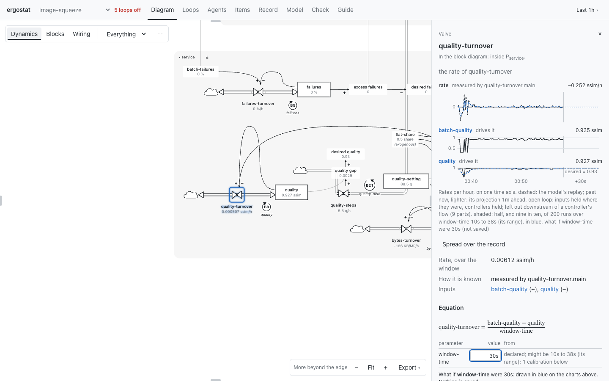

### Leverage

**What it is.** Each flow a proposal touches sped up by a tenth in turn, projected to the horizon, and
ranked by how far it moves what the goals hold (SD Lab's leverage).

**What you get.** Which flow is worth acting on, among all of them.

**Where.** Model page → **Changes to review** → an entry → **Effect and diff** → **leverage** (and for
**Simulate all pending**).

**Needs.** A proposal waiting, a goal on a part the projection reaches; a negligible move is not said.
"none to say: …" otherwise.

### Loop dominance

**What it is.** Which feedback loops drive the behaviour, and when, by the Loops That Matter method on
the replay: each loop's relative score at each stock it runs through, from −1 (a balancing loop drives
everything there) to +1 (a reinforcing one), beside the loops competing there.

**What you get.** Why the system behaves as it does: growth turning into saturation as a reinforcing
loop gives way to a balancing one; a goal-seeking loop that dominates throughout is a controller doing
its job.

**Where.** Diagram → **Dynamics** → click a loop marker (R or B, inside the loop) or a loop in the side
panel's list → **When it drives the behaviour**.

**Needs.** A replay over the window through the loop's stocks. A loop through a link that cannot be
scored (a decision with several inputs, an equation with a delay inside it, an unsigned link) says why;
a stock where loops cannot be scored says how many are.

**How.** On image-squeeze, **What's available** → **Tools** → loop dominance opens B8, `quality` (the
window's own turnover, balancing): its relative score is −1 throughout, and the panel says that it is
the only one of the eight loops through `quality` that can be scored (the others run through the
tuner's and the rollout's decisions), so no loop is named as dominant there.

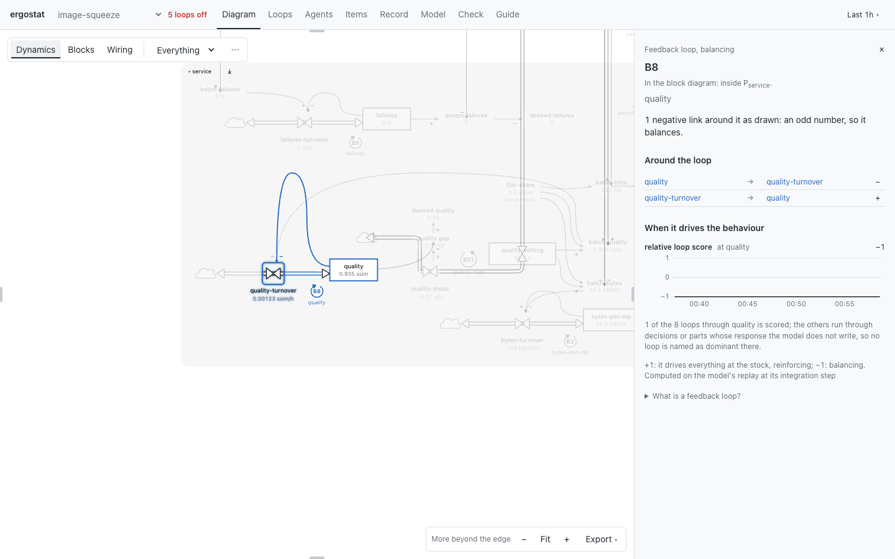

## How do my loops behave, and how should they be tuned?

These are worked out for each loop whose controller moves one thing: a **setting** it steps (a stock
moved by a two-way flow its block sets) or a **valve** (a flow it sets). That is u; what its goal holds
is y. A loop that closes the long way, through queues and the blocks that work them off, has no one
process: Model page → **What's available** lists those on one line, with a link to each one's scope.

### Identification

**What it is.** The process from u to y fitted from the record as first order with dead time,
K e^(−θs)/(τs + 1), or an integrator with dead time, k e^(−θs)/s, driven by the measured u alone
(an output-error model), with standard errors and tests on the record held out.

**What you get.** The loop's gain, time constant and dead time, how sure each is, and how it was tested:
what every other control tool needs.

**Where.** Diagram → **Blocks** → click the process block **P** that the loop's y comes out of → **The
loop NAME, from u to y**: the process in MathML, gain K, time constant τ, dead time θ, fit, what it
leaves of the record held out, where it came from, the whiteness and independence of its errors, and y
against the model's own simulation ŷ. Loops page → click a loop → the same, with the controller's.
Model page → **What's available** → a loop's **process** link opens it.

**Needs.** u stepped three times or more in the part fitted (or a step test), forty readings fitted
spanning five of τ + θ, a record held out that moves 15% past its noise and of which the model leaves at
most 1.5 times the noise, and K, τ and θ each told apart (a standard error under half of it). Until
then the panel shows the record's best guess, "not proposed", with each reason ("u stepped only 2 times
in the part fitted (at least 3)", "11 readings fitted (at least 40)"), and **What's available** shows
the first one. A valve that fills y's stock directly is an integrator known from the model; only its
dead time needs a step of u. You can also write it: `process: {gain: …, time-constant: …, dead-time:
…}` on the goal (or `integrating: true` in place of `time-constant`).

**How.** On image-squeeze the tuner steps `quality-setting` every 16 s, so `quality-held` is
analysed from the loop working; after 21 minutes (u stepped 35 times, 128 readings fitted) its best
guess was a lag of about 1000 s with K 0.022 ± 0.469: not told apart (closed loop, quality held near its
setpoint, so u and y moved little together). The panel lists each reason, and its last line says why no
step test yet ("u has been at its limit (5 to 95) in the last 3m"); a step test is what identifies it. Once it is proposable,
Accept writes the goal's `process:` (also in Model page → **Changes to review**, or `ergostat accept
ID`).

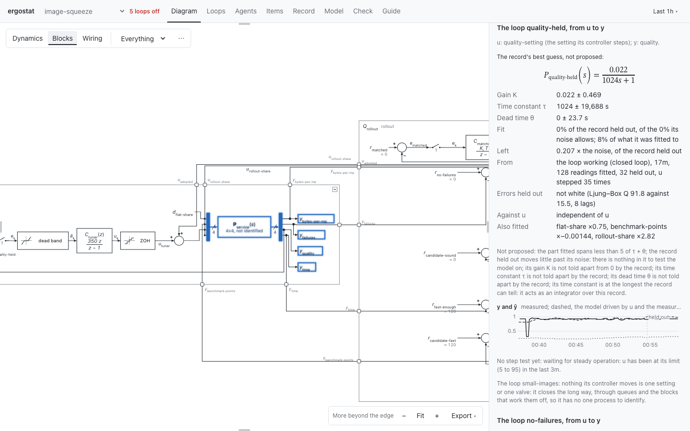

### Process step response and Bode plot

**What it is.** The process's response to a unit step of u, and its gain and phase against frequency.

**What you get.** How far and how fast y answers a move of u, and where the dead time costs phase.

**Where.** The same process panel, under the identification.

**Needs.** A process: the model's `process:`, or one identified with its numbers told apart (an
integrator guessed under integral action is not used: it never settles).

### Margins, closed-loop step and Bode

**What it is.** The closed loop worked out exactly in discrete time from the process and the controller
as its block writes it (integral action from `gain:`, PI with `integral-time:`), with the controller's
own delay (how old the reading it acts on is, and how long its run takes) added to the dead time.

**What you get.** Gain, phase and delay margins, Ms (the sensitivity's peak: "not robustly" past 2 or
under 30° of phase), whether the loop settles, its overshoot and settling time for a step of r, the
loop's Bode plot, the margins at the worst the process could be (K ± 2σ, θ + 2σ, τ ± 2σ), and what the
linear numbers leave out (a dead band, a setting's resolution, its limits).

**Where.** Diagram → **Blocks** → click the controller **C** → **With the loop NAME's process**. Model
page → **What's available** → a loop's **controller** link.

**Needs.** A linear law the block writes: `gain:` (and `integral-time:` for PI), run every T, reading
only its goal's error. A program or AI that reads more than its error, an on/off block, or a gain not
written says so ("matcher steps its setting by its error (integral action), but its gain is not
written (gain:)"). And a process (above); until then "Its process is not identified yet, so no margins,
closed-loop step or tuning".

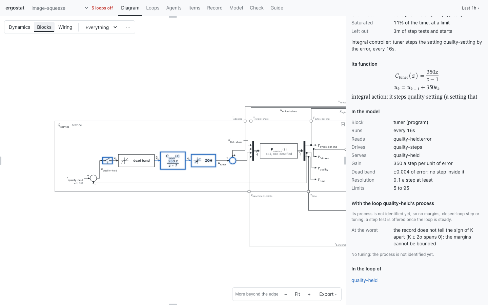

### Monitoring

**What it is.** How the loop is doing over the last day: for a level held (`==`), the Harris index (the
variance a minimum-variance controller would leave given the dead time, over the loop's own); for a
ceiling or a floor, how often and how far y was past it; whether the error oscillates (period and
amplitude); how long it takes to settle and how far it overshoots; how often u was at a limit. Step
tests and starts are left out.

**What you get.** Whether a loop needs attention before anyone notices: saturation, oscillation, a slow
recovery.

**Where.** Diagram → **Blocks** → click the loop's summing junction **Σ**, its controller or its output
y → the scope (y with r, u, e) → **How it is doing**. Loops page: a word per loop (or what it lacks:
"needs θ", "too little record"), and the whole of it in a loop's panel. Model page → **What's
available** → **scope**.

**Needs.** Ten controller periods (two minutes at least) past the start; the Harris index needs the dead
time θ, from a process identified or written ("needs the loop's dead time: identify its process").

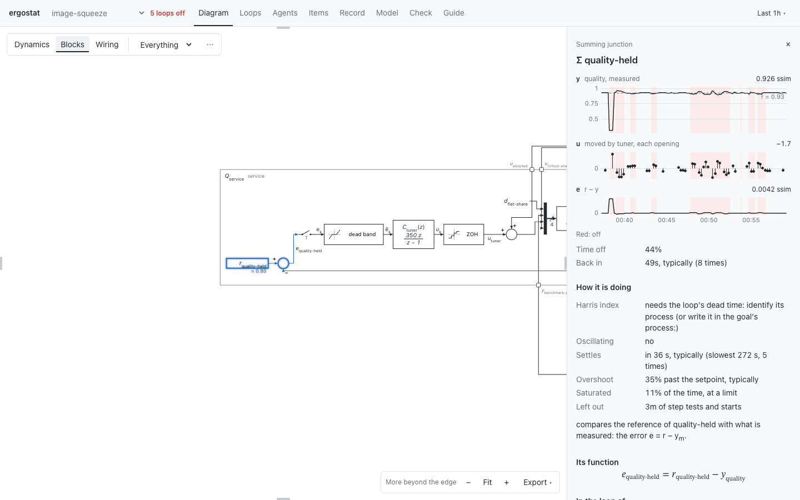

### SIMC tuning and detuning

**What it is.** Skogestad's SIMC rules for the controller's gain (and integral time), with the tight
default τc = θ, offered with its margins and closed-loop step beside the controller's own. Where none is
offered and the loop's gain margin at the worst the process could be is under 2, a detuning: the gain
scaled so that worst margin is 2.

**What you get.** A gain to write, with what it does before you write it.

**Where.** The controller's panel (under the margins), as "SIMC (Skogestad): …" or "Detuned for
robustness: …", and a **Proposed tuning** with Accept (also in Model page → **Changes to review**).

**Needs.** A process in the model (accept the identified one first: "the process it is tuned for is not
in the model yet: accept it first"), the block's `gain:` written, and a change of more than a fifth that
settles the loop.

### Step tests

**What it is.** A deliberate experiment ergostat plans and, once you approve it, runs: it holds the
loop's own blocks (and those that move inputs beside its path), steps the setting by a planned amount,
waits, puts it back to the value it recorded, waits, and gives the loop back, recording every move.

**What you get.** A process identified open loop, quickly and cleanly, when the loop's own record does
not identify it (a loop that holds well moves u too little).

**Where.** Diagram → **Blocks** → the process block's panel → **Proposed step test** (its size, how long
each way, when it stops early, the blocks held) → **Approve** or **Dismiss**; the tests run and finished
are listed there. Its state, until it is offered, is the last line of the panel ("No step test yet:
waiting for steady operation: …"), and **What's available** shows it per loop.

**Needs.** A setting its own controller steps by this loop's error alone, the record not identifying it,
and steady operation: ten controller periods, three of τ + θ and ten minutes of record since the start,
and over the last five periods (three minutes at least) the error within its tolerance on average and
not drifting, u away from its limits. It runs only while `ergostat run` is running.

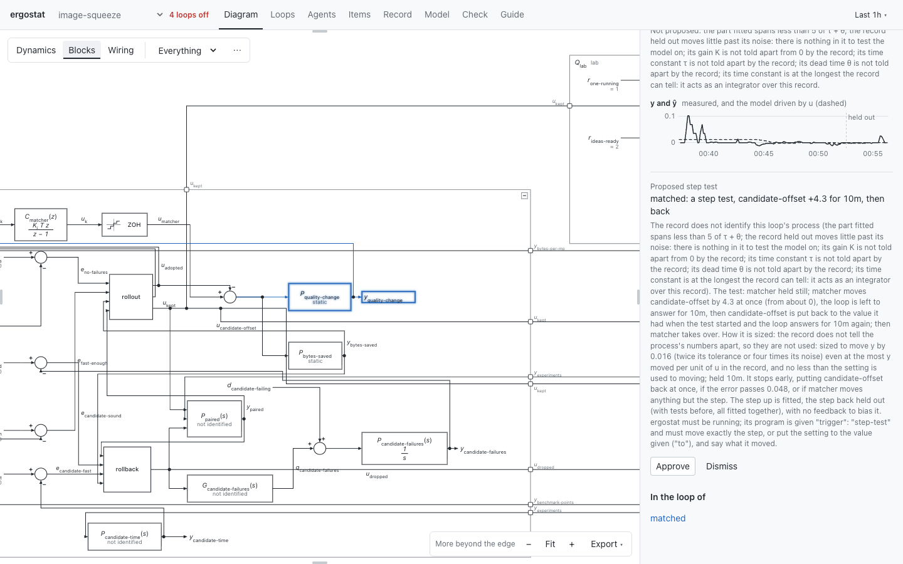

## How we know the improver works

The model can improve itself as a loop (SPEC §12e): any block proposes a change with its evidence, ergostat
checks it, a judge replays it on the record that came after it, and what passes is written (by the owner, or
by the judge where `improve.accept` says `auto`). Five layers check that loop, each from a different side
(SPEC §12f). They drive the loop's own modules (`propose` lines, the `ergostat.model-change` items, the built-in
judge, Accept), at moments of a simulated record.

| Layer | What it shows | Where |
|---|---|---|
| 1. The pipeline | A proposal without checkable evidence, or whose edit does not compile, is refused; Accept writes exactly the diff shown; a change made against a model since changed is never written; under the default policy nothing is written without the owner | `tests/test_bench.py` |
| 2. The judge | Its false-accept rate (a worse, neutral or slowed change written) and false-reject rate (a better one not written), over many seeds, on worlds where the truth is known | `ergostat bench judge` |
| 3. Recovery | True models damaged by known defects; the loop run on each with the truth's record; recall, precision, damage, fit, forecast and cost | `ergostat bench improve` |
| 4. The prediction check | Each change written, scored again later on the record since; flagged for revert when the model forecasts worse with it | `ergostat verify` |
| 5. The loop's own measures | Changes written a day, flagged, the share verified, the fit they gained, what each cost | a sensor (`builtin: ergostat.model.accepted-per-day`), `ergostat measure`, `ergostat bench meta` |

### The recovery benchmark

**What it is.** Fifteen cases with known true models (`ergostat/bench/cases/`, ergostat YAML with equations):
eleven of SD Lab's ladder cases, converted by `scripts/bench_ladder.py` (a step is three minutes, every number a
parameter), and four written from the examples' worlds (the-job's ramps, DELAY3, outages and alerts;
software-factory's users, bugs and missing operations; image-squeeze's lab and service; an HPA loop like
kube-sim's). Each truth is simulated by ergostat's own replay, read every minute with 2% measurement noise.
A defect from the catalogue is planted (two in four cases): a flow removed, a sign flipped, a parameter three times
off, a delay missing, a stock merged away, a spurious link. The improver then works on the damaged model for six
rounds: it proposes seeing only the record so far, the judge judges on the two hours after, and what passes is
written (`accept: auto`). Four hours of record after the last round are kept for the forecast.

**What you get.** A scorecard per case and overall (`scorecard.md`, `scorecard.json`):

- **recall**: the planted defects fixed, judged at the stocks each shows at by the model's inflow and outflow worked
  out on the truth's own record (the partial-model test) against the truth's; a defect the record cannot tell
  from the truth is said so and left out;
- **precision**: the improver's proposals that move the model towards the truth;
- **damage**: changes written that moved it away;
- **fit** over the record and **forecast** on the later record, damaged, final and truth (the noise floor);
- **cost**: rounds, seconds, tokens and dollars.

**How.**

```bash
ergostat bench improve --list                          # the cases and their defects
ergostat bench improve                                 # the stand-in, every case (a few minutes)
ergostat bench improve --cases 003,tag:world           # some
ergostat bench improve --improver ai --model sonnet --cases 002,011,063   # an AI improver, on demand (costs money)
ergostat bench improve --judge-fixes                   # the judge with the changes proposed to it (below)
```

The **stand-in** is a program: it knows nothing of the truth, and each round tries a fixed menu (every parameter
retuned, a term dropped or its sign flipped, a drain, inflow or transfer added, a delay put on a flow, a stock put
back where a series the model does not read was measured), tunes each and proposes the best two. The
**calibrator** (`--improver calibrator`) does what the examples' stand-ins do: it proposes the calibration's own
estimates for the judge to decide. The **AI** improver is `claude -p` given the model, its fit, its findings and the
unread series. A small subset of the stand-in's benchmark runs in the test suite. The scorecard counts the proposals
by kind, so it shows how parameter changes fare against changes to the structure.

### The judge's error rates

`ergostat bench judge --seeds 20` proposes changes whose worth is known on two synthetic worlds (a queue; a
third-order delay between two stocks), each world written with one number off: **better** (the number within 5%
of the truth, or the missing delay put back), **worse**, **neutral** (nothing the record can tell) and **slowed**
(a drain two hundred times too slow, so its stock's replay is slower than the record and leaves the fit's total).
It reports the false-accept rate, which must be about 0, and the false-reject rate.

Two weaknesses it found in the judge as built, and the changes proposed for them (`--judge-fixes` tries both):

- **A stock can leave the total.** The fit's total leaves out a stock whose replay is slower than the record is
  long; a change that slows one enough looks better in every window. *Like for like*: the judge compares the two
  models over the same stocks, each stock's scaled error counted whatever its time constant.
- **Windows start cold.** Each window is replayed from its own first reading, every delay in equilibrium, so a
  correct delay is often worse in a short window than none. *Warm windows*: each window is scored on a replay
  started six hours before it.

### As measured (2026-11-17)

The judge (`ergostat bench judge --seeds 10`, 120 trials): as built, 5 of 90 worse, neutral or slowed changes
written (all five slowed: a stock pushed out of the total) and 17 of 30 better ones not (the delay world: cold
windows); with warm windows alone, 0 and 0; like for like alone, 1 and 17; both, 0 and 0.

The recovery benchmark (15 cases, 16 defects the record can see, six rounds):

| Improver, judge | Recall | Precision | Accepted (real fixes, damaging) | Final fit, median × truth's | Forecast better than damaged | Cost |
|---|---|---|---|---|---|---|
| stand-in, as built | 9/16 | 45/92 | 14 (9, 3) | 1.54 | 10 of 15 | 14 min, $0 |
| stand-in, both fixes | 12/16 | 24/65 | 23 (15, 2) | 1.01 | 13 of 15 | 11 min, $0 |
| calibrator, as built | 5/16 | 21/66 | 13 (8, 4) | 28 | 8 of 15 | 1.4 min, $0 |
| AI (Sonnet), as built, 3 cases | 1/3 | 8/20 | 3 (2, 0) | 2.3 | 1 of 3 | $0.95 |

What it shows: parameter proposals made from the record they were fitted on mostly fail the judge on the record
after them (the calibrator: 49 checked, 16 passed, 25 failed), and one in three of those it wrote moved the model
away from the truth: a value refitted to make up for a missing flow fits better and is wrong. The damage that gets
through is of that kind, a compensating error, which a judge of fit alone cannot see. A missing delay is recovered
only with warm windows. Where the record barely shows a defect (a hidden stock merged away, the-job's missing
delay) the benchmark says so and does not count it.

### The prediction check

**What it is.** Each change written is scored again once three hold-outs of record have come after it: the
model as it is now beside the same model with that change undone, over the record since it was written and its
halves (a free replay, the inputs as measured). **Verified** (`ergostat.model-change.verified`, a state of the change's item) when it forecasts
no worse; **regressed** (`ergostat.model-change.regressed`) when without it the forecast is better by the threshold
over the whole record since and in half the windows, with the edit that undoes it.

**How.** `ergostat verify` (run by a block, like the judge; `--propose` proposes the undoing, for the judge and the
owner to decide). A change a later one rewrote is said so and not judged.

### The loop's own measures

`ergostat bench meta` prints, over the last week: `ergostat.model.accepted-per-day`, `ergostat.model.regressed`,
`ergostat.model.verified-share`, `ergostat.model.fit-gained` (what the changes written lowered the scaled error
by, together) and `ergostat.model.cost-per-accepted` (the `cost_usd` the blocks that make changes recorded, over
the changes written). They sit beside the improver's own `ergostat.model.fit`, `.unexplained`,
`.unidentified-loops` and `.open-findings`, and are read the same way (a sensor with `builtin:`), so a goal can hold
how well the loop works as well as how good the model is.

## A walkthrough on image-squeeze

```bash
cp -r examples/image-squeeze /tmp/squeeze && cd /tmp/squeeze
ergostat run                          # the stand-ins work; the page is at the address it prints
```

What follows is what a 20-minute run showed; the numbers move from run to run.

1. **Model** page → **What's available**: six loops that can be analysed and four closing through
   queues (`small-images`, `candidate-sound`, `candidate-fast`, `every-case`); `quality-held`
   (`quality-setting → quality`) with the record's best guess, not proposed, and why; two parameters to
   estimate, `window-time` (in the four turnovers) and `images-per-hour` (in `compared`).
2. `ergostat fit`: `paired` runs high (U_M 0.80), `quality` R² 0.32 with its error mostly U_C.
3. Click `quality-turnover` in **Parameters to estimate**: the Dynamics view opens on its valve, with
   its equation `(batch-quality − quality) / window-time` and its causes strip (replay dashed,
   projection and its fan past now). Type `30s` over `window-time` and press Enter: the charts redraw
   with the value in blue, and the fit before and after appears under the parameters. **Put it back**
   (or **Propose these**, which puts it in the queue).
4. Back on the Model page, **Calibrate** (each part alone), or:

   ```bash
   ergostat proposals --calibrate parts     # cfa56db5  A parameter's value
                                            #   images-per-hour: 4500 → 4217 ± 10.39 ... scaled error 0.0465 → 0.012
   ergostat proposals --show cfa56db5       # what, where, why, how found, benefit, and the diff
   ergostat accept cfa56db5                 # writes rollout.yaml's value, comments kept
   ```

   On the page: **Changes to review** → **Effect and diff** shows `paired` replayed as it is and with
   the change, the leverage, and the one-line diff; **Accept** → **Write it**.
5. **What's available** → `quality-held` → **process**: the Blocks view opens on `P_service`'s panel at
   "The loop quality-held, from u to y": the best guess (a long lag), its numbers, y against ŷ, and
   each reason it is not proposed. **controller**: the tuner's law (integral action, gain 350 every 16 s,
   a dead band of ±0.004, steps of 0.1, limits 5 to 95); no margins yet, and why. **scope**: how the
   loop is doing (settling, overshoot, saturation; the Harris index waits for θ).
6. Once a loop has held steady (ten minutes since the start, the error within its tolerance over the
   last three minutes, u away from its limits), a step test is offered in its process panel. In this
   run `matched` was offered "candidate-offset +4.3 for 10m, then back" (the matcher held still);
   `quality-held` waited, its setting at its limit while logos kept quality off. **Approve** it and
   watch the setting step and come back on the scope; the test's record identifies the process open loop. Accept the process,
   and the controller's panel works out the margins and offers a SIMC gain.
7. `ergostat check`: structure, signs and extreme conditions; image-squeeze passes.
