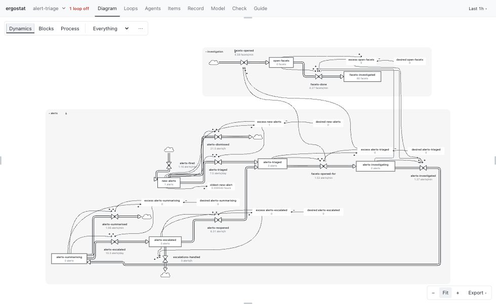
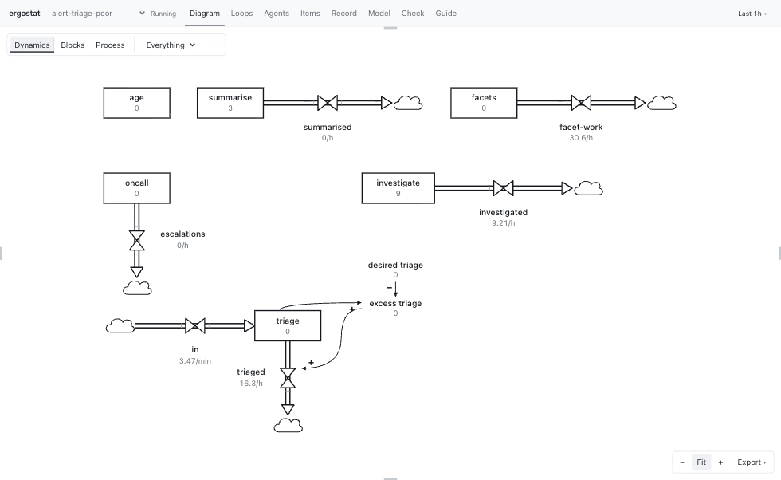
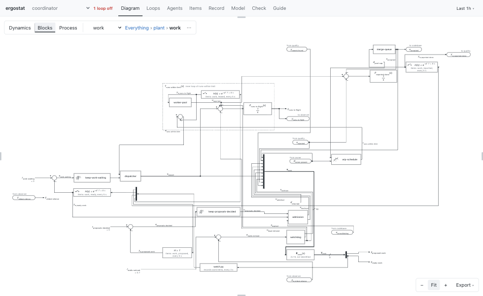
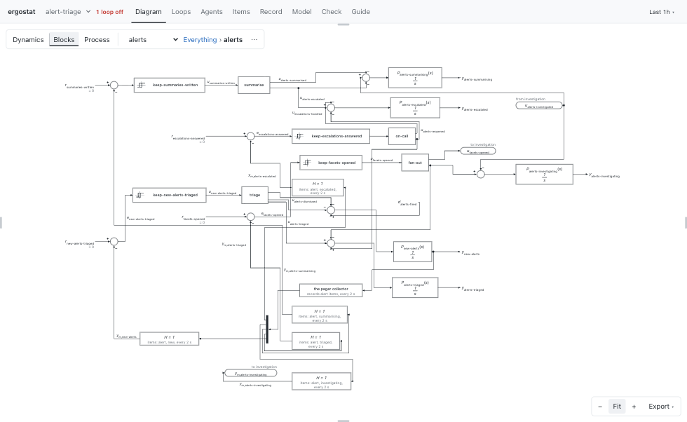
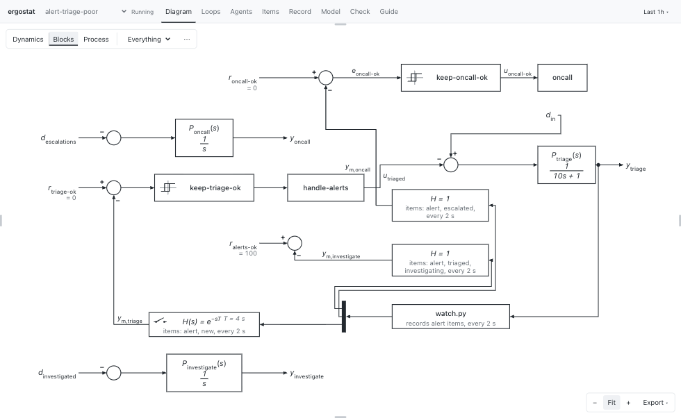
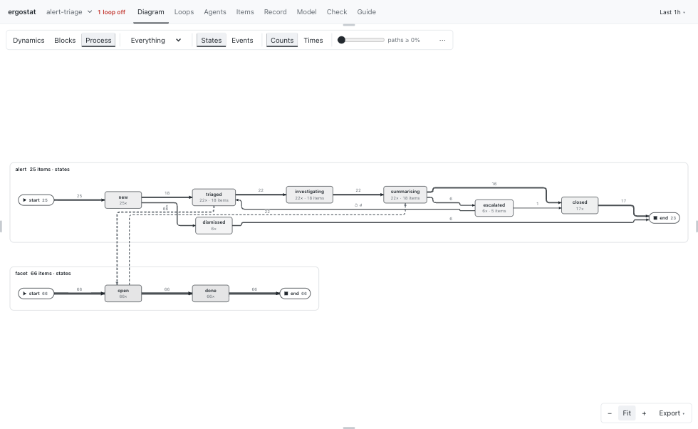
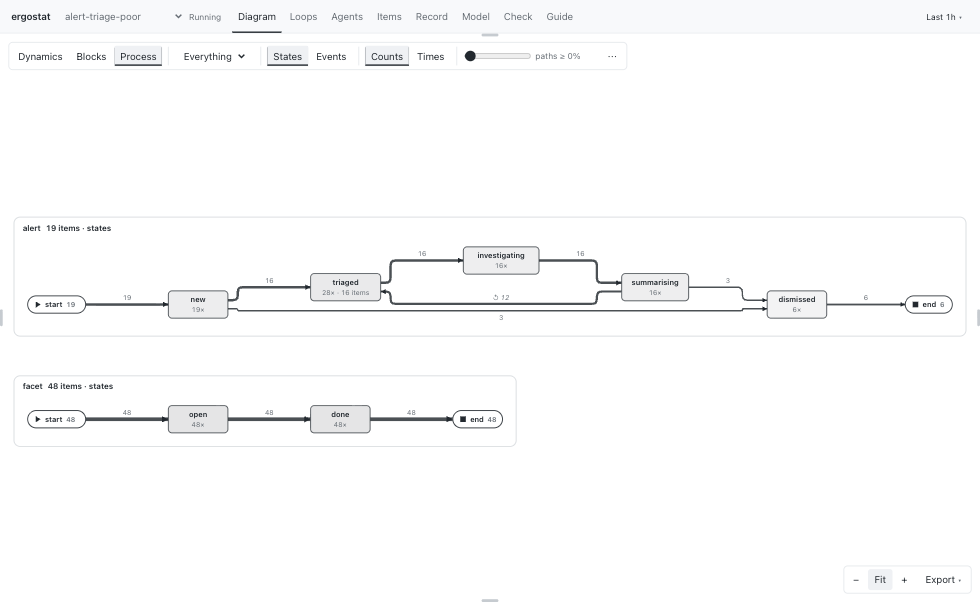
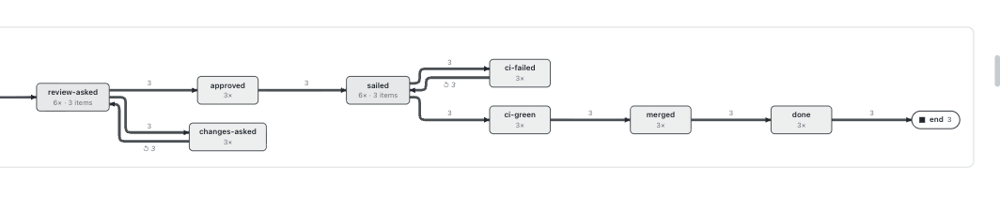

# Modelling well: three diagrams a professional would recognise

`ergostat check` tells you whether a model is **correct**: it loads, its chains join, its goals close, its three
views agree. This page is about what comes after that: the **craft** that makes each diagram look the way a
professional in its discipline would have drawn it. A system dynamics modeller opening the Dynamics view, a control
engineer opening the Blocks view and a process analyst opening the Process view should each find it normal and
methodical, "surprising only in the subject, never in the method or the words"
([00-oracle.md](proposals/coordinator/00-oracle.md)).

Read [AGENT-GUIDE.md](AGENT-GUIDE.md) first (the method, the chain, the check-look-fix loop). This page assumes the
model is already the right shape and asks: would a professional wince?

The running example is [`examples/alert-triage`](../examples/alert-triage/): alerts from a pager are triaged, fanned
out into three facets investigated in parallel (logs, deploys, metrics), joined, summarised, and closed or escalated
to the on-call engineer, who may send one back. Beside it, `examples/alert-triage/poor/` is **the same workflow
modelled badly on purpose**: it loads, it runs, and every diagram below marked *poor* comes from it. Every YAML
snippet on this page passes `ergostat check`. The screenshots are made by `scripts/modelling_well_shots.py`.

## 1. Dynamics: the stock-and-flow view

### Stocks are quantities; flows are rates

A stock is something you could count if you froze time: *alerts waiting for triage*, *open facets*. A flow is how
fast it changes: *alerts triaged per hour*. Name them that way, as nouns and noun phrases, plural for counts:

| Poor | Good | Why |
|---|---|---|
| stock `triage` | stock `new-alerts` | a step is not a quantity; "how many triage?" has no answer |
| stock `investigate` holding two states | stock `alerts-triaged` and stock `alerts-investigating` | one stock per state where work waits; two states in one hide the fan-out |
| flow `in` | flow `alerts-fired` | the flow's name says what moves and how |
| stock `age` (`measure: oldest`) | auxiliary `oldest-new-alert` | an age has no inflow or outflow: it is not a stock (below) |

Give every stock a **unit**, in the natural unit of what it counts (`alerts`, `facets`, `tickets`, `GB`), never a
generic `items` when the kind has a name. Flows take their stocks' unit per hour; ergostat shows them per minute or
per day by size (`rate-unit:` to choose). Two different things in one chain is a sign the chain is wrong; a flow
from one unit to another is a **coflow** and needs a converting parameter (below).

### Material links and information links

The Dynamics view draws two kinds of arrow, and an SD reader looks for the difference first:

- **material** (a double-lined pipe with a valve): a flow, which moves the conserved thing from stock to stock. Alerts move from
  `new-alerts` to `alerts-triaged`; nothing is created or lost on the way.
- **information** (a thin curved arrow, with its sign): a `driven-by` connector, which says a rate *depends on* something without moving
  it. `alerts-triaged` depends on `new-alerts` (the more waiting, the faster they are triaged).

A move between two of your own states is always material: a flow from one stock to the next, never an outflow to a
cloud and an inflow from another (that is the commonest wrong shape; `check` reports `outflow-not-chained`). An
influence is always information: a `driven-by`, never a flow.

A connector acts at once. When a cause takes time to have its effect, the time is a stock between them, and
`check` says `rate-driven-by-rate`. When it really is immediate, say so with `instant: true` and a comment: the
fan-out opens the facets as it moves the alert, so the facets flow follows the fan-out flow in the same moment:

```yaml
flows:
  facets-opened:
    to: open-facets
    description: three facets for every alert fanned out (a coflow)
    driven-by:
      - cause: +flow.facets-opened-for
        instant: true                 # the fan-out opens them as it moves the alert
    equation: facets-per-alert * flow.facets-opened-for
    sensor: {items: facet, entering: open, over: 10m}
```

This is also how a **fan-out** and a **join** are drawn in SD: facets are a coflow of alerts, so many of one per
another (`facets-per-alert`, `unit: facets/alert`), and the join is the inverse coflow, one alert out of
`alerts-investigating` for every three facets done (`equation: flow.facets-done / facets-per-alert`).

### Every flow gets an equation

A flow without an equation is only what its sensor reads. It can be replayed against the record, but it cannot be
**projected** (what happens next week) or **asked what if** (what if the AI took twice as long, what if alerts
doubled), and the loops through it have no size, only a sign. Write the rate as the decision rule a modeller would:

```yaml
flows:
  alerts-triaged:
    from: new-alerts
    to: alerts-triaged
    description: triaged as worth a look
    driven-by: [+stock.new-alerts]
    equation: (1 - noise-share) * stock.new-alerts / triage-time
    sensor: {items: alert, entering: triaged, where: {via: triage}, over: 10m}
```

Three forms cover most workflows:

- **first-order outflow**: `stock.x / time-to-do-it` (a queue drained by a step that takes `time-to-do-it`);
- **a split**: the same with `share` and `(1 - share)` on the two branches (triaged or dismissed; closed or
  escalated), so the shares sum to one by construction;
- **a coflow**: `ratio * flow.other`, with `instant: true` on the link.

Every number is a **parameter** with a unit, a description and, while you are guessing, `estimate: true` so the
record fits it and `ergostat proposals` offers the fitted value. Shares get `range: [0, 1]`. Durations are written as
durations (`2s`, `4h`), never as a number with `unit: min` (ergostat counts time in hours and refuses that).
Arrivals from outside are the one flow that keeps no equation: they are measured (the collector's sensor), and that
is what makes them exogenous.

### Goal-seeking structure, perceived state and information delays

An SD reader expects to find the **balancing loops** that hold the system near its goals, and each drawn the
textbook way: a desired state, the actual state, the gap, and a corrective flow proportional to the gap. In
ergostat the goal's setpoint is the desired state, its stock is the actual state, and the step's outflow equation
(`stock / time`) is the correction. `ergostat explain` names each loop B (balancing) or R (reinforcing). The Dynamics view
draws the gap for you: each goal's stock gets a *desired* and an *excess* beside it, so the goal-seeking structure is
visible without writing it.

ergostat finds every loop, and every way round each: alert-triage's one rework cycle (escalated, sent back,
investigated again, escalated again: reinforcing, as Ford and Sterman's rework cycle is) is found 52 ways, through
each goal and block it can pass. An SD reader wants the few loops that matter named. Name them, with the polarity
first in the description, and turn the loop markers off (the ⋯ menu) when reading the chain:

```yaml
loops:                                # the loops a reader should find first, named (the rest are drawn unnamed)
  rework-cycle:
    through: [flow.alerts-reopened, stock.alerts-triaged]
    description: R - escalations the on-call sends back are investigated, summarised and may be escalated again
```

Decisions read what the decision maker can know, when they know it (Sterman's Baker criterion). A block reads a
sensor, which is already a measurement; when the decision maker sees something slower (a daily report, a weekly
average, a reputation), the perceived value is an **information delay**, a `SMOOTH` of the true one:

```yaml
parameters:
  planning-window:
    value: 168h
    description: how far back the rota looks - a week
auxiliaries:
  alert-rate-seen:
    unit: alerts/h
    description: the alert rate the rota is planned on - last week's average, not today's
    driven-by: [+flow.alerts-fired]
    equation: SMOOTH(flow.alerts-fired, planning-window)
```

A material delay (work in transit that takes time but is not lost) is `DELAY3`, or better a stock of its own you can
measure. Leaving perception out makes the model react faster and oscillate less than the real system.

### When a quantity is an auxiliary

Memory decides, not how it is measured. A **stock** keeps its value when nothing happens and changes only through
its flows. An **auxiliary** is worked out afresh from others at each moment: an age, a ratio, a share, a score, a
perceived value written as an equation. The oldest waiting alert's age rises with the clock and resets when that
alert leaves: no flow fills or drains it, so it is an auxiliary:

```yaml
auxiliaries:
  oldest-new-alert:
    unit: hours
    description: how long the oldest untriaged alert has waited
    driven-by: [+stock.new-alerts]
    sensor: {items: alert, state: new, measure: oldest, every: 2s}
```

An auxiliary that nothing in the model explains is an input from outside: say so with `exogenous: true` rather than
leaving it unexplained.

### System size, splitting, and the boundary

A system (`systems:`) is a sector in SD's sense: a part of the model with its own purpose, drawn in its own frame.
Readable systems hold **about four to nine stocks**, one main chain, and the loops that act on it. Split when:

- a second **item kind** has its own chain (alert-triage has `alerts` and `investigation`, one per kind);
- a part is **controlled by someone else** (an external team's queue, a vendor) or runs on a much slower clock
  (planning, model improvement);
- the frame no longer fits on a screen with its labels readable.

Do not split one chain across systems to make frames smaller: the chain is the story, and a cut through it
becomes a cross-system signal in the Blocks view (below). Give each system a `description` and a `show:` list of
the two or three parts that tell its state at a glance.

**The boundary** is what you chose not to model. Write it down: the head comment of `ergostat.yaml` (or the
system's description) says what is endogenous (the chains and loops), what is exogenous (arrivals, the pool cap the
owner sets, `exogenous: true` auxiliaries), and what is deliberately left out (the services that fire the alerts,
the on-call's other work). A reviewer reads the excluded list first. Model the problem, not everything: if a part
neither moves a goal nor explains a residual, it is outside.

### How an SD practitioner reads it, and what makes them wince

They look for the main chain first (left to right, in from a cloud, out to clouds where work really ends), then the
loops (B and R, named), then the delays, then the units. They wince at:

- stocks named for activities, and stocks with no unit;
- rows of stocks each draining to a cloud: the chain was never drawn;
- an age, a ratio or a score drawn as a stock;
- a flow driven by another flow with no stock between and no `instant:`;
- flows with no equation: "so what does this model predict?";
- a decision that sees the truth the instant it changes;
- parameters with no units and no source.

| Good: `alert-triage`, both systems open | Poor: the same workflow |
|---|---|
|  |  |

The poor one is six stocks that share nothing: five drain to clouds, `age` has no flow at all, nothing has a unit,
and no flow has an equation (the rates shown are only what the sensors read). Only `triage` has a goal, so only it
shows the desired-and-excess structure. **Its fix**: each move a flow from one state's stock to the next (`check`'s
`outflow-not-chained` and `state-stocks-disconnected` name each edit), the stocks renamed as quantities with
units, `age` moved to `auxiliaries:`, and an equation on each flow.

## 2. Blocks: the control view

The Blocks view is drawn in the textbooks' notation (Franklin, Powell and Emami-Naeini; Åström and Murray): a
reference r into a summing junction, the error e into a controller C, its output u into the process P, the output y
read back through a sensor H on the feedback path. A control engineer reads each loop as **CV** (what is held),
**MV** (what is moved), **DV** (what disturbs it).

### One goal per loop, with a clear setpoint and tolerance

Each goal is one controlled variable at one setpoint. Write the setpoint so it says what is wanted, and the
tolerance explicitly, even when it is zero, with why:

```yaml
goals:
  new-alerts-triaged:
    stock: new-alerts
    hold: "<= 0"
    tolerance: 0                      # no hysteresis: a tolerance here would let alerts pile up before triage starts
    description: every alert triaged as it fires
```

The tolerance is the **deadband** (hysteresis): the goal goes off only when the value is past the setpoint by more
than it. That decides when a block works. A step that takes items (`takes:`) and names its goal runs only while the
goal is off, so a queue of items that should each be worked as it comes is held at `"<= 0"` with tolerance 0; a
tolerance of 2 there would let three alerts wait before anyone looked. A tolerance belongs on a **level** (a disk,
a cache, a pool size), where acting on every small wobble wastes effort.

Keep **setpoints** (steered to) apart from **constraints** (never crossed): a constraint is a `critical: true` goal,
an alarm, or a gated action, not another setpoint on the same loop. A block serves one goal (`goal:`); two goals on
one actuator need a selector (`type: select`) or a cascade, never two loops fighting over one flow.

### A named collector and sensor on every feedback path

The sensor sits on the feedback path, beneath the loop, labelled with what it reads and how often. When the count
comes from items, the **collector** that brings those items in (the poller of the pager, Jira, a queue) is drawn in
front of it: the count is only as fresh as the collector. The Blocks view titles the collector with its sensor's
description when that is 40 characters or fewer (else with the command, `watch.py`), so give it a short name and
put the rest in the flow's description:

```yaml
flows:
  alerts-fired:
    to: new-alerts
    description: alerts from the pager, as the collector reads them
    sensor:
      run: python3 bin/watch.py
      every: 2s
      averages: 10m
      description: the pager collector                # (40 characters at most: the Blocks view titles the collector with it)
```

A collector **measures and never acts**; ergostat's check says so ("moves flow.arriving on its own schedule; nothing
commands it": an open loop on purpose, since arrivals are the world's doing). If a loop's sensor polls slowly
against the loop (a tenth of its period or more), the Blocks view draws the delay e^(−sT): poll faster, or accept
and say why.

### Steps are actuators, each with `out:`

A block whose output is a flow is that flow's **actuator** (in SD, its valve's decision rule). Every step names
the flows its work moves; a block without `out:` is drawn with nothing attached and closes no loop:

```yaml
blocks:
  summarise:
    type: ai
    agent: claude
    description: writes the alert's summary from its facets' findings; closes it, or escalates it to the on-call
    goal: summaries-written
    prompt: prompts/summarise.md
    run: python3 bin/step.py summarise   # the stand-in
    takes: {kind: alert, at: summarising, to: [closed, escalated]}
    pool: 2
    out: [flow.alerts-summarised, flow.alerts-escalated]
```

One block per step. A block that "triages, investigates and summarises" (the poor model's `handle-alerts`) hides
three loops in one, and the control engineer cannot see which MV moves which CV.

### Cascades: a slow loop sets a fast one's setpoint

When one quantity should follow another (the work in flight should follow the owner's cap, scheduled on whether
the owner is at the desk), the outer loop's output is the inner goal's **setpoint**, not the inner actuator.
The coordinator example does this:

```yaml
blocks:
  wip-schedule:
    type: expr                        # S2 scheduled on the owner's presence (d2): the cap present, half of it away
    in:
      cap: auxiliary.pool-cap
      present: auxiliary.owner-present
    expr: cap * (0.5 + 0.5 * present)
    out: goal.runs-within-limit
```



The Blocks view draws the inner loop nested in the outer. Keep the outer several times slower than the inner (a
time-scale separation of 3 to 10 is usual), and say the ratio in the description; an outer loop that moves a
setpoint faster than the inner can follow is a coupled loop, not a hierarchy.

### Few signals across systems

Every signal that crosses a system's frame is a port mark and a long line. Keep them few: a system's blocks read
and move that system's parts, and a step that must read another system reads one signal: a goal's error, or a
stock, signed (`in: [+stock.alerts-investigating]`). If two systems
trade many signals, the boundary between them is in the wrong place.

### Tiers marked

Every block has a **tier**: `program`, `ai`, `person`, `external`, or a built-in law (`onoff`, `proportional`,
`expr`). Use the type that says who really does the work: a person's step is `type: person` with `ask:` (ergostat
asks them while its goal is off), never a `program` that runs `true` in their place. Declare shared machines and
people under `agents:` with their `kind:` (`ai`, `person`) and a description, and put each block on one
(`agent: claude`, `agent: on-call`). The Blocks view writes each block's tier small in its corner (a named block's name
and tier, its function beneath: its law, or `f(·), law not stated`); its panel, `explain` and the Agents page then say
which tier fills each loop and which loops one person or one AI pool carries, so a person is seen as the bottleneck
they may be.

### The process: "not yet modelled", never a made-up transfer function

The process block P(s) is what the world does between u and y. Until it has been identified from the record
(`ergostat identify`, then accepting the result, which writes `process:` with `identified:`), leave it out: the
Blocks view draws the stock as an integrator 1/s, or a block marked "not identified", which is the honest drawing.
A `process: {gain: 1, time-constant: 10s}` written by guesswork (the poor model has one) is a claim a control
engineer will take at its word and tune against. Write one only from a step test or an identification, and say
which.

### How a control engineer reads it

They find each loop's CV, MV and sensor; check every loop has all three; look for loops that share an actuator;
check that the sensor's sampling is fast against the loop; look for cascades and their time-scale ratio; and look
at what enters as a disturbance. They wince at: a goal no block serves ("missing feedback"); a block with no output;
a sensor with no name; one actuator serving several goals; a person modelled as a program; and a transfer function
nobody measured.

| Good: the `alerts` system's loops | Poor: blocks without outputs, one block for three steps |
|---|---|
|  |  |

In the poor one, `triage` has a made-up first-order process, P(s) = 1/(10s + 1); `oncall` hangs off its on-off
controller with nothing after it (a program that runs `true`); the goal `alerts-ok` (at 100) has no controller at
all; two flows nothing moves come in as disturbances; and the collector is titled with its command, `watch.py`.
**The fix**: split `handle-alerts` into `triage` and `summarise`, each with its `takes:` and its `out:`; make
`oncall` a `type: person` block with `ask:` and `out:` the flows it moves; remove the invented `process:`; give each
goal the block that moves its stock's outflow; name the collector; give the sweep's work to a block that takes the
items (below).

## 3. Process: the process map

The Process view is process mining's directly-follows graph, object-centric: one map per item kind, drawn from the
record, and dashed lines between kinds where work on one caused work on another. Nothing is declared for it; it is
only as good as the events the steps record.

### Declare the states

With `states:` declared (in order) and every event that moves an item mapped in `on:`, the map is drawn **by
states**: the workflow as you wrote it, in your order, with your names, held directly against the stocks. Without
states it is drawn by event types, every comment and retry a node. Declare every state a step waits in or ends in,
including the side exits (`dismissed`, `stopped`).

### Event types: `kind.verb-past`

Name each event type for the item kind and what happened, in the past tense: `alert.fired`, `alert.triaged`,
`alert.escalated`, `facet.opened`, `facet.done`. ergostat refuses anything but lowercase words joined by dots, but
inside that rule the poor model still manages `triage.finished`, `alerts.noise`, `alert.investigate` (an
imperative), `investigation.complete` and `facet.complete`: five spellings for one workflow, two subjects that are
not item kinds, and a reader who cannot guess the next one. The kind first, then the past-tense verb (with a
hyphen when it needs two words: `alert.facets-opened`).

When two moves enter the same state (closed by the summary, closed by the on-call), record **which** in the
event's data (`via: summary`, `via: on-call`), so each flow's sensor can count its own (`where: {via: on-call}`).

### What caused what: the fan-out and the join

A dashed line between two kinds appears when an event on an item of one kind was **caused** (`causedby`) by an event
on an item of another. ergostat records the cause for you, exactly as follows:

1. A step that `takes:` an item holds a lease on it; the lease (`ergostat.lease.taken`) is recorded as caused by
   the event that brought the item to its state.
2. The run is recorded as caused by that lease (`agent.started`, its id is `$ERGOSTAT_RUN`).
3. **Every event line the run prints** is recorded as caused by the run, whatever item it is about. So is every
   event the run records with `$ERGOSTAT_CMD event --add` (it reads `ERGOSTAT_RUN` from the environment).
4. The Process view follows `causedby` up through events about no item (the run) for up to four steps, to the
   first event on an item; if that item is of another kind, it draws the line.

So what a step program must do is simple: **do the fan-out and the join inside a run that holds a lease on the
causing item, and print the other item's events from that run.**

- **Fan-out**: the step that takes the parent prints one event per child, each child citing its parent in its
  data, then the parent's own move:

  ```python
  for f in ("logs", "deploys", "metrics"):
      say("facet.opened", f"facet/{n}-{rnd}-{f}", {"alert": alert, "facet": f, "round": rnd})
  say("alert.facets-opened", alert, {"rounds": 1})
  ```

- **Join**: the step that takes a child records the child's last event, reads its siblings and, if it was the
  last, prints the parent's move. Three things make that reliable:
  - runs of one block go at once (`pool:`), so take a **lock** around "record mine, read the siblings, maybe move the
    parent";
  - record the child's own event with **`$ERGOSTAT_CMD event --add`**, not a printed line: the command writes it
    before it returns (still caused by the run, through `ERGOSTAT_RUN`), whereas a printed line is recorded by the
    running ergostat and another process reading the items a moment later may not see it yet;
  - count a sibling done by a **field** its event folds in (`finding`), not by its state: a sibling whose run has
    not ended yet still shows as `leased`.

  ```python
  with open(RUN / "join.lock", "w") as lock:
      fcntl.flock(lock, fcntl.LOCK_EX)
      record("facet.done", facet, {"finding": finding})       # $ERGOSTAT_CMD event --add facet.done --item ...
      siblings = [i for i in items("facet") if i["fields"].get("alert") == alert and i["fields"].get("round") == rnd]
      if all("finding" in i["fields"] for i in siblings):
          say("alert.investigated", alert, {"facets_done": len(siblings)})
  ```

  The run learns which parent it is joining from its input: the item it holds, with its fields, is `item` in the JSON
  it is given (a program block gets the JSON alone on standard input; an `ai` block's `run:` wrapper gets its prompt
  first and the JSON as the last line).

  Declare the parent's flow in the child step's `out:` too (`out: [flow.facets-done, flow.alerts-investigated]`),
  or coherence reports the parent's move as `acts-undeclared`.

What does **not** draw a line: a block on a schedule (`every:`) that sweeps the items and opens or closes others.
Its run is caused by nothing, so its events have no cause on an item. The poor model's `sweep` is exactly that: the
facets appear from nowhere, and the Process view shows two unrelated maps.

| Good: fan-out (`alert triaged → facet open`) and join (`facet open → alert summarising`), dashed | Poor: no lines between the kinds |
|---|---|
|  |  |

The good map also shows the rework the model declares (`escalated → triaged`, ↺). The poor one shows rework that
is not real: one block takes alerts at two states and cannot tell which step it is doing, so alerts it should have
summarised went back to `triaged` (↺ 12), and none was ever closed. A process map catches a confused step at once,
where the diagrams of the model cannot.

### Rework, visible

A move that takes an item back to a state it has already been in (a repeated step) is marked ↺, with how many
returns in the line's panel; one back to an earlier state is drawn running back. Rework that is real (a review asking for
changes, the on-call sending an alert back) should be a declared state change (`alert.reopened: triaged`) with a
flow for it in the chain (`alerts-reopened`), so the map, the stock-and-flow view and coherence agree. Rework that is
not real, a lease handed back again and again, is a failing step: its median time says how long each try took.
Never hide rework by mapping the return to a new state of its own ("re-triaged"): the ↺ is the information.



The second half of the ticket factory's map shows both kinds of rework a reviewer looks for: `changes-asked → review-asked` (review
rework) and `ci-failed → sailed` (CI rework).

### Reading a process map for bottlenecks and deviations

- **Times** on: the line with the longest median time out of a state is where items wait. Compare it with the
  stock's goal: a step whose items wait an hour while its goal says "nothing waits" is under-resourced (raise its
  `pool:`) or its block is not running.
- **Counts** on, the paths slider down: the thick path is the usual case; a thin line that skips a state is a
  **deviation** (an item that went straight from `new` to `closed`): a mapping that is wrong, or a real shortcut the
  model lacks (`check`'s coherence calls it `chain-skipped`).
- **The end node**: items should end where the work ends. An item that ends in a waiting state is a step that
  never reports.
- **Dashed lines**: their counts should match the coflow (three facets for every alert fanned out). A join whose
  count is lower than the fan-out's is a join that sometimes never fires.

## 4. Across all three views

**The same names everywhere.** The state, its stock, the flow out of it, the event that moves an item on, the goal
and the block that works it should read as one family: state `summarising`, stock `alerts-summarising`, flow
`alerts-summarised`, event `alert.summarised`, goal `summaries-written`, block `summarise`. A reader who meets the
name in one view finds it in the other two. Never call one thing two names (the poor model's stock `oncall`, state
`escalated` and flow `escalations`).

**Descriptions on everything**: stocks, flows, auxiliaries, parameters, goals, blocks, sensors, item kinds,
systems, agents; one line a newcomer can read without the YAML, in the world's words, and for a flow what decides
it. They are what the diagrams show when a reader clicks.

**Coherence is the arbiter.** When the views disagree, `ergostat check`'s Coherence section (MCP `coherence`) says
which pair, where, and the fix. Run the model on its stand-ins, then check, until every kind reads `N of N agree`.
A model that agrees with itself and with its record is correct; this page is about making it also look right.

## 5. Review checklists

Ordered by what matters most. Go through each after `check` is clean.

**Dynamics**

1. Each item kind is one chain: in from outside at its first stock, out where the work ends, every move a flow
   from stock to stock (rework included).
2. Each kind arrives from a cloud once: no second inflow from outside counting the same kind into a later state
   (`kind-enters-many-times`), unless the record shows items arriving there; few clouds, each really outside
   (`many-cloud-inflows`).
3. Every stock is a quantity with a natural unit, named as a noun; ages, ratios and scores are auxiliaries.
4. Every flow but the measured arrivals has an equation, with parameters that have units, descriptions and
   `estimate: true` until known; shares have `range: [0, 1]`.
5. Links are signed; any flow driven by a flow is `instant: true` with a comment, or has a stock between.
6. Decisions read what their maker can see; slow perceptions are `SMOOTH`s.
7. Systems of four to nine stocks, one chain each, split by kind or by who controls them; the boundary is
   written down.
8. Every part has a description.

**Blocks**

1. Every goal is served by exactly one block whose `out:` moves a flow of what the goal holds.
2. Every step is one block with `out:`; item steps' goals are `"<= 0"` with `tolerance: 0`; levels have a
   tolerance.
3. Every feedback path has a described sensor; the collector feeding each chain is described.
4. Person steps are `type: person`, AI steps `type: ai`, on declared `agents:` with their kind.
5. Cascades set setpoints (`out: goal.X`), with the time-scale ratio said.
6. Few signals cross systems.
7. No `process:` that was not identified.

**Process**

1. Every kind declares its states and maps every moving event in `on:`.
2. Event types are `kind.verb-past`; branches into one state carry `via:`.
3. Fan-outs and joins are done inside runs that hold the causing item's lease, and their dashed lines appear.
4. Rework is a declared move back, drawn ↺, with its flow in the chain.
5. Items end where the work ends; no state is dead.
6. Coherence reads `N of N agree` for every kind.

**Reviewing a change** (the modelling loop's reviewer reads each structural change and redesign with these first)

1. The causal story: it says why, in the world's terms, the stock fills or the flow moves; the system's people would
   recognise it. A link that only makes the curves meet is not a mechanism.
2. Units and boundary: units convert along every flow and equation it touches; nothing that no valve controls is
   pulled inside, nothing the loops need is pushed out.
3. Not fitting noise: no stock no one could count, no delay or constant that only absorbs the record's wiggles.
4. One coherent change: one thing a reviewer can name; unrelated edits are split.
5. The behaviour it predicts: it says what the model will now do (settle, oscillate, grow) and why the system does
   that.

## 6. What ergostat does not help with yet

`check` says much of the craft above as **notes** (a part with no description, a flow between
stocks with no equation, an undescribed collector, event types in mixed forms, a queue's goal with a tolerance, a
process nobody identified; a stock with no unit is a finding, `no-unit`, drawn `unit ?`, and raises no request), and
`use: modelling` takes each up as a request: its rule tier answers the mechanical ones
and, with `ai: true`, its AI tier the rest (SPEC §12e). [GAPS.md](GAPS.md) lists what is still harder than it should
be: no built-in join, and no way for a scheduled block's events to name a cause.

## Sources

Sterman, *Business Dynamics* (2000): ch. 5–6 (stocks, flows, links), 11 (delays), 12 (coflows), 13 (decision
rules). Meadows, *Thinking in Systems*. Franklin, Powell and Emami-Naeini, *Feedback Control of Dynamic Systems*;
Åström and Murray, *Feedback Systems*; Seborg et al., *Process Dynamics and Control* (cascade, time-scale
separation). van der Aalst, *Process Mining: Data Science in Action* (directly-follows graphs, object-centric
process mining). The review questions behind this page are [00-oracle.md](proposals/coordinator/00-oracle.md); its
words are [01-terminology.md](proposals/coordinator/01-terminology.md); the reading list is [READING.md](READING.md).
