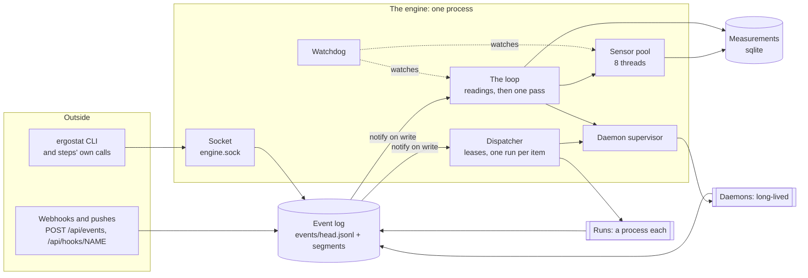
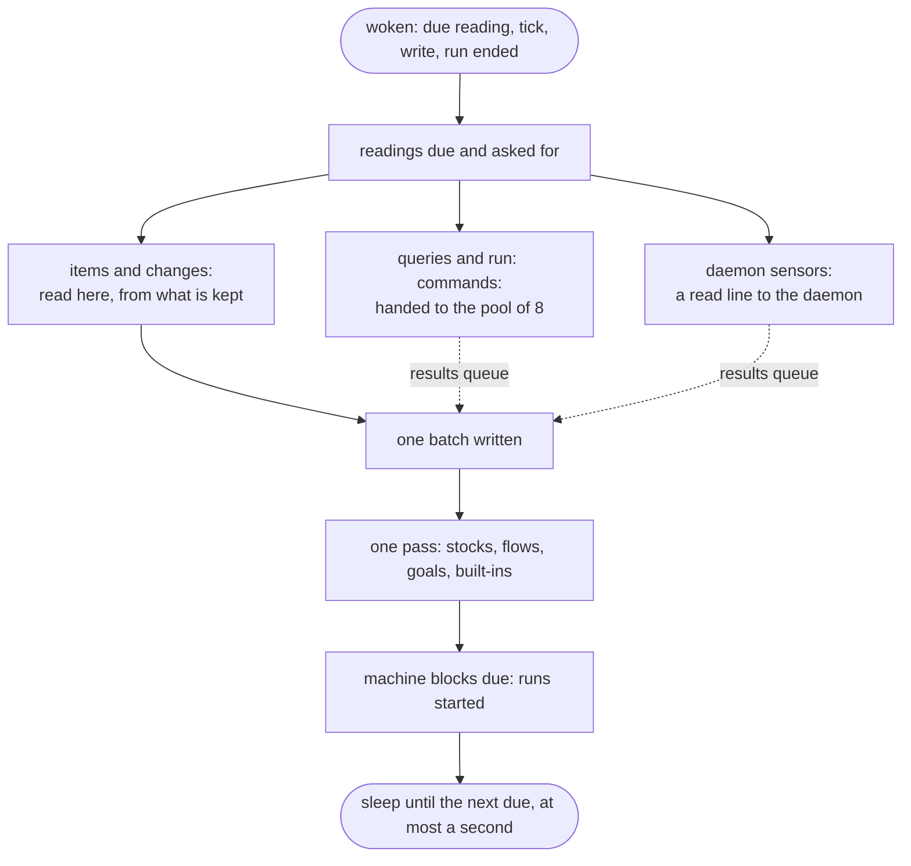
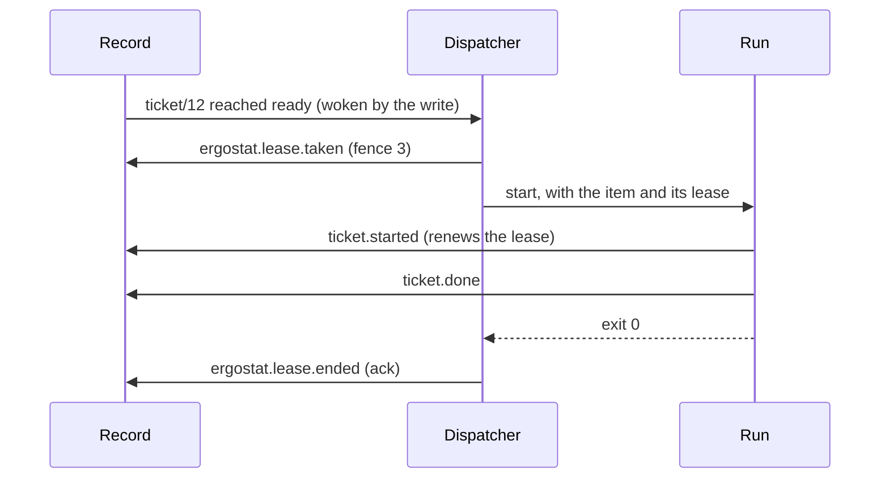
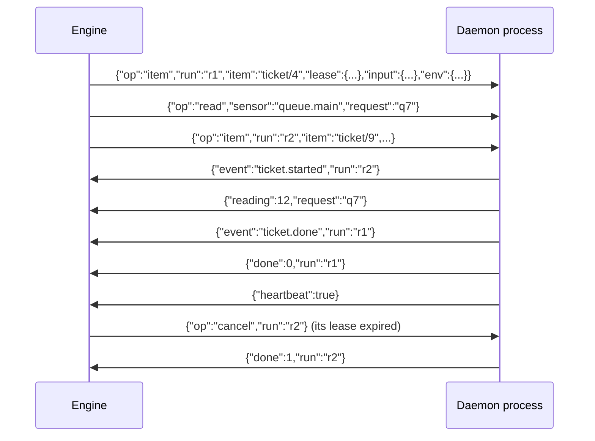
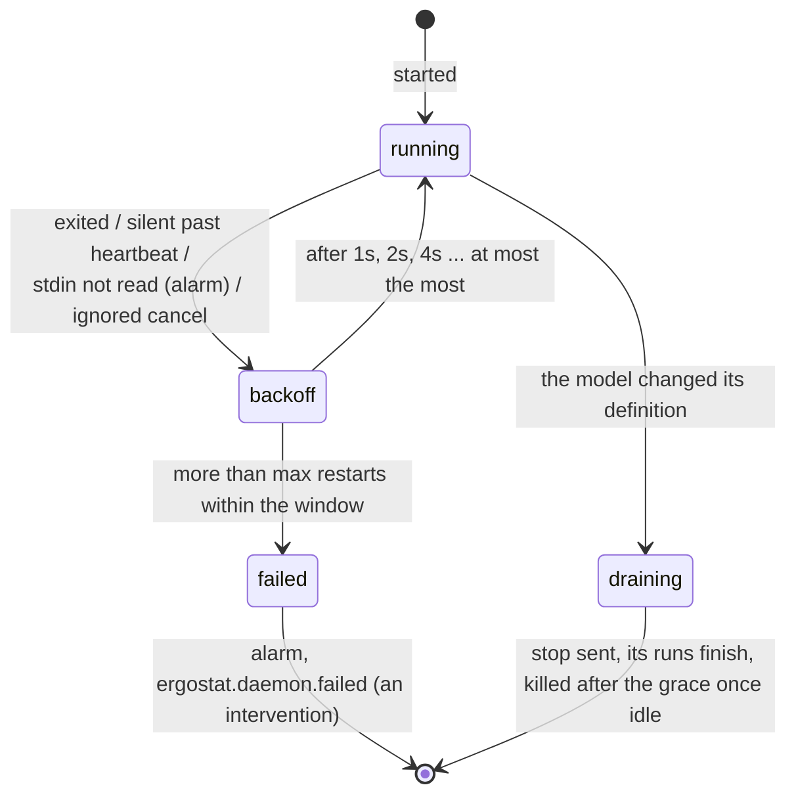

# How ergostat runs

This is a plain account of what happens inside a running ergostat (`ergostat run`): where things are kept, what
wakes what, which threads and processes there are, and what each costs. `docs/SPEC.md` is the reference; this is the
tour. The numbers at the end were measured on a laptop (Apple silicon, macOS).

## The record is the bus

Everything ergostat knows, and everything that happens, is an **event** in one append-only log in the project's
state folder (`~/.ergostat/<project>/events/`). There is no message broker: the log is the bus. A sensor's
observation, a run starting and ending, a lease taken, a webhook from Jira, the owner approving a change: each is a
line in the log, and everything else (an item's state, a lease, the Items page) is folded from those lines.

**Two backends.** The default, `segments`, keeps the newest events in `head.jsonl`, one JSON line each, and every
32,768 events seals them into a compressed segment with an index (by item, by type, by time), so a question about one
item or one type reads only what matches. The other, `sqlite`, keeps them in `events.db`. Measurements (the
sensors' readings) are a second store, kept apart because there are many more of them: SQLite by default, rolled
into coarser buckets as they age, or VictoriaMetrics.

**One writer at a time.** Several processes write to one record: the engine, the page, the command line, a step
calling `ergostat event --add`. Each append takes a file lock (`flock`), so lines never interleave, and a batch of
events a run printed in a row is written in one append.

**Notify on write.** Anything that waits for news waits on the record's *board*: in the writing process a condition
variable is woken by the write itself; from other processes, the kernel's file notifications (kqueue on macOS) wake
it. So a webhook that lands, or a step that records an event, wakes the engine's loop and the dispatcher within
milliseconds, not at their next poll. Where there are no file notifications (Linux without inotify in the standard
library), a waiter wakes on its own timeout, a quarter of a second.

## The loop

One thread, the loop, runs the model. Each round it:

1. reads what is due: every sensor whose `every:` has run out, every reading a run asked for (a block that moved a
   flow asks for that flow's stocks to be read at once), and, if the record was written since, every count of items;
2. takes those readings as one **batch** and writes them together;
3. runs one **pass**: each stock's level, each flow's rate, each goal's error and status, every built-in block (in an
   order where each comes after what it reads), and which machine blocks are now due;
4. starts the runs the pass decided on, and sleeps until the next reading is due, the next one-second tick, or
   something wakes it (a reading back from the pool, a run that ended, a write to the record).

A pass works out only what changed since the last one, except the first after a start or a model change. What
lands within 50 ms of a pass waits for the next one, so a burst of readings costs one pass, not a hundred.

## Sensors, and which start processes

A sensor measures one stock or one flow. How it reads decides what it costs:

| Sensor | How it reads | Processes started |
|---|---|---|
| `items:` | a count of items in a state, or moving between states, kept up to date as the record folds | none |
| `changes:` | a flow's rate, worked out from its stock's own readings | none |
| `builtin:` | one of ergostat's own measures (the model's fit, costs, leases) | one per reading (`ergostat measure`) |
| `query:` | a PromQL query to a Prometheus source, or another ergostat's reading | none (an HTTP request, on the pool) |
| `run:` | a shell command whose output is the number | **one per reading**, on the pool |
| `daemon:` | a line asked of a long-lived process, answered by a line | **none** per reading: one process for many sensors |
| `manual:` | a person records it | none |

Commands and queries run on a fixed **pool of eight threads**, never a thread per reading, so a thousand sensors
due at once queue for the eight rather than starting a thousand threads. A `run:` sensor's reading is a process
started from scratch (a shell, then usually an interpreter), which is what makes many command sensors costly: 170
sensors every 3 minutes is 57 process starts a minute. A **daemon** sensor is asked over a pipe instead (below).

## Blocks and runs

A block is a function from inputs to outputs. **Built-in** blocks (on/off, proportional, limits, timers, alarms)
are computed inside the pass, with no process. **Machine** blocks are programs, AI sessions or people: when what
commands them turns on, or on their own schedule, ergostat starts a **run**: a process given its inputs as JSON on
standard input, whose standard output is read line by line as it prints. Each line takes effect when it is printed:
an event recorded, a flow's valve opened, a command to another block. A block never runs twice at once; a command
that arrives while it runs is held, and the latest is used when it finishes.

Each run is recorded (`agent.started`, then `agent.ran` or `agent.failed`) with its exit, its wall time, and what it
cost: the CPU and peak memory of its whole process tree (from its wait status and one shared sampler that lists
the processes once a second while any run is under way), and the dollars and tokens of any AI session in it.

## The dispatcher and leases

Some blocks **take items**: a run for each ticket that reaches `ready`, say, up to the block's `pool` at once. The
dispatcher, a thread of its own, looks whenever the record is written (and every second): each block's queue is the
items in its `at:` states; for each free place in its pool it takes the oldest one by recording
`ergostat.lease.taken`, and starts a run for it.

A **lease** is the run's hold on its item. Anything the run says about the item renews it; a run silent for its TTL
loses it (`ergostat.lease.expired`): the item goes back to the queue, the attempt counted, and the run is
**killed** (its process tree sent SIGTERM, then SIGKILL after a grace). Each lease has a fencing number, so anything a
stale run says after its lease ended is refused. When the run ends, the lease ends: an *ack* when the item moved on,
a *nack* (given back) otherwise. An item that fails its attempts becomes a dead letter and needs the owner.

## The socket, and pushes from outside

The engine listens on a **Unix socket** in the state folder (`engine.sock`), named to every run as
`ERGOSTAT_SOCKET`. A step's `ergostat event --add`, `lease --renew`, `act` or `item ID` is answered there in
milliseconds, one JSON line asked and one answered, without loading the model; with no engine running, the same
commands do the work themselves.

From outside the machine, events are **pushed** rather than polled: `POST /api/events` on the page takes events in
the same envelope a run prints, and `POST /api/hooks/NAME` takes a sender's own payload (Jira, GitHub, PagerDuty)
and maps it to events. Each push is written to the record in one write, which wakes whatever waits for it.

## When the model changes

Edits to `ergostat.yaml` are taken **in place**, once the files have stayed the same for 1.5 s: the new model is
worked out whole first, and only then swapped in. Nothing restarts and no run is killed: a run under way finishes
under the model it started with, and new runs start under the new one. Goals and sensors switch at once; a built-in
block written the same keeps its state, and one changed takes over the state of the one before it. A model with
errors is never taken: the last good one runs on, and the page and `ergostat status` say why. A daemon whose
definition changed is drained and replaced (below).

## The watchdog and the outer watcher

Inside the engine, the **watchdog** looks once a second. If the sensor pool has given nothing back for 30 s while
readings are out, a fresh pool takes over. If no pass has finished for 30 s, the loop is started again; if that does
not help, the process restarts itself in place, with a back-off so a cause that persists does not become a restart
storm. Each time, every thread's stack is written to `stalls/` and `ergostat.engine.stalled` is recorded.

Outside it, the **outer watcher** (installed as a LaunchAgent or a systemd user unit with `ergostat run --service
--install`) reads only the engine's pid file and heartbeat every 5 s: an engine that died, or whose last pass is
older than 3 minutes, is started again (under the same back-off), unless it was stopped on purpose.

## Daemons

A **daemon** is a long-lived process that ergostat hands work to as JSON lines, instead of starting a process for
each run or reading. One daemon serves many items at once, and one can serve many sensors.

Every line the daemon prints is tagged with the run or the request it belongs to, so lines for different items may
interleave freely; a line tagged with nothing, or with a run it does not hold, is written to its log and dropped,
never given to another item. What an item needs to know (its `ERGOSTAT_ITEM`, lease, run id) travels in its line,
never in the process's environment, so nothing of one item leaks into the next.

Each item is still a run in the record, with its lease and fencing, as before. What is different is cost: the CPU
and memory are the daemon's, sampled for the whole process every 30 seconds and shown on the Agents page; an item's
run records only its wall time, because a process serving many items at once cannot honestly say which CPU second
was whose.

**Supervision** is a thread of its own, never the engine's loop. Everything written to a daemon goes through a
bounded queue and a writer thread per daemon, so the engine never waits on one.

- **Crash:** a daemon that exits is started again after a back-off that doubles each time. Its runs in flight fail
  and are counted (one of them may be what killed it).
- **Silence:** with `heartbeat: 30s`, a daemon that prints nothing at all for 30 s is restarted.
- **Backpressure:** a daemon that stops reading its standard input (a write waits longer than `stdin-timeout`, or
  its queue fills) is restarted and an alarm raised.
- **Too many restarts:** past `restart: max` within `within`, it is given up: state `failed`, an alarm on the page
  and in `ergostat status`, and `ergostat.daemon.failed`, an intervention, recorded.
- **Cancel:** a lease that expires, a run's timeout, or the owner's `block NAME --stop` sends `cancel`; a daemon still
  holding the run after the grace is restarted, and its other items given back uncounted.

## Measured: process starts against a sensor daemon

`scripts/daemon_bench.py` runs a model of N stocks, each with a sensor every 3 minutes and a goal on it, for 6.5
minutes (three rounds of readings), first as `run:` commands (a small Python script each) and then as one shared
sensor daemon. It is watched: killed past 1,500 threads or 6 GB.

BENCH-TABLE

BENCH-READING
