# The Coordinator as a system: problem articulation and reference modes

Status: SD steps 1 and 2 of Sterman's modelling process (*Business Dynamics* ch. 3), 2026-11-17. Step 1 is
here; the dynamic hypothesis is [03-dynamic-hypothesis.md](03-dynamic-hypothesis.md). The subject is a
long-running AI Coordinator session doing software work through subagents, and the case is this project's own
history. It reads [harness-as-control-system.md](../harness-as-control-system.md) and the sixteen parity notes
([parity/](../parity/)) as the questions; it answers none of them yet. Every series below was computed from the
record. Only aggregate series and counts are given here. The per-event working data and the scripts stay in the
owner's private folder.

## 1. The problem

**The system.** One harness session (the Coordinator) holds a conversation with the owner, turns it into work,
hands parts of that work to subagents in their own worktrees, checks what comes back, merges it and reports.
The owner sets directions, reads the reports, and corrects the session. The repository is the record of the
work. Its mainline is "work reported done".

**The behaviour that matters.** The Coordinator is productive. It landed 78,000 lines of code in ergostat in
3.5 days, and 124,000 in orchestra_2 over a month. But a large share of what it lands is later redone. The
rework is found hours to days after it was reported done, and much of it is found by the owner. The owner's
corrections do not fall off within a line of work. They start again at each new direction. Safeguards that
the session learns from an incident fade. When the owner is away and several agents run at once, stalled work
goes unnoticed for hours. Items that need the owner pile up with nothing to drain them. So the "progress" the
owner sees runs ahead of the progress that will hold. That is the gap Ford and Sterman (1998) call
undiscovered rework, and the 90%-done syndrome is its usual symptom.

**Why it matters.** ergostat proposes to replace the one long session with many ergostat-scheduled sessions
(harness-as-control-system §6). The stabilising loops in the long session are implicit: checking before
merging, learning from a correction, noticing a stalled agent. They live in the session's context and
habits. A replacement keeps them only if they become explicit structure. So the reference modes below are
two things at once:

- the behaviour any model of the Coordinator must reproduce (Sterman ch. 21, behaviour reproduction);
- the yardstick for parity. An ergostat deployment is at parity when these curves look at least as good.

**The decision the model is for.** It is the owner's: which of the session's implicit policies ergostat
must turn into explicit structure when it replaces the session, and with what parameters.

**Time horizon.** The dynamics run at three speeds:

- **Hours.** A subagent's run, a merge, a test, the time to discover a slip.
- **Days.** A direction of work, from the owner's first ask until the rework dies down.
- **Weeks.** The stock of standing rules, the stock of code, pruning.

The model's horizon is therefore 30 days, long enough to hold three or four directions and one pruning. Its
time step must be under an hour, because the shortest delays (discovery within the hour, stalls of 30 minutes
or more) matter.

## 2. Data, and what each measure means

| Source | Span | What was computed |
|---|---|---|
| orchestra_2 mainline (`git`, read only) | 10 Oct to 4 Nov, 668 commits, 116 merges | rework by line age, code stock, merge conflicts against branches open |
| ergostat mainline (`git`, read only) | 14 to 17 Nov, 312 commits, 34 merges | the same |
| the session transcript | 45 h from the owner's first message (15 Nov, 16:25), 167 owner messages | test runs, subagents, questions, absences |
| the decisions and corrections extracted from it (private, unconfirmed) | the first 38 h | corrections by time, said again or not |
| the owner's memory files (counts and creation days only) | 25 Oct to 17 Nov | standing corrections kept |
| the transcript's usage and compaction records | the same 45 h | working context per request, compactions (RM9 to RM14) |
| the parity benchmark's first run (private) | 48 cases from the first 38 h | what each store of context keeps, by the age of the fact (RM12) |

Definitions:

- **Rework of landed work.** For every mainline commit, each removed or replaced line of code is traced (by
  `git blame` on the parent) to the commit that wrote it. A line that landed and was later changed is work
  reported done and later redone. Its age at that moment is the *time to discover*. This counts
  restructuring (a file split) as rework too, so it is an upper bound. Documentation is counted separately
  and left out of the charts.
- **Merge conflict.** `git merge-tree` re-run on each merge's two parents, in a throwaway clone.
- **Test run.** A command in the session that ran `pytest`. *Status hidden* means its output went through
  a pipe with no `pipefail`, so the exit code was the pipe's, not the tests'. *Failed* means the output
  reported failures.
- **Subagent silence.** The longest gap between consecutive records in a subagent's own transcript. *Never
  finished* is the harness's own flag.
- **Owner away.** No owner message for more than two hours.
- **Working context.** The tokens the model was sent with one request (input, cache read and cache written),
  one value per API request. A **compaction** (a *cut*) is the harness's own record of one, with the size
  before and after.
- **File read.** A `Read` call, or a shell command that reads (`cat`, `sed`, `head`, `grep` and the like),
  per file named. A **re-read** is a read of a file read before in the same session.
- **State check.** A command that looks at the state of the work (`git status`, `log`, `branch`, `worktree
  list`, `ps`, `pgrep`). An **act** is a `git commit`, `merge`, `push`, `rebase` or `cherry-pick`.
- **Brief** and **report.** The prompt the Coordinator gave a subagent, and the result the subagent's
  notification returned, both by size only.

## 3. The reference modes

Eight behaviours were tested first. Six are supported, one partly, and one is not. Seven more (RM9 to RM15)
measure the context sector, added after the owner's review of the dynamic hypothesis: five are supported, one
partly, and one is not.

### RM1. Rework of landed work spikes at each new direction, then decays

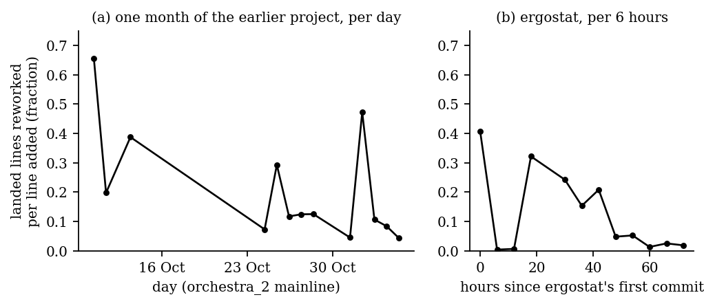

| orchestra_2, day | 10 Oct | 11 | 13 | 24 | 25 | 26 | 27 | 28 | 31 | 1 Nov | 2 | 3 | 4 |
|---|---|---|---|---|---|---|---|---|---|---|---|---|---|
| reworked per line added | .66 | .20 | .39 | .07 | .29 | .12 | .12 | .13 | .05 | .47 | .11 | .08 | .04 |

ergostat, per 6 hours from its first commit: .41, .00, .01, .32, .24, .15, .21, .05, .05, .01, .03, .02.

Over the whole record, 12% of ergostat's code lines and 24% of orchestra_2's were replaced within a week of
landing. Each burst comes at the start of a direction: the first days of each project, the core emptied on
25 Oct, the intended model on 1 Nov. Within a direction the fraction falls to a floor of 2 to 5%. This is
the rework cycle's signature. Most errors are made while the work is new and poorly understood, and they are
found and fixed as it settles (Cooper 1993; Ford and Sterman 1998).

### RM2. Rework is discovered hours to days after landing

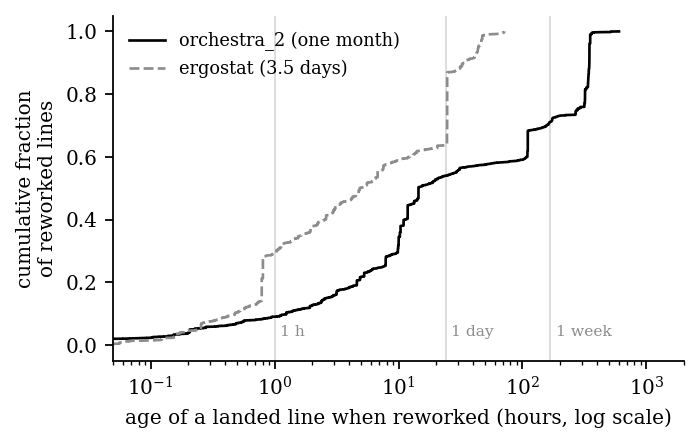

| | reworked lines | median age | under 1 h | under 1 day | over 1 week |
|---|---|---|---|---|---|
| ergostat | 9,604 | 4.9 h | 29% | 64% | 0% |
| orchestra_2 | 42,456 | 14.5 h | 9% | 54% | 29% |

The discovery delay is the rework cycle's key parameter. It is long here: half of what is redone has stood on
main for half a day or more. In orchestra_2, 29% of reworked lines were over a week old, and 70% of those went
in one removal (8,542 lines on 25 Oct). That is the pruning of a subsystem, not the discovery of defects
(RM3).

### RM3. The stock of code grows in steps and is pruned once, late

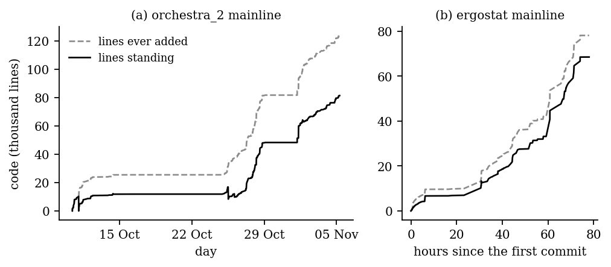

The stock of code grows in bursts that match the directions. At the end, the lines standing were 66% of the
lines ever added in orchestra_2 (81k of 124k) and 88% in ergostat (69k of 78k). The one fall in the stock came
two weeks after the work it removed was built. It came on the owner's decision, not from any loop inside the
session.

- **Supported:** scope accumulates freely and is cut back only by an outside decision, after a long delay.
- **Not supported:** that the features had little value. Value is not in the record.

### RM4. The owner's corrections do not fall within a session; standing corrections only accumulate

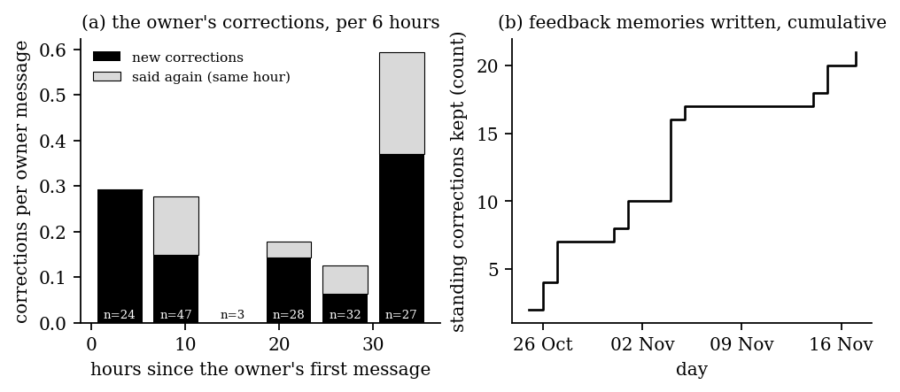

| hours from the owner's first message | 0–6 | 6–12 | 12–18 | 18–24 | 24–30 | 30–36 |
|---|---|---|---|---|---|---|
| owner messages | 24 | 47 | 3 | 28 | 32 | 27 |
| new corrections | 7 | 7 | 0 | 4 | 2 | 10 |
| said again (same correction) | 0 | 6 | 0 | 1 | 2 | 6 |

New corrections per owner message ran at 0.29, 0.15, 0.14, 0.06, then 0.37. They fell through one line of work
and jumped in the last window (hours 31 to 35). That window came after an absence, when the owner opened new
lines of work, the harness-parity question among them. Of 30
corrections, 17 concern modelling, 4 documentation, 3 diagrams and 6 other kinds of work.

13 corrections were said again, every time within six minutes. This is the owner pressing a point, not a
lesson forgotten and corrected later. In this 38-hour window there is no evidence of the same correction
coming back hours later, so the long-delay repeat of the capability trap is not shown. The parity benchmark
(private) shows the other half of it: fresh sessions repeat corrected mistakes. That is the cost of a
correction that lives only in one session's context.

Panel (b) is the stock of standing corrections: feedback memories written to the memory folder. It rose from
2 to 21 over 24 days, about one every day of active work. Nothing has ever left it.

### RM5. Checking goes blind, is restored after an incident, and drifts back

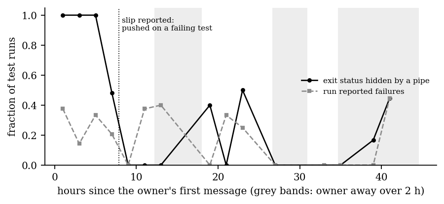

| hours | 0–2 | 2–4 | 4–6 | 6–8 | 8–18 | 18–24 | 24–38 | 38–42 |
|---|---|---|---|---|---|---|---|---|
| test runs | 24 | 28 | 9 | 29 | 18 | 16 | 15 | 15 |
| status hidden | 24 | 28 | 9 | 14 | 0 | 6 | 0 | 5 |
| reported failures | 9 | 4 | 3 | 6 | 5 | 3 | 1 | 4 |

For the first six hours, every one of 61 test runs was piped through `tail` or `grep` with its exit code
lost. The Coordinator read the text instead. At hour 7.9 it reported a slip: it had pushed on a failing
test. Hidden runs then went to zero for ten hours (the switch itself began at hour 7.0 to 7.3, around a
compaction at 7.2 and before the report: RM14), came back to 38% around hour 22, and to 33% around hour 40.
Hour 40 was the overnight run with the owner away and stalled agents being salvaged (RM6). Over the session,
23% of runs reported failures.

This is the mode of a safeguard held in memory, not in structure. Discipline jumps after an incident and
decays without one. Repenning and Sterman call it capability erosion; it is also the drift towards the
boundary of safe practice. The data does not show whether the later hidden runs hid a failure. That needs the
claims and the runs matched one by one.

### RM6. Stalls go unnoticed while the owner is away and several agents run

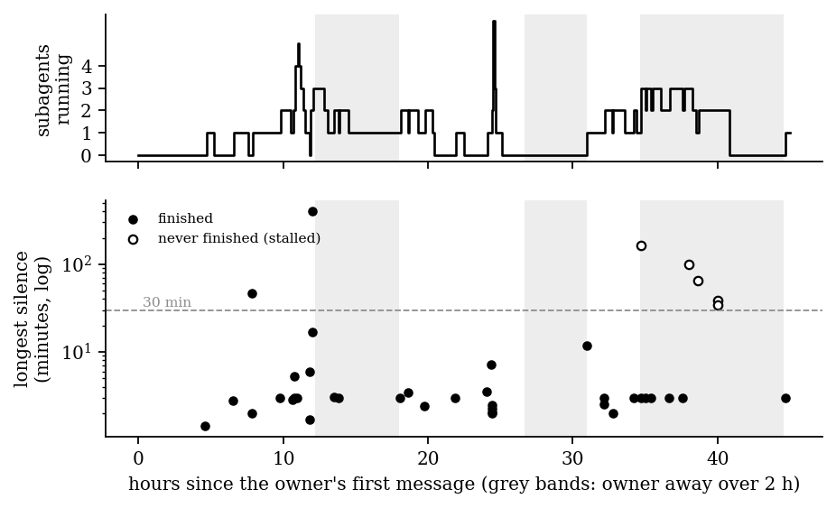

- **Agents:** 41 subagents, usually 1 to 3 at once and briefly 6.
- **Silences:** 7 were silent for more than 30 minutes at some point. 5 never finished.
- **Timing:** all 5 started during the owner's longest absence (hours 34.7 to 42.5), the overnight run of
  parallel work. There they were silent for 34 to 164 minutes before anyone acted.
- **Salvage:** the Coordinator committed what three of them had left as work in progress, and finished it
  itself.
- **Supervision:** across the session it sent 41 messages to agents, stopped 7 and set 16 wake-ups.

Before hour 34, only 2 of 30 agents had a silence over 30 minutes, and both finished. Stalls do not depend
on concurrency alone. They depend on the owner's absence and the Coordinator's attention spread across
several agents at once.

### RM7. Merge conflicts did not rise with concurrency (not supported)

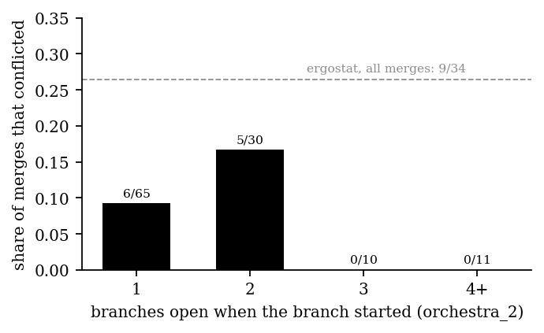

9 of 34 ergostat merges (26%) and 11 of 116 orchestra_2 merges (9%) would have conflicted. In orchestra_2 the
share was 6/65 with one branch open, 5/30 with two, and 0/21 with three or more. The Coordinator kept
concurrent work in separate files, which is parity gap 14 working. **The candidate "conflict rework rose with
concurrency" is rejected.** The conflicts that did happen were in hub files that every line of work
touches: the rendering test and its recorded sizes, the schema, the spec and top-level guides, the CLI and the
web entry point. They are the cost of shared files, not of concurrency.

### RM8. What waits for the owner has no outflow (partly supported)

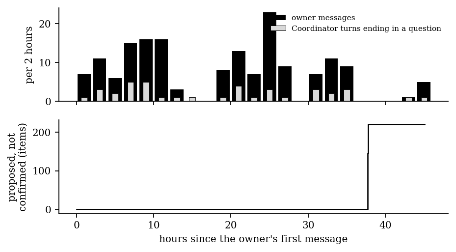

- **The owner's presence comes in bursts.** The owner sent 167 messages in 45 hours, with four absences of
  5.8, 4.3, 7.9 and 2.1 hours.
- **Questions when present.** The Coordinator ended 17% of its turns with a question. When it did, the owner
  answered in a median 1.8 minutes; after a plain report, 4.1 minutes. Questions to a present owner are
  answered quickly.
- **The batch queue.** At hour 37.7 the extractor proposed 221 decisions and corrections for the owner to
  confirm. None had been confirmed by the end of the record.
- **The earlier project.** orchestra_2's rules record a standing consent added on 4 Nov that lets authors
  settle their own proposals: an outflow built for a queue only the owner could drain.

This is one step and one rule change, not a measured trajectory, so the mode is sketched rather than
established.

### The context sector (RM9 to RM15)

The owner's review of the dynamic hypothesis: it leaves out the main thing a harness does, managing semantic
context, and that is what is lost in moving to an orchestrator unless it is modelled and replaced. The modes
below measure context as stocks and flows from the same record. Two limits apply to all of them. The record
holds the text that entered the window, not the model's reading of it, so *relevance* is not measured
directly anywhere. And there are only three compactions, one of them before the record's first owner message,
so every before-and-after comparison rests on one or two cuts.

### RM9. The working context fills in hours and is cut to a sixteenth

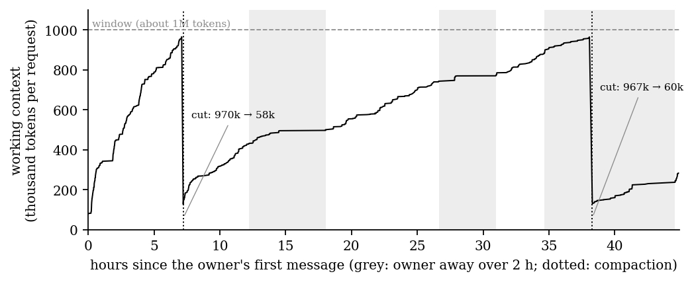

| | start (h) | first request (k tokens) | peak (k) | fill rate (k tokens/h) | ended by |
|---|---|---|---|---|---|
| window 1 | 0.0 | 79 | 966 | 125 | cut at hour 7.2: 970k to 58k |
| window 2 | 7.2 | 128 | 965 | 27 | cut at hour 38.3: 967k to 60k |
| window 3 | 38.3 | 131 | 283 | 23 | end of record |

- **The stock is bounded and drains in steps.** The window holds about a million tokens. The harness cuts it
  when it is nearly full, to 6% of its size, in one step. A third cut came 0.9 hours before the record's
  first owner message (349k to 27k).
- **The fill rate is set by the work.** The first window filled in seven hours, under the heaviest flow of
  the owner's requests and test runs (RM4, RM5). The second lasted 31 hours, through two absences in which
  the stock stood still.
- **The cut is not the whole outflow.** The first request after each cut was already 128k and 131k, against
  a summary of 58k and 60k: the harness re-injects about 70k (instructions, the files it was working on)
  before any work.
- **Not supported:** displacement within a window. The harness drops nothing between cuts, so whatever is
  lost between them is lost to attention, not to the stock, and the record cannot show it.

### RM10. What fills the window is mostly the Coordinator's own traffic; the owner's words are 2.5%

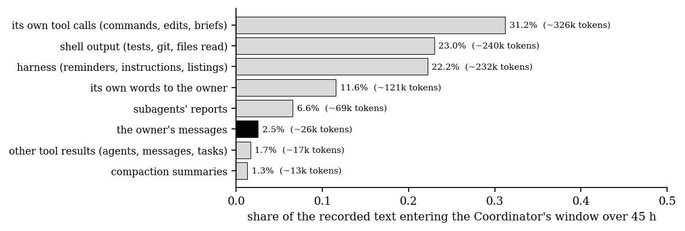

Of the recorded text that entered the window over 45 hours (about a million tokens at four characters a
token), 31% was the Coordinator's own tool calls (commands, edits, briefs), 23% shell output, 22% the
harness's reminders and listings, 12% its own words to the owner, 7% subagents' reports, and **2.5% (about
26k tokens) the owner's messages**.

Set beside the parity benchmark this is the sector's central fact. Given only the owner's messages, a fresh
session scored 0.94; given documentation 0.33, memory 0.21 (harness-parity-plan §4). The smallest inflow
carries most of what matters, and it is mixed into a stock forty times its size that the harness cuts by
size, not by meaning.

- **Not measured:** the model's thinking (redacted in the record) and 167 screenshots. Together with the
  four-characters estimate, the recorded text accounts for about half the growth the usage figures show, so
  the shares are of what was recorded, not of the window.

### RM11. After a cut, the Coordinator re-reads what it had seen; most re-reading is not caused by cuts

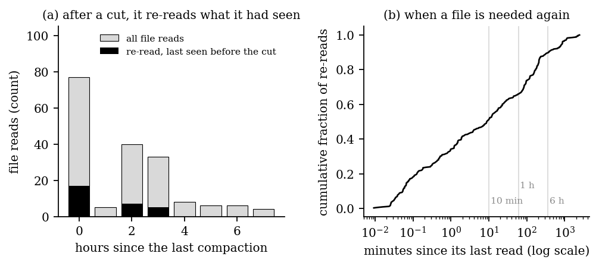

- **Re-reading is the norm.** Of 606 file reads, 346 (57%) were of a file read before. The median time since
  the last read was 9 minutes: 51% within 10 minutes, 66% within the hour, 10% after six hours.
- **The cut adds a burst.** After the two cuts in the record, 35 reads were of files last read before the
  cut: 17 in the first hour (22% of that hour's 77 reads), 12 more in hours 2 and 3, none after hour 4. The
  harness's re-injection (RM9) is the same flow, done for it.
- **State is checked just before acting.** Of 105 commits, merges and pushes, the last state check came a
  median 0 minutes before (usually in the same command), and only once more than 30 minutes before.
- **Not supported:** that re-reading is mainly the cost of cuts. Most re-reads come within minutes, inside a
  window: a file read in pieces, read again after an edit, or checked again before an act. The data cannot
  say which re-reads recovered something lost.

### RM12. What each store keeps falls with the age of the fact, except the owner's own words

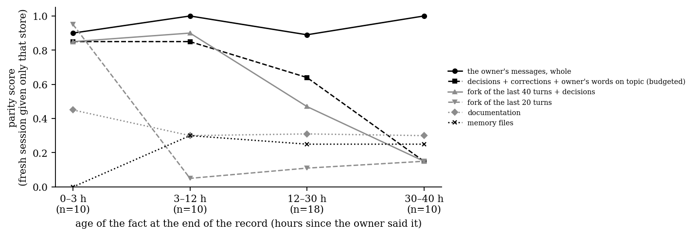

The parity benchmark's 48 cases each ask about something the owner said at a known point in the record.
Grouped by the fact's age at the end of the record, each store's score is:

| age of the fact (n) | 0–3 h (10) | 3–12 h (10) | 12–30 h (18) | 30–40 h (10) |
|---|---|---|---|---|
| the owner's messages, whole | .90 | 1.00 | .89 | 1.00 |
| decisions + corrections + owner's words on topic (the recommended recipe) | .85 | .85 | .64 | .15 |
| decisions alone (all 45) | .45 | .65 | .44 | .45 |
| fork of the last 40 turns + decisions | .85 | .90 | .47 | .15 |
| fork of the last 20 turns (its window: 3.1 h) | .95 | .05 | .11 | .15 |
| documentation | .45 | .30 | .31 | .30 |
| memory files | .00 | .30 | .25 | .25 |

- **A fork is a working context: perfect inside its window, nearly empty outside.** The 20-turn fork scores
  .95 on facts under three hours old and .05 to .15 on the rest.
- **Recipes forget the oldest.** The recipes, which fit each part to a budget, fall to .15 for facts over 30
  hours old. The decisions alone, all 45 of them, hold at about .45 at every age. Facts said before the cut at hour 7.2 (12 cases)
  score .17 to .25 in the recipes and .65 to .75 after it.
- **Durable stores are flat and low.** Documentation and memory neither forget nor hold much: they carry
  outcomes, not reasons.
- **Restating.** Of 26 decisions and 15 corrections the owner said more than once, every repeat came within
  ten minutes of the first, and none across a cut. The owner never had to restate a fact the session had
  lost, in this record.
- **Not supported:** a forgetting curve for the session itself. The benchmark tests fresh sessions given a
  store, not what the live session still held. And that the budget is what drops the old facts is the likely
  reading, not tested here.

### RM13. Context is compressed about five hundred times into a brief, and two hundred times into a report

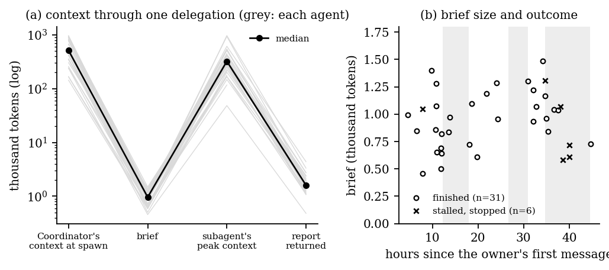

| | median | range |
|---|---|---|
| the Coordinator's working context when it spawned an agent | 513k tokens | |
| the brief | 960 tokens (0.19% of it) | 460 to 1,490 |
| the subagent's own peak context | 321k tokens | |
| the report returned | 1,600 tokens (0.5% of it) | |

37 subagents had a brief the record links. 6 stalled and were stopped (RM6), all but one in the overnight
absence. Their briefs' median was 880 tokens, against 960 for those that finished.

- **Supported:** each handoff is a compression by two to three orders of magnitude, in both directions. The
  brief and the report are the only paths for context between the Coordinator and a worker.
- **Not supported:** that brief size predicts the outcome. Six stalls, clustered in one absence, cannot
  separate brief from attention. Briefs could not be linked to the rework or the merges their work led to,
  and size is not quality: the parity notes' evidence that verbatim owner words worked is about content.

### RM14. Mistakes do not rise with the fill of the window or after a cut (not supported)

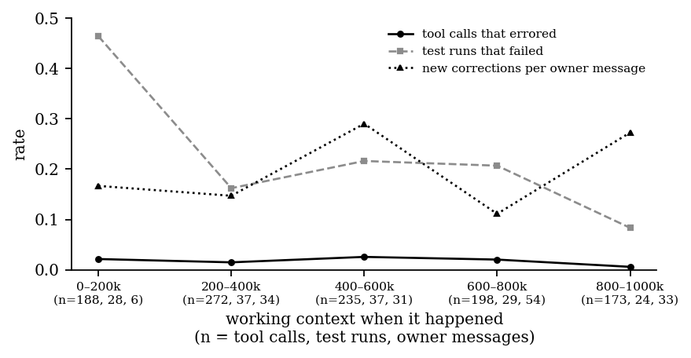

By the working context at the moment, in bands of 200k tokens:

- **Tool calls that errored:** 2.1%, 1.5%, 2.6%, 2.0%, 0.6%.
- **Test runs that failed:** 46%, 16%, 22%, 21%, 8%. The first band is the session's first hours (RM5).
- **New corrections per owner message:** .17, .15, .29, .11, .27.

None rises with the fill. In the three hours either side of the cut at hour 7.2, tool errors went from 1 in 138
to 3 in 133 and new corrections from 3 to 6 (with 19 and 22 owner messages): too few to read. The cut at hour
38.3 came during an absence, with nothing to compare.

One thing did change at the cut at 7.2. Hidden test runs went from 17 of 18 in the three hours before to 3 of 21
after. The switch began between hours 7.0 and 7.3, before the slip was reported at hour 7.9, and after two
hidden failures at hour 6.9. So RM5's restored discipline cannot be put on the reported incident alone: the
session may have noticed the failures, or the cut may have dropped the habit with the rest. One cut cannot
tell these apart.

**The candidate "context saturation raises errors" is not shown by this record.** That is weak evidence
against it: errors here are tool errors, test failures and the owner's corrections, while the saturation loop
acts through relevance, which nothing in the record measures, and through rework found hours later (RM2).

### RM15. Durable knowledge accumulates, is revised within a day, and the memory is never retired

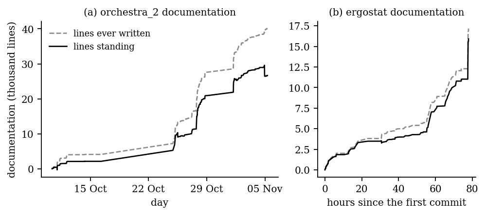

| | written | standing | revised, median age | revised within a day |
|---|---|---|---|---|
| orchestra_2 documentation | 40.1k lines | 26.6k (66%) | 22 h | 50% |
| ergostat documentation | 17.2k lines | 15.9k (93%) | 25 h | 49% |

- **Two durable stores behave differently.** Documentation grows in steps with the directions, like code
  (RM3), and is revised at a median age of about a day: it has an obsolescence outflow. The memory folder only
  fills (21 standing corrections, none retired: RM4b).
- **The record of decisions waits.** 45 decisions and 30 corrections were proposed from this session, and none
  was confirmed by the end (RM8). The store that scored best after the owner's own words has no inflow
  until the owner drains a queue.
- **Externalising is rare against reading.** In the 45 hours the Coordinator wrote durable files (docs,
  memory, rules) 34 times and read them 140 times.
- **Not supported:** that writing knowledge down improved later work. Nothing in the record links a durable
  write to a later outcome.

### Candidates the data does not support

| Candidate | Finding |
|---|---|
| Merge-conflict rework rising with concurrency | Rejected (RM7) |
| Flaky tests | No run failed and then passed under the same command without an edit between. One test was fixed for a fixed wait that failed under load. Too few to form a mode |
| Tests claimed passing | One self-reported incident. The measurable precondition, the hidden exit status, is RM5. Reports were not matched to runs |
| The same correction returning after a delay | Not seen in one session's window (RM4). It needs several sessions' transcripts |
| Scope drift towards low value | The stock and the late pruning are visible (RM3). Value is not |
| Errors rising as the window fills, or after a cut | Rejected for tool errors, test failures and corrections (RM14). Relevance is not measured |
| Corrections repeated after a cut | None: every repeat came within minutes, none across a cut (RM12) |
| Acting on stale state | Not in the Coordinator's own acts: it checked state a median 0 minutes before (RM11). Workers' state is not in the record |
| Brief size predicting outcome | Not separable from the absence the stalls clustered in (RM13) |

## 4. The hoped-for modes

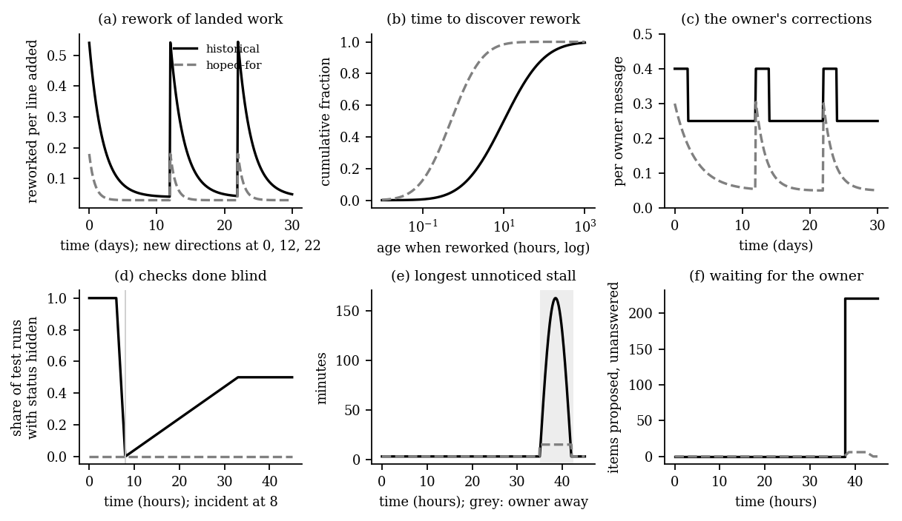

Black is the historical shape and grey dashed the hoped-for one. These are sketches, not forecasts:

- **(a) Rework.** Spikes at new directions are inevitable. The hope is that they are smaller and die down in
  hours, because more is caught before landing.
- **(b) Discovery.** The time to discover moves left, so that most rework is found before or within the hour
  of landing, by checks and not by the owner.
- **(c) Corrections.** Within a direction, corrections per owner message decay, and part of the learning
  carries into the next direction.
- **(d) Checking.** The checking stays at zero blind runs because it is structure, not memory, so it cannot
  drift.
- **(e) Stalls.** A stall is noticed within a fixed bound (minutes), whether or not the owner is there.
- **(f) The owner's queue.** What waits for the owner stays bounded and drains at the rate the owner
  actually answers.
- **(g) Context** (not sketched). Each session's window holds what its work needs, so it is cut rarely or
  never; old facts are retrieved as well as new ones (RM12's curves flat and high); and each handoff carries
  the owner's words, not a paraphrase.

The feared mode is the reverse, and it is what a naive deployment of many sessions would produce. With more
agents at once and the owner away more, R3 and R2 (in [03](03-dynamic-hypothesis.md)) would dominate:
stalls and blind checks become the norm, and rework is found later, by the owner. Each new session starts
from a brief, so the context sector's R10 and R9 would dominate too: thin briefs, and knowledge that lives in
no session.

## 5. What the model must reproduce

A model of the Coordinator is credible for this purpose (Sterman ch. 21) if, driven by the owner's new
directions and the owner's absences as exogenous inputs, it reproduces:

1. RM1's spike-and-decay of rework at each direction;
2. RM2's discovery delay of hours, with a tail of days;
3. RM4's corrections that reset at each direction while the stock of standing corrections only rises;
4. RM5's drop and drift of checking;
5. RM6's stalls clustered in unattended stretches;
6. RM9's sawtooth of working context, filled at a rate set by the work and cut by the harness;
7. RM11's burst of re-reading after a cut, on top of a steady re-reading within the window;
8. RM12's retention: stores that keep the owner's words whole hold old facts, and budgeted or windowed stores
   lose them.

It must do so without reproducing RM7's rise in conflicts, which did not happen, or a rise of errors with the
fill of the window, which RM14 did not find. The dynamic hypothesis proposes the loops that would do this.

## Sources

- Cooper, K. G. (1993). The rework cycle: why projects are mismanaged. *PM Network* 7(2).
- Ford, D. N. and Sterman, J. D. (1998). Dynamic modeling of product development processes. *System Dynamics
  Review* 14(1).
- Lyneis, J. M. and Ford, D. N. (2007). System dynamics applied to project management: a survey, assessment,
  and directions for future research. *System Dynamics Review* 23(2–3).
- Repenning, N. P. and Sterman, J. D. (2001). Nobody ever gets credit for fixing problems that never happened.
  *California Management Review* 43(4).
- Sterman, J. D. (2000). *Business Dynamics*, ch. 3 (the modelling process) and ch. 21 (tests).
