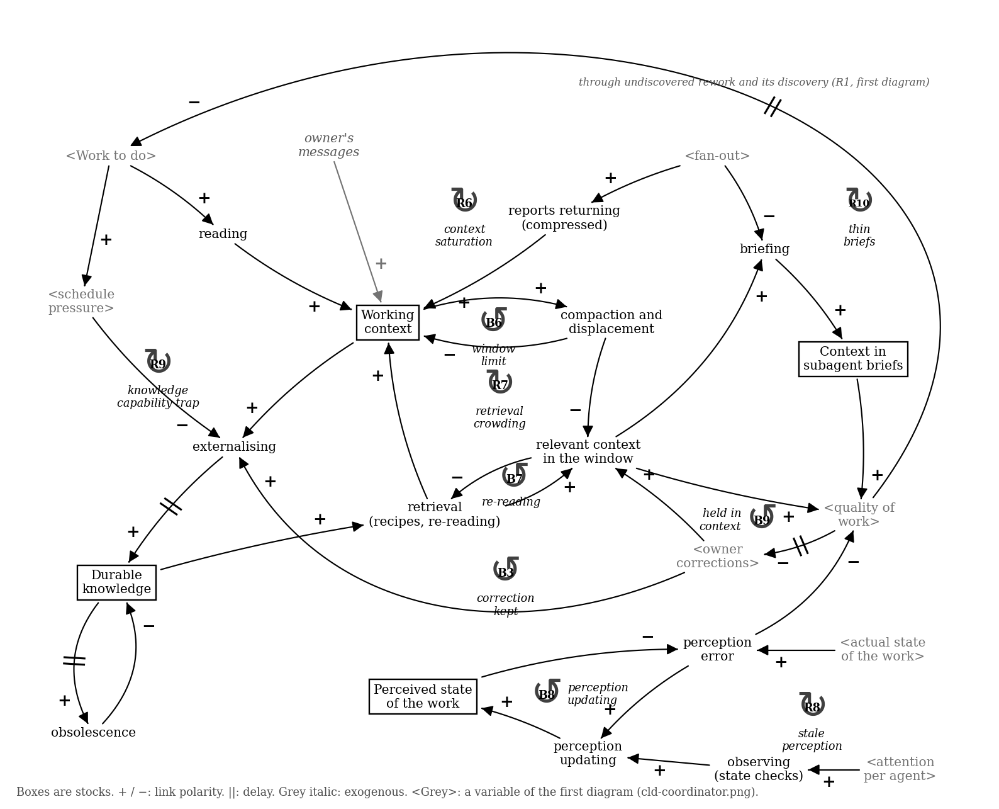

# The Coordinator as a system: model boundary and dynamic hypothesis

Status: SD step 2 of Sterman's modelling process (*Business Dynamics* ch. 3), 2026-11-17. It explains the
reference modes of [02-reference-modes.md](02-reference-modes.md) with a few feedback loops. Nothing here is
formulated as equations yet: that is step 3, and the hypothesis is written so step 3 can test it. Section 3, the
context sector, was added after the owner's review of the first diagram.

## 1. The model boundary

Sterman's boundary chart (ch. 3) lists what the model generates, what it takes as given, and what it leaves
out. The unit of work is a line of landed code (the measure behind RM1 to RM3). The time step is under an hour
and the horizon is 30 days.

| Endogenous (generated by the loops) | Exogenous (taken as given) | Excluded |
|---|---|---|
| Work to do (stock) | The owner's new directions (a step input of new work, and a fall in quality: a new direction is unfamiliar) | Money and token cost (no series; not what the owner judges by) |
| work rate | The owner's availability (present, or away for hours) | The organisation around the owner, and other projects (outside the decision) |
| Work reported done (stock) | The model behind the harness and its abilities | The running behaviour and users of the software built (another system) |
| Undiscovered rework (stock), rework discovery | The harness's tools | The owner's fatigue (no data, and private) |
| quality of work (the fraction landed right) | The test suite's coverage, at the start | Which subagent did what (agents are pooled, as staff are in project models) |
| schedule pressure (work to do against the pace the owner sets) | | The content of decisions (private; only counts and timing enter) |
| verification effort, Verification discipline (stock) | | Merge conflicts as a separate rework source (RM7 found no growth with concurrency) |
| fan-out (agents at once), the Coordinator's attention per agent | | The model's attention within the window: displacement without a cut (no series; RM14 found no sign of it) |
| owner corrections, Standing rules (stock), time on capability | | |
| new proposals, pruning | | |
| Working context (stock), compaction, relevant context in the window | The window's capacity, the harness's compaction rule and what it re-injects | The content of the context (private; only sizes, times and counts enter) |
| Durable knowledge (stock), externalising, obsolescence, retrieval and re-reading | The content of the owner's messages (only their timing and size enter) | |
| Context in subagent briefs (stock), briefing, reports returning | | |
| Perceived state of the work (stock), perception updating, perception error, observing | | |

The model has six sectors, each with the agent that controls it:

- **Work:** the rework chain (work to do, done, undiscovered rework), controlled by the Coordinator's
  acceptance.
- **Verification:** controlled by the Coordinator.
- **Coordination:** fan-out and attention, controlled by the Coordinator.
- **Learning:** corrections and standing rules, shared between the owner and the Coordinator.
- **Scope:** proposals and pruning, controlled by the owner.
- **Context:** the working context, durable knowledge, briefs and the perceived state of the work (section 3),
  controlled by the Coordinator, except the cut, which the harness controls.

The owner is an exogenous sector. The owner supplies new directions and availability, and receives reports.
New directions are exogenous because, in the record, they come from the owner.

## 2. The causal loop diagram

The notation is Sterman's (ch. 5):

- boxes are stocks;
- each arrow is a causal link, marked + (the effect moves the same way as the cause) or − (the opposite way);
- `||` marks a material delay;
- each loop carries its polarity (R reinforcing, B balancing) and a name.

The ten loops form four groups. **The rework core** is B1, R1 and R2, with B4 as R2's counterweight. **The
coordination loops** are B2 and R3. **The learning loops** are B3 and R4, with B4 again. **The scope loops**
are R5 and B5.

### B1 Work completion

More work to do raises the work rate, which drains it: the first-order goal-seeking structure of every project
model (Sterman ch. 8). Alone it would finish the work smoothly; nothing in the reference modes looks like that.

### R1 The rework cycle

- **Errors are made.** Of the work done, a fraction (1 − quality) is wrong. It lands on main as if it were
  right and enters the stock of *Undiscovered rework*.
- **They are found late.** After a discovery delay it is found: by the next test, by the next piece of work
  that touches it, by a reviewer, or by the owner. It returns to *Work to do*.
- **Rework breeds rework.** The rework is itself done at the same quality, so it makes errors of its own.

The loop is reinforcing with a gain below one, so it stretches the work rather than exploding it. This is the
core of Cooper's naval-shipbuilding work (Cooper 1980, 1993), formalised by Ford and Sterman (1998) and
surveyed by Lyneis and Ford (2007).

- **What it explains.** RM1: each new direction starts with low quality, so rework spikes, and the fraction
  decays as quality rises. RM2: the discovery delay is the median age of reworked lines, 5 to 15 hours. The
  stock of undiscovered rework is what makes the owner's picture run ahead of the truth.

### R2 Haste makes waste

- **Pressure cuts checking.** Schedule pressure lowers verification effort: fewer or quicker checks, results
  read from a tail of the output.
- **Less checking lands more errors.** Lower verification lowers quality, which adds undiscovered rework.
- **The rework comes back as pressure.** Once discovered, the rework is more work to do, and so more pressure.

This is Lyneis and Ford's "haste makes waste" and Abdel-Hamid and Madnick's (1991) finding that quality
assurance is the first thing cut when software projects fall behind.

- **What it explains.** Together with B4, RM5. In the first hours of the session, under a heavy flow of the
  owner's requests (24 to 47 messages per 6 hours), every test run was read through a pipe.

### B2 More hands, and R3 Too many to watch

- **B2, the intended effect.** Pressure raises fan-out, the number of agents at once. That raises the work rate
  and drains the work.
- **R3, the side effect.** More agents leave less of the Coordinator's attention for each. Agents that are
  watched less stall unnoticed, and the effective work rate falls. That keeps work in the stock and the
  pressure up.

This is the coordination version of Brooks's law (Brooks 1975), in the form Lyneis and Ford list as "too many
cooks". Here it shows up through supervision, not communication overhead.

- **What it explains.** RM6: stalls of 34 to 164 minutes happened only when two or three agents ran with the
  owner away. The owner's availability is an exogenous input to attention. When the owner is present, the
  owner's questions make the Coordinator look.
- **What it does not explain.** RM7. Conflicts did not rise with concurrency, so the "too many cooks" channel
  through conflicts is left out.

### B3 Learning from correction

- **Corrections follow discovery.** Discovered rework, above all what the owner discovers, produces owner
  corrections.
- **Corrections become rules, after a delay.** A correction becomes a standing rule: a memory file, a line in
  the rules, a convention. The delay is the time to write it down and for it to be loaded.
- **Rules raise quality.** Standing rules raise quality, which lowers undiscovered rework and the discoveries
  that drive corrections.

The loop is balancing: corrections should fall as the rules build up. This is organisational learning in its
plainest SD form. ILC and adaptive control are its engineering cousins (parity note 13).

- **What it explains.** RM4: corrections per message fall within a line of work (0.29, 0.15, 0.14, 0.06) and the
  stock of standing rules rises by about one a day.
- **Why corrections jump again.** A new direction cuts the rules' effect, because the stock holds rules for
  the old work. That the stock never drains (21 kept, none retired) is its own risk. A stock that only fills
  eventually stops being read (parity notes 12 and 13).

### R4 The capability trap

- **Pressure crowds out capability work.** Schedule pressure lowers the time spent on capability: writing a
  rule down properly, building a check instead of remembering it, an audit script, a test that guards a
  decision.
- **Capability decays.** Less capability work means fewer standing rules, after a delay. Quality falls and
  rework rises.
- **The trap closes.** The extra rework is more pressure, which crowds out capability work further.

This is Repenning and Sterman's capability trap (2001; 2002): working harder pays at once and working
smarter pays later, so under pressure the system settles into firefighting.

- **What the data shows.** The precondition. Standing rules are written mostly when the owner asks, and the
  checks of RM5 were restored by memory, not built into the merge path.
- **What it does not show.** A day-scale decline of capability, which needs a longer record than one session.

### B4 Vigilance (and its erosion)

- **Incidents raise discipline.** Discovered failures raise the stock of *Verification discipline*: an incident
  makes the Coordinator check properly.
- **Discipline cuts failures.** Discipline raises verification effort and quality, so fewer failures escape,
  so fewer are discovered.
- **The goal erodes.** Discipline drains away with time, so as incidents become rare, the discipline that
  made them rare fades.

The loop is balancing, with a delay and an erosion. It therefore oscillates: incident, tightening, quiet,
loosening, incident. This is eroding goals in Sterman's terms (the standard set by recent experience), and
the drift toward the boundary of safe practice (Rasmussen 1997; Rudolph and Repenning 2002).

- **What it explains.** RM5's shape: hidden runs at 100%, an incident at hour 7.9, zero for ten hours, then 33
  to 38% again. The drift returned in the unattended overnight stretch, where R2's pressure (salvaging stalled
  work) met B4's erosion.

### R5 Ideas breed work, and B5 Pruning

- **R5.** Work done suggests new work: a new feature implies a page, a test, a document, a further proposal.
  New proposals add to work to do, which adds to the work done.
- **B5.** The stock of what has been built is pruned when it grows past what it is worth, but only after a long
  delay and by an outside decision.

This is scope growth as in Lyneis and Ford's "scope creep", and the harness note's product-owner agent that
drifted (§3): a reinforcing loop with no balancing loop inside the system.

- **What it explains.** RM3: the stock of code grew in bursts and fell once, two weeks late, when the owner
  removed a subsystem. In the record B5 is not endogenous to the Coordinator at all. Pruning came only from
  the owner. The missing balancing loop is the hypothesis.

### The hypothesis in words, through one direction

1. **The direction opens.** A new direction lands as a step of work to do at low quality. R1 and R2
   dominate: work lands fast, a large share of it wrong, and its discovery hours later refills the backlog.
   That is RM1's spike and RM2's delay.
2. **The balancing loops take over.** As errors surface, B3 and B4 take over. Corrections become rules and
   incidents restore checking, so quality rises and the rework fraction decays to its floor.
3. **Erosion sets in.** With the backlog lower and incidents rare, B4's discipline erodes, and R5 adds scope
   that nothing balances.
4. **Pressure returns.** Fan-out with the owner away lets R3 dominate briefly (RM6). Eventually B5 prunes
   from outside, or a new direction resets the cycle.

### Which loops produce which mode

| Mode | Dominant loops | The behaviour they generate |
|---|---|---|
| RM1 rework spikes and decays | R1, with B3 raising quality through a direction | A first-order decay of the rework fraction, reset by each new direction |
| RM2 discovery in hours to days | R1's discovery delay, and the owner's availability | The age distribution of rework |
| RM3 stock grows, pruned late | R5 dominant, B5 with a long delay | Growth in steps, then a sharp fall |
| RM4 corrections fall then reset | B3 within a direction, reset by the exogenous directions | A sawtooth, and a stock that only fills |
| RM5 checking lost, restored, drifting | B4 with erosion, R2 under pressure | A damped oscillation of discipline |
| RM6 stalls when unattended | R3 with the owner away | Stalls clustered in the absences |

## 3. The context sector

The owner's review of section 2: the diagram makes sense, but it misses the main thing a harness does, managing
semantic context. That is what an orchestrator loses unless it is modelled and replaced. In section 2 context
appeared only as "the harness's mechanics" (exogenous) and as "the session's semantic context" (excluded). This
section makes it endogenous: context is held in stocks, and those stocks drive the flows of the first diagram.
Its reference modes are RM9 to RM15.

Both disciplines already have the frame.

- **System dynamics.** Decisions are made on perceived state, not actual, and perception lags through
  information delays (Sterman ch. 11). Each decision sees the system through filters: what reaches the decision
  maker, in what form, and when (Morecroft 1983, 1985). The limit is attention, not information (Simon 1971;
  Sterman ch. 15 on bounded rationality). Knowledge and know-how are stocks: they accumulate only through
  flows, take time to build, and erode (Dierickx and Cool 1989; Argote, Beckman and Epple 1990).
- **Control engineering.** The same thing is the controller's state estimate, kept by an observer (the last
  part of this section).

### Stocks and flows

The diagram is a second sheet: the first stays as it was, and the variables they share appear here as shadow
variables in angle brackets (Vensim's convention).

| Stock | Unit | Inflows | Outflows | Reference mode |
|---|---|---|---|---|
| **Working context**: the window | tokens | reading; reports returning (compressed); the owner's messages; retrieval and re-reading; the harness's re-injection | compaction, in steps at capacity | RM9, RM10, RM11 |
| **Durable knowledge**: memory files, documentation, decisions and corrections, the event record | entries, lines | externalising (with a delay: written, then loaded) | obsolescence (revised or retired) | RM15, RM4b, RM8 |
| **Context in subagent briefs** | tokens per agent | briefing | none: it ends with the agent, and returns as a report | RM13 |
| **Perceived state of the work** | the units of the work's own stocks | perception updating | none: it is adjusted, not drained | RM11 |

Four modelling choices follow the textbooks:

- **Information is not conserved.** Retrieval copies durable knowledge into the window without draining it,
  and briefing copies the window into a brief. These are information links, not material flows (Sterman
  ch. 6).
- **Perception is a stock.** *Perceived state of the work* is a first-order information delay. Perception
  updating closes the gap between actual and perceived over a perception delay, which observing shortens.
  This is Sterman's adaptive expectations (ch. 11), and it is what the Baker criterion asks of every decision
  rule (00-oracle SD-10). *Perception error* is the signed gap for the updating and its size for the effect on
  quality.
- **Relevance is an auxiliary, and the sector's key unmeasured variable.** *Relevant context in the window* is
  the share of the window the next decision needs. Compaction lowers it, retrieval and a correction in the
  window raise it, and it raises quality and the brief. Nothing in the record measures it (RM9, RM14). It is
  the first thing step 3 must find a measure for.
- **The first diagram's *Standing rules* are part of Durable knowledge**: the part that holds corrections.

### The loops

Nine new loops, and B3 redrawn through durable knowledge.

#### B6 Window limit

The fuller the window, the more is compacted, which empties it. The harness sets this balancing loop's goal
(its capacity) and its rule (cut to a summary when nearly full). It is a hard nonlinearity: nothing leaves
until the threshold, then 94% leaves at once.

- **What it explains.** RM9's sawtooth.

#### R6 Context saturation

- **Work fills the window.** More work to do means more reading, and more fan-out means more reports.
- **The cut takes what is relevant.** A full window is compacted, and the summary keeps what the summariser
  chose, by size, not what the next decision needs. Relevant context falls.
- **Lost relevance becomes rework.** Lower relevance lowers quality, and the errors return as work, through
  R1's discovery delay. More work fills the window again.

The loop is reinforcing, and slow: its delay is R1's discovery. It is the context version of information
overload: "a wealth of information creates a poverty of attention" (Simon 1971). For language models in
particular, use of a long context falls for material in its middle (Liu et al. 2024), which would make relevance
fall with the fill even without a cut. That link is left out of the diagram, because RM14 found no sign of it.

- **What the data shows.** The precondition. The window fills at a rate set by the work (RM9), and the
  owner's words, the inflow that carries most of what matters (parity 0.94), are 2.5% of it (RM10).
- **What it does not show.** The loop closing. Errors did not rise with the fill or after a cut (RM14). The
  record cannot see relevance, and the rework a lost fact would cause comes hours later.

#### B7 Re-reading, and R7 Retrieval crowding

- **B7, the intended effect.** When relevant context is missing, the Coordinator re-reads or retrieves it, and
  relevance is restored.
- **R7, the side effect.** What is retrieved also fills the window, which brings the next cut sooner, which
  removes relevant context, which calls for more retrieval.

B7 dominates while the window has room, and R7 as it nears capacity. A context recipe with a fixed budget is
R7 inside one handoff: what it retrieves displaces what it leaves out. The pair is the archetype Senge (1990)
calls "fixes that fail": a fix whose side effect, after a delay, brings the problem back.

- **What it explains.** RM11: re-reading is steady within a window (57% of reads), with a burst in the first
  hour after a cut. The harness does B7 itself by re-injecting about 70k tokens after each cut (RM9). RM12: the
  budgeted recipes lose the oldest facts, and the decisions alone, all of them, do not.

#### R9 Knowledge capability trap (externalising as investment)

- **Pressure crowds out writing down.** Under schedule pressure the Coordinator writes less down: a decision
  with its reason, a correction as a rule, a document brought up to date.
- **Unwritten knowledge cannot be retrieved.** Less durable knowledge, after a delay, means less to retrieve,
  lower relevance after each cut and in every new session, and lower quality.
- **The trap closes.** Lower quality is more rework and more pressure.

This is the capability trap of section 2's R4 (Repenning and Sterman 2002) with knowledge as the capability.
Externalising is Nonaka and Takeuchi's (1995) name for turning what a person knows into what a document says.
Dierickx and Cool (1989) give its two properties: the stock takes time to build, so the shortfall is felt late,
and it erodes without upkeep. Obsolescence is that erosion; the depreciation of organisational knowledge is
measured by Argote, Beckman and Epple (1990).

- **What the data shows.** Externalising happens when the owner asks: 34 durable writes against 140 reads in
  45 hours. The decisions record, the best store after the owner's own words (RM12), waits for the owner to
  confirm it (RM8, RM15). Documentation is revised within a day; memory is never retired (RM15).
- **What it does not show.** A decline of quality from knowledge not written down. The record links no write
  to a later outcome.

#### B9 Correction held in context, and B3 Correction kept

- **B9.** A correction from the owner raises relevant context at once, so quality rises and the corrections
  stop. But it is held only in the window, and the next cut can take it.
- **B3**, from the first diagram. The correction is also externalised. Then it reaches every later window
  through retrieval, and survives cuts and new sessions.

The two are the same balancing loop with two memories. B9 is fast and leaks at every cut. B3 is slow and
keeps. A correction that is never externalised is corrected again after the next cut, or in the next session.
That is the "repeated corrections" behaviour, and it is the capability trap's signature in learning
(Repenning and Sterman 2002; parity notes 12 and 13).

- **What the data shows.** Inside one session B9 suffices: the owner never repeated a correction across a
  cut (RM12). Across sessions B9 holds nothing: fresh sessions repeat corrected mistakes (the parity
  benchmark's tasks), and memory files alone score 0.21.

#### R10 Thin briefs

- **Fan-out thins briefing.** More agents at once leaves less of the Coordinator's attention and less of its
  relevant context for each brief.
- **Thin briefs make worse work.** Less context in the brief means lower quality, more rework, more pressure
  and more fan-out (section 2's B2 closes the loop on the first sheet).

A brief is the only context a subagent starts with. Knowledge transfer between units is "sticky" (Szulanski
1996), and what is lost at a handoff is the interpretation, not the facts (harness-as-control-system §7).
The relevant-context link means a saturated or just-cut Coordinator also writes worse briefs.

- **What the data shows.** Each handoff compresses by two to three orders of magnitude: a brief is 0.19% of
  the Coordinator's window, and a report 0.5% of the subagent's (RM13).
- **What it does not show.** Brief size predicting outcome (RM13).

#### B8 Perception updating, and R8 Stale perception

- **B8.** The perception error drives perception updating: the perceived state moves towards the actual,
  faster the more the Coordinator observes.
- **R8.** When the Coordinator's attention per agent falls (section 2's R3), it observes less, so the
  perceived state lags and the error grows. Acting on old state lowers quality. The rework raises the
  pressure and the fan-out, and attention per agent falls further.

This is the misperception of feedback: decision makers act on the state they perceive and ignore what is in
transit (Sterman 1989). Information delays inside a loop cause overshoot and oscillation (Forrester 1961;
Sterman ch. 11).

- **What the data shows.** For its own acts on the repository, the Coordinator kept B8 tight: it checked the
  state a median 0 minutes before every commit, merge or push (RM11). R8 shows where it did not look: agents
  silent for 34 to 164 minutes in the overnight absence (RM6). There the perceived state ("running") was hours
  older than the actual ("stalled").
- **What it does not show.** Workers' perception. A worker starts from its brief's picture of the work, and
  the record does not hold what it believed. The parity benchmark's weakest kinds are state (0.5) and meaning
  (0.35).

### Which context loops produce which mode

| Mode | Dominant loops | The behaviour they generate |
|---|---|---|
| RM9 the window's sawtooth | B6, with the inflows R6 drives | Linear fill at a rate set by the work, cut in one step at capacity |
| RM10 what fills the window | R6's inflows; the owner's messages exogenous | A small, valuable inflow in a large stock cut by size |
| RM11 re-reading, and a burst after a cut | B7, with the harness's re-injection | Steady re-reading, plus a decaying burst after each cut |
| RM12 retention by age | B7 and R7 in a store's budget; B9 against B3 | Windowed and budgeted stores lose old facts; whole records keep them |
| RM13 compression at handoffs | R10 | Briefs and reports two to three orders smaller than the contexts they connect |
| RM14 no rise of errors with fill | R6 not dominant in this record | (the loop's absence, or its delay, in 45 hours) |
| RM15 durable knowledge | R9, obsolescence | Steps of writing with the directions, revised in a day, memory never retired |

### The hypothesis in words, for context

A new direction arrives as the owner's messages: a small inflow, read through everything the window already
holds. That interpretation is the semantic context. While the window has room, B7 restores whatever is
missing by re-reading, and B9 holds each correction. As the work fills the window, B6 cuts it. What the cut
takes is restored by B7 if it was written down or can be read again, and lost if it lived only in the window.
So after each cut, and in every new session, the system runs on what R9 put into durable knowledge and what
R10 put into briefs. A long session hides this, because one window holds hours of interpretation and cuts are
rare (two in 45 hours). An orchestrator of short sessions makes every session start after a cut. So R9 and
R10, which barely bind in the long session, become the dominant loops.

### The control view: context is the observer

In control terms, the Coordinator's context, as far as it concerns the work, is its **state estimate** x̂: its
belief about what is done, what is broken, what each agent is doing and what the owner wants. Leveson calls it
the controller's process model (00-oracle §4.1, ST-4). The estimator that maintains it is an **observer**
(Luenberger 1964; Kalman 1960). The standard results read straight across.

- **Uncertainty grows with time since measurement and shrinks at each measurement.** In the Kalman filter the
  estimate's covariance grows between measurements, by the process noise Q: how fast the work changes
  unobserved. More agents running raise Q. At each measurement the covariance shrinks, by an amount the
  sensor's noise R sets. A state check, a test run read by its exit code and an agent's report are
  measurements. A test piped through `tail` is a sensor whose noise is unbounded (RM5). An overstated report is
  a biased sensor (parity gap 16). So the time to measure is when the uncertainty about what is about to be
  acted on is large. The record shows the Coordinator measuring just before its own acts (RM11), and not
  measuring agents it was not about to act on (RM6).
- **Compaction is reduced-order estimation.** A cut replaces a high-order estimate with a low-order summary.
  Model reduction has a criterion for what to keep: balanced truncation keeps the states that are most
  observable and controllable (Moore 1981). The harness's cut has none beyond what a summariser picks within a
  size. The burst of re-reading after a cut (RM11) is the observer re-estimating the dropped states from fresh
  measurements. RM12's falling curves are the cost of reduction without a relevance criterion.
- **Observability: what the Coordinator can see at all.** A state is observable if the measurements determine
  it (Kalman 1960). Undiscovered rework is unobservable by definition until a test, a review or the owner
  reads it. It is also not stable: it accumulates (R1). An unobservable state that does not decay on its own
  makes the system not **detectable** (Anderson and Moore 1979), and then no estimator, however good, will
  track it. That is why verification (section 2's B4) is a sensor design problem, not a matter of discipline.
  The owner's intent is observable only through the owner's messages and corrections: a sensor with a low
  rate and a high value (RM10). A worker's progress is observable through its notifications and transcript,
  and only if something reads them (RM6).
- **The separation principle.** For linear plants with Gaussian noise, the optimal controller is optimal state
  feedback applied to the optimal estimate, and the two can be designed separately (the LQG result: Wonham
  1968). Here it licenses designing "managing context" as its own part, an observer, with its own
  measurements (reads, state checks, reports, the owner's messages), its own memory policy (what to keep,
  when and how to reduce), its own initialisation (a brief is a worker's initial estimate x̂₀, and a thin
  brief is a large initial uncertainty) and its own measure of performance (estimation error against the
  record, as in RM12). It is designed apart from the decision rules of the work loops. Two cautions apply.
  Separation is a theorem for the linear-Gaussian case only. And where an action changes what can be learned
  (the **dual effect**: Feldbaum 1960–61; Bar-Shalom and Tse 1974), the controller should probe as well as
  steer. The Coordinator's small experiments (re-run one test, grep before editing: parity gap 7) are such
  probing actions. So the observer and the controller are designed separately, and the probing actions are
  designed as the bridge between them.

**Why this matters for step 3.** The control architecture (00-oracle §3.3 to §3.5) will design an observer
explicitly, beside every controller:

- the Coordinator's, from the measurements listed above;
- each worker's, initialised from its brief;
- the owner's, which is cascaded on the Coordinator's, because its only measurement is the Coordinator's
  reports (parity gap 11).

The design questions are the estimator's own: what to measure, how often (sampling: CE-14), what to keep (the
order of the estimate), how to initialise (briefs), and how to judge it (estimation error, by kind). In a
harness all of this was implicit in "managing context". In ergostat it becomes the observer half of the
design, specified like the controller half.

## 4. The Coordinator as the decision function

In every loop the Coordinator is the decision rule that turns information into a rate (Sterman ch. 13,
Morecroft on bounded rationality). Each row of the table below describes its policy as the record shows it,
not as it might be designed.

| Loop | Decision | Information it uses | Policy observed |
|---|---|---|---|
| B1 | What to start next; when a piece of work is done | the plan in its context, the owner's latest message, notifications that agents finished | Start the next planned item when an agent returns. Wake itself to check (16 wake-ups) |
| R1 | Accept (merge) or send back | test output read as text, the agent's report, the diff, screenshots | Merge when the text says the tests passed and the report is plausible. Send back on a visible failure. The discovery delay is set by what it chose not to look at |
| R2, B4 | How hard to verify | the most recent incident in its context; the owner's pace | Run the suite, but read its tail. Tighten after an incident, drift back without one. There is no stored rule, so discipline lives as long as the context holds it |
| B2, R3 | How many agents at once; when to look at one | the independent items in the plan, notifications, wake-ups | 1 to 3 agents at once, briefly 6. Look on notification or wake-up. Nudge (41 messages) or stop (7). A silent agent is noticed only on its next look |
| B3 | What to keep from a correction, and how widely | the owner's words, the memories already written | Write a feedback memory when told (21 in 24 days). Guess its scope. Retire nothing |
| R4 | Time on capability against time on features | implicit; nothing measures it | No explicit allocation. Capability work happens when the owner asks for it |
| R5, B5 | Admit a proposal; prune | the owner's direction, its own plan | Propose and build. Prune only on the owner's decision |
| (all) | Ask or act; what to report | whether the owner is present | Ask in 17% of turns when present (answered in a median 1.8 minutes). Act alone when away |
| R6, B6 | What to read | the task at hand | Read in pieces and re-read freely (57% of reads, a median 9 minutes after the last). The cut is the harness's, at capacity, never the Coordinator's |
| B7, R7 | What to restore after a cut | the summary, the files the harness re-injects | Re-read the files it was working on, within the first hour (RM11) |
| R9, B9 | What to write down | the owner's instruction | Externalise when told: 34 durable writes against 140 reads in 45 hours |
| R10 | What to put in a brief | its own window | About a thousand tokens, 0.2% of its context. The owner's words verbatim when it judged them needed |
| B8, R8 | When to look at the state | the act it is about to make | Check just before acting (a median 0 minutes). Between acts, look at an agent only on a notification or a wake-up |

The pattern is consistent. The Coordinator's rules read local, recent information: the last test's tail, the
last incident, the agent that just notified. They never read the stocks the loops turn on: undiscovered
rework, verification discipline, the rules' coverage of the current direction. Deciding on visible flows
rather than the accumulations that drive the behaviour is the classic source of policy resistance. The context
rows show the same pattern from the other side. The Coordinator manages its context by reading again, not by
deciding what to keep: what to keep is decided by the harness (the cut) and by the owner (what to write down).

## 5. The parity gaps this hypothesis speaks to

| Parity gap | Loops | What the hypothesis says |
|---|---|---|
| 2 Knowing when done | R1, B4 | "Done" is a flow into a stock that holds hidden rework. The decision to accept sets the discovery delay |
| 6 Diagnosing failures | R1, R3 | A stall is a hidden fall in the work rate. A failure found late is R1's discovery |
| 8 State before and after | R2, B4, B8, R8 | Checking effects is the verification effort that pressure cuts and vigilance restores. State before an act is perception updating: tight for the Coordinator's own acts (RM11), absent for agents it is not about to act on |
| 9 Allocating attention | R3, B2 | Attention per agent is the variable that turns fan-out into stalls |
| 10 Delegation and trust | R1, R3, R10 | A brief is the worker's whole initial context, compressed about five hundred times (RM13). Review depth is verification effort |
| 12 Coherence | B3, R5, R9 | Coherence is retrieval of what was decided. Budgeted and windowed stores lose the oldest decisions first (RM12) |
| 13 Learning from correction | B3, B9, R4, R9 | A correction held only in the window (B9) leaks at each cut and is gone in a new session; only one externalised (B3) persists |
| 14 Concurrent work | B2, R3 | Concurrency costs supervision, not conflicts (RM7) |
| 15 Prioritisation and value | R5, B5 | Scope growth has no balancing loop inside the system |
| 16 Reporting truthfully | R1, B4 | Undiscovered rework is the gap between reported and true. Blind checks widen it |
| 3 Intent, ask or act | B8 on the owner's intent, B9 | Asking is a measurement of the owner's intent: worth the owner's time when the estimate of the intent is uncertain and a wrong act is costly, and cheap when the owner is present (answered in 1.8 minutes, RM8). The context sector makes the choice a measurement decision of the observer |
| 1 Revising goals | B8, R10 | Partly. The goal and its reasons are part of the estimate. Re-planning is a measurement update of it, which the long session makes with every message; a worker starts from a brief and receives none. Directions themselves stay exogenous |
| 4 Absorbing disruptions | B9, R10 | Partly. An interruption is a measurement update arriving mid-act. The long session absorbs it because the estimate and the work share one window; a worker has no inflow of the owner's messages unless they are routed. Preemption itself is not modelled |
| 7 Experiments | B7, B8 (the dual effect) | Probing before acting is measurement to cut the estimate's uncertainty: the dual effect of control under uncertainty. Re-reads and state checks are its trace (RM11) |
| 11 Translating both ways | B8, cascaded | The owner's picture of progress is a second observer, cascaded on the Coordinator's. Its only measurement is the Coordinator's reports, so its error is at least the Coordinator's plus the reports' compression. Not measured |

**The gap the hypothesis does not explain: 5, gating by risk.** There are no outward-facing actions in the
data. Gaps 1 and 4 are explained only in part, and 11 only in structure: each needs a series not yet
collected (the owner's picture of progress, workers' beliefs, preemptions).

## 6. What step 3 must test

1. **Formulate R1 with B1** (Ford and Sterman's structure) and calibrate the discovery delay and the quality
   fraction per direction against RM1 and RM2.
2. **Add B4 with an erosion time constant.** Check that it reproduces RM5's drop and drift without forcing.
3. **Add R3 with attention as a function of fan-out and the owner's availability.** Check RM6's clustering.
4. **Add B3 and R4.** Check that corrections reset at each exogenous direction (RM4), and that removing time
   on capability produces a slow decline of quality under pressure.
5. **Add the context sector.** Formulate the working context with B6's cut (capacity and rule as the
   harness's parameters) and reproduce RM9 from the work's inflows. Formulate retention per store and fit
   RM12. Find a measure of relevant context: without it R6 cannot be tested, and RM14 is the only evidence
   against it.
6. **Formulate perception as a first-order information delay** for the Coordinator, each worker (initialised
   from its brief) and the owner (cascaded on reports). Check that R8 produces RM6's stalls without a separate
   stall mechanism.
7. **Run extreme-condition tests** (Sterman ch. 21): a window that never cuts, a window of one turn, briefs of
   zero. Then run the parity notes' policies as changed decision rules: checks in the merge path, a stall
   timer, rules with an outflow, pruning inside the loop, context recipes without a budget, and briefs that
   carry the owner's words.

## Sources

- Anderson, B. D. O. and Moore, J. B. (1979). *Optimal Filtering*. Prentice Hall.
- Argote, L., Beckman, S. L. and Epple, D. (1990). The persistence and transfer of learning in industrial
  settings. *Management Science* 36(2).
- Bar-Shalom, Y. and Tse, E. (1974). Dual effect, certainty equivalence, and separation in stochastic control.
  *IEEE Transactions on Automatic Control* 19(5).
- Dierickx, I. and Cool, K. (1989). Asset stock accumulation and sustainability of competitive advantage.
  *Management Science* 35(12).
- Feldbaum, A. A. (1960–61). Dual control theory, I–IV. *Automation and Remote Control* 21–22.
- Forrester, J. W. (1961). *Industrial Dynamics*. MIT Press.
- Kalman, R. E. (1960). A new approach to linear filtering and prediction problems. *Journal of Basic
  Engineering* 82(1). And: On the general theory of control systems. *Proceedings of the First IFAC
  Congress*.
- Liu, N. F. et al. (2024). Lost in the middle: how language models use long contexts. *Transactions of the
  Association for Computational Linguistics* 12.
- Luenberger, D. G. (1964). Observing the state of a linear system. *IEEE Transactions on Military
  Electronics* 8(2).
- Moore, B. C. (1981). Principal component analysis in linear systems: controllability, observability, and
  model reduction. *IEEE Transactions on Automatic Control* 26(1).
- Morecroft, J. D. W. (1983). System dynamics: portraying bounded rationality. *Omega* 11(2).
- Morecroft, J. D. W. (1985). Rationality in the analysis of behavioral simulation models. *Management
  Science* 31(7).
- Nonaka, I. and Takeuchi, H. (1995). *The Knowledge-Creating Company*. Oxford University Press.
- Senge, P. M. (1990). *The Fifth Discipline*. Doubleday.
- Simon, H. A. (1971). Designing organizations for an information-rich world. In Greenberger (ed.),
  *Computers, Communications, and the Public Interest*. Johns Hopkins Press.
- Sterman, J. D. (1989). Modeling managerial behavior: misperceptions of feedback in a dynamic decision making
  experiment. *Management Science* 35(3).
- Szulanski, G. (1996). Exploring internal stickiness: impediments to the transfer of best practice within
  the firm. *Strategic Management Journal* 17(S2).
- Wonham, W. M. (1968). On the separation theorem of stochastic control. *SIAM Journal on Control* 6(2).
- Abdel-Hamid, T. and Madnick, S. (1991). *Software Project Dynamics: An Integrated Approach*. Prentice Hall.
- Brooks, F. P. (1975). *The Mythical Man-Month*. Addison-Wesley.
- Cooper, K. G. (1980). Naval ship production: a claim settled and a framework built. *Interfaces* 10(6).
- Cooper, K. G. (1993). The rework cycle: why projects are mismanaged. *PM Network* 7(2).
- Ford, D. N. and Sterman, J. D. (1998). Dynamic modeling of product development processes. *System Dynamics
  Review* 14(1).
- Lyneis, J. M. and Ford, D. N. (2007). System dynamics applied to project management. *System Dynamics
  Review* 23(2–3).
- Morecroft, J. (2015). *Strategic Modelling and Business Dynamics*, 2nd ed. Wiley.
- Rasmussen, J. (1997). Risk management in a dynamic society. *Safety Science* 27(2–3).
- Repenning, N. P. and Sterman, J. D. (2001). Nobody ever gets credit for fixing problems that never happened.
  *California Management Review* 43(4).
- Repenning, N. P. and Sterman, J. D. (2002). Capability traps and self-confirming attribution errors in the
  dynamics of process improvement. *Administrative Science Quarterly* 47(2).
- Rudolph, J. W. and Repenning, N. P. (2002). Disaster dynamics. *Administrative Science Quarterly* 47(1).
- Sterman, J. D. (2000). *Business Dynamics*, ch. 1, 3, 5, 6, 8, 11, 13, 15 and 21.

To check against the source before quoting: the issue and page details of Feldbaum's four papers, Kalman's
IFAC paper, and Liu et al.
