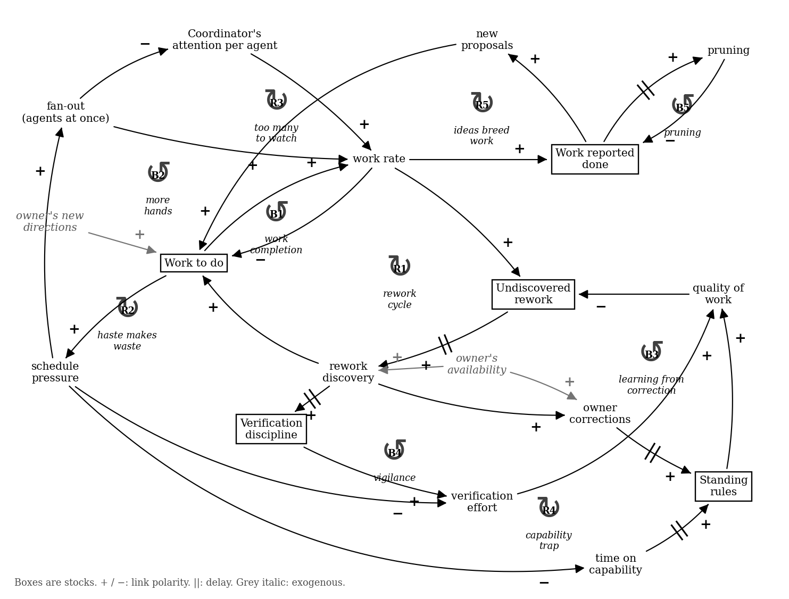

# The Coordinator as a system: model boundary and dynamic hypothesis

Status: SD step 2 of Sterman's modelling process (*Business Dynamics* ch. 3), 2026-11-17. It explains the
reference modes of [02-reference-modes.md](02-reference-modes.md) with a few feedback loops. Nothing here is
formulated as equations yet: that is step 3, and the hypothesis is written so step 3 can test it.

## 1. The model boundary

Sterman's boundary chart (ch. 3) lists what the model generates, what it takes as given, and what it leaves
out. The unit of work is a line of landed code (the measure behind RM1 to RM3). The time step is under an hour
and the horizon is 30 days.

| Endogenous (generated by the loops) | Exogenous (taken as given) | Excluded |
|---|---|---|
| Work to do (stock) | The owner's new directions (a step input of new work, and a fall in quality: a new direction is unfamiliar) | Money and token cost (no series; not what the owner judges by) |
| work rate | The owner's availability (present, or away for hours) | The organisation around the owner, and other projects (outside the decision) |
| Work reported done (stock) | The model behind the harness and its abilities | The running behaviour and users of the software built (another system) |
| Undiscovered rework (stock), rework discovery | The harness's own mechanics: context limit, compaction, tools | The owner's fatigue (no data, and private) |
| quality of work (the fraction landed right) | The test suite's coverage, at the start | Which subagent did what (agents are pooled, as staff are in project models) |
| schedule pressure (work to do against the pace the owner sets) | | The content of decisions (private; only counts and timing enter) |
| verification effort, Verification discipline (stock) | | Merge conflicts as a separate rework source (RM7 found no growth with concurrency) |
| fan-out (agents at once), the Coordinator's attention per agent | | The session's semantic context as a stock (no series yet; it acts through quality) |
| owner corrections, Standing rules (stock), time on capability | | |
| new proposals, pruning | | |

The model has five sectors, each with the agent that controls it:

- **Work:** the rework chain (work to do, done, undiscovered rework), controlled by the Coordinator's
  acceptance.
- **Verification:** controlled by the Coordinator.
- **Coordination:** fan-out and attention, controlled by the Coordinator.
- **Learning:** corrections and standing rules, shared between the owner and the Coordinator.
- **Scope:** proposals and pruning, controlled by the owner.

The owner is an exogenous sector. The owner supplies new directions and availability, and receives reports.
New directions are exogenous because, in the record, they come from the owner.

## 2. The causal loop diagram

The notation is Sterman's (ch. 5):

- boxes are stocks;
- each arrow is a causal link, marked + (the effect moves the same way as the cause) or − (the opposite way);
- `||` marks a material delay;
- each loop carries its polarity (R reinforcing, B balancing) and a name.

The ten loops form four groups. **The rework core** is B1, R1 and R2, with B4 as R2's counterweight. **The
coordination loops** are B2 and R3. **The learning loops** are B3 and R4, with B4 again. **The scope loops**
are R5 and B5.

### B1 Work completion

More work to do raises the work rate, which drains it: the first-order goal-seeking structure of every project
model (Sterman ch. 8). Alone it would finish the work smoothly; nothing in the reference modes looks like that.

### R1 The rework cycle

- **Errors are made.** Of the work done, a fraction (1 − quality) is wrong. It lands on main as if it were
  right and enters the stock of *Undiscovered rework*.
- **They are found late.** After a discovery delay it is found: by the next test, by the next piece of work
  that touches it, by a reviewer, or by the owner. It returns to *Work to do*.
- **Rework breeds rework.** The rework is itself done at the same quality, so it makes errors of its own.

The loop is reinforcing with a gain below one, so it stretches the work rather than exploding it. This is the
core of Cooper's naval-shipbuilding work (Cooper 1980, 1993), formalised by Ford and Sterman (1998) and
surveyed by Lyneis and Ford (2007).

- **What it explains.** RM1: each new direction starts with low quality, so rework spikes, and the fraction
  decays as quality rises. RM2: the discovery delay is the median age of reworked lines, 5 to 15 hours. The
  stock of undiscovered rework is what makes the owner's picture run ahead of the truth.

### R2 Haste makes waste

- **Pressure cuts checking.** Schedule pressure lowers verification effort: fewer or quicker checks, results
  read from a tail of the output.
- **Less checking lands more errors.** Lower verification lowers quality, which adds undiscovered rework.
- **The rework comes back as pressure.** Once discovered, the rework is more work to do, and so more pressure.

This is Lyneis and Ford's "haste makes waste" and Abdel-Hamid and Madnick's (1991) finding that quality
assurance is the first thing cut when software projects fall behind.

- **What it explains.** Together with B4, RM5. In the first hours of the session, under a heavy flow of the
  owner's requests (24 to 47 messages per 6 hours), every test run was read through a pipe.

### B2 More hands, and R3 Too many to watch

- **B2, the intended effect.** Pressure raises fan-out, the number of agents at once. That raises the work rate
  and drains the work.
- **R3, the side effect.** More agents leave less of the Coordinator's attention for each. Agents that are
  watched less stall unnoticed, and the effective work rate falls. That keeps work in the stock and the
  pressure up.

This is the coordination version of Brooks's law (Brooks 1975), in the form Lyneis and Ford list as "too many
cooks". Here it shows up through supervision, not communication overhead.

- **What it explains.** RM6: stalls of 34 to 164 minutes happened only when two or three agents ran with the
  owner away. The owner's availability is an exogenous input to attention. When the owner is present, the
  owner's questions make the Coordinator look.
- **What it does not explain.** RM7. Conflicts did not rise with concurrency, so the "too many cooks" channel
  through conflicts is left out.

### B3 Learning from correction

- **Corrections follow discovery.** Discovered rework, above all what the owner discovers, produces owner
  corrections.
- **Corrections become rules, after a delay.** A correction becomes a standing rule: a memory file, a line in
  the rules, a convention. The delay is the time to write it down and for it to be loaded.
- **Rules raise quality.** Standing rules raise quality, which lowers undiscovered rework and the discoveries
  that drive corrections.

The loop is balancing: corrections should fall as the rules build up. This is organisational learning in its
plainest SD form. ILC and adaptive control are its engineering cousins (parity note 13).

- **What it explains.** RM4: corrections per message fall within a line of work (0.29, 0.15, 0.14, 0.06) and the
  stock of standing rules rises by about one a day.
- **Why corrections jump again.** A new direction cuts the rules' effect, because the stock holds rules for
  the old work. That the stock never drains (21 kept, none retired) is its own risk. A stock that only fills
  eventually stops being read (parity notes 12 and 13).

### R4 The capability trap

- **Pressure crowds out capability work.** Schedule pressure lowers the time spent on capability: writing a
  rule down properly, building a check instead of remembering it, an audit script, a test that guards a
  decision.
- **Capability decays.** Less capability work means fewer standing rules, after a delay. Quality falls and
  rework rises.
- **The trap closes.** The extra rework is more pressure, which crowds out capability work further.

This is Repenning and Sterman's capability trap (2001; 2002): working harder pays at once and working
smarter pays later, so under pressure the system settles into firefighting.

- **What the data shows.** The precondition. Standing rules are written mostly when the owner asks, and the
  checks of RM5 were restored by memory, not built into the merge path.
- **What it does not show.** A day-scale decline of capability, which needs a longer record than one session.

### B4 Vigilance (and its erosion)

- **Incidents raise discipline.** Discovered failures raise the stock of *Verification discipline*: an incident
  makes the Coordinator check properly.
- **Discipline cuts failures.** Discipline raises verification effort and quality, so fewer failures escape,
  so fewer are discovered.
- **The goal erodes.** Discipline drains away with time, so as incidents become rare, the discipline that
  made them rare fades.

The loop is balancing, with a delay and an erosion. It therefore oscillates: incident, tightening, quiet,
loosening, incident. This is eroding goals in Sterman's terms (the standard set by recent experience), and
the drift toward the boundary of safe practice (Rasmussen 1997; Rudolph and Repenning 2002).

- **What it explains.** RM5's shape: hidden runs at 100%, an incident at hour 7.9, zero for ten hours, then 33
  to 38% again. The drift returned in the unattended overnight stretch, where R2's pressure (salvaging stalled
  work) met B4's erosion.

### R5 Ideas breed work, and B5 Pruning

- **R5.** Work done suggests new work: a new feature implies a page, a test, a document, a further proposal.
  New proposals add to work to do, which adds to the work done.
- **B5.** The stock of what has been built is pruned when it grows past what it is worth, but only after a long
  delay and by an outside decision.

This is scope growth as in Lyneis and Ford's "scope creep", and the harness note's product-owner agent that
drifted (§3): a reinforcing loop with no balancing loop inside the system.

- **What it explains.** RM3: the stock of code grew in bursts and fell once, two weeks late, when the owner
  removed a subsystem. In the record B5 is not endogenous to the Coordinator at all. Pruning came only from
  the owner. The missing balancing loop is the hypothesis.

### The hypothesis in words, through one direction

1. **The direction opens.** A new direction lands as a step of work to do at low quality. R1 and R2
   dominate: work lands fast, a large share of it wrong, and its discovery hours later refills the backlog.
   That is RM1's spike and RM2's delay.
2. **The balancing loops take over.** As errors surface, B3 and B4 take over. Corrections become rules and
   incidents restore checking, so quality rises and the rework fraction decays to its floor.
3. **Erosion sets in.** With the backlog lower and incidents rare, B4's discipline erodes, and R5 adds scope
   that nothing balances.
4. **Pressure returns.** Fan-out with the owner away lets R3 dominate briefly (RM6). Eventually B5 prunes
   from outside, or a new direction resets the cycle.

### Which loops produce which mode

| Mode | Dominant loops | The behaviour they generate |
|---|---|---|
| RM1 rework spikes and decays | R1, with B3 raising quality through a direction | A first-order decay of the rework fraction, reset by each new direction |
| RM2 discovery in hours to days | R1's discovery delay, and the owner's availability | The age distribution of rework |
| RM3 stock grows, pruned late | R5 dominant, B5 with a long delay | Growth in steps, then a sharp fall |
| RM4 corrections fall then reset | B3 within a direction, reset by the exogenous directions | A sawtooth, and a stock that only fills |
| RM5 checking lost, restored, drifting | B4 with erosion, R2 under pressure | A damped oscillation of discipline |
| RM6 stalls when unattended | R3 with the owner away | Stalls clustered in the absences |

## 3. The Coordinator as the decision function

In every loop the Coordinator is the decision rule that turns information into a rate (Sterman ch. 13,
Morecroft on bounded rationality). Each row of the table below describes its policy as the record shows it,
not as it might be designed.

| Loop | Decision | Information it uses | Policy observed |
|---|---|---|---|
| B1 | What to start next; when a piece of work is done | the plan in its context, the owner's latest message, notifications that agents finished | Start the next planned item when an agent returns. Wake itself to check (16 wake-ups) |
| R1 | Accept (merge) or send back | test output read as text, the agent's report, the diff, screenshots | Merge when the text says the tests passed and the report is plausible. Send back on a visible failure. The discovery delay is set by what it chose not to look at |
| R2, B4 | How hard to verify | the most recent incident in its context; the owner's pace | Run the suite, but read its tail. Tighten after an incident, drift back without one. There is no stored rule, so discipline lives as long as the context holds it |
| B2, R3 | How many agents at once; when to look at one | the independent items in the plan, notifications, wake-ups | 1 to 3 agents at once, briefly 6. Look on notification or wake-up. Nudge (41 messages) or stop (7). A silent agent is noticed only on its next look |
| B3 | What to keep from a correction, and how widely | the owner's words, the memories already written | Write a feedback memory when told (21 in 24 days). Guess its scope. Retire nothing |
| R4 | Time on capability against time on features | implicit; nothing measures it | No explicit allocation. Capability work happens when the owner asks for it |
| R5, B5 | Admit a proposal; prune | the owner's direction, its own plan | Propose and build. Prune only on the owner's decision |
| (all) | Ask or act; what to report | whether the owner is present | Ask in 17% of turns when present (answered in a median 1.8 minutes). Act alone when away |

The pattern is consistent. The Coordinator's rules read local, recent information: the last test's tail, the
last incident, the agent that just notified. They never read the stocks the loops turn on: undiscovered
rework, verification discipline, the rules' coverage of the current direction. Deciding on visible flows
rather than the accumulations that drive the behaviour is the classic source of policy resistance.

## 4. The parity gaps this hypothesis speaks to

| Parity gap | Loops | What the hypothesis says |
|---|---|---|
| 2 Knowing when done | R1, B4 | "Done" is a flow into a stock that holds hidden rework. The decision to accept sets the discovery delay |
| 6 Diagnosing failures | R1, R3 | A stall is a hidden fall in the work rate. A failure found late is R1's discovery |
| 8 State before and after | R2, B4 | Checking effects is the verification effort that pressure cuts and vigilance restores |
| 9 Allocating attention | R3, B2 | Attention per agent is the variable that turns fan-out into stalls |
| 10 Delegation and trust | R1, R3 | Brief quality is a cause of quality of work. Review depth is verification effort |
| 12 Coherence | B3, R5 | Standing rules keep work coherent. Their coverage resets at new directions |
| 13 Learning from correction | B3, R4 | Corrections are an inflow to a stock with a delay and no outflow. Pressure crowds out the learning |
| 14 Concurrent work | B2, R3 | Concurrency costs supervision, not conflicts (RM7) |
| 15 Prioritisation and value | R5, B5 | Scope growth has no balancing loop inside the system |
| 16 Reporting truthfully | R1, B4 | Undiscovered rework is the gap between reported and true. Blind checks widen it |
| 3 Intent, ask or act | B3, and the owner's availability | Partly. Asking moves discovery earlier when the owner is present. The choice itself is not modelled |

**Gaps the hypothesis does not explain:**

- **1 Revising goals.** New directions are exogenous here.
- **4 Absorbing disruptions.** Interruptions (5 in the record) are pulses with no structure for preemption.
- **5 Gating by risk.** There are no outward-facing actions in the data.
- **7 Experiments.** There is no series of probes before action.
- **11 Translating both ways.** The owner's perceived state is not a stock here. It is the obvious next one:
  *the owner's picture of progress*, filled by reports and corrected by discoveries.

Each needs a longer record or a series not yet collected.

## 5. What step 3 must test

1. **Formulate R1 with B1** (Ford and Sterman's structure) and calibrate the discovery delay and the quality
   fraction per direction against RM1 and RM2.
2. **Add B4 with an erosion time constant.** Check that it reproduces RM5's drop and drift without forcing.
3. **Add R3 with attention as a function of fan-out and the owner's availability.** Check RM6's clustering.
4. **Add B3 and R4.** Check that corrections reset at each exogenous direction (RM4), and that removing time
   on capability produces a slow decline of quality under pressure.
5. **Run extreme-condition tests** (Sterman ch. 21), then the parity notes' policies as changed decision
   rules: checks in the merge path, a stall timer, rules with an outflow, pruning inside the loop.

## Sources

- Abdel-Hamid, T. and Madnick, S. (1991). *Software Project Dynamics: An Integrated Approach*. Prentice Hall.
- Brooks, F. P. (1975). *The Mythical Man-Month*. Addison-Wesley.
- Cooper, K. G. (1980). Naval ship production: a claim settled and a framework built. *Interfaces* 10(6).
- Cooper, K. G. (1993). The rework cycle: why projects are mismanaged. *PM Network* 7(2).
- Ford, D. N. and Sterman, J. D. (1998). Dynamic modeling of product development processes. *System Dynamics
  Review* 14(1).
- Lyneis, J. M. and Ford, D. N. (2007). System dynamics applied to project management. *System Dynamics
  Review* 23(2–3).
- Morecroft, J. (2015). *Strategic Modelling and Business Dynamics*, 2nd ed. Wiley.
- Rasmussen, J. (1997). Risk management in a dynamic society. *Safety Science* 27(2–3).
- Repenning, N. P. and Sterman, J. D. (2001). Nobody ever gets credit for fixing problems that never happened.
  *California Management Review* 43(4).
- Repenning, N. P. and Sterman, J. D. (2002). Capability traps and self-confirming attribution errors in the
  dynamics of process improvement. *Administrative Science Quarterly* 47(2).
- Rudolph, J. W. and Repenning, N. P. (2002). Disaster dynamics. *Administrative Science Quarterly* 47(1).
- Sterman, J. D. (2000). *Business Dynamics*, ch. 3, 5, 8, 13 and 21.
