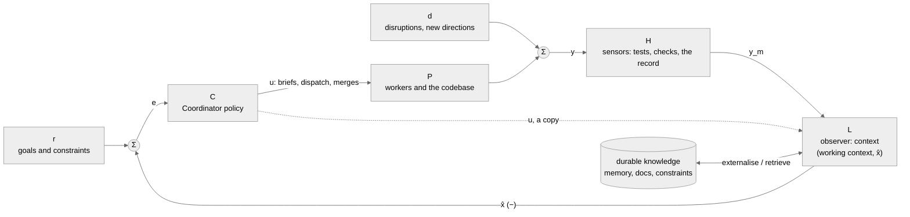
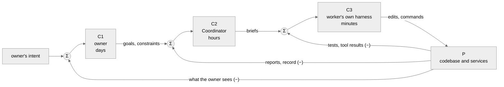
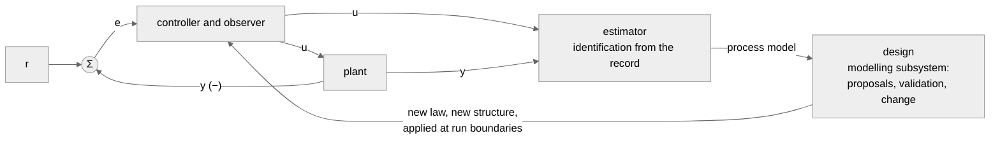

# The Coordinator as a control system: block diagrams (draft)

A first sketch for step 3, the control architecture (see [00-oracle.md](00-oracle.md) §3). Three diagrams, each in
the form a control textbook uses: the single loop with an observer, the cascade that separates time scales, and the
adaptive (self-tuning) structure in which the modelling subsystem sits. Notation: r reference, e error, u control
signal, d disturbance, y plant output, y_m measured output, x̂ estimated state. Signs on a summing junction are on
its inputs.

## 1. The loop with an observer

The Coordinator never sees the work itself. It sees measurements (tests, the record, reports) and keeps an estimate
of the state of the work, its **context**. Every decision is made on x̂, not on x. This is the standard
observer-based controller (Åström and Murray ch. 7–8; Franklin, Powell and Emami-Naeini ch. 7): the controller
acts on the estimate, and the observer corrects the estimate with each measurement. Managing context is designing
the observer.

What the diagram says, in the field's terms:

- **The observer runs open loop between measurements.** Its uncertainty grows with time since the last reading
  (the Kalman picture). A Coordinator that acts on a stale x̂ is a controller acting on an estimate whose covariance
  has grown: the reference mode where state checks were skipped, and the parity benchmark's weakest kind of
  question (the state of the work).
- **Compaction is reduced-order estimation.** The window cannot hold the full state, so x̂ is projected onto fewer
  dimensions. What is dropped is chosen by the compactor, not by what the controller will need.
- **Durable knowledge is a second, slower state.** It has a slow write (externalising) and a read (retrieval, the
  context recipes) that re-initialises the observer when a session starts.
- **The observer is fed a copy of u.** It predicts the effect of its own commands before the measurement arrives.
  This is how the harness "knows what it just asked for".
- **The separation principle applies:** design the observer and the controller separately. Most of what an
  orchestrator lacks is on the observer side.

## 2. Cascade: separating time scales

The owner, the Coordinator and the workers are nested loops at different speeds. The outer loop's output is the
inner loop's reference. Time-scale separation (the inner loop several times faster than the outer) is the textbook
condition for cascade control to work (Seborg et al.; Skogestad ch. 10), and it is why a Coordinator does not
retarget a subagent mid-run (see [parity 01](../parity/01-revising-goals.md)).

The innermost loop, C3, is inside an AI block and is not ergostat's to design: that block has its own harness.
ergostat is C2, and the interface to C1.

## 3. The modelling subsystem as adaptive control

When the controller or observer itself is wrong, a slower loop re-estimates the plant and redesigns them. This is
the self-tuning regulator (Åström and Wittenmark, *Adaptive Control*, ch. 3, 5): an estimator identifies the
process from u and y, and a design block computes new controller (and observer) settings. ergostat's modelling
subsystem is this outer loop. Its job is identification plus redesign, at a rate slower than the loops it adjusts,
so the loops stay stable while their law changes (see [parity 00](../parity/00-modeling-review.md) for how far
today's implementation is from it).

## Open for step 3

- Which measurements make the work observable at all, and which state stays unobservable (a worker's intent, a
  bug not yet hit).
- The observer's design: what x̂ holds, how often each part is re-measured (sampling), what is kept on compaction,
  what is externalised and when.
- Pairing: which actuators (dispatch, brief content, review depth, merge, the owner's attention) move which
  controlled variables.
- Modes and protection layers (ISA-88, IEC 61511), drawn as supervisory logic around these loops.
