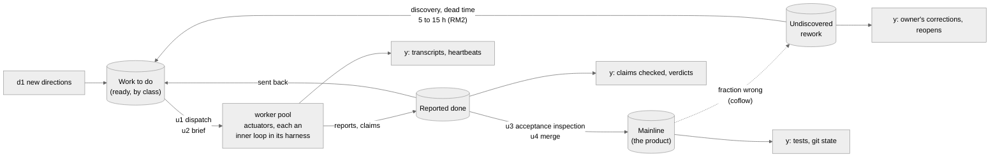
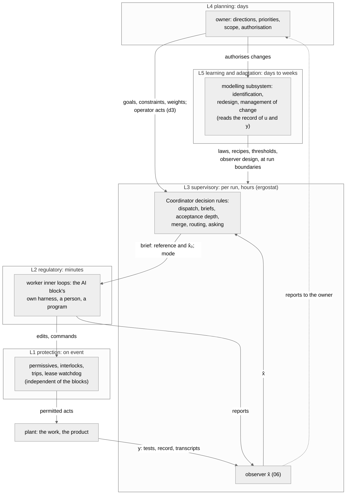

# 05. The plant, its variables and the control hierarchy

Status: control-engineering steps 1 to 3 of [00-oracle.md](00-oracle.md) (§3.1 the plant, §3.2 objectives and
constraints, §3.3 the hierarchy), 2026-11-17. The first half of the control architecture; the observer is
[06-observer.md](06-observer.md); pairing, loop sheets, modes and protection follow. It takes the boundary,
stocks and loops of [03-dynamic-hypothesis.md](03-dynamic-hypothesis.md), the record of
[02-reference-modes.md](02-reference-modes.md) and the words of [01-terminology.md](01-terminology.md) as given.
Numbers marked *proposed* are starting values for the owner to confirm; numbers from the record cite their
reference mode.

## 1. The plant

### 1.1 What is controlled

The plant is three things together:

- **The work.** Items moving through their states (SPEC §5a): ready, in progress, reported done, accepted; and
  the hidden coflow of 03's rework cycle, in which part of what is reported done is wrong and sits as
  *Undiscovered rework* until something finds it (Ford and Sterman 1998).
- **The product.** The codebase on its mainline, its tests, any services it runs: what the work changes and the
  owner finally judges. The code stock (RM3) and the defects hidden in it live here.
- **The workers, as actuators with inner loops.** An AI session, a program or a person takes a brief and moves the
  work. An AI worker is not a final control element that goes where it is told: it is a closed loop of its own
  (edit, run, read, edit again) inside its harness, the secondary loop of a cascade, like a valve positioner inside
  a flow loop (01, **servo**). ergostat sets its reference (the brief) and reads its result (the report, the
  record); it does not design its law. The worker's harness, its window and its cuts are part of the actuator.

Not the plant: the Coordinator's estimate of all this (its context, 03 §3), which is the controller's own state,
designed in 06; and the owner, outside the plant in the four roles 01 keeps apart (source of requirements,
operator, change authority, sensor).

### 1.2 The boundary

03's boundary chart, read in control's roles. Nothing is brought in that 03 left out.

| 03 sector | Its stocks | Role in the control view |
|---|---|---|
| Work | Work to do, Work reported done, Undiscovered rework | **plant states** |
| Verification | Verification discipline | a **sensor** (tests, inspection) and an **MV** (review depth); the stock becomes structure, not memory |
| Coordination | fan-out, attention per agent | an **MV** (dispatch) and a **capacity** (the Coordinator's attention) |
| Learning | Standing rules | the **adaptive layer**'s state (§4) |
| Scope | proposals, pruning, the code stock | the **planning layer**, the owner's |
| Context | Working context, Durable knowledge, Context in briefs, Perceived state of the work | the **observer** (06) |

03's exogenous inputs are §2.3's disturbances. Its excluded column stays excluded: token cost (except as a budget,
§2.4), the organisation around the owner, the software's users, the owner's fatigue, the content of decisions.

### 1.3 The plant drawn

As Hellerstein et al. draw a computing plant: queues and servers, with where each MV acts (u) and each sensor
reads (y).

### 1.4 Its dynamics in brief

- **A long measurement dead time on quality.** What is wrong in landed work is seen only when something reads it:
  a median 4.9 h in ergostat and 14.5 h in orchestra_2, 29% and 9% within the hour, a tail of days (RM2). A
  quality loop closed only through later discovery is dead-time dominated, and no tuning makes it fast. The remedy
  is structural: a faster secondary measurement (inspection at acceptance) inside it, the textbook reason for a
  cascade (Seborg et al.).
- **Integrators.** Undiscovered rework, the code stock and the standing rules hold what flows in until something
  drains them: discovery, pruning (two weeks late, by the owner: RM3), and nothing (RM15).
- **A gain that moves with the operating point.** The share of landed work later redone is 0.3 to 0.66 in a
  direction's first hours and 0.02 to 0.05 later (RM1). Any fixed review depth is wrong at one end; the case for
  gain scheduling on the direction's age (Åström and Hägglund) is in the data.
- **Capacity limits and a relay.** Workers ran 1 to 3 at once, briefly 6 (RM6); the Coordinator is one serial
  thread; the owner was away for 2 to 8 h at a time (RM8). Each AI worker's window holds about a million tokens
  and is cut to about 6% in one step when nearly full (RM9): a relay at the actuator that ergostat does not set.
- **An actuator that sticks.** 7 of 41 workers fell silent for over 30 minutes; the 5 that never finished started
  in the longest absence and stood 34 to 164 minutes before anyone acted (RM6). Nothing measured their position.

Merge conflicts did not grow with concurrency (RM7); the interaction runs through hub files and is kept as a
measured disturbance.

## 2. The variable list

One row per variable (CE-1, CE-2). "Stock" is the stock of 03 the variable is or is read from. Sampling is on a
clock, on an event, or before an act.

### 2.1 Controlled variables (y)

| Tag | Controlled variable | Unit | Measured by | Sampling | Stock (03) |
|---|---|---|---|---|---|
| CV1 | Escaped rework: of the work accepted, the share later found not done as meant | fraction per kind, over a week | `ergostat.intent.false-done` (SPEC §12i); for code, lines replaced within a week of landing (02's trace) | on event; read daily | Undiscovered rework (its discovered outflow) |
| CV2 | Rework caught before landing: of the rework found, the share found at or before acceptance | fraction | sent-back and held verdicts against later reopens and replaced lines | on event; read daily | Undiscovered rework (its inflow avoided) |
| CV3 | Work waiting, by class | items | `items:` sensor on ready states | on event, every minute | Work to do |
| CV4 | Accepted throughput | items a day | `entering:` sensor on accepted states | on event; over a day | Work reported done (inflow) |
| CV5 | Age of the oldest unattended run: time since a running worker last showed progress | minutes | time since its last transcript line, item event or heartbeat | every minute, and on event | Perceived state of the work |
| CV6 | The owner's queue, and the age of its oldest item | items; hours | items held, unrouted or proposed (`measure: oldest`) | on event | (RM8's stock) |
| CV7 | Corrections per owner message within a direction; repeats across sessions | per message; per week | `ergostat.correction` items, `correction.repeated` | on event; per direction | Standing rules (the learning loop's error) |

CV1 and CV2 read one hidden stock from its two sides, and neither reads it directly (§5). CV5 replaces "the
Coordinator noticed" with a measured age, which RM6 lacked.

### 2.2 Manipulated variables (u)

| Tag | Manipulated variable | Range | When it moves | What it moves (03) | Purpose (CE-3) |
|---|---|---|---|---|---|
| u1 | **Dispatch and fan-out**: which ready item starts next, where, and how many run at once | 0 to the pool's `at-once` (1 to 6 in the record) | at a free slot; never mid-run | work rate (B1, B2); attention per agent (R3) | throughput without stalls |
| u2 | **Brief content**: the control recipe rendered for the run (SPEC §12j) | parts and tokens (460 to 1,490 tokens: RM13) | at run start; held for the run | the worker's reference and initial estimate; quality (R10, B9) | quality; fewer repeated corrections |
| u3 | **Review and acceptance depth**: none, claims checked, tests re-run, acceptance inspection, deep review | five levels | when a run reports done | verification effort (B4, R2); the discovery delay | rework caught before landing |
| u4 | **Merge**: enable or hold the move onto the mainline, and its order | one at a time | when accepted | undiscovered rework's inflow (R1) | a sound mainline |
| u5 | **Retrieval and measurement**: what is re-read, re-checked or looked up before a decision | reads, checks | before an act; on event | the estimate (B7, B8) | a fresh x̂ (06) |
| u6 | **Externalising**: what is written to durable knowledge, and when | entries | on event; at run end | Durable knowledge (R9, B3) | knowledge that outlives a cut |
| u7 | **Asking the owner**: a question about intent, or a hold point for a release | interruptions | when intent is uncertain and a wrong act costly (parity 03) | the estimate of intent; the owner's queue | the right act first time |
| u8 | **Pausing work**: holding a run, a class or new dispatch (ISA-88's held state); stopping | running, held, stopped | at once (stop); next step (hold) | the work rate while a fault is open | protection, recovery |
| u9 | **The call on the owner's attention**: interrupt now, batch into a report, or defer | interruptions a day | on event, against a budget | the owner's queue; the owner's picture (06 §6) | the scarcest capacity spent where it pays |

u5, u6 and the asking half of u7 act on the observer, not the plant. They count among the degrees of freedom
(where and when to measure is a design variable, and under the dual effect measuring is part of acting: 03 §3),
but are designed in 06. u9 is the demand on the owner's attention, not the attention, which is a capacity (§2.4).

**Degrees of freedom.** Six MVs act on the plant (u1 to u4, u8, u7's release) against seven CVs, of which CV1 and
CV2 are two readings of one stock and CV7 belongs to the adaptive layer, which acts through the recipes rather
than the plant. Every MV has a purpose and every CV an MV that moves it; pairing is the next note's (§3.4 of 00).

### 2.3 Disturbance variables (d)

| Tag | Disturbance | Measured? | Enters at | Feedforward |
|---|---|---|---|---|
| d1 | **A new direction**: a step of new work, and a step fall in quality | the step, yes (the message); the fall in quality, no | Work to do; the quality fraction (RM1) | raise u3 and u2 for the direction's first hours, scheduled on its age |
| d2 | **The owner's availability** | yes: time since the owner's last act (the operating state) | the owner's queue's outflow | schedule u3, u7, u9 on it |
| d3 | **The owner's messages mid-work**: redirect, constraint, stop, question | yes: `ergostat.message` (§12h) | the reference of work in flight | route and deliver to the run (parity 04) |
| d4 | **A worker stalls or fails** | only as silence | the work rate | none; feedback on CV5 through a lease |
| d5 | **The mainline moves under a worker** | yes: git | the worker's estimate; hub-file conflicts (RM7) | message runs whose footprint overlaps (parity 14) |
| d6 | **A faulty measurement**: a flaky test, a hidden exit code, an overstated report | no, until a residual shows it | the sensors: CVs read biased | none; analytical redundancy (parity 16) |

Unmeasured and left to feedback: a change in the model behind the harness (d7, it moves the plant's gain), a cut
inside a worker's window (d8, half-visible as a summary line in its transcript), and defects already in the
product (d9).

### 2.4 Constraints

Written apart from setpoints because they are enforced apart: a hard constraint by a permissive, interlock or
trip (IEC 61511's words), a soft one by a penalty or an alarm against a budget.

| Tag | Constraint | Hard or soft | Enforced by | Bounds |
|---|---|---|---|---|
| H1 | No merge unless the tests' exit status was read and is zero, by a check independent of the worker | hard | permissive on u4 | Undiscovered rework's inflow |
| H2 | No outward or irreversible act (a push to a shared remote, a write to another system, a delete of what the work did not create) without its class pre-approved or the owner's release | hard | permissive, hold point (parity 05) | the losses |
| H3 | The owner's confirmed constraints that can be checked | hard | an interlock each (parity 12) | Work reported done |
| H4 | Spend within budget per run and per day | hard | trip | resources |
| H5 | Each AI worker's window, about a million tokens | hard, physical | the harness's cut, not ergostat's | the worker's working context |
| S1 | Interruptions of the owner within a budget (*proposed*: 4 a day, parity 09) | soft | alarm rationalisation; batching (u9) | the owner's queue |
| S2 | Runs in progress within a limit (*proposed*: 3 with the owner away, 6 present) | soft | limit on u1 | attention per agent |
| S3 | One run at a time on a hub file (RM7) | soft | interlock on a measured footprint (parity 14) | conflicts |
| S4 | One structural model change in flight per neighbourhood, applied at run boundaries | soft | management of change (parity 00, 01) | the model's state |

## 3. Control objectives: the functional specification

In priority order: when two conflict, the higher wins (CE-6). Hard constraints come before all of them and are
not objectives. A limit is held by zone control (01, **goal**).

| # | Objective | CV | Setpoint or limit (*proposed*) | Reference mode, from → hoped for (02 §4) |
|---|---|---|---|---|
| 1 | Little accepted work turns out not done as meant | CV1 | ≤ 0.1 per kind (image-squeeze's goal) | RM1 → (a): smaller spikes, gone in hours |
| 2 | Rework is caught before it lands | CV2 | ≥ 0.6, against 0.29 and 0.09 found within the hour today | RM2 → (b): discovery moved left, by checks, not the owner |
| 3 | A stalled run is noticed within a bound, owner or not | CV5 | ≤ 10 min (parity 06's lease) | RM6 → (e) |
| 4 | What waits for the owner stays bounded and drains | CV6 | oldest ≤ 1 day; interruptions within S1 | RM8 → (f) |
| 5 | Corrections fall within a direction and do not recur across sessions | CV7 | halving each day of a direction; repeats ≤ 1 a week | RM4 → (c) |
| 6 | Throughput | CV4 | maximised, subject to 1 to 5 | (why there are workers) |

H1 is how RM5 reaches (d), checking that cannot drift because it is structure, not memory. The context sector's
objectives (RM9 to RM15 → (g)) are the observer's, specified in 06 §8.

At the conflicts:

- **Throughput against quality.** Quality wins: review depth rises at a direction's start (d1's feedforward)
  though it slows the work. This reverses R2, haste makes waste, and must be structure, because under pressure
  checking is cut first (RM5; Abdel-Hamid and Madnick 1991).
- **The interruption budget against a hard constraint.** A hold point is never dropped to save an interruption.
  It waits, batched; work that does not depend on it goes on.
- **Stall recovery against the owner's attention.** A stalled run is requeued (u1, u8) without asking; the owner
  hears only if recovery fails (parity 06's dead-letter stock).

Scope (R5, B5; RM3) has no objective here: value is not in the record, and admitting and pruning work is the
owner's planning layer. That boundary is deliberate, and the first to revisit (§7).

## 4. The control hierarchy

### 4.1 Layers and time scales

Seborg et al.'s hierarchy of control activities (ch. 1), Skogestad's regulatory and supervisory layers (Skogestad
and Postlethwaite ch. 10), and protection beside the loops, not inside them (CE-7, CE-9).

| Layer | Does | Who | Sets in the layer below | Time scale (record) |
|---|---|---|---|---|
| L0 Measurement, actuation | tests, git, item events, transcript lines (read every 2 s), merges | programs | | seconds |
| L1 Protection, beside L2 to L4 | permissives on merge and outward acts, trips on spend, the lease watchdog | ergostat, program tier, outside the blocks it guards (CE-23) | breaks a loop; never sets a reference | seconds, on event |
| L2 Regulatory | edit, run, read, edit again; its own window and cuts | **the AI block's own harness**, a person, a program | its own tool calls | minutes: a test run every 6 minutes early in the session (RM5) |
| L3 Supervisory | dispatch, briefs, acceptance depth, merge order, routing, asking | **ergostat** | the brief (reference and initial estimate) and the mode (running, held) | per run: tens of minutes to hours |
| L4 Planning | directions, priorities, scope, authorising change | **the owner**; ergostat keeps the queues and displays | goals, constraints, priority weights | days: a direction's rework settles in 1 to 3 days (RM1) |
| L5 Learning and adaptation | identification and redesign of L1 to L4's laws: recipes, review thresholds, lease times, the observer | ergostat's modelling subsystem, the owner authorising (01) | new laws and parameters, at run boundaries | days to weeks: a standing rule a day (RM4b), documents revised at about a day (RM15) |

**Separation** (CE-8):

- **L2 to L3, about ten.** The inner loop cycles in minutes; its reference moves only at run boundaries. That is
  why a run is not retargeted mid-run (parity 01): a brief moved faster than the worker settles is a coupled
  loop, not a cascade.
- **L3 to L4, about ten when the owner plans, about one when the owner operates.** Present, the owner sent 24 to
  47 messages in six hours (RM4), inside L3's time scale. The owner is then an **operator**, and the separation
  holds only if those acts arrive typed and logged (CE-30) as d3, not as a re-plan.
- **L3 to L5, ten or more.** Changes to laws are batched daily and applied at run boundaries (parity 00, 15), so
  each loop settles under one law before the next, as an adaptive loop must (Åström and Wittenmark, *Adaptive
  Control*).
- **The violation.** The quality loop's measurement dead time (5 to 15 h) is longer than L3's period: through
  later discovery, L3 acts on quality several runs old. Hence the cascade of §1.4, a fast quality measurement
  inside L3 (u3), leaving the slow loop through the owner only what escapes it. Simon's near-decomposability
  (Simon 1962; Simon and Ando 1961) is the warrant for layers whose fast parts settle before the slow ones move;
  this is where the record shows they do not yet.

### 4.2 The control structure diagram

### 4.3 Where each party sits

- **ergostat** is L3 with its observer, L1 as program-tier checks that do not run inside the blocks they guard,
  the queues and displays that serve L4, and L5. In 04's cascade it is C2 and the interface to C1.
- **The owner** is L4 as planner and change authority, an operator across L3 when present, and a sensor of intent
  and of escaped rework, slow and valuable (RM10).
- **The AI block's own harness** is L2. ergostat treats it as an observed controller (01, **external**) whose
  closed-loop behaviour is identified from the record (how often its reports hold, how long it runs, how often it
  stalls). Its cut is its own; ergostat controls what it starts from (u2) and what reaches it while it runs (d3
  and d5, as messages).

## 5. Observability and controllability, in plain terms

Kalman's two questions (Kalman 1960; Åström and Murray, on state and output feedback): do the measurements
determine the state, and can the inputs move it? Read structurally, as Kalman's canonical decomposition sorts a
system into four parts. The plant is not linear; these are statements about which paths exist, not rank tests.

| | Observable | Not observable |
|---|---|---|
| **Controllable** | work waiting and in flight; the mainline and its tests (if the exit status is read); merges; the owner's queue | **Undiscovered rework**, moved by u2 and u3 and seen only when a sensor reads it; each worker's belief about the work, moved by the brief and seen only through reports and transcripts |
| **Not controllable** | the owner's presence and directions (d1, d2); the mainline moved by others (d5) | the value of what is built; intent the owner never said; the model's abilities; the relevance of what a worker holds |

- **The system is not detectable today.** Undiscovered rework is unobservable until read and does not decay: it
  integrates (R1). Such a mode cannot be tracked by any estimator (Anderson and Moore 1979), so a sensor must be
  added, not a better estimator: acceptance inspection, claims re-checked, exit statuses read (H1). Each reads the
  hidden stock as work lands, in minutes instead of the owner's hours.
- **The owner's intent is observable at a low rate.** Its sensor is the owner's words: 2.5% of what entered the
  window (RM10), carrying most of what matters (0.94 on the parity benchmark). Asking (u7) raises the rate at the
  cost of S1. Intent never said is a disturbance to tolerate, not a state to estimate.
- **A worker's progress is observable if something reads it.** Transcripts stream in as events (SPEC §5a); RM6 was
  a sampling failure, not an observability one. CV5 samples it.
- **Standing rules cannot be moved down.** The stock has no outflow (RM15): no actuator retires a rule, so it
  grows without bound towards a stock nobody reads (03, B3). 06 §4.4 adds the actuator.
- **Relevance stays unobserved** (03). 06 measures instead what can be: the estimate's error by kind and by the
  age of the fact.

## 6. Checklist (00-oracle §6)

- **Done:** CE-1 (§2), CE-2 (§2.3), CE-3 (§2.2), CE-4 (§3, numbers *proposed*), CE-5 (§2.4, §3), CE-6 (§3),
  CE-7 and CE-8 (§4.1, with the quality loop's dead time as the stated violation), CE-9 (by design, §4.1), SD-6
  (§1.2).
- **Partly:** CE-12 (CV1 and CV2 read a hidden stock; 06 gives the estimator); ST-2 (§4.2 shows the layers; each
  control action and feedback path comes with the unsafe control actions table).
- **Open:** CE-10 and CE-11 (pairing, the next note); HU-1 (the level of automation per function, with the mode
  table).

## 7. Open questions for the owner

1. **The numbers in §3**: escaped rework ≤ 0.1 per kind, ≥ 60% caught before landing, stalls seen within 10
   minutes, the owner's oldest item under a day, 4 interruptions a day. Right order of magnitude? And quality
   always before throughput?
2. **Scope.** Should ergostat hold a limit on the code stock's growth against something measured (complexity,
   unused code, as parity 15 proposes), or leave admitting and pruning to you?
3. **You as operator.** When present you act inside L3's time scale. Should those acts be typed (stop, hold,
   override, setpoint) so they can be counted, or stay free text a classifier types afterwards (parity 04, 11)?
4. **H3, hard or soft.** Is work against a checkable constraint held until you release it, or landed with the
   breach raised?
5. **The worker's harness.** Should ergostat ever set its parameters (model, tools, when it cuts), or only its
   brief and its messages?

## Sources

- Abdel-Hamid, T. and Madnick, S. (1991). *Software Project Dynamics*. Prentice Hall.
- Anderson, B. D. O. and Moore, J. B. (1979). *Optimal Filtering*. Prentice Hall.
- Åström, K. J. and Hägglund, T. (2006). *Advanced PID Control*. ISA.
- Åström, K. J. and Murray, R. M. *Feedback Systems* (2nd ed.). Princeton University Press.
- Åström, K. J. and Wittenmark, B. *Adaptive Control* (2nd ed.). Addison-Wesley.
- Ford, D. N. and Sterman, J. D. (1998). Dynamic modeling of product development processes. *System Dynamics
  Review* 14(1).
- Hellerstein, J. L., Diao, Y., Parekh, S. and Tilbury, D. M. (2004). *Feedback Control of Computing Systems*.
  Wiley.
- Kalman, R. E. (1960). On the general theory of control systems. *Proceedings of the First IFAC Congress*.
- Seborg, D. E., Edgar, T. F., Mellichamp, D. A. and Doyle, F. J. *Process Dynamics and Control*, ch. 1. Wiley.
- Simon, H. A. (1962). The architecture of complexity. *Proceedings of the American Philosophical Society*
  106(6).
- Simon, H. A. and Ando, A. (1961). Aggregation of variables in dynamic systems. *Econometrica* 29(2).
- Skogestad, S. and Postlethwaite, I. *Multivariable Feedback Control*, ch. 10. Wiley.

To check before quoting: the chapter numbers of Åström and Murray's state and output feedback in the edition
cited (04 cites ch. 7 to 8); Seborg et al.'s ch. 1 for the hierarchy (00-oracle §7).
