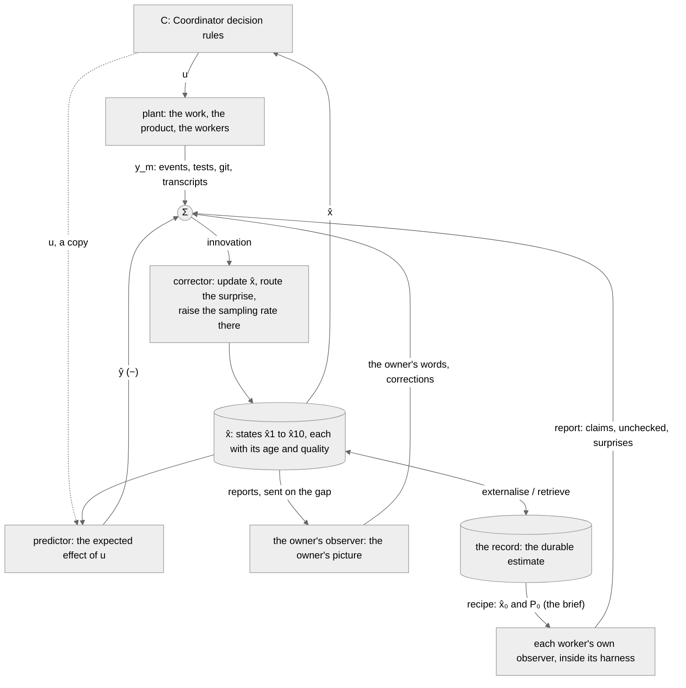
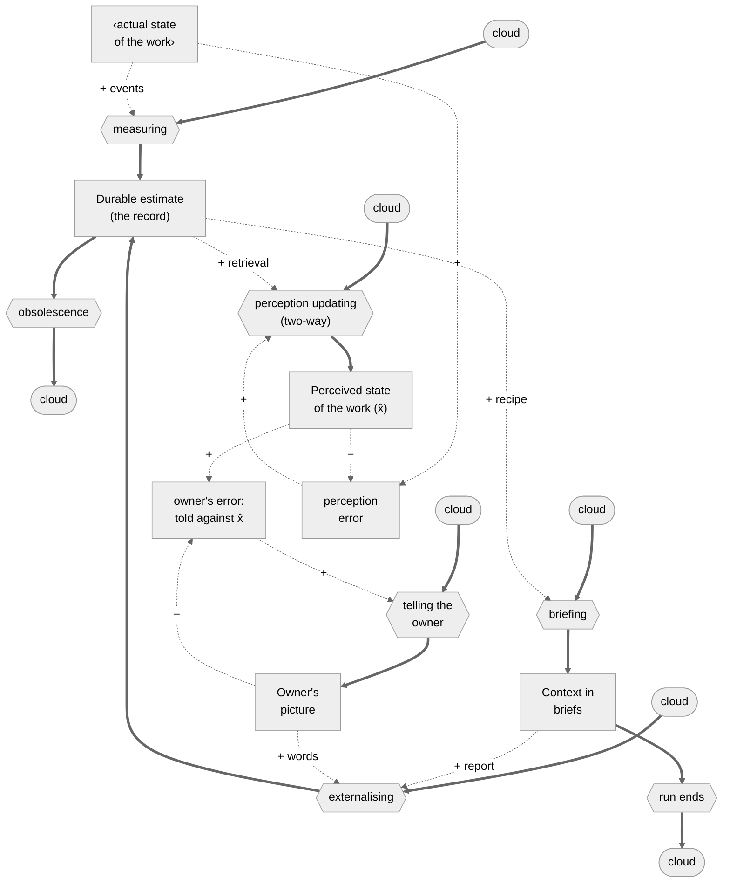

# 06. The observer: the Coordinator's context, designed as a state estimator

Status: the first half of the separation principle for the Coordinator, 2026-11-17. It designs the observer of
[04-block-diagram.md](04-block-diagram.md) §1 for the plant of [05-plant-and-hierarchy.md](05-plant-and-hierarchy.md),
from the context sector of [03-dynamic-hypothesis.md](03-dynamic-hypothesis.md) §3 and its reference modes RM9 to
RM15 ([02-reference-modes.md](02-reference-modes.md)). The controller half (the decision rules that read x̂) is
the pairing and loop sheets that follow.

## 1. Why the observer is designed apart

The Coordinator never acts on the work; it acts on its estimate of the work, x̂, which an observer keeps from
measurements and from a copy of its own commands (Luenberger 1964; Kalman 1960; Franklin, Powell and
Emami-Naeini ch. 7; Åström and Murray, on output feedback). In SD terms every decision reads perceived values,
which are stocks behind information delays (Sterman ch. 11), filtered by what reaches the decision maker
(Morecroft 1983) and limited by attention more than by information (Simon 1971; Sterman ch. 15). Both disciplines
say the same thing: the quality of a decision is bounded by the quality of the picture it reads.

The separation principle (Wonham 1968) licenses designing the observer apart from the decision rules. It is a
theorem only for linear-Gaussian plants, so it is used here as an engineering habit, with 03 §3's caution about
the dual effect: choosing what to measure (05's u5, u7) is specified here, as the observer's sampling policy.

One fact shapes the design. A harness keeps its estimate in a window and cuts it when full (RM9). ergostat
keeps every measurement in **the record** (historian and event log, 01) and folds items from it (SPEC §5a). Its
durable estimate is never cut; a **working estimate** is a projection of the record rendered for one decision (a
brief, a report, a page). Compaction happens only where a projection meets a budget (§4.2), and inside each
worker's window, which is the worker's (05 §4.3).

## 2. What x̂ holds

Named states, each tied to a stock of 03's context sector, ranked by how many of 05's decision rules read it.
The kind column is the parity benchmark's category of question that tests the state (§8).

| State | Holds | Stock (03 §3) | Read by (05) | Benchmark kind |
|---|---|---|---|---|
| x̂1 **Work in flight** | each run: item, worker, brief, start, last progress, footprint, expected end | Perceived state of the work | u1, u8; CV5 | state |
| x̂2 **Each item's state** | state, fields, history; acceptance criteria; verdicts | Perceived state of the work | u1, u3, u4 | state |
| x̂3 **The mainline** | head, what moved since, test status as read | Perceived state of the work | u4 (H1); d5 | state |
| x̂4 **Hidden rework** | per item and area, the undiscovered rework expected | Undiscovered rework, estimated | u3; CV1, CV2 | not asked yet |
| x̂5 **The owner's intent** | directions and asks in the owner's words, acceptance criteria, priorities | Working context; Durable knowledge | u1, u2, u7 | meaning |
| x̂6 **Decisions and constraints** | decisions with reasons and rejected alternatives; corrections by kind of work | Durable knowledge (Standing rules) | u2, u3; L1 | decisions, rejections |
| x̂7 **The owner's state** | present or away; the queue; **what the owner was told**, and when | RM8's queue | u7, u9 | not asked yet |
| x̂8 **Each worker's estimate**, as believed | its brief, messages delivered since, what moved since its start | Context in subagent briefs | d3, d5; u8 | state |
| x̂9 **Questions and surprises** | unexplained innovations; pending experiments (parity 07) | Working context | u5, u7 | not asked yet |
| x̂10 **The model's own state** | version, changes under test, laws in force, the version each run was briefed under | Durable knowledge | L5; u2 | not asked yet |

x̂4 runs open loop between checks, since undiscovered rework is unobservable until read (05 §5): from the
kind's quality fraction, the direction's age (RM1) and the checks each item passed. It is parity 16's design A,
and it lets u3 put review where hidden rework is likely, not evenly.

## 3. Measurement, prediction and staleness, per state

### 3.1 Three ways to sample

Each state is re-measured on one or more of three triggers, in this order of preference:

- **On an event** (event-triggered, or Lebesgue, sampling: Åström and Bernhardsson 2002): an item event, a
  transcript line, a merge, a message, as the record already delivers them. Cheap and fresh, and blind to what
  stops happening.
- **On a clock**, only where no event will come: a silent run produces none, so CV5 needs a heartbeat and a lease
  (parity 06, 14), sampled several times per time to be noticed (Åström and Wittenmark, *Computer-Controlled
  Systems*): every minute or two for a 10-minute bound.
- **Before acting**, at the actuator: the permissive reads the state at the moment of the act (parity 08 design
  A). RM11 shows the session doing this for its own acts (a median 0 minutes before) and not for agents it was not
  about to act on (RM6). ergostat makes the first structural and adds the clock for the second.

### 3.2 The table

Prediction is the copy of u (04 §1): an act moves the estimate to what it should produce, and the next
measurement is compared with that; the difference is the **innovation**. Staleness: for a state that changes at
rate λ (changes an hour, measured from the record for its kind), an estimate of age a is still right with
probability about e^(−λa), the discrete counterpart of the Kalman filter's covariance growing by the process noise
between measurements (Kalman 1960; Anderson and Moore 1979). The age is the age of the information, not of the
last look (Kaul, Yates and Gruteser 2012).

| State | Measured by | Sampling | Prediction (copy of u) | Goes stale | Shown as |
|---|---|---|---|---|---|
| x̂1 in flight | run events, transcript lines, heartbeats | event; clock, 1 to 2 min | dispatch: *running*, progress within the lease | past the lease (*proposed* 10 min silent) | age since last progress |
| x̂2 items | item events | event | each act: the item's next state | at its kind's rate | state, as of its last event |
| x̂3 mainline | git, exit statuses | event; before every merge | a merge: new head, tests green | in minutes (3.7 commits an hour in ergostat, 02): re-read before acting | head and tests, with age |
| x̂4 hidden rework | checks, verdicts, reopens, corrections | event | acceptance: none escaped, at the kind's prior | with time since the last check | expected escapes per area; what was not checked |
| x̂5 intent | the owner's messages; u7 | event | dispatch: the work matches the intent as read | at a new direction (d1) | latest words, verbatim, dated |
| x̂6 decisions | decision and correction items | event | none: only the owner moves them | by event, not age (§4.4) | proposed or confirmed |
| x̂7 the owner | last act; the queue; what was told | event; clock for absence | a report: the owner's picture matches | absent after 2 h (02) | present or away; told against true (§6) |
| x̂8 a worker's x̂ | its brief, deliveries, transcript | event | a delivery: the worker has it | as x̂2 and x̂3 move under it (d5) | what moved since its brief |
| x̂9 surprises | innovations; experiment items | event | an experiment: an answer by a time | unanswered past its time | open, with age |
| x̂10 the model | model-change items | event | an accepted change: in force at the next run | never, between changes | the version each run was briefed under |

### 3.3 What an innovation does

A measurement that matches its prediction moves nothing and is not shown (grey by default, ISA-101). A surprise
is routed (parity 08 design C) either to the item (the act went wrong: diagnosis, parity 06) or to the observer
(the picture is wrong: a sensor that hides its result, a rate set too low). Either way sampling on that
neighbourhood rises for a while. This is the discipline RM5 showed decaying, made a gain schedule instead of a
memory.

### 3.4 How uncertainty is shown

Every value given to a decision rule, a brief or the owner carries its **age** (as of when, from which source)
and its **quality**: good, uncertain or bad, OPC UA's status classes (parity 16, design D). Uncertain is past the
state's staleness threshold, or proposed and not confirmed; bad is from a sensor known faulty (a contradicted
claim, a hidden exit status). Colour is kept for these. A rule that needs a good value and holds an uncertain one
re-measures first, or says so in what it writes.

## 4. The working and the durable estimate

### 4.1 What is externalised, and when

In ergostat every measurement is externalised by construction, as an event. What is not is **interpretation**:
what the owner meant, why, what was rejected; what documentation and memory lack (RM12) and what scored best
after the owner's own words. Externalising (05's u6) is writing interpretation, triggered by events rather than
left to pressure (R9's trap):

- **each owner message**: the extractor proposes the decisions and corrections in it (SPEC §5a);
- **each run's end**: the report's candidate decisions, its surprises, and what it did not check (§5);
- **each cut inside a worker** (d8): the summary line its transcript records, kept on the session item;
- **each surprise explained** (§3.3): the explanation, as a correction or a proposed model change.

RM8 and RM15 showed the best store waiting for the owner (45 decisions and 30 corrections, none confirmed). The
design separates **estimation from enforcement**. Proposed items enter the estimate at once, marked uncertain,
because an uncertain fact beats none (the proposed decisions alone scored 0.49, nothing 0.03). Only confirmed
items are enforced, by the acceptance inspection (SPEC §12i) and interlocks (parity 12). Confirmation lowers
uncertainty; it no longer gates use.

### 4.2 What a projection keeps: reduced-order estimation

Every brief, report and page projects the estimate onto a budget. Model reduction has a criterion: balanced
truncation keeps the states most observable and controllable (Moore 1981). Its counterpart here: **keep what
cannot be re-measured; re-measure what can.** Files, the mainline, an item's state are cheap to read again (57% of
reads were re-reads: RM11). The owner's words, a reason, a rejected alternative, a failed attempt cannot be
recovered from the plant; lost, they cost the owner's attention. The rank, first kept to first dropped:

1. the owner's words on the topic, verbatim (0.94 on the benchmark; 2.5% of the inflow: RM10);
2. decisions with their rejected alternatives, and corrections for the kind of work (0.83 and 0.88 by kind);
3. commitments in flight: what was asked of whom, with its acceptance criteria (the copies of u);
4. open questions and unexplained surprises (x̂9);
5. state in flight on the item's neighbourhood: what is running, what moved, the owner's latest ask (state:
   0.5 today, the weakest kind);
6. item history, summarised;
7. file and code contents: dropped, and re-read before acting.

Two consequences follow from RM12. **No budget drops by age**: the budgeted recipes fell to 0.15 on facts over 30
hours old while the decisions given whole held at 0.45 at every age, so relevance to the scope orders a part, not
recency. And **whatever does not fit leaves a pointer**, a one-line index entry with its id, as `ergostat context
decisions` already does: the worker can retrieve what was dropped, and the dropped part stays observable.

### 4.3 Retrieval as initialisation

A worker starts from nothing but its brief: the initial estimate x̂₀ and its covariance P₀, what is known and
how well. A thin brief is a large P₀ (R10). Retrieval is observer initialisation, and the context recipes (SPEC
§12j) are its design, a master recipe per kind of work rendered into a control recipe per run (01). Each part
initialises named states: `owner-words` x̂5, `decisions` and `corrections` x̂6, `item-history` x̂2, `state` x̂1,
x̂3 and x̂8, `model` x̂10. Two changes follow from the benchmark: `state` must carry what is in flight on the item's neighbourhood and the
owner's latest ask, not only commits; and every part carries age and quality (§3.4), so the worker starts
knowing what is uncertain. Retrieval during a run is a measurement update to the worker's estimate, by message
(SPEC §12h).

### 4.4 Obsolescence and retirement

RM15: documentation is revised within a day, the memory folder only fills, and a stock that only fills stops
being read (03). The outflow should be by **event, not age**. Recursive estimators forget exponentially to track a
changing plant (Åström and Wittenmark, *Adaptive Control*), but RM12 shows the cost here: old decisions were still
true. An entry becomes obsolete when:

- **it is superseded**: a decision by a later one, with a reason (exists, owner only);
- **what it is about is gone**: the parts, files or kinds in its scope were removed (a pruning, RM3), raised for
  retirement;
- **it is absorbed**: a correction compiled into a check that has since held (parity 13), retired automatically;
- **it goes dormant**: not retrieved, matched or held to across several directions, raised for review.

Each moves the entry out of what is rendered by default, never out of the record. The stock's measure is its age
distribution against how much of it was read in the last week.

## 5. The handoff: brief down, report up

RM13: each handoff compresses by two to three orders of magnitude. What matters is what survives it. The brief is
the inner loop's reference and x̂₀; the report is its measurement coming back, from a sensor that is the actuator
itself and so biased until checked (parity 16).

| A brief carries (the estimate sent down) | A report carries (the measurement sent up) |
|---|---|
| the work order: what, and its acceptance criteria in the owner's words | each claim, with the check that would verify it (SPEC §12g) |
| the owner's words on the topic, verbatim | what changed: the commit or branch, the files |
| decisions and corrections in scope, with what was rejected | what was **not** checked, said plainly |
| what is in flight on the neighbourhood: other runs, their footprints, what moved on the mainline | surprises: what did not go as the brief predicted |
| known unknowns: open questions, uncertain facts, marked | candidate interpretation: decisions or corrections the worker inferred, as proposals |
| how to report (the lines above), and how messages will reach it | where it stopped: committed or not, what is left |

The report is never taken as the state: claims are re-checked (hardware redundancy, in FDI's terms), finished
work is inspected (SPEC §12i), and the transcript is a wider channel read when an innovation says to. What the
report adds that the record cannot is the third and fifth rows on the right: the worker's uncertainty and
interpretation, which otherwise die with its window.

## 6. The owner's estimate

For the owner, the reports are the state (parity 11, 16). The owner's picture is a second observer cascaded on
the first: fed by what it is told and what the owner looks at, its error is at least the Coordinator's plus what
reports drop (03 §5). It also produces the most valuable measurement, the owner's words (RM10), and cannot be
re-measured on demand while the owner is away (RM8). Three choices follow.

- **ergostat models the owner's estimate.** x̂7 keeps what the owner was told about each item, and when. The gap
  between what was told and the current x̂ is the owner's estimation error, which ergostat can compute and the
  owner cannot.
- **Reports are sent on that gap, not on a clock** (send-on-delta, the event-triggered sampling of §3.1): the owner
  is told when the gap crosses what would change an owner's decision (work the owner believes done that was
  reopened; a constraint at risk; a decision needed), within the interruption budget (05, S1); the rest is
  batched into the handover report (01, **ledger**). Each sentence cites its reading, with its age and quality
  (§3.4), so the owner's picture inherits the uncertainty instead of hiding it.
- **The owner's estimate is measured.** Its error shows when the owner asks about something already known
  (parity 09's measure), reopens accepted work (CV1), or corrects a belief the Coordinator had reported (a
  correction naming a report). These are the owner's innovations, and the reporter's error signal.

## 7. Drawn in both views

**The control view**: the observer of 04 §1, opened up. The predictor is fed a copy of u; the innovation is the
measurement against the prediction; the corrector updates x̂ and routes the surprise. The worker's observer is
initialised from the record by a recipe; the owner's is cascaded on x̂ and fed back through the owner's words.

**The SD view**: the context sector's stocks and flows as ergostat's Dynamics view would draw them, with every
flow's valve on its pipe (hexagons), clouds at the boundary, and information links dashed with their polarity.
Retrieval and briefing are information links, because information is copied, not drained (03 §3). Perception
updating is a two-way flow driven by the perception error (Sterman ch. 11's adaptive expectations); the owner's
picture has the same structure, driven by the gap between what the owner was told and x̂ (§6).

## 8. How parity is measured

The observer is judged as estimators are: by its error against the truth, by kind of state, and by whether its
stated uncertainty is honest.

- **The parity benchmark, by kind and by age of the fact.** RM12's table is the observer's error curve, split
  by the benchmark's kinds (decisions, rejected alternatives, meaning, state, corrections on tasks). Parity is
  the owner's whole messages' curve, flat at 0.9 to 1.0, reached by a recipe within its budget. *Proposed* targets: no age band below 80% of the youngest
  band (today 0.15 against 0.85); state at 0.8 or above (0.5 today); meaning at 0.7 (0.35 today). The dataset
  needs questions about x̂4, x̂7 and x̂9, which it does not yet ask.
- **Re-reads**, from each worker's transcript (02's definitions): a good brief lowers the burst after a cut, not
  the steady re-reading before acts (§3.1's third trigger).
- **Stale actions.** Acts whose permissive found the state changed since the estimate the act was planned on (the
  permissive's stale flow, parity 08); messages that arrived after the run they were for had ended
  (`ergostat.message.missed`); runs briefed under a model version superseded before they started.
- **Calibration.** A consistent filter's innovations match its stated uncertainty (Bar-Shalom, Li and
  Kirubarajan 2001): here, values shown good are nearly always right, and those shown uncertain wrong often enough
  to justify the re-read.
- **The owner's estimate** (§6): asked-already-known, reopened accepted work, corrections of reported beliefs.

## 9. What each choice addresses

| Design choice | Reference modes | Parity gaps |
|---|---|---|
| The durable estimate is the record, never cut; working estimates are projections (§1) | RM9, RM12 (no session forgetting curve to suffer) | 12 coherence, 13 learning |
| Three sampling triggers; the clock where no event comes (§3.1) | RM6, RM11 | 6 diagnosing, 8 state, 9 attention, 14 concurrency |
| A prediction with every act; innovations route surprises and raise sampling (§3.2, §3.3) | RM5, RM14 | 7 experiments, 8 state, 16 reporting |
| Age and quality on every value (§3.4) | RM11, RM12 | 8 state, 11 translating, 16 reporting |
| Interpretation externalised on events; proposed items used, marked (§4.1) | RM8, RM15 | 3 intent, 12 coherence, 13 learning |
| Keep what cannot be re-measured; no budget by age; pointers for the rest (§4.2) | RM10, RM11, RM12 | 12 coherence, 13 learning |
| The brief as x̂₀ and P₀, with state in flight and known unknowns (§4.3, §5) | RM13 | 1 revising goals, 10 delegation, 4 disruptions |
| Obsolescence by event (§4.4) | RM15, RM4b | 12 coherence, 13 learning |
| Reports as biased measurements, re-checked (§5) | RM13 | 2 knowing when done, 10 delegation, 16 reporting |
| The owner's estimate modelled, reported on the gap (§6) | RM8, RM10 | 9 attention, 11 translating, 16 reporting |

Gaps 5 (risk) and 15 (prioritisation) are the observer's customers: a permissive's risk reading is only as good
as x̂'s staleness (parity 05), and the dispatcher reads x̂4 and x̂5.

## 10. What ergostat has, and what is new

**It exists.** The record (SPEC §4b); items with field history and time travel (§5a): x̂2 with its age;
transcripts as events (§5a): the channel for x̂1 and x̂8; messages delivered to running work (§12h): the update to a
worker's estimate; decisions and corrections in the owner's words (§5a): x̂6; context recipes with outcomes per
version (§12j): the initialisation; claims (§12g) and the acceptance inspection (§12i): the report's validation;
`measure: oldest`; roll-up (§4b), a reduced-order durable estimate that keeps the fold exactly.

**It is new.**

1. Age and quality on every value a recipe, report or page gives (§3.4), and each state's staleness rate,
   measured from the record.
2. The prediction recorded with each act, and the innovation monitor over it (parity 08 design C).
3. The clock where no event comes: leases and heartbeats on runs (parity 06, 14), for x̂1.
4. The `state` part carrying what is in flight on the neighbourhood and the owner's latest ask; recipes ordered by
   relevance, not age, leaving pointers for what does not fit (§4.2).
5. Proposed items rendered, marked uncertain, in recipes; confirmed only for enforcement (§4.1).
6. The report convention of §5 (unchecked, surprises, candidate interpretation) in the recipe's instructions.
7. The told record and reports sent on the gap (§6).
8. Obsolescence events on durable items: retirement raised when a scope is gone, automatic on absorption,
   dormancy flagged (§4.4).
9. The benchmark extended by age band, by kind, and to x̂4, x̂7 and x̂9 (§8).

No new page or panel: ages and quality go on values already shown.

## 11. Checklist and open questions

**Checklist.** CE-12 (every CV observable, or estimated with a stated estimator): done for the states of §2; x̂4
is the estimator of CV1 and CV2's hidden stock. ST-4 (each controller's process model named, and what happens
when it is wrong): done for the Coordinator (§2, §3.3) and the owner (§6); each worker's is identified, not
designed (05 §4.3). SD-10 (the Baker criterion): every decision rule reads x̂, with its age, and re-measures before
acting. AV-3 (every attenuator measured for what it drops): recipes by the benchmark's age bands, reports by
claims re-checked, the owner's reports by §6's measures. CE-14 (sampling justified): §3.1 to §3.2, with the
periods *proposed*.

**Open questions for the owner.**

1. **Proposed before confirmed.** Should briefs carry proposed decisions and corrections, marked uncertain, rather
   than wait for your confirmation (§4.1)? It drains RM8's queue for estimation, at the risk of a worker following
   a misread decision.
2. **Retirement.** May ergostat retire a correction on its own once a check that absorbed it has held, and flag
   dormant entries for you, or must every retirement be yours (§4.4)?
3. **Reports on the gap.** Is "what you were told no longer matches what is true, and it would change a decision
   of yours" the right trigger to interrupt you, within the budget (§6)?
4. **The worker's report.** May the recipe require of every worker the report of §5 (unchecked, surprises,
   candidate decisions), at a cost in tokens on every run?
5. **Benchmark spend.** Extending the parity benchmark by age band and to x̂4, x̂7 and x̂9 costs AI runs; at what
   budget, and how often?

## Sources

- Anderson, B. D. O. and Moore, J. B. (1979). *Optimal Filtering*. Prentice Hall.
- Åström, K. J. and Bernhardsson, B. (2002). Comparison of Riemann and Lebesgue sampling for first order
  stochastic systems. *Proceedings of the 41st IEEE Conference on Decision and Control*.
- Åström, K. J. and Murray, R. M. *Feedback Systems* (2nd ed.). Princeton University Press.
- Åström, K. J. and Wittenmark, B. *Computer-Controlled Systems*, and *Adaptive Control*. Prentice Hall and
  Addison-Wesley.
- Bar-Shalom, Y., Li, X. R. and Kirubarajan, T. (2001). *Estimation with Applications to Tracking and
  Navigation*. Wiley.
- Franklin, G. F., Powell, J. D. and Emami-Naeini, A. *Feedback Control of Dynamic Systems*, ch. 7. Pearson.
- Kalman, R. E. (1960). A new approach to linear filtering and prediction problems. *Journal of Basic
  Engineering* 82(1).
- Kaul, S., Yates, R. and Gruteser, M. (2012). Real-time status: how often should one update? *Proceedings of IEEE
  INFOCOM*.
- Luenberger, D. G. (1964). Observing the state of a linear system. *IEEE Transactions on Military Electronics*
  8(2).
- Moore, B. C. (1981). Principal component analysis in linear systems: controllability, observability, and model
  reduction. *IEEE Transactions on Automatic Control* 26(1).
- Morecroft, J. D. W. (1983). System dynamics: portraying bounded rationality. *Omega* 11(2).
- Simon, H. A. (1971). Designing organizations for an information-rich world. In Greenberger (ed.), *Computers,
  Communications, and the Public Interest*. Johns Hopkins Press.
- Sterman, J. D. (2000). *Business Dynamics*, ch. 11 and 15. McGraw-Hill.
- Wonham, W. M. (1968). On the separation theorem of stochastic control. *SIAM Journal on Control* 6(2).

To check before quoting: the chapter of Åström and Murray on output feedback (04 cites ch. 7 to 8); Franklin et
al.'s ch. 7 (state-space design) in the edition used; the venue details of Åström and Bernhardsson (2002) and
Kaul, Yates and Gruteser (2012).
