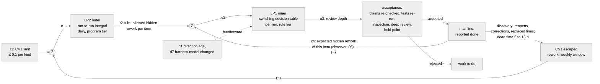
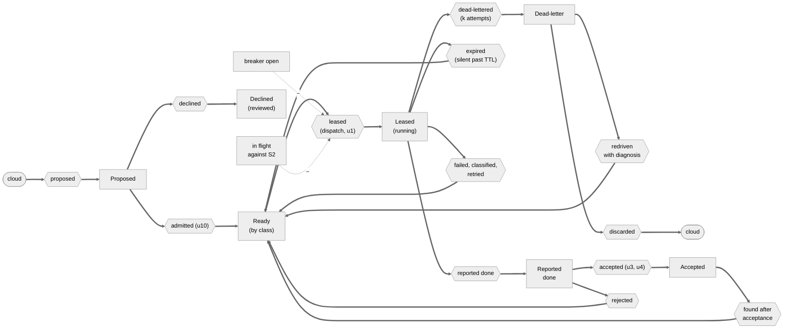

# 07. Pairing and loop design

Status: control-engineering steps 4 and 5 of [00-oracle.md](00-oracle.md) (§3.4, §3.5), 2026-11-17: the
controller half of the separation principle, after the observer of [06-observer.md](06-observer.md). It pairs the
variables of [05-plant-and-hierarchy.md](05-plant-and-hierarchy.md) and writes one loop sheet per loop, in the words
of [01-terminology.md](01-terminology.md), taking the parity notes' designs ([../parity/](../parity/)) where they fit.
Numbers marked *proposed* are defaults ([10-adaptation-and-change.md](10-adaptation-and-change.md) tunes them).

**The owner's answers to 05 and 06** (2026-11-17), built in here: every target is a configurable default, and
thresholds and timeouts are configured **per tier** (rule, program, narrow AI, AI agent, person). A stall is per
run: no event caused by the run for longer than its tier's lease TTL. The owner neither admits nor prunes work:
the plant is a factory that balances on its resource levels, and the owner's one lever on throughput is the cap on
each worker pool. Code growth is held as a ratio, not a size (§3, LP10). Hard or soft is configured per constraint
(08). Briefs carry proposed decisions, marked uncertain, and a correction absorbed into a check that holds is
retired by ergostat. Holds and questions awaiting the owner are a constraint with a budget, **S5**, which the
design stays under.

Loop tags are LP1 to LP10 (ISA-5.1's letters are avoided: "LC" is a level controller).

## 1. Selecting what to control

Skogestad's top-down analysis ("Control structure design for complete chemical plants", 2004) asks, before
pairing, for the objective, the variables whose constant setpoints keep operation near optimal (self-optimising
control), and the throughput manipulator.

- **The objective** is 05 §3's, in priority order.
- **The primary controlled variables** are CV1 and CV2 (one hidden stock read from two sides), CV3, CV5 and CV6.
  They are self-optimising: a new direction moves the quality fraction, not the escaped-rework share the owner
  will accept.
- **The throughput manipulator is u1**, dispatch. Throughput (CV4) has no setpoint: it is maximised by holding work
  in progress at its limit S2 whenever work waits, **active constraint control** (Skogestad 2004). S2's ceiling is
  the owner's cap on each worker pool, the owner's one lever on throughput.
- **CV7 is not controlled at L3.** Corrections fall only when the laws change: L5's loop (10).
- **One MV is added: u10, admission**, for work the system proposes itself (03's R5), set by the factory's resource
  levels, not by the owner. The owner's directions are d1, ordered but never declined. u10 brings 03's missing
  balancing loop B5 inside the system.
- **One CV is added: CV8, code per feature**, the code stock over the features it serves, against a capacity
  analysis of the expected code cost per feature. It replaces a limit on size (05's question 2): growth with
  features is fine; inflation is not. Its MV is a mode, consolidation (LP10, 08).
- **One constraint is added: S5, the owner's blockers**: holds and questions awaiting the owner, at most 3 open
  (*proposed*), soft, held by LP7 and LP1's override.

## 2. The pairing table

Rows are the CVs, columns the MVs. **P** is the paired MV; **+** and **−** are the signs of the other material
effects, with their channel; blank is none worth designing for.

| | u1 dispatch | u2 brief | u3 review depth | u4 merge | u8 pause | u9 owner's attention | u10 admission |
|---|---|---|---|---|---|---|---|
| CV1 escaped rework | + (R3, R10: more at once, less attention, thinner briefs) | − (feedforward on quality) | **P** (outer, through CV2: cascade) | | | − (hold points need the owner) | |
| CV2 caught before landing | − (small: attention per run) | | **P** (inner) | | | + (hold point is the deepest level) | |
| CV3 work waiting, by class | **P** | | + (rejects return to ready) | | + (held work waits) | | **P** (inflow of proposed work) |
| CV4 throughput | maximised at S2 | | − (review takes time) | − (one merge at a time) | − | | |
| CV5 oldest unattended run | + (more runs, more to watch) | | | | **P** (expire, requeue) | | |
| CV6 the owner's queue | | | + (hold points) | | | **P** | |
| CV7 corrections | | − (via L5) | − (via L5) | | | | |
| CV8 code per feature | | − (recipes revised in consolidation) | − | | | | − (less admitted in consolidation); **P** is the consolidation mode |

Observer-side MVs (u5 retrieval, u6 externalising, u7's asking half) act on x̂, not the plant. They get their own
loops in §4, as 06 asked. u4 is paired with a constraint, not a CV: it sequences, under H1's permissive.

**Why this pairing (CE-11).** u3 has the largest and fastest effect on what lands wrong, at the moment a run
reports done; every other route to quality passes through the worker's inner loop and R1's discovery delay of 5 to
15 hours (RM2). u1 alone drains the queue. Only a lease's expiry acts on a silent run without the owner (RM6). u9
alone sets the outflow the owner sees. u10 acts on the one inflow the system makes itself.

**Interaction (CE-10, the RGA in words).** The coupling that matters is the 2×2 block {CV2, CV3} × {u3, u1}. Bristol's
relative gain for the diagonal pairing is λ11 = 1/(1 − κ), with κ = g12·g21 / (g11·g22). From the record's signs:
g11 (u3 → CV2) is large and positive; g22 (u1 → CV3) large and negative; g21 (u3 → CV3) positive and moderate,
through rejects; g12 (u1 → CV2) negative and small, through attention. So κ is positive and small, λ11 is a little
above 1, and the diagonal pairing stands. The crossed pairing would have λ = 1 − λ11 < 0, which Skogestad and
Postlethwaite (ch. 10) say never to pair on: u3 would push the queue the wrong way when the quality loop opened.

κ is not constant. It grows when attention is short: with several runs at once and the owner away, more runs mean
thinner briefs and less looking (R3, R10, RM6), so g12 grows, λ11 rises well above 1, and each loop's effective
gain falls when the other closes. **The WIP limit S2 keeps the operating point where κ is small.** Its ceiling is
the owner's pool cap; below it, a default lowers in-flight AI-agent runs while the owner is away (configurable,
off if the owner prefers the full cap). It is not only a capacity limit: it keeps decentralised control valid.

The other couplings are handled by structure:

- **CV1 and CV2**, one stock's two sides, form a **cascade** (LP1 inside LP2).
- **The owner's attention** is a capacity shared by u3's deepest level, u7, u9 and H2's hold points, bounded by S1
  (interruptions) and S5 (blockers open). LP7 allocates it, with an **override**: near S5, u3's hold point is
  replaced by deep review by an AI agent wherever the constraint's configured mode allows, and only hold points
  configured as owner-only wait, batched (05 §3: never dropped).
- **LP5's redrives** disturb LP3's queue, decoupled by time scale: minutes against hours.

## 3. Loop sheets

Each sheet gives what 00-oracle §3.5 asks: CV, MV, setpoint or constraint, controller form and tier (01's tiers:
rule, program, narrow AI, AI agent, person), sampling, the actuator's limits and anti-windup, feedforward, cascade,
expected closed-loop time constant, and the reference mode it targets (02). The margins are stated where the loop
has a continuous law; the event-driven loops are verified instead by the supervisor's checks in 08.

### LP1. The quality cascade, inner: acceptance depth

| | |
|---|---|
| CV | CV2, read per run as e2 = h* − x̂4(item): the hidden rework the observer expects in this item if accepted at the depth chosen |
| MV | u3, five levels: claims re-checked; tests re-run with the exit status read; acceptance inspection against the acceptance criteria; deep review by an AI agent; hold point for the owner |
| Setpoint | h*, set by LP2 |
| Form, tier | a switching decision table, rule tier: the least depth whose expected escapes fall under h*. Its switching is acceptance sampling's (ISO 2859-1's normal, tightened and reduced inspection), with x̂4 in place of a lot's history |
| Sampling | on event: each run reporting done |
| Limits, anti-windup | the top level is bounded by S1 and S5. At the bound the table holds at deep review and records the shortfall as a standing alert; it does not keep escalating against a saturated owner |
| Feedforward | d1, the direction's age: depth raised for its first hours, decaying with RM1's measured decay (0.3 to 0.66 of new work later redone in the first hours, 0.02 to 0.05 later). d7, a change of the model behind the harness, resets the age. Both are gain scheduling (Åström and Hägglund) on measured variables |
| Cascade | inner loop of LP2 |
| Time constant | one run: the verdict is reached within the acceptance step |
| Process model | x̂4's prior per kind (the quality fraction against direction age), identified by L5 from replaced lines and reopens |
| Targets | RM2 → (b): discovery moved before landing. RM5 → (d): the exit status read is structure, not memory |

It replaces §12j's `review:` key, which set depth from the claim contradiction rate: one input to x̂4, not the
variable to hold (parity 10).

### LP2. The quality cascade, outer: escaped rework

| | |
|---|---|
| CV | CV1, escaped rework per kind over a week |
| MV | h*, LP1's setpoint, per kind |
| Setpoint | ≤ 0.1 per kind (*proposed*, 05 §3), held by zone control: no action inside a deadband of ±0.02 |
| Form, tier | integral action in velocity form, run to run, program tier: Δh* = −Ki·e1 per day. This is parity 13's EWMA run-to-run controller for review thresholds, and Skogestad's SIMC rule for a delay-dominant process (2003): pure integral, Ki = 1/(k(τc + θ)) with τc = θ |
| Process model | gain k ≈ 1 when x̂4 is calibrated (allowed hidden rework becomes escaped rework); effective dead time θ ≈ discovery delay plus half the window, about 4 days. So Ki ≈ 1/8 of the error per day. k is identified by L5 |
| Sampling | daily: about ten samples per closed-loop time constant (Åström and Wittenmark, *Computer-Controlled Systems*) |
| Limits, anti-windup | h* clamped to a band per kind (*proposed* 0.02 to 0.3). Conditional integration: no integration while LP1 is saturated (at its top level for most runs) or while the kind has fewer than ten acceptances in the window |
| Feedforward | none: d1 enters through LP1 |
| Time constant | about 4 to 8 days. Time-scale separation from LP1: one run against a day's sample, a ratio above twenty (CE-8) |
| Margins | for SIMC with τc = θ, a gain margin of about 3, a phase margin of about 60° and Ms about 1.6 (Skogestad 2003): stable if x̂4 is off by a factor of three or the discovery delay doubles |
| Targets | RM1 → (a): smaller spikes, gone in hours |

Changes to h* inside its band are tuning within the approved range, not a change under management of change
(00-oracle CE-35). Moving the band is L5's.

This is the textbook reason for a cascade (Seborg et al.): the slow loop is dead-time dominated, so a fast
secondary measurement is put inside it to catch what it can before the dead time. 05 §4.1 named the violation of
time-scale separation in the quality loop; the cascade is its remedy.

### LP3. Dispatch and work in progress

| | |
|---|---|
| CV | CV3, work waiting by class; CV4 maximised |
| MV | u1: which ready item starts, on which worker, whenever a slot is free |
| Constraint | S2, runs in flight per pool ≤ the owner's cap (the owner's lever); below it, a default of half the cap for AI-agent runs while the owner is away (*proposed*, configurable); S3, one run at a time on a hub file |
| Form, tier | a WIP-capped pull (CONWIP: Hopp and Spearman, *Factory Physics*), rule tier: start the head of the ordered queue (LP6) whenever in flight is below the limit |
| Sampling | on event: an item ready, a slot freed; a one-minute clock as a backstop |
| Limits, anti-windup | lowering the limit drains: no new lease until in flight is under it; nothing running is killed (parity 14). A command arriving while a block is busy is held, not queued (SPEC §9.1) |
| Feedforward | d2: the limit falls as the owner leaves, before attention runs short (the κ argument of §2). d5: an item whose predicted footprint overlaps a running one on a hub file waits (S3; RM7's conflicts were in hub files) |
| Cascade | outer loop of each worker's own harness (L2): the brief u2 is the reference and initial estimate x̂₀, held for the run (parity 01: no mid-run retarget) |
| Time constant | lead time per item, hours; Little's law (WIP = throughput × lead time) gives the first estimate from the record |
| Targets | RM6 → (e) through S2; RM7 kept as it is |

u2, the brief, has no loop of its own at L3: it is set once per run, open loop, from the master recipe (01), and
tuned by L5 against CV7, re-reading after a worker's cut, and stale acts (06 §8).

### LP4. Merge sequencing

| | |
|---|---|
| Held | the mainline green (x̂3); merge latency |
| MV, form | u4, a merge queue, program tier: one at a time, in order, on event (accepted, mainline moved) |
| Constraint | H1's permissive (L1, 08): the exit status read by ergostat, zero, on the head merged into, re-read at the act. A red mainline holds the queue except for its own fix (08's nonblocking check) |
| Feedforward | d5: runs whose footprint the merge touches get a message (§12h) |
| Time constant, targets | minutes per merge; RM5 → (d); no merge breaks the mainline (parity 14) |

### LP5. Stall detection and recovery

| | |
|---|---|
| CV | CV5, per run (one block working one item): time since the last event the run caused, against its lease TTL |
| MV | u8 (expire the lease, hold a worker class) and u1 (redrive) |
| Setpoint | a stall is noticed within the run's TTL plus one sample. 05 §3's 10 minutes is too short for AI agents (the owner often sees 30-minute silences in sound runs), so the TTL is configured per tier |
| Lease TTL by tier (*proposed* defaults, configurable) | rule 1 min; program 5 min, or its `timeout`; narrow AI 10 min; **AI agent 40 min** (30 to 45); person one working day |
| Form, tier | a watchdog with leases (Gray and Cheriton 1989): an on/off law, program tier, in L1, independent of the worker it watches. Each lease carries a fencing number, so a run that outlives it cannot move the item |
| Lease renewal | any event the run causes on the item (transcript lines, item events, heartbeats): observed, never declared |
| Sampling | a one-minute clock (06 §3.1: no event comes from a silent run), several samples per TTL at every tier but rule, which is checked on every reading |
| Recovery | classify first, then retry: transient (backoff 1 then 10 min, not counted), brief (requeued with the attempt's evidence in the next brief), stalled (redriven). After k = 3 counted attempts, the dead-letter stock |
| Breaker | a trip with a timed half-open probe: four failures of one worker class in an hour stop its new leases; after 30 min, one probe lease (*proposed*) |
| Diagnosis | the classifier (rules, then a narrow AI for the residue); the dead-letter diagnoser (AI agent, outputs limited to redrive with hints, split, discard proposed, correction proposed, model-change request); a p-chart of failure share per recipe and worker class (Shewhart), whose out-of-control points alone raise a request to L5 |
| Limits, anti-windup | the breaker stops retry storms in a common-cause fault; uncounted transients mean an outage never dead-letters good work |
| Feedforward | none on purpose: the loop must not depend on d2 |
| Time constant | detection ≤ TTL + 1 min (41 min for an AI agent, against RM6's 34 to 164 min unnoticed); recovery one run; the dead-letter stock held to oldest ≤ 1 day (*proposed*) |
| Targets | RM6 → (e) |

This is parity 06's design C on A's skeleton, with B's breaker and D's chart, and parity 14's lease, kept nearly
whole. The watchdog's detection is protection (L1); the requeue and the diagnosis are supervisory (L3).

### LP6. Admission and ordering (parity 2.9, 2.15)

| | |
|---|---|
| CV | CV3 by class, against the pools' capacity; the declined stock's age |
| MV | u10 admission (system-proposed work only) and u1's order |
| Setpoint | an admission bar on the factory's resource levels: b = b0 + g·(standard work waiting ÷ pool capacity), so admission tightens as the queue outgrows the workers the owner has capped (*proposed* b0 = 0.3, g = 0.2). The owner sets no bar and prunes nothing |
| Form, tier | an estimator at the door (narrow AI, once per item: value as the expected move of a named goal, and size), feedforward; the admission rule and the dispatcher on the rule tier. Order: class precedence (expedite, then standard), then cost of delay over size (Reinertsen's WSJF), plus an ageing term so nothing starves |
| Manual override | an owner's "this first" is a hand/auto station: the item enters the expedite class, WIP-limited to one. Overrides are counted; a cluster is a signal to L5 that the discipline is wrong |
| Sampling | on event: at each proposal and each pull |
| Limits | declined work is a stock reviewed, never dropped; the owner's resurrections from it are one error signal, admitted work later called pointless the other |
| Time constant | per pull; the bar moves with the queue in hours |
| Targets | RM3: the stock's growth balanced inside the system, with LP10 |

### LP7. The interruption budget on the owner's attention

| | |
|---|---|
| CV | CV6, the owner's queue and the age of its oldest item; the blockers open (S5) |
| MV | u9: interrupt now, put in the handover report, or defer; and the limit on u7's asking |
| Setpoint, constraint | oldest ≤ 1 day; S1, ≤ 4 interruptions a day; S5, ≤ 3 blockers open (*proposed*, configurable). Near S5, LP1's override takes hold points the constraint's mode allows to deep review, and u7 asks only where a wrong act is not reversible; the factory runs nearly unattended by design |
| Trigger | an interruption is sent when the gap between what the owner was told and what is true would change one of the owner's decisions (06 §6; agreed by the owner) |
| Form, tier | a prioritised queue drained by a token bucket, rule tier. Priority comes from alarm rationalisation (09): consequence and time allowed to respond |
| What counts | an interruption is a message pushed to the owner that does not answer the owner's own act of the last few minutes. A question to a present owner in conversation is not one (answered in 1.8 min, RM8) |
| Limits, anti-windup | the bucket holds at most a day's tokens, so quiet days do not save up for a flood. Ageing raises an item's priority, but only the top priority may spend the reserved token |
| Feedforward | d2: the handover report is sent on the owner's return (an event), not on a clock; while the owner is away only the top priority interrupts |
| Time constant | hours to a day |
| Targets | RM8 → (f) |

### LP10. Code per feature, and the consolidation mode

| | |
|---|---|
| CV | CV8 = (code stock ÷ features delivered) ÷ (expected code cost per feature), per sector, over a rolling month. The expected cost comes from a capacity analysis of past features (identified by L5); 1.0 is "as expected" |
| MV | the factory's operating state: normal or **consolidation** (08 §2), an ISA-88-style supervisory mode switch, not a continuous law |
| Limit | enter at CV8 ≥ 1.3, leave at ≤ 1.1 (*proposed*): on/off with hysteresis, so it cannot chatter, and a dwell of at least a week in each state |
| Form, tier | a compare block (rule tier) raises the switch; it is **decided through review**: a review by an AI agent of the evidence (the ratio by sector, the parts unused or duplicated), recorded as a change request (10, class 2), not by the owner pruning |
| In consolidation | admission (u10) tightens to fixes and removals; workers are briefed to remove what is not needed, measured by the code it takes away with tests held; and the AI workers' context resources (master recipes, examples, standing rules) are revised so they stop inflating code, through L5 |
| Sampling | daily |
| Time constant | weeks: one consolidation, then a dwell |
| Targets | RM3: growth in steps with features, pruned from inside the loop, not two weeks late by an outside decision |

## 4. The observer-side loops

06 designed what x̂ holds; these two loops keep it, with their own CVs. They are the controller half of 03's B7,
B9, R9 and B3.

### LP8. Retrieval and measurement before acting

| | |
|---|---|
| CV | the share of the values a decision reads that are good (06 §3.4: inside their staleness threshold, from a sensor not known faulty) |
| MV | u5: re-read, re-check, retrieve |
| Setpoint | every value an act depends on is good at the act, or re-measured, or the act says it was not |
| Form, tier | rule tier: before each act, re-measure the states it reads that are uncertain. After an innovation (06 §3.3), the sampling rate on that neighbourhood is raised for its next runs and decays back: a gain schedule in place of RM5's decaying discipline |
| Sampling | before acting; on event; a clock only where no event comes |
| Time constant | seconds to minutes |
| Targets | RM11 (re-reading kept to what cannot be held); 06 §8's stale acts |

### LP9. Externalising

| | |
|---|---|
| CV | interpretation not yet externalised: owner messages not yet extracted, runs ended without the report's fields (06 §5), surprises unexplained |
| MV | u6: extract, record, raise retirement |
| Setpoint | none older than an hour, a run, and a day respectively (*proposed*) |
| Form, tier | event-triggered: each owner message (the extractor, narrow AI), each run end (the report's form checked by a rule), each worker's cut (its summary line kept), each surprise explained. Proposed entries go into briefs at once, marked uncertain, and are enforced only once confirmed (06 §4.1; agreed by the owner) |
| Outflow | obsolescence by event (06 §4.4): superseded, scope gone, dormant (flagged), and absorbed: a correction compiled into a check that has held is retired by ergostat itself (agreed by the owner) |
| Time constant | minutes to an hour |
| Targets | RM15, RM8, RM12 → (g) |

## 5. The variety account (AV-1, AV-2)

| Regulator | Disturbance classes it meets (from the record) | Its responses | What falls outside, routed where |
|---|---|---|---|
| LP1 decision table | five depths × the kinds of work seen | five levels | a kind with no prior (new direction, new kind) → deep review by an AI agent until L5 identifies one |
| LP5 classifier | transient, brief, stalled, worker fault (RM6's seven silences, the flaky browser test) | backoff, rebrief, redrive, breaker | an unclassified failure → dead letter → AI agent diagnoser → owner if unresolved in a day |
| LP6 estimator | proposals by goal named | admit, decline, expedite | a proposal naming no goal → declined with the reason, reviewed |
| LP7 queue | parity 04's eight message classes and the machine's own disruptions | interrupt, batch, defer | an item no rationalised alarm covers → batched as a finding, never an interruption (09) |

## 6. Templates that fall out of the loops

The parity notes proposed "library parts". 01 names them **templates** (a generic structure in the SD view, a
library block in the control view). Four fall out of these loops as one shape used several times, which is the
test for a template:

| Template | From | Used by | Its parts |
|---|---|---|---|
| **Leased work queue** | parity 06, 14 | LP3, LP5; every machine block fed by items | ready, leased, dead-letter stocks; leased, renewed, expired, failed, redriven flows; watchdog, classifier, breaker, diagnoser |
| **Prioritised queue** | parity 09, 15 | LP6 (workers), LP7 (the owner), the dead-letter stock's review order | class stocks, an ordered pull, an estimator at the door, an override station, an ageing term |
| **Rework cycle** | parity 02, 10, 16 | LP1 and LP2, once per completable kind | reported done, accepted, undiscovered rework (estimated, drawn dashed), discovery flows; the switching decision table and the run-to-run integral |
| **Permissive at the actuator** | parity 05, 08, 12 | H1 on merge, H2 on outward acts, H3 on acceptance, P3 on dispatch (08) | the act held in a pending stock, the state re-read at the act, released, reshaped, held or refused |

The leased work queue, drawn in the SD view (aging chain with its expiry backflow and the dead-letter sink):

**What does not belong as a template:**

- **The merge queue and git workspaces** (parity 14 D): git-specific; a starter set beside the templates.
- **The timing rule for model changes** (parity 01 D's "timing valve"): management of change's rule for when a
  change reaches running work, the same for every model, so L5's (10).
- **A trust stock per worker**: dropped; the claim contradiction rate is a measure x̂4 reads.
- **The gate** (parity 05): split into the permissive template, the supervisory logic of 08 (operating states and
  the threshold table) and an L5 loop (the risk budget).
- **The constraint monitor per decision** (parity 12 A): an instance of the permissive template (08).
- **The triage switch and the operator part** (parity 04 A, 11): the operator interface (09).
- **The experiments side-loop** (parity 07 B): probing for L5 (10).
- **`digest` and `ergostat.failure` kinds**: retracted; the handover report is LP7's batched outflow, a failure an
  attempt folded onto its item.

## 7. Checklist (00-oracle §6)

- **Done:** CE-10 (§2: each CV paired with one MV, CV1 and CV2 as a cascade, CV4 by active constraint, CV7 at L5, CV8 by a mode);
  CE-11 (§2: gain, delay, the RGA argument in signs); CE-12 (each CV read or estimated by 06's x̂); CE-13 (each
  sheet's form; the continuous one with its process model); CE-14 (each sheet's sampling); CE-15 (each sheet's
  limits and anti-windup); CE-16 (feedforward only on measured d1, d2, d5, d7; cascade only on quality; override on
  the owner's attention); AV-1, AV-2 (§5); SD-8 (each decision's information is in its sheet).
- **Partly:** CE-17 (margins for LP2 only; the event-driven loops are checked as supervisors in 08); AV-3 (the
  estimator at LP6's door is measured by resurrections and later "pointless" calls; the classifier by redrives
  that failed the same way).

## 8. Open questions for the owner

1. **h\* per kind.** Is a moving allowance of hidden rework per kind, held by escaped rework, the right outer
   loop, or should review depth be fixed per kind?
2. **Below your pool cap.** May ergostat run fewer AI agents than your cap while you are away (half, by
   default), since that is what keeps the quality and dispatch loops from interacting, or should the cap always
   be filled?
3. **Code cost per feature.** What counts as a feature for CV8's denominator: an accepted item of a named kind,
   or something you declare?

## Sources

- Åström, K. J. and Hägglund, T. (2006). *Advanced PID Control*. ISA.
- Åström, K. J. and Wittenmark, B. *Computer-Controlled Systems*. Prentice Hall.
- Bristol, E. H. (1966). On a new measure of interaction for multivariable process control. *IEEE Transactions on
  Automatic Control* 11.
- Gray, C. and Cheriton, D. (1989). Leases: an efficient fault-tolerant mechanism for distributed file cache
  consistency. *Proceedings of the 12th ACM Symposium on Operating Systems Principles*.
- Hopp, W. J. and Spearman, M. L. *Factory Physics*. McGraw-Hill.
- ISO 2859-1. Sampling procedures for inspection by attributes.
- Reinertsen, D. G. (2009). *The Principles of Product Development Flow*. Celeritas.
- Seborg, D. E., Edgar, T. F., Mellichamp, D. A. and Doyle, F. J. *Process Dynamics and Control*. Wiley.
- Skogestad, S. (2003). Simple analytic rules for model reduction and PID controller tuning. *Journal of Process
  Control* 13.
- Skogestad, S. (2004). Control structure design for complete chemical plants. *Computers and Chemical
  Engineering* 28.
- Skogestad, S. and Postlethwaite, I. *Multivariable Feedback Control*, ch. 10. Wiley.

To check before quoting: the SIMC margins for τc = θ (gain margin about 3, phase margin about 60°, Ms about 1.6) in
Skogestad (2003); ISO 2859-1's switching rules as normal, tightened and reduced inspection.
