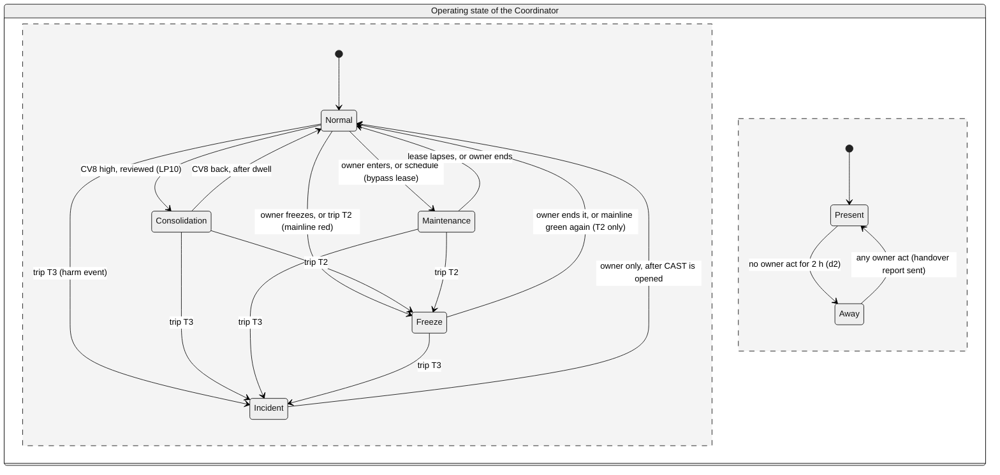
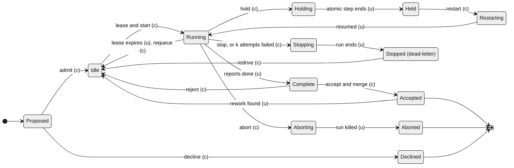

# 08. Modes, the supervisor, and layers of protection

Status: control-engineering steps 6 and 7 of [00-oracle.md](00-oracle.md) (§3.6 modes and supervisory logic, §3.7
layers of protection) and STPA steps 1, 3 and 4 (§4.1), 2026-11-17. It wraps the loops of
[07-loops.md](07-loops.md) in discrete logic and protection, for the plant and constraints of
[05-plant-and-hierarchy.md](05-plant-and-hierarchy.md) (H1 to H5, S1 to S4). Parity 2.5, gating by risk, lands
here (§6). Words are [01-terminology.md](01-terminology.md)'s: the parity notes' "regime" is an **operating state**,
"gate" a **permissive**, "invariant" a **constraint**. As 00-oracle §7 warns, the ISA-88 names below are given from
memory of Part 1 and should be checked against the standard before they are quoted.

## 1. Three things kept apart

| | What it says | Standard | Changed by | Example |
|---|---|---|---|---|
| **Operating state** | the situation of the whole Coordinator, which schedules limits and permissives | ISA-18.2's state-based alarming; gain scheduling | a measurement (the owner's presence), a trip, or an owner's typed act | normal, freeze |
| **Procedural state** | where one unit of work is | ISA-88's states | commands and the run's own events | running, held |
| **Mode** | who drives an actuator's transitions | ISA-88's modes | the owner, or a protective override toward manual | automatic, semi-automatic |

01 reserves "hold" and "held" for ISA-88's paused-and-resumable state; work an inspection stopped is **rejected**.

## 2. Operating states of the Coordinator

The situations the owner named are two variables, not one list. The owner's **presence** (present, away) is a
measured scheduling variable, d2, orthogonal to the rest. The **plant state** is one of five: normal,
**consolidation** (the owner's answer to 05's scope question: entered when code per feature, CV8, drifts above its
expected cost, 07 LP10), maintenance, freeze and incident, with incident taking precedence over freeze, and freeze
over the rest. The factory is designed to run nearly unattended: every limit below is a configurable default, and
thresholds and timeouts are set per tier.

| State | Entered by | WIP limit (S2) | Acceptance (LP1) | Outward acts | Alarms | L5 changes |
|---|---|---|---|---|---|---|
| Normal, present | default | the owner's pool cap | scheduled on direction age | per the table of §6 | all, within S1 and S5 | applied at run boundaries |
| Normal, away | d2: no owner act for 2 h | half the cap for AI agents (default) | one level deeper; hold points that may fall back go to deep review (S5) | owner-only hold points batched, not interrupting | top priority only interrupts | values only |
| Consolidation | LP10: CV8 above its limit, the switch reviewed by an AI agent and recorded | as normal | as normal, plus a check that each change does not add code per feature | as normal | the switch and the ratio shown on the overview | recipe revisions to stop inflation, at run boundaries |
| Maintenance | the owner, or a schedule, as a bypass lease | named loops in manual | as normal | named categories opened for the lease | the maintained loops' alarms shelved | the change under test only |
| Freeze | the owner; trip T2 | running work finishes, nothing new starts | as normal | merges and pushes held, except the fix of a T2 cause | freeze shown on the overview | none |
| Incident | trip T3 | 0: dispatch stopped | deep review on all | all held | the incident alarm; consequential alarms suppressed (first-out) | none until CAST is opened |

Maintenance is the step test generalised (SPEC §12d): a bounded, authorised bypass that holds named loops still.
Every state but normal is visible on the overview (09) for as long as it lasts.

## 3. A unit of work, and the modes of each actuator

### 3.1 Procedural states (CE-18)

Each item that runs is an ISA-88 unit procedure. Events are marked **(c)** controllable, which ergostat may
disable, or **(u)** uncontrollable, which it may not (Ramadge and Wonham 1987).

ISA-88 has no "accepted": its complete is the procedure's end. Acceptance is the quality state the rework cycle
adds (07, LP1), and "rework found" (u) is the discovery flow that reopens accepted work. The marked states, where
work may rightly rest, are accepted, aborted and declined. The recipe is kept apart from the equipment (CE-21): the
master recipe (`contexts:`) says what a kind of work needs; the worker that runs it is chosen by dispatch.

### 3.2 Modes per actuator (CE-19, HU-1)

**Automatic**: ergostat drives the transitions. **Semi-automatic**: ergostat proposes and the owner confirms each
one (today's `mode: advise`). **Manual**: the owner acts and ergostat records.

| Actuator | Default | Who may switch | Protective switch toward manual |
|---|---|---|---|
| u1 dispatch | automatic | owner | breaker open (per worker class); incident |
| u2 brief | automatic | owner, L5 (the recipe) | none |
| u3 acceptance | automatic; hold points semi-automatic per constraint (P4) | owner | correction rate per kind above its limit (parity 13 C): first deep review by an AI agent (still automatic), semi-automatic only while S5 has room |
| u4 merge | automatic behind P1 | owner | freeze |
| outward acts (H2) | per §6's table | owner, by MOC | incident; freeze for merges and pushes |
| u8 pause and stop | automatic for leases | owner | none |
| u9 interrupting the owner | automatic within S1 | owner | none |
| L5 changes | values automatic in range; the rest semi-automatic | owner | incident |

Protective switches may only move toward manual; the return to automatic is the owner's (a correction rate
switches alone, and to deeper automatic review before semi-automatic, so the factory stays under S5). **Bumpless transfer**: on leaving automatic the actuator's last command is held, not
reset; on returning, held commands are released one at a time and the integral term of LP2 is initialised from
the current h* (Åström and Hägglund, on transfer between modes).

## 4. The discrete-event supervisor (CE-20)

Following Ramadge and Wonham (1987) and Cassandras and Lafortune (ch. 3), the plant is the product of the unit
automaton above (one per item), the operating-state automaton, and a budget counter. The supervisor observes every
event and may disable only controllable ones.

| Controllable (may be disabled) | Uncontrollable (may not) |
|---|---|
| admit, decline; lease and start; hold, restart, stop, abort; requeue, redrive; accept, reject, merge; release an outward act; send a brief or a message; apply a model change; enter maintenance | reports done; lease expires (the clock); a test result; the owner's messages and presence; the mainline moved by others; rework found; spend accruing within a run; a worker's window cut (H5) |

**The specification, as allowed behaviour:**

- SP-1 (H1): merge only between "exit status read zero on this head" and the next mainline move.
- SP-2 (H2): an outward act only after its release under the operating state in force.
- SP-3 (H3): accept only after every confirmed constraint in the item's scope has been checked, and passed or
  resolved in the mode configured for it (§5.3, P4).
- SP-4 (H4): spend never above the day's budget.
- SP-5 (S2, S3): at most the WIP limit leased; at most one lease on a hub file.
- SP-6 (S4): no change to a law applied while a run that uses it is running.
- SP-7: no merge in freeze, except the fix of its own cause; no lease in incident.

**Controllability.** SP-1, 2, 3, 5, 6 and 7 disable only controllable events and are controllable as written.
**SP-4 is not**: spend accrues uncontrollably once a run starts, so the supervisor cannot stop the budget being
crossed mid-run. Its **supremal controllable sublanguage** disables the controllable event before it: no lease
starts unless the budget left exceeds the run's maximum cost. That is permissive P3 below, and trip T1 kills a run
at its own cap as a separate protection. A stall cannot be forbidden at all (expiry is the clock's); the response to
it is a requirement on a controller, LP5's watchdog, because a Ramadge–Wonham supervisor can disable but never
force.

**Nonblocking.** Every reachable state must still reach a marked one. The check finds one blocking state in the
naive design: in freeze after T2 every merge is disabled, including the fix that would turn the mainline green, so
nothing can complete. SP-7's exception removes it. Held items wait on the owner's presence, which is uncontrollable
but recurs (RM8: absences of 2 to 8 hours), and the dead-letter stock has redrive and discard, so neither blocks.
The check belongs in the test suite: the product automaton is small enough to search exhaustively for each change
to the supervisor (CE-20's "proof or test").

## 5. Layers of protection (IEC 61511)

### 5.1 Losses, hazards and the hazard register (CE-22, ST-1)

Losses (STPA's; tagged LS because L0 to L5 are the layers):

- **LS-1** the product wrong on its mainline: work reported done that is not;
- **LS-2** harm outside the repository: an outward or irreversible act the owner did not authorise;
- **LS-3** money spent past budget;
- **LS-4** the owner's attention wasted: redone work, floods, repeated corrections;
- **LS-5** the owner's intent lost: what was decided or corrected not kept.

The register, HAZOP-style (IEC 61882), on the plant's main lines:

| Hazard | Node and guideword | Cause (record) | Consequence | Safeguards today | Constraint |
|---|---|---|---|---|---|
| HZ-1 unverified work accepted | acceptance: NO or LESS check | exit status hidden by a pipe, 61 of 61 runs in the first 6 h; a push on failing tests (RM5) | LS-1 | the worker's own tests; the owner, hours later | H1 |
| HZ-2 unauthorised outward act | outward acts: MORE, OTHER THAN | an AI worker judging its own act; a broad delete | LS-2 | the harness's permission profile | H2 |
| HZ-3 a confirmed constraint broken | acceptance: OTHER THAN intended | the constraint lived in a window that was cut | LS-1, LS-5 | the intent judge (an AI) | H3 |
| HZ-4 spend runaway | dispatch: MORE | retry storms; long agent runs | LS-3 | none in ergostat | H4 |
| HZ-5 a worker acts after its cut dropped what it needed | brief: LESS | the harness's cut (RM9) | LS-1, LS-5 | the brief | H5 (physical) |
| HZ-6 a stall unnoticed | dispatch: LATE detection | silences of 34 to 164 min, owner away (RM6) | LS-4 | the Coordinator's wake-ups | CV5 |
| HZ-7 the owner flooded, a hold point missed | owner channel: MORE | 221 proposals in one batch (RM8) | LS-2, LS-4 | none | S1 |
| HZ-8 an act on a stale estimate | any act: LATE information | the mainline moved under a run (d5) | LS-1, LS-2 | state checked before the Coordinator's own acts (RM11) | P1, LP8 |
| HZ-9 a change to the laws loosens a protection | L5: OTHER THAN | eroding goals after a quiet spell (RM5's drift) | all | the judge's `accept:` map | S4, MOC (10) |
| HZ-10 a bypass or shelving outlives its window | protection: MORE time | forgotten maintenance | all | none | §5.3 |

### 5.2 Layers, and which are independent (CE-23)

LOPA (CCPS 2001) credits a layer only if it is independent of the initiating cause and of the other layers,
effective, and auditable. The record gives initiating frequencies, not probabilities of failure on demand, so the
table credits by independence and leaves the numbers for when the record has them.

| Hazard | Design (inherent) | L3 control | Alarm and owner | L1 protection (program tier, outside the blocks) | Mitigation outside ergostat | Credited IPLs |
|---|---|---|---|---|---|---|
| HZ-1 | a worktree per lease | LP1 inspection: an AI, so not independent of an AI worker's common causes | escaped rework, P2 | P1: ergostat reads the exit status itself | revert; the remote's branch protection | P1; the remote's protection where it exists |
| HZ-2 | outward acts withdrawn from workers' sessions | none | the hold point | P2 and the act table (§6) | the other system's own permissions | P2 |
| HZ-3 | constraints in the brief | LP1 inspection | P2 | P4, one check per compiled constraint | revert | P4, only where the check is a program |
| HZ-4 | the run's own cap | LP3's WIP limit | budget alarm | P3, T1 | the provider's spend limit | P3, T1, the provider's limit |
| HZ-6 | none | LP5's requeue | dead-letter age | the lease watchdog | none | the watchdog |

The pattern 00-oracle CE-23 warns of is visible: every layer that is an AI (the worker's tests, the inspector, the
classifier) shares common causes with the AI worker and is not credited as independent. The program tier is.

### 5.3 Permissives, interlocks, trips and bypasses (CE-24, CE-25)

- **Permissives** (must hold before an act starts): **P1** merge: exit status read by ergostat, zero, on the head
  being merged into, re-read at the act (H1, SP-1). **P2** outward act: released under §6's table (H2). **P3**
  lease: budget left exceeds the run's maximum cost (H4, SP-4). **P4** accept: each compiled constraint's check
  passed (H3). P4 is a guard on the accepted transition, a review hold point in the owner's words, whose mode is **configured per constraint** (the owner's answer to 05's
  question 4): *reject* (work sent back to the worker: hard, automatic), *hold point* (work held for the owner:
  hard, semi-automatic), or *land and raise* (work lands, the breach is raised: soft). The default is reject, so
  the factory stays under S5; a constraint is raised with the owner again only if it proves more structural than
  a guard.
- **Interlocks** (prevent an act while a condition holds): **I1** freeze holds merges and pushes. **I2** one lease
  per hub file (S3). **I3** a breaker open holds its worker class (07, LP5). **I4** one structural change in flight
  per neighbourhood (S4).
- **Trips** (to a safe state when a limit is crossed): **T1** a run at its spend cap is stopped; the day's budget
  reached stops dispatch. **T2** the mainline red after a merge enters freeze and proposes the revert. **T3** a
  harm event (an outward act reverted, a constraint breach found on the mainline, breakers open on two classes)
  enters incident. **The safe state** is held: running work ends its atomic step and stops there, nothing new
  starts, nothing is deleted, and the record says why.
- **Bypasses are leases**: granted only by the owner's typed act, with a duration (at most 24 h, *proposed*),
  renewed or lapsing, recorded, and alarmed as standing while active. P1 and P2 may be bypassed for one named act;
  T1 and the watchdog may not be bypassed at all. A protective function breaks the loop; no setpoint or controller
  can move it (CE-26): its limits live in L1 and change only through MOC class 4 (10).

### 5.4 Cause and effect matrix for H1 to H5

Effects: **E1** block the merge; **E2** hold the act; **E3** refuse the act; **E4** stop the run; **E5** stop new
leases; **E6** enter freeze; **E7** enter incident; **E8** alarm the owner (priority, 09); **E9** request to L5;
**E10** record only. X is always; S is per operating state (§6). All act within one sample of the cause (seconds),
except E9, at L5's next pass.

| Cause | E1 | E2 | E3 | E4 | E5 | E6 | E7 | E8 | E9 | E10 |
|---|---|---|---|---|---|---|---|---|---|---|
| H1: exit status not read, or hidden | X | | | | | | | | X | X |
| H1: exit status nonzero | X | | | | | | | | | X |
| H1: head moved since the read | X | | | | | | | | | X |
| H1: mainline red after a merge | | | | | | X | | P2 | X | X |
| H2: category not released in this state | | S | S | | | | | P2 if held | | X |
| H2: category closed (freeze, incident, the owner's standing rule) | | | X | | | | | | | X |
| H2: act released and later reverted | | | | | | | X | P1 | X | X |
| H3: a compiled constraint's check fails | per its mode: reject or hold | | | | | | | P3 if held; P4 if landed | | X |
| H3: a constraint cannot be checked by a program | | X | | | | | | P3 batched | X | X |
| H3: a breach found on the mainline | | | | | | | X | P1 | X | X |
| H4: budget left below a run's maximum cost | | | | | X | | | P3 | | X |
| H4: a run at its cap | | | | X | | | | | | X |
| H4: the day's budget reached | | | | | X | | | P2 | | X |
| H5: a worker's window cut | | | | | | | | | | X |

H5 is the harness's, not ergostat's: ergostat can only record the cut (d8) and rank what a brief carries so a cut
loses least (06 §4.2).

## 6. Permissives scheduled by risk (parity 2.5)

**The owner's gap**, from parity 05: the long session held a fixed standard (do not destroy what you did not
create, do not act outward without leave, prefer the reversible step), and what adapted was which parts of it
applied, chosen by context. In control terms that is **gain scheduling** (Åström and Hägglund; Seborg et al.): a
family of fixed laws designed in advance, one chosen by a measured scheduling variable; and ISA-18.2's state-based
alarming, where limits depend on the plant's state. It is not an adaptive threshold.

- **The fixed standard** is design: the act categories, their severity, the table below, and the risk appetite.
  It changes only through L5 under management of change (10), and loosening is the owner's.
- **The context** is measured at each act: the operating state (which column is in force), and the
  **act-risk features**: category, reversibility, scope (blast radius), visibility, cost, the **staleness** of the
  x̂ the act was planned on (06 §3.4), the asker's **claim contradiction rate**, and the act's novelty. The
  likelihood term is plain arithmetic: act-risk = severity(category) × (1 + staleness) × (1 + 4 × contradiction
  rate) × (1 + novelty) (parity 05's form, *proposed* weights).
- **The AI tier is a sensor only.** A narrow AI labels an act no rule recognises into a category, with a
  confidence; low confidence reads as the most severe plausible category. It never releases.

| Act category (severity) | Normal, present | Normal, away | Maintenance | Freeze | Incident |
|---|---|---|---|---|---|
| Local, reversible: an edit or commit in a worktree (1) | release | release | release | release | hold |
| Merge to the owner's mainline (2) | release behind P1 | release behind P1 | release behind P1 | refuse, except the T2 fix | refuse |
| Push to the owner's remote (3) | release | reshape: push a branch, not main | release | refuse | refuse |
| Pull request, or push to a shared remote (4) | reshape: draft | hold point | per the lease | refuse | refuse |
| Write to another system: tracker, chat, mail (5) | hold point | hold point | per the lease | refuse | refuse |
| Delete what the work did not create (5) | hold point | refuse | per the lease | refuse | refuse |
| Spend above a run's cap (4) | hold point | refuse | per the lease | refuse | refuse |

An act whose act-risk exceeds its cell's severity by a threshold (*proposed*: doubled) moves one step stricter:
release to hold point, hold point to refuse. **Reshaping** is a reference governor (Gilbert and Kolmanovsky's
idea): the nearest admissible act goes ahead at once, and the full act waits as a new pending act. A standing rule
of the owner's, such as no writes to the team's systems while at work, is a constraint that closes a row whatever
the state.

**How the thresholds adapt, and only through L5.** Replaying the table over past acts against the owner's actual
answers gives a confusion matrix (needless holds against releases later reverted), a fair counterfactual because
the answers are in the record (parity 05). A run of needless holds becomes a proposed loosening, for the owner; a
miss becomes a proposed tightening, which may be pre-approved. A **risk budget** refilled at a fixed rate (the
appetite) and drained by harm schedules the thresholds tighter as it drains and never looser than the table: the
absence of incidents earns nothing, which answers Sterman's eroding goals and Rasmussen's drift by construction.

## 7. STPA: unsafe control actions and loss scenarios (ST-3, ST-4)

The control structure is 05 §4.2's. Each control action in Leveson's four ways:

| Control action | Not provided | Provided, causing a hazard | Too early, too late, out of order | Stopped too soon, applied too long |
|---|---|---|---|---|
| CA-1 lease and start (u1) | UCA-1 ready work idles while slots are free | UCA-2 a lease beyond the WIP limit with the owner away (HZ-6) | UCA-3 started before the run it depends on merged | UCA-4 a lease kept on a silent run (HZ-6) |
| CA-2 brief (u2) | UCA-5 a brief without the owner's words on the topic (HZ-3) | UCA-6 a brief carrying a misread decision as confirmed | UCA-7 a brief built before a change it needed was applied | (one per run) |
| CA-3 accept (u3) | UCA-8 sound work held for the owner past S5, blocking the factory (HZ-7) | UCA-9 accept with the exit status unread (HZ-1) | UCA-10 accept before the constraint checks finish (HZ-3) | UCA-11 a hold point left open for days |
| CA-4 merge (u4) | UCA-12 the T2 fix not merged in freeze | UCA-13 merge on a red head (HZ-1) | UCA-14 merge on a head moved since the read (HZ-8) | |
| CA-5 release an outward act | UCA-15 a needed act refused for days | UCA-16 release of an unauthorised category (HZ-2) | UCA-17 release under a state that ended (HZ-8) | UCA-18 a bypass lease left open (HZ-10) |
| CA-6 interrupt or ask the owner (u7, u9) | UCA-19 a hold point never raised | UCA-20 interruptions past S1, a flood (HZ-7) | UCA-21 asked while away, unanswered for hours | |
| CA-7 hold, stop, expire (u8) | UCA-22 a stall not expired | UCA-23 a live run expired during a long silent step | UCA-24 a stop that arrives after the outward act | UCA-25 a hold never restarted |
| CA-8 apply a model change (L5) | UCA-26 a correction never absorbed (LS-5) | UCA-27 a loosening applied without the owner (HZ-9) | UCA-28 applied mid-run (SP-6) | UCA-29 a trial change left in force |

Loss scenarios, each with the flaw in the controller's process model or feedback, and the requirement it gives:

| Scenario | UCA | Why it happens | Requirement, and where it is met |
|---|---|---|---|
| LSc-1 | UCA-9, 13 | the Coordinator believed the tests passed: the exit code was hidden by a pipe (a flawed process model from a sensor with unbounded noise, RM5) | P1 reads the exit status itself, outside the worker (§5.3) |
| LSc-2 | UCA-14, 17 | the estimate was stale: the mainline or the state moved after the read | permissives re-read at the act (P1, P2); age on every value (06 §3.4) |
| LSc-3 | UCA-16 | the asker judged its own act low risk: the controller checking itself | outward acts leave the worker and pass P2 in L1; the AI only labels (§6) |
| LSc-4 | UCA-4, 22 | feedback missing: a silent run sends no event, and the Coordinator's attention was on other runs (R3) | a clock-sampled lease watchdog (07, LP5) |
| LSc-5 | UCA-19, 20 | the owner's channel flooded, so the one hold point that mattered was not seen | rationalised alarms, a rate budget, first-out (09) |
| LSc-6 | UCA-27 | eroding goals: thresholds loosened after a quiet spell | loosening only by the owner; a risk budget that earns nothing from quiet (§6) |
| LSc-7 | UCA-24 | two controllers on one run: the owner's stop and the Coordinator's release in flight | the owner's typed act takes precedence at the actuator, through a selector (09) |
| LSc-8 | UCA-18 | a bypass granted and forgotten | bypasses are leases, alarmed while standing (§5.3) |
| LSc-9 | UCA-5, 10 | a worker's cut dropped a constraint (H5) | constraints ranked first in the brief (06 §4.2), and enforced by P4 regardless |
| LSc-10 | UCA-23 | the watchdog's model of progress was wrong: a sound AI-agent run is often silent for 30 minutes | lease TTL per tier, 40 minutes by default for AI agents (07, LP5) |

Every incident is analysed after the fact with CAST (Leveson ch. 11): as a control failure in this structure, never
as an actor's error (ST-5).

## 8. Checklist and open questions

**Checklist.** Done: CE-18 (§3.1, the unit; §2, the Coordinator), CE-19 (§3.2), CE-20 (§4, with SP-4's supremal
sublanguage and the nonblocking fix), CE-21 (§3.1), CE-22 (§5.1), CE-23 (§5.2), CE-24 (§5.4), CE-25 (§5.3), CE-26
(§5.3), ST-1 (§5.1), ST-3 and ST-4 (§7), HU-1 (§3.2). Open: the probabilities of failure on demand in §5.2, until
the record holds enough demands; the automated nonblocking test.

**Open questions for the owner.**

1. **Outward acts withdrawn from workers.** Should every outward act leave the worker's session and pass P2, or is
   setting the session's permission profile per operating state enough for now?
2. **The table of §6.** Are the rows and cells right to start, and is "write to another system" refused, not held,
   while you are at work?
3. **Bypasses.** At most 24 hours, renewable; P1 and P2 bypassable for one named act; T1 and the watchdog never.
   Agreed?
4. **Incident.** Should only you end an incident, even when the cause is fixed and verified?

## Sources

- Åström, K. J. and Hägglund, T. (2006). *Advanced PID Control*. ISA.
- Cassandras, C. G. and Lafortune, S. (2008). *Introduction to Discrete Event Systems*, 2nd ed., ch. 3. Springer.
- CCPS (2001). *Layer of Protection Analysis: Simplified Process Risk Assessment*. AIChE.
- Gilbert, E. and Kolmanovsky, I. (2002). Nonlinear tracking control in the presence of state and control
  constraints: a generalized reference governor. *Automatica* 38(12).
- IEC 61511, *Functional safety: safety instrumented systems for the process industry sector*.
- IEC 61882, *Hazard and operability studies (HAZOP studies): application guide*.
- ISA-88 (IEC 61512-1), *Batch control, Part 1: models and terminology*.
- ISA-18.2 (IEC 62682), *Management of alarm systems for the process industries*.
- Leveson, N. G. (2011). *Engineering a Safer World*, ch. 4, 8 and 11. MIT Press.
- Leveson, N. G. and Thomas, J. P. (2018). *STPA Handbook*.
- Ramadge, P. J. and Wonham, W. M. (1987). Supervisory control of a class of discrete event processes. *SIAM
  Journal on Control and Optimization* 25(1).
- Rasmussen, J. (1997). Risk management in a dynamic society. *Safety Science* 27(2–3).
- Seborg, D. E., Edgar, T. F., Mellichamp, D. A. and Doyle, F. J. *Process Dynamics and Control*. Wiley.
- Sterman, J. D. (2000). *Business Dynamics*. McGraw-Hill.

To check before quoting: ISA-88's state and mode names (00-oracle §7); the Gilbert and Kolmanovsky reference's
volume and title.
