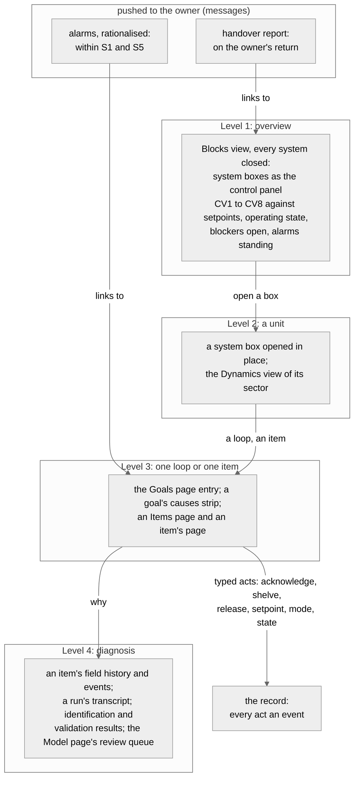

# 09. The owner as operator: interface, alarms and typed acts

Status: control-engineering step 8 of [00-oracle.md](00-oracle.md) (§3.8, the operator interface and alarms) and
the human-in-the-loop questions (§4.3), 2026-11-17. It serves the loops of [07-loops.md](07-loops.md) and the modes
and protection of [08-modes-and-protection.md](08-modes-and-protection.md), with the observer of
[06-observer.md](06-observer.md) §6 (the owner's estimate). Parity 2.4 (absorbing disruptions), 2.9 (allocating
attention), 2.11 (translating both ways) and 2.16 (reporting truthfully) land here. **No new page or panel**: everything
below is placed on ergostat's existing surfaces, the two diagrams (Dynamics and Blocks), the system boxes, the
Goals page, the Items pages, the Model page's review queue, and messages.

## 1. Which of the owner's roles this is

01 separates four roles: **operator** (watches, acknowledges, overrides), **change authority** (approves changes,
10), **source of requirements** (directions, goals, constraints) and **sensor** (corrections, observations). This
note is the operator, and how the sensor role's readings arrive.

The owner's answers to 05 and 06 set the philosophy. The plant is a factory meant to run nearly unattended. The
owner does not admit or prune work; the owner's lever on throughput is the cap on each worker pool. The owner's
attention is bounded by two constraints: **S1**, interruptions a day (≤ 4), and **S5**, blockers open, the holds
and questions awaiting the owner (≤ 3). Both are configurable defaults, and the design stays under them rather
than spending them (07, LP7). The owner is interrupted when what they were told no longer matches the truth in a
way that would change one of their decisions (06 §6, agreed).

## 2. The HMI philosophy and display hierarchy (ISA-101)

ISA-101's principles, as Hollifield et al. (*The High Performance HMI Handbook*) apply them: overview first;
deviations from targets salient; grey by default, colour kept for the abnormal and for quality (06 §3.4's good,
uncertain, bad); analogue values shown against their targets, not as bare numbers; detail on demand.

| Level | ISA-101's purpose | ergostat's existing surface | What it shows for the Coordinator |
|---|---|---|---|
| 1 Overview | the whole area at a glance; is anything abnormal? | the **Blocks view with every system closed**: the system boxes as the control panel (SPEC §4a) | CV1 to CV8 against their setpoints with trend; the operating state and the owner's presence; blockers open against S5; standing alarms; bypasses active |
| 2 Unit | one unit's loops and states | a **system box opened in place**; the **Dynamics view** of its sector | the dispatch pool with its leases; the quality cascade; the owner's queue by class; the dead-letter stock |
| 3 Detail | one goal, one item | the **Goals page** entry; a goal's causes strip; an **Items page** and an **item's page** | one loop's performance; one run: its lease, brief, report, verdicts; one held act with its risk reading |
| 4 Diagnosis | why | an item's **field history** and events; a run's transcript; identification and validation results; the **Model page's review queue** | the record behind a verdict, a trip, a change request |

What is added is not a surface but content on existing ones: the operating state, S5's count and the standing
alarms as measures on the Coordinator's system box (`show:`); ages and quality flags on every value already shown;
an estimated stock (undiscovered rework, x̂4) drawn dashed in the Dynamics view, as SD draws an estimate (parity 16).

## 3. What the owner sees, and when

| Situation | Pushed (messages) | On the overview when looked at | Not shown unless asked |
|---|---|---|---|
| Present, working with ergostat | high and medium alarms at once; answers to the owner's own questions | all of Level 1, live | runs proceeding normally, retries, rejects |
| Away | high alarms only, within S1 | (not looked at) | everything else, batched into the handover report |
| Returning (the first owner act after an absence) | the **handover report** at once | Level 1 | |
| Freeze, incident | the trip that caused it, first-out; consequential alarms suppressed | the state, the cause, what is held | |
| Consolidation | nothing: it needs no owner act | the switch and the ratio CV8 | |

**The handover report** is the shift-handover practice of control rooms (01: the-job's "morning brief" and
"ledger" are its names today). It is LP7's batched outflow, ordered by the gap between what the owner was told and
what is true (06 §6), then by alarm priority. Each sentence cites the reading it rests on, with its age and quality,
so the owner's picture inherits the uncertainty instead of hiding it (parity 16 D).

## 4. Alarm management (ISA-18.2)

### 4.1 The alarm philosophy

An alarm is an indication to the owner of an abnormal condition that requires a timely response (ISA-18.2). An
indication with no defined response is not an alarm: it is an **alert** on a display, or a **finding**. Every
`alarm` block ergostat ships must be rationalised before it may interrupt (CE-27; 01's definition). The
philosophy's rules:

- **Consequence and time decide priority**, not the source.
- **Most of the factory's abnormal events are handled without the owner.** A stall recovered by LP5, a rejected
  run, a breaker that closes again, a consolidation entered: alerts at most.
- **The owner is a part-time operator.** ISA-18.2's commonly quoted performance figures (on the order of 6 alarms
  an hour as acceptable, a flood above 10 in 10 minutes) are for a full-time console operator. Here the budget is
  a day's: S1, 4 interruptions, and a flood is more than S1 within one hour.

### 4.2 Rationalisation: the master alarm database

| Tag | Condition | Consequence if ignored | The owner's response | Time to respond | Priority |
|---|---|---|---|---|---|
| AL-1 | incident entered (T3) | harm continues; the factory stopped | read the cause; keep or end the incident | 1 h | high |
| AL-2 | the day's budget reached (T1) | the factory stopped for the day | raise the budget, or leave it | 2 h | high |
| AL-3 | a hold point (an owner-only constraint, an outward act) blocking work, with S5 reached | the factory stalls on the owner | release, reshape or refuse | 2 h | medium |
| AL-4 | what you were told no longer holds, and it would change a decision of yours (06 §6) | a decision made on a wrong picture | read; decide again | before the decision; 1 day | medium |
| AL-5 | freeze by T2 not cleared within 2 h | merges held; work piling up | look at the fix in progress | 4 h | medium |
| AL-6 | a bypass lease standing past its window | a protection off unnoticed | renew or let it lapse | 4 h | medium |
| AL-7 | a hold point waiting, S5 not reached | work on it waits | release, reshape or refuse | 1 day | low |
| AL-8 | the dead-letter stock's oldest over a day | work lost to diagnosis | read the diagnosis; discard or redrive | 1 day | low |
| AL-9 | breakers opened on one worker class twice in a day | capacity lost to a common cause | check the harness or provider | 1 day | low |

Hollifield and Habibi recommend a distribution of roughly 80% low, 15% medium and 5% high; the alarm system's
performance report (§4.4) checks it.

**Rationalised out** (alerts or findings, never interruptions): stalls recovered, retries, rejects, a CV inside its
deadband (01: the "tolerance" key), consolidation entered or left, a proposed decision extracted, a model change
waiting in the review queue that blocks no work.

### 4.3 Detailed design

- **Deadband and on-delay** on every alarm (`alarm` block's `for`), so a condition that flickers raises once.
- **State-based suppression**: alarms are suppressed by operating state (08 §2): a maintained loop's alarms in
  maintenance; consequential alarms in incident (**first-out**: only the initiating cause is pushed).
- **Flood handling**: past S1 within an hour, further alarms of medium and low priority are consolidated into one
  message naming the first cause and the count.
- **Shelving** is a lease (08 §5.3): the owner shelves an alarm for a stated time, at most 24 h; it returns by
  itself; shelved alarms are counted and listed on the overview.
- **Out of service** (an alarm disabled) is a change under management of change (10, class 2), not an operator act.

### 4.4 Monitoring and assessment

The alarm system's own measures, on its system box: interruptions a day against S1; blockers open against S5;
time in flood; standing alarms (older than their time to respond); chattering alarms (raised three times or more
in a day); shelved count; the priority distribution; and **alarms the owner dismissed without action**, the
nuisance rate. A chattering or nuisance alarm becomes a request to L5 to re-rationalise it (CE-28).

## 5. The owner's acts, typed (CE-30)

Every act that changes the plant is a closed, typed operator input, recorded as an event with its author and time.
Free text stays the owner's way of speaking; it is translated into one of these acts before it takes effect.

| Act | Where it is made today | What it changes | Takes effect |
|---|---|---|---|
| acknowledge | a message reply; the item's page | the alarm's state | at once |
| shelve (duration) | the alarm's item page | suppression, as a lease | at once; returns by itself |
| release, reshape, refuse | the held act's item page (its existing Confirm and Dismiss) | P2, P4 | at once |
| hold, restart, stop, abort | the run's item page | the unit's procedural state (08 §3.1) | at its next atomic step |
| expedite ("this first") | a message | the item's class (07, LP6's override station) | at the next pull |
| **pool cap** | a message, echoed as the act | S2's ceiling: the owner's lever on throughput | at once; a lower cap drains, nothing is killed |
| mode (automatic, semi-automatic, manual) | a message, echoed | one actuator's mode (08 §3.2), with bumpless transfer | at once |
| a constraint's mode (reject, hold point, land and raise) | the constraint's item page | P4 for that constraint | at the next acceptance |
| operating state (maintenance lease, freeze, end incident) | a message, echoed | 08 §2 | at once |
| bypass (with duration) | a message, echoed | one permissive, as a lease | at once; lapses |
| setpoint or limit, within its band | a message, echoed | a goal; a tier's timeout | at the next run (bumpless) |
| query | a message | nothing: answered from the record (§6) | at once |
| new work (a direction) | a message | an item in its first state (d1) | queued |
| correction, constraint, observation | a message | extracted and proposed (07, LP9); a constraint compiled through L5 (10) | proposed at once, used marked uncertain |
| accept or refuse a change request | the Model page's review queue | the laws (10) | at the run boundary |

**Words to acts.** The interpreter is a **reference prefilter** (parity 11 A; two-degree-of-freedom control): it
maps a message to one act from the closed list, by rules first and a narrow AI for the residue. An act that
changes a state, mode, cap, bypass or setpoint is **echoed** as the typed act on the message's item before it takes
effect, so the owner sees what was understood, as a console echoes an entry. Queries and new work take effect at
once. The owner's re-routes and undone echoes are the prefilter's error, measured.

**Two controllers on one actuator.** The owner's act takes precedence over ergostat's command at the same actuator,
through a selector, and the overridden command is recorded (08, LSc-7).

## 6. Status questions answered from the record (2.4, 2.11)

A status question is classed first (parity 04 A's triage) and answered by a **program reading the record**: items,
goals, runs, the system boxes' measures. An AI may phrase the answer, but every number and claim in it is a cited
reading with its age and quality. Status questions are never delivered to running workers (parity 04: worker
turns spent on status should fall to zero).

A question the record cannot answer is a **gap**, recorded and put in the handover report. Questions that recur on
one topic drive a slow loop (parity 04 B, the internal model principle): L5 proposes the measure that would have
answered it, added to a system box's `show:`, so the answer is on the overview before it is asked (a class-2
change, display only, 10). Measured: questions per topic falling after such a change; the owner asking about
something already known, ≤ 1 a week (parity 09).

## 7. The owner's estimate, kept current

06 §6 models the owner's picture as a second observer, cascaded on ergostat's: x̂7 records **what the owner was
told about each item, and when**. The gap between it and the current x̂ is the owner's estimation error, which
ergostat can compute and the owner cannot. Three uses:

- **The trigger.** AL-4 fires when the gap would change one of the owner's decisions: work the owner believes done
  that was reopened; a constraint at risk; a held act whose risk reading changed. This is send-on-delta sampling
  (06 §3.1), and the owner agreed to it.
- **The report.** The handover report is ordered by that gap, so the largest corrections of the owner's picture
  come first.
- **The display.** "What you were told" is a field with history on the item, shown on its page beside the current
  state; the overview counts items whose two differ.

The owner's own innovations (asking what was already known, reopening accepted work, correcting a belief ergostat
reported) are the reporter's error signal, a measure for L5 (parity 11 B).

## 8. Levels of automation, takeover and reliance (HU-1 to HU-3)

| Function | Level (Parasuraman, Sheridan and Wickens) | The owner's part |
|---|---|---|
| Dispatch, leases, retries | automatic; informs only by alarm | sets the pool cap |
| Acceptance | automatic; hold points per constraint mode | releases hold points configured as owner-only |
| Merge | automatic behind P1 | none, unless in freeze |
| Outward acts | per 08 §6's table: automatic, reshaped, or the owner approves | releases hold points |
| Consolidation | automatic after an AI agent's review; the owner informed on the overview | none |
| Changes to the laws | values automatic in range; others proposed, the owner approves (10) | change authority |

**Takeover (HU-2).** Every actuator has a manual mode with its state on its Level 3 display. Bainbridge's irony
applies: an owner who rarely operates loses the picture needed to take over. The handover report on every return,
and the "what you were told" field, are the countermeasures: they keep the owner's estimate current without asking
the owner to operate.

**Reliance (HU-3).** Lee and See ask that reliance match capability. Each worker class's system box shows its
measured capability, the claim contradiction rate and escaped rework by kind, beside its tier, so the owner's
reliance can be calibrated against measurement. 01 reserves "trust" for the owner's attitude; ergostat shows the
measures that should inform it.

## 9. Checklist and open questions

**Checklist.** CE-27: done (§4.2, every interruption rationalised; the rest rationalised out). CE-28: done (§4.4,
against S1 and S5, floods, standing and chattering counted). CE-29: done (§2, overview first on existing surfaces).
CE-30: done (§5). HU-1 to HU-3: done (§8). AV-3: the handover report and the prefilter are measured for what they
drop (§5, §7).

**Open questions for the owner.**

1. **Echo before acting.** Should a typed act read from your words always be echoed and wait for your nod, or act
   at once when the classifier is confident, with the echo afterwards?
2. **The pool cap.** Is setting it by message, echoed, enough, or should the pool's system box carry it as a
   setpoint you change in place (a control on an existing surface, not a new panel)?
3. **Flood.** Is "more than your daily budget within an hour" the right flood line for a part-time operator?

## Sources

- Bainbridge, L. (1983). Ironies of automation. *Automatica* 19(6).
- Hollifield, B. and Habibi, E. *Alarm Management: A Comprehensive Guide*. ISA.
- Hollifield, B., Oliver, D., Nimmo, I. and Habibi, E. *The High Performance HMI Handbook*. PAS.
- ISA-101.01, *Human Machine Interfaces for Process Automation Systems*.
- ISA-18.2 (IEC 62682), *Management of alarm systems for the process industries*.
- Lee, J. D. and See, K. A. (2004). Trust in automation: designing for appropriate reliance. *Human Factors* 46(1).
- Parasuraman, R., Sheridan, T. B. and Wickens, C. D. (2000). A model for types and levels of human interaction
  with automation. *IEEE Transactions on Systems, Man, and Cybernetics A* 30(3).
- Sheridan, T. B. (1992). *Telerobotics, Automation, and Human Supervisory Control*. MIT Press.

To check before quoting: ISA-18.2's rate figures (00-oracle §7); the 80/15/5 priority distribution in Hollifield and
Habibi; the author list of *The High Performance HMI Handbook*.
