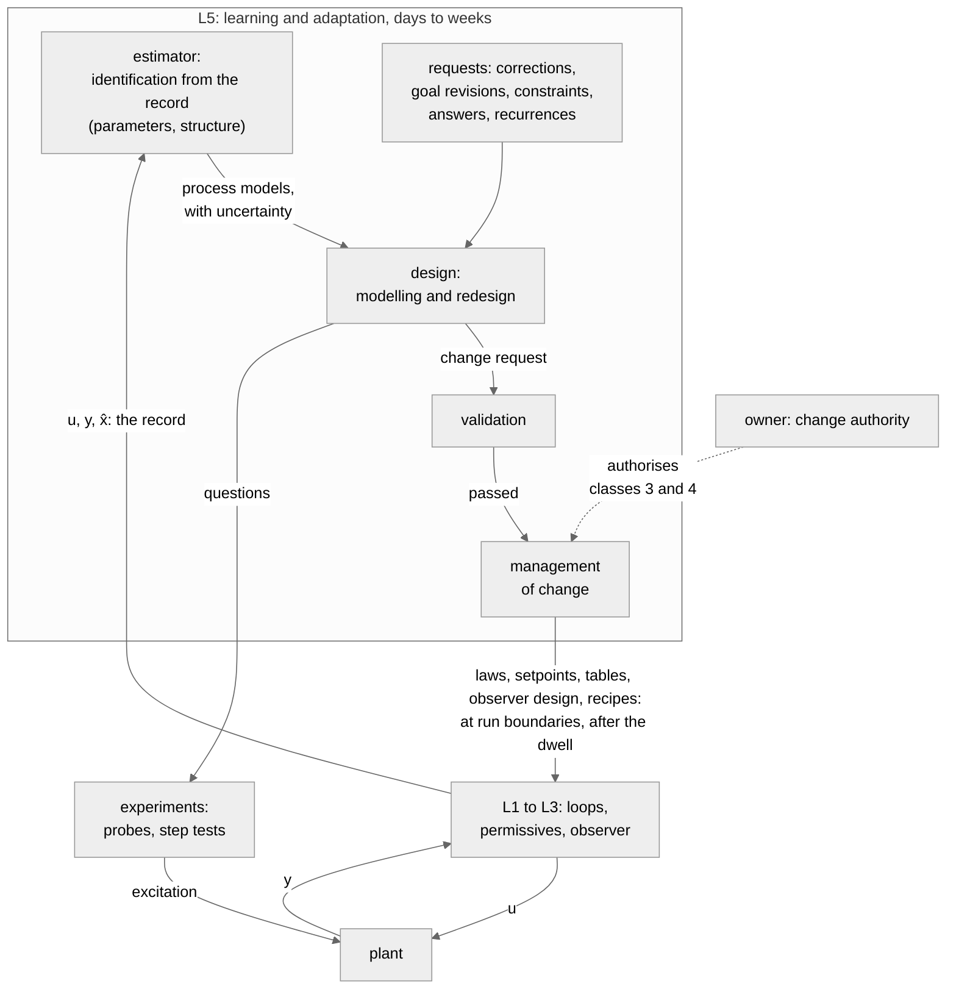
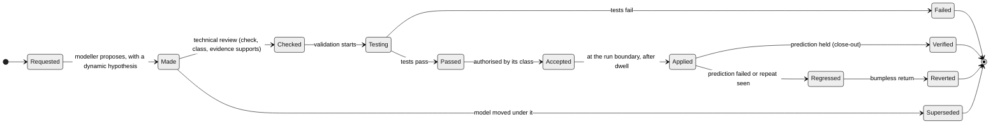

# 10. Adaptation and change: the L5 learning layer

Status: control-engineering steps 9 and 10 of [00-oracle.md](00-oracle.md) (§3.9 identification and validation,
§3.10 management of change) and SD's testing and policy design (§2.4, §2.5), 2026-11-17. It designs L5 of
[05-plant-and-hierarchy.md](05-plant-and-hierarchy.md) §4: the only layer that changes the laws of L1 to L4. It
takes the critique of [../parity/00-modeling-review.md](../parity/00-modeling-review.md) as the list of what must
be fixed, and the parity notes' learning designs (2.1, 2.3, 2.7, 2.12, 2.13) as its inputs. Words are
[01-terminology.md](01-terminology.md)'s: the model "judge" is **validation**, a `model-change` is a **change
request** in the sense of management of change (MOC), "improver" is the **modeller**.

## 1. L5 as a self-tuning regulator

04 §3 drew the modelling subsystem as the outer loop of an adaptive controller. In Åström and Wittenmark's terms
(*Adaptive Control*) it is an **indirect self-tuning regulator**: an estimator identifies the process from the
record of u and y, and a design block computes new controller settings from the estimate, as if it were true
(certainty equivalence). Two things make the Coordinator's version more than parameter tuning:

- **What is designed is wider than gains.** SD's policy design (Sterman ch. 3) changes decision rules and
  structure, not only numbers; control's redesign changes laws, setpoints, observers and protection tables.
- **The modelling subsystem is three functions** (01): **identification** (numbers and structure from the record),
  **modelling** (formulation, testing and policy design), and **management of change** (who authorises, and when
  a change reaches running work). Today they are one block and one judge.

Two cautions from the adaptive-control literature carry over directly:

- **Closed-loop data needs excitation.** Data taken under feedback correlate the input with the noise, and a loop
  that holds its setpoint well teaches nothing about its process (Ljung ch. 13). The experiments of parity 2.7 are
  the excitation, designed rather than hoped for (§4.4).
- **Adaptation must be supervised.** Practical adaptive controllers freeze estimation when the data are poor and
  bound how far one update may move a law (Åström and Wittenmark, on practical issues). Here: no estimate from too
  little record (the 2% change accepted on 11 minutes of record in 00-review is the failure), conditional updating
  (07's LP2 stops integrating at saturation), and the dwell and budget of §2.

### What L5 identifies

The loops of 07 and 08 were designed on numbers L5 must supply and keep current:

| Parameter | Used by | Identified from |
|---|---|---|
| quality fraction by kind against direction age | x̂4's prior; LP1's table; d1's feedforward | replaced lines and reopens by age of the direction (RM1) |
| discovery delay distribution; gain k | LP2's tuning (θ, Ki) | the age of rework when found (RM2) |
| silence distribution of sound runs, per tier | the lease TTL per tier (07, LP5) | the longest silence of runs that finished well; the owner's 30 minutes for AI agents is the first reading |
| staleness rate λ per state | 06 §3.2's thresholds | the rate each state changes in the record |
| failure share per worker class and recipe | LP5's p-chart limits | attempts by class |
| the owner's answer rate and presence pattern | LP7, S5 | the owner's acts (RM8) |
| expected code cost per feature | CV8's denominator (07, LP10) | a capacity analysis of past features: code added per accepted feature, by kind |
| confusion matrix of the act table | 08 §6's thresholds | held and released acts against the owner's answers |

## 2. What L5 may change, and at what rate

| Class of change | Examples | How fast it may reach running work |
|---|---|---|
| parameters within their band | a lease TTL per tier, h*, a WIP default below the cap, a deadband | at the next lease or run |
| setpoints and bands | CV1's limit; a tier's timeout band | at the next run, after the dwell |
| structure of the control model | a stock, flow, loop, sensor, template instance | at the run boundaries of the blocks it touches |
| observer design | sampling periods, staleness thresholds, recipe parts and their order, report fields | at the next brief |
| decision rules and tables | LP1's table, the act table of 08 §6, the admission bar's form | between passes; never recalls an act already released |
| protection | permissives, interlocks, trips, bypass limits, H1 to H5 | after a pre-start-up review |

**The rate rules**, from the theory of switching systems and of cascades:

- **Dwell time.** A loop is changed at most once per dwell, at least three of its closed-loop time constants, so it
  settles under one law before the next (a switched system is stable when it dwells long enough in each stable
  law: Liberzon, *Switching in Systems and Control*). For LP1 that is a few runs; for LP2 a week.
- **Time-scale separation.** L5's changes are batched daily, ten or more times slower than L3 (05 §4.1, CE-8).
- **Run boundaries.** A change reaches a run at its next start, never mid-run (parity 01; S4; SP-6 of 08). A run
  started under the old law finishes under it and is told by a message when the change would matter to it. The
  first concrete step is parity 01's: stop killing runs when the model changes.
- **Bumpless transfer.** A new law starts from the old one's state: LP2's integral from the current h*, a new
  table from the current depth, held commands released one at a time (Åström and Hägglund).
- **One structural change in flight per neighbourhood** (S4), and a budget of structural changes accepted a day,
  so churn is visible and bounded (00-review §3: 76 changes made, 59 failed, the same removals made again).

## 3. Management of change: classes and authority (CE-35 to CE-38)

The owner's direction is a factory that runs almost entirely by itself. So most classes are pre-approved (01's
word for "standing consent": a **pre-approved change class**, ITIL's standard change), and the owner's authority
is kept for what loosens protection or moves the boundary.

| Class | What | Validation | Authorised by |
|---|---|---|---|
| 0 | tuning within the approved band; per-tier thresholds within their bands | a replay showing no loop worse | automatic, recorded |
| 1 | a value or setpoint outside its band, or a band moved | per-variable replay of the neighbourhood (§5) | automatic when it tightens; the owner when it loosens |
| 2 | display and observer: a measure on a system's `show:`, a recipe's parts and budgets, report fields, sampling periods, alarm re-rationalisation, the consolidation switch and its recipe revisions | the parity benchmark's trials for recipes; none for display | automatic after an AI agent's review, the owner informed |
| 3 | decision rules, structure, the act table tightened, a constraint compiled into a check | dynamic hypothesis and policy simulation (§5) | automatic when it only adds protection; otherwise the owner, in the review queue, never blocking work |
| 4 | protection loosened or removed, H1 to H5, a constraint retired against the owner's words, the boundary moved | policy simulation, the cause and effect matrix re-verified, a pre-start-up review | the owner only; never an AI tier |

Each change request runs MOC's lifecycle on the existing `ergostat.model-change` item:

"Checked" is MOC's technical and hazard review: which loops, permissives and unsafe control actions of 08 §7 the
change touches. "Applied" carries a pre-start-up review for class 4: `check` passes and the cause and effect matrix
still holds. Temporary changes (a trial, a bypass) carry their expiry (CE-38). The class is computed from the spec
section the edit touches, never from whether it changes only values (00-review's first shortcoming: a goal edit
was classed a parameter).

## 4. How requests arrive

A request is an item (`ergostat.model-request`, 00-review §3) naming what prompted it and pointing at the record.
The modeller is given only its **neighbourhood** (the parts within a few links, the loops through them, the goals,
blocks and constraints on them) plus the series for its span, never one global scalar.

### 4.1 Learning from correction (2.13)

A confirmed correction is a reading from the owner as a sensor: an error nothing else measured. It enters a stock,
**corrections unabsorbed**, which L5 drains by a change that says which part of the control system was wrong
(parity 13 B): a missing sensor (absorbed as a check), a setpoint misread, a permissive set wrongly, a decision rule,
missing structure, or a constraint. Corrections absorbed only as words in a recipe sit in a second stock,
**corrections in context**, which L5 is held to keep small by compiling them down the tiers into checks. Each
absorption is validated by its **trial**: the situation the correction arose in, re-run against the changed model,
as iterative learning control re-runs a trial. **Once a compiled check has held, ergostat retires the correction
itself** (agreed by the owner); a repeat reopens it as `regressed`. The fast response (more review on the corrected
kind of work at once) is L3's protective switch (08 §3.2), not L5's.

### 4.2 Revising goals (2.1)

A goal revision is a setpoint or band change (class 1) or structure (class 3), requested by the owner, by a worker
through `propose` with its transcript as evidence, or by L5 itself. Two anchors stop drift: a revision that lowers
a goal the owner set, or contradicts a confirmed constraint, is class 4; and the flow of goals lowered is measured,
since eroding goals is the archetype to watch (Sterman). Structure a worker asks for with no record yet is accepted
as a declared assumption, to be tested when the record allows.

### 4.3 Constraints from decisions (2.3, 2.12)

Decisions and corrections are extracted from the owner's messages (07, LP9) and go into briefs at once as
proposed, marked uncertain (agreed by the owner); that is estimation. Enforcement needs compiling: L5 proposes,
per confirmed decision about the product, a constraint with its check (a program where possible, a narrow AI
otherwise) and its **mode** (reject, hold point, land and raise: 08 P4), default reject. Adding one is class 3
that only adds protection, so automatic; retiring one against the owner's words is class 4. A decision no check can
judge stays as feedforward in the brief, counted as **unenforced**, which says honestly how much coherence is not
yet structure. The `ergostat.decision` kind retires into these change requests and the design decision record.

### 4.4 Experiments (2.7)

L5 raises **questions** where the model cannot answer: a wide sensitivity fan, a loop never identified, a
parameter at the edge of its search. The experiments side-loop (parity 07 B) answers them with probes (read-only:
free) and interventions (a step test, a trial on part of the work), ranked by the value of the information against
its cost. Interventions run in **maintenance** (08 §2): the loops they perturb are put in manual for the span, as
the step test already does (SPEC §12d). Answers are evidence for change requests; experiments never change the
model themselves.

### 4.5 The other sources

The p-chart of failures (07, LP5), recurring messages by class (parity 04 B), innovations that point at a missing
measurement (parity 08 C), a goal whose measure disagrees with the owner's reopens (parity 16 C: a suspect
measure), clusters of the owner's expedites (parity 15), the act table's confusion matrix (08 §6), and CV8
crossing its limit (07, LP10).

## 5. Validating L5's own work

00-review found a validation step with almost nothing feeding it, judging by one number that cannot see most changes. The
fixes, each tied to Sterman's Table 21-4 and to Ljung's validation (ch. 16):

| Shortcoming (00-review) | Fix | Test it answers |
|---|---|---|
| goals, sensors, blocks classed as parameters | the class from the spec section (§3) | (prerequisite) |
| evidence checked for existence, not support | a residual cited must be significant and of the claimed sign; a finding must still hold and touch the change; a line cited is read by a checker for bearing | structure assessment |
| one scalar over the whole model | per-variable fit in the neighbourhood, with Theil's split into bias, unequal variation and unequal covariation (Sterman 1984; SD-15); the rest required no worse | behaviour reproduction |
| validation and goal measured on different scales; warm-up longer than the record | warm-up bounded by the record held; scores in the goal's own measure; a forecast skill over a horizon (SD Lab's skill@H) where a long free replay is not possible | integration error; behaviour reproduction |
| pure hold-out selection, which SD Lab measured and rejected | a blend of fit and held-out score | behaviour reproduction |
| simplifications can never pass ("better by 2% in every window") | a penalised criterion (Akaike's, as Ljung ch. 16 gives it): equal fit with fewer parts passes | parameter assessment; Occam |
| no structure from residuals | residual tests: whiteness (autocorrelation means a missing state), cross-correlation with an input at lag k (a missing delay); SD Lab's hidden-stock likelihood | Ljung's residual analysis; boundary adequacy |
| no hypothesis before fitting | every class-3 request states a dynamic hypothesis: a series, a direction, a span; validation scores the prediction | surprise behaviour; SD-5 |
| control changes never simulated | closed-loop policy simulation with the blocks' laws; margins at the worst plausible process (CE-17) | policy design; SD-18 to SD-20 |
| sensitivity unused | a policy conclusion must survive the sensitivity fan over the uncertain parameters | sensitivity analysis; SD-16 |
| | extreme conditions on every class-3 change (a window that never cuts, briefs of zero, the owner away a week) | extreme conditions |
| | a change to a template validated on two examples (image-squeeze and the-job) | family member |
| | loop knockout on the neighbourhood | behaviour anomaly; SD-17 |

Barlas's order is kept: structure tests before behaviour tests, behaviour pattern tests last, so a model cannot
pass by reproducing the data for the wrong reasons.

**L5's own performance monitoring** (CE-34): changes accepted a day by class; the share verified against regressed;
the prediction hit rate per modeller, which is the modeller's claim contradiction rate; churn (the same change
made again); the validation's false accepts on the bench's planted changes; and corrections unabsorbed and in
context. **L5 must not oscillate**: a change reverted within its dwell is counted, and two in a neighbourhood
within a month freeze adaptation there until the owner looks.

## 6. Milestones, ranked, reconciled with 00-review

00-review ranked eight milestones. This architecture keeps its first two as prerequisites, moves two forward
because the loops of 07 and 08 depend on them, and adds one.

| Rank | Milestone | 00-review | Why here | Done when |
|---|---|---|---|---|
| 1 | **Classify honestly, check evidence for support**: class by spec section (control, protection, observer kinds added); evidence checked for support | 1 | unchanged: without it a protection change can pass as a parameter | a goal edit is class 3 or 4; ten planted unsupported reasons all refused |
| 2 | **Validation that works on a young, real record**: bounded warm-up, the goal's own measure, per-variable Theil, a penalised criterion | 2 | unchanged | the image-squeeze run replayed with no 1000%-scale swings; genuinely dead parts pass, rare goal flows are not proposed |
| 3 | **Changes reach running work at run boundaries, with dwell and bumpless transfer**; runs never killed by a model change | new (parity 01's first step) | every L5 change otherwise bumps L3 | a change during a run lands at its end; the run is told |
| 4 | **Identify the loops' parameters** (§1's table) | new | 07's loops need θ, k, TTL per tier, λ, code cost per feature before they can be tuned | each with an identification report and its uncertainty |
| 5 | **Requests and focus**: request items from corrections, goal revisions, constraints, experiments, findings; the neighbourhood recipe with series | 4 | the inputs of §4; moved above structure finding because absorption (2.13) and constraints (2.12) need no new finder | a correction produces a request, a neighbourhood session, and a change there |
| 6 | **MOC classes and the lifecycle** of §3 on the change request | (part of 1 and 7) | the factory needs most classes pre-approved and the dangerous ones held | each class reaches the right authority; class 4 never auto |
| 7 | **Structure from residuals** in the product | 3 | | a damaged example yields the missing stock or delay; recall ≥ the bench stand-in's 12/16 |
| 8 | **Dynamic hypotheses and predictions** on every class-3 request | 5 | | the review entry shows predicted against actual |
| 9 | **Control and protection changes judged by policy simulation** | 7 | | a setpoint revision and a new sensor each get a verdict about the policy |
| 10 | **Drawn on the diagram**: a proposed change as a tentative part in both views | 6 | the owner reviews class 3 and 4 there | a proposed stock is visible in place |
| 11 | **The loop wired once** | 8 | | every example turns it on in one line |

## 7. Checklist and open questions

**Checklist.** CE-31 to CE-33: §1 (identification from the record and from experiments, closed loop flagged),
§5 (residual tests). CE-34: §5 (L5's own monitoring; each loop's in 07). CE-35 to CE-38: §2, §3. SD-13 to SD-20:
§5. AV-4: the model each regulator holds is the one in ergostat, kept by this layer.

**Open questions for the owner.**

1. **Class 3 when it only adds protection.** May L5 add a check or tighten a permissive without you, as a
   pre-approved class, so long as anything that loosens stays yours?
2. **Freezing adaptation.** Two reverted changes in a neighbourhood within a month freeze L5 there until you look.
   Is that the right tripwire, or should it be a soft alarm only?
3. **Experiment spend.** How much of the budget may experiments and benchmark trials take each week?

## Sources

- Åström, K. J. and Hägglund, T. (2006). *Advanced PID Control*. ISA.
- Åström, K. J. and Wittenmark, B. *Adaptive Control* (2nd ed.). Addison-Wesley.
- Barlas, Y. (1996). Formal aspects of model validity and validation in system dynamics. *System Dynamics Review*
  12(3).
- CCPS (2008). *Guidelines for the Management of Change for Process Safety*. AIChE.
- Liberzon, D. (2003). *Switching in Systems and Control*. Birkhäuser.
- Ljung, L. (1999). *System Identification: Theory for the User*, 2nd ed., ch. 13 and 16. Prentice Hall.
- OSHA, 29 CFR 1910.119, paragraphs (i) and (l).
- Sterman, J. D. (1984). Appropriate summary statistics for evaluating the historical fit of system dynamics
  models. *Dynamica* 10.
- Sterman, J. D. (2000). *Business Dynamics*, ch. 3 and 21. McGraw-Hill.

To check before quoting: the chapter of Åström and Wittenmark on practical issues of adaptive control; Liberzon's
dwell-time results (ch. 3).
