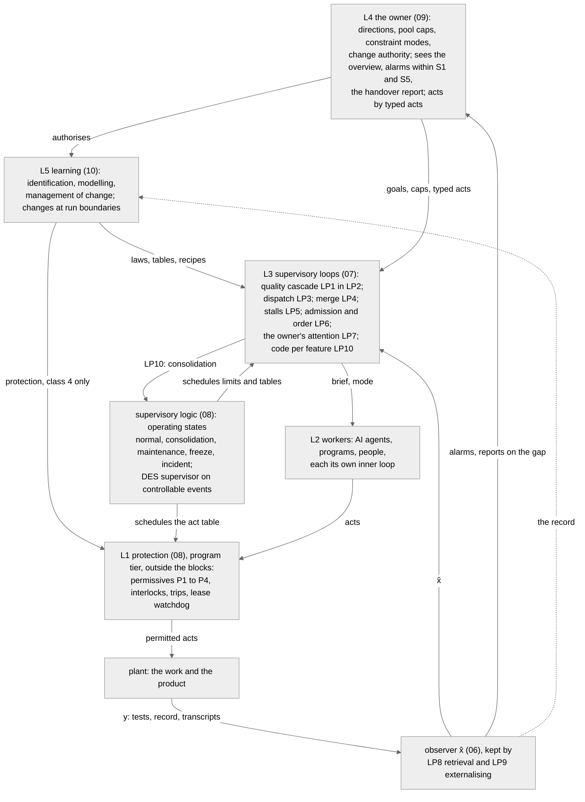

# 11. The Coordinator's control architecture on one page

Status: summary of [07-loops.md](07-loops.md) to [10-adaptation-and-change.md](10-adaptation-and-change.md), with
[05](05-plant-and-hierarchy.md) and [06](06-observer.md), 2026-11-17. Words are [01](01-terminology.md)'s.

## 1. The architecture

The Coordinator is a supervisory controller with an observer, wrapped in discrete logic and independent
protection, with a self-tuning layer above it and the owner as a part-time operator and change authority.

- **L3, the loops (07).** A quality cascade: acceptance depth per run (LP1, rule tier) inside an outer loop on
  escaped rework (LP2, a run-to-run integral, daily). Dispatch as a WIP-capped pull (LP3) under the owner's pool
  cap, the owner's one lever on throughput. A merge queue (LP4). A lease watchdog with retries, a breaker and a
  dead-letter stock (LP5), its TTL set per tier (40 minutes for AI agents). Admission and ordering on the
  factory's resource levels (LP6). The owner's attention under two budgets, interruptions (S1) and blockers (S5)
  (LP7). Code per feature against its expected cost, switching the factory into consolidation (LP10). Two loops
  keep the observer: retrieval before acting (LP8) and externalising (LP9).
- **Supervisory logic (08).** Operating states (normal, consolidation, maintenance, freeze, incident, crossed with
  the owner present or away) schedule limits and tables. Each unit of work follows ISA-88 procedural states; each
  actuator has a mode. A Ramadge–Wonham supervisor disables only controllable events, checked controllable and
  nonblocking.
- **L1, protection (08).** Permissives P1 to P4, interlocks, trips and bypass leases, on the program tier,
  outside the blocks they guard; a cause and effect matrix for H1 to H5; outward acts scheduled by risk.
- **L5, learning (10).** Identification, modelling and management of change, applied at run boundaries after a
  dwell, most classes pre-approved, loosening protection the owner's alone.
- **The owner (09).** Overview first on the existing diagrams and system boxes, rationalised alarms, typed acts,
  a handover report ordered by the gap between what the owner was told and the truth.

## 2. Where each parity gap lives now

| Gap | Where it lives |
|---|---|
| 1 Revising goals | L5: class-1 or class-3 change requests with anchors (10 §4.2), applied at run boundaries with a dwell (10 §2) |
| 2 Knowing when done | the rework cycle template: LP1 inside LP2 (07); acceptance criteria; P4 (08) |
| 3 Intent, ask or act | x̂5 (06); asking limited by S5 and reversibility (07, LP7); constraints compiled (10 §4.3) |
| 4 Absorbing disruptions | typed acts through the reference prefilter (09 §5); status answered from the record (09 §6); recurrences to L5 |
| 5 Gating by risk | operating states and the act table, gain-scheduled, P2 (08 §2, §6); adapted only through L5 |
| 6 Diagnosing failures | LP5: classify, retry, breaker, dead-letter diagnoser, p-chart to L5 (07) |
| 7 Experiments | probes before acting (LP8); interventions in maintenance, answers as evidence (10 §4.4) |
| 8 State before and after | permissives re-read at the act (08 P1, P2); innovations (06 §3.3) |
| 9 Allocating attention | LP6's ordered pull; LP7 and the alarm philosophy (09 §4) |
| 10 Delegation | the brief as x̂₀ (06 §5); review depth as LP1, replacing `review:` |
| 11 Translating both ways | the prefilter (09 §5); the owner's estimate and the handover report (09 §7) |
| 12 Coherence | proposed decisions in briefs, marked uncertain; confirmed ones compiled into constraints with a per-constraint mode (10 §4.3, 08 P4) |
| 13 Learning from correction | the absorption loop, trials, automatic retirement once a check holds (10 §4.1); the protective switch (08 §3.2) |
| 14 Concurrent work | LP3 under the pool cap, S3 on hub files, LP4, leases (07) |
| 15 Prioritisation | LP6 admission on resource levels and ordering; LP10 consolidation (07) |
| 16 Reporting truthfully | x̂4, estimated hidden rework, drawn dashed; P1 and P4 on fact-asserting transitions; quality flags (06, 09) |

## 3. Last night's built features: keep, rename, retire

| Built | Verdict | As what |
|---|---|---|
| Changesets and field history (F1) | keep | the record's fold; x̂2 with its age; "what you were told" as a field |
| Transcripts as events | keep | lease renewal (LP5); x̂1 and x̂8 |
| Storage (F2) | keep | the historian and event log |
| Parity benchmark (F3) | keep | the observer's error by kind and age; L5's trials for recipes and corrections |
| Claims and their checks (§12g) | keep | redundant measurement of the report; P1's independent read |
| `ergostat.trust.*` | rename | **claim contradiction rate**; "trust" kept for the owner's reliance |
| `developer-honest` goal | retire as a goal | a monitored value, or wired into LP1 |
| Decisions (§5a) | rename, then retire the kind | checkable ones become **constraints** through change requests; the rest a **design decision record** |
| Corrections (§5a) and the extractor | keep | an observation of a nonconformity; the absorbing change is the corrective action (LP9, 10 §4.1) |
| Messages (§12h) | keep | the inward channel; add the class first and the typed act (09) |
| Recipes, `contexts:` (§12j) | keep, rename | **context recipe**: a master recipe, rendered into the control recipe, the brief; add proposed items, age and quality |
| `review:` | retire | into LP1's drawn decision table |
| The intent judge (§12i) | rename | **acceptance inspection** (the inspector); one discovery flow of the rework cycle, behind rule-tier checks |
| The model judge and `accept:` | rename | **validation** (the validator); `accept:` becomes the MOC classes (10 §3) |
| `mode: advise` | rename | **semi-automatic** mode |
| `session.lost` | rename | **lease expiry** |
| `done_when` | rename | **acceptance criteria** |

## 4. Open questions for the owner

1. Should review depth move per kind with escaped rework (LP2), or stay fixed per kind?
2. While you are away, may ergostat run fewer AI agents than your cap (half, by default) to keep the loops from
   interacting? And is the cap set by an echoed message enough, or a setpoint on the pool's box?
3. What counts as a feature in code per feature: an accepted item of named kinds, or something you declare?
4. Should every outward act leave the worker's session and pass P2, or is a permission profile per state enough?
5. Are the act table's rows and cells right to start (08 §6)?
6. Bypasses: at most 24 hours, P1 and P2 bypassable for one named act, T1 and the watchdog never?
7. Is ending an incident always yours?
8. Should acts read from your words be echoed and wait for your nod, or act at once when the classifier is sure?
9. Is "more than your daily interruption budget within an hour" the flood line?
10. May L5 add checks or tighten permissives without you, anything that loosens staying yours?
11. Should two reverted changes in a month freeze adaptation in that neighbourhood until you look?
12. How much may experiments and benchmark trials spend each week?
