# 12. The Coordinator built as an ergostat model, and tested

Status: step 4 of designing ergostat as the Coordinator, 2026-11-18. The architecture of
[05](05-plant-and-hierarchy.md) to [11](11-summary.md) is built as an example model, `examples/coordinator/`, run
against a simulated factory, and tested as [00](00-oracle.md) §2.4 asks: the structure first, then behaviour
reproduction against [02](02-reference-modes.md)'s reference modes with the controllers off, then the designed
controllers on. Everything is simulated and free: no AI is called. The last section lists what ergostat could not
express, each with the workaround used and the feature that would remove it. That list is the milestone list.

## 1. What was built

| Part | Files | What it is |
|---|---|---|
| The model | `ergostat.yaml`, `factory/*.yaml` | 22 stocks, 38 flows, 9 auxiliaries, 13 goals, 15 blocks (4 more implied), 3 agents; 96 feedback loops |
| The plant | `world/plant.py` | the work, the workers, the codebase and the owner, simulated, as a function of the clock |
| The laws | `world/policy.py` | each loop's law twice: `harness` (the long session as the record shows it) and `designed` (07's loop sheets with their *proposed* defaults) |
| The wiring | `bin/coord.py`, `bin/watch.py`, `world/read.py`, `world/sim.py` | a block runs one loop's law on the world and reports what it moved; the watcher relays the tracker's events as item events; the sensors read the world |
| The tests | `world/experiment.py`, `world/knockout.py`, `world/charts.py` | thirty-day closed-loop runs, loop knockout, sensitivity, the time step halved, and the charts below |

A factory hour passes every 30 seconds. The record sets the plant (02, 03): new work is wrong 0.55 of the time at a
direction's start, decaying to 0.04 over about 16 hours before learning; landed rework is found by a red test
within the hour (a quarter of it), by later work, or by the owner at the desk; one run in eight stalls; the owner
is away overnight and on some afternoons; the harness cuts the window at 965k tokens to 60k and re-injects 70k.
Five directions arrive over thirty days, 100 to 160 items each, and landed work proposes half an item more.

`COORD_POLICY=harness ergostat run` runs the same blocks with the harness's laws: the controllers "off" in the
sense 02 means, the implicit policies of the long session. The default is the designed Coordinator.

## 2. How the architecture maps to the YAML

The plant is one system with four inside it (work, quality, codebase, owner); the observer and modelling are beside
it. Each loop's block sits in the system it holds, as 07 pairs them. Below, the blocks and the stocks they act on
(solid: what a block moves or sets; dotted: what flows on, and what is read):

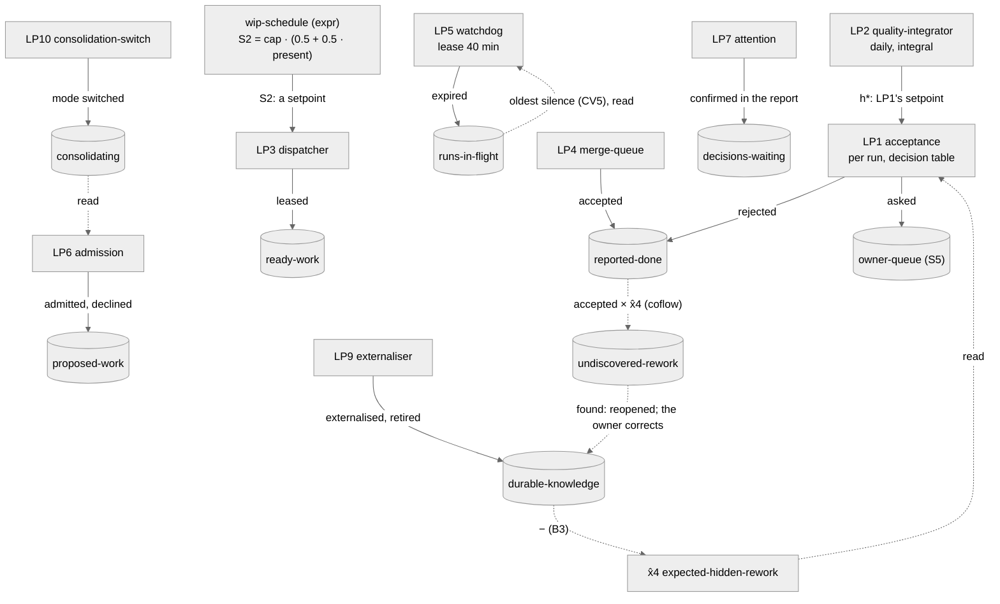

| Architecture | In the YAML | Inside the program, not the YAML |
|---|---|---|
| Work in flight and done (CV3, u1) | stocks counted from `work/*` items by state; flows by items entering a state, told apart by the field `via` | |
| The worker pool and its cap (S2) | `worker-pool`, an external block on agent `ai-agents` (`at-once: 6`); `pool-cap`, exogenous | the workers themselves (simulated) |
| LP3 dispatch, S2 on presence | `dispatcher` reads `goal.runs-within-limit.error`; `wip-schedule` (`expr`) sets that goal's setpoint to `cap · (0.5 + 0.5 · present)` | the order: rework, directions, WSJF with ageing (LP6) |
| LP5 lease watchdog | `watchdog` holds `stalls-noticed` (oldest silence ≤ 0.7 factory hours); moves `expired`, `dead-lettered`, `redriven` | the lease, its TTL, attempts, the diagnoser |
| LP6 admission | `admission` reads `-stock.ready-work`, `-stock.consolidating`; `declined-work` kept, `resurrected` its outflow | the value estimate and the bar |
| LP1 acceptance (inner) | `acceptance` holds `hidden-rework-allowed` (x̂4 ≤ h*); moves `rejected`, `asked`, `habit-changed` | the decision table, the away schedule, S5's override |
| LP2 escaped rework (outer) | `quality-integrator` reads `goal.escaped-rework-low.error`, sets `goal.hidden-rework-allowed`; `gain`, `deadband`, `limits` declared | the conditional integration |
| LP4 merge, H1 | `merge-queue` moves `accepted`; `tests-read`, a critical goal on `unread-test-runs = 1 − checking-habit` (03's B4) | the exit status read |
| The rework cycle (R1) | `escaped` (`flow.accepted · x̂4`), `undiscovered-rework`, `rework-found` (`discovery-time` estimated), `reopened` | |
| LP7, S1 and S5 | `attention` moves `decisions-confirmed` (the handover report); `blockers-within-budget` (≤ 3), read by `acceptance` as room | the token bucket, the batching |
| LP10, the consolidation state | `consolidating`, a 0/1 stock moved by a two-way flow from `consolidation-switch`, which holds CV8 ≤ 1.3 | hysteresis, dwell, removals briefed |
| The observer (06), LP9 | `working-context` (limit 965k; `harness-cut` external), `unrecorded-corrections`, `durable-knowledge`; `externaliser` holds `knowledge-recorded` | absorption and dormancy |
| LP8 retrieval | none | every block reads the world and the record at its act (gap 7) |
| L5 modelling (10) | `factory/modelling.yaml`: `ergostat.model.fit`, an improver stand-in, the judge | |
| Operating states, ISA-88 states, modes (08) | `consolidating` and `owner-present` only | gaps 4 and 6 |

The leased work queue as built, in 07 §6's form:

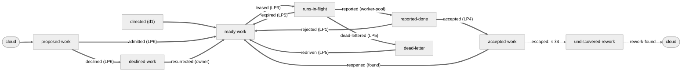

## 3. Structure tests

- **`ergostat check`**: no errors and no findings; 13 of 13 goals closed by a loop ergostat can see. Getting
  there changed the model five times, each for a reason the method gives: a rate driven by a rate needed its
  coflow written (proposals, lines and features per item landed; corrections per rework found); `reopened`
  ignored its own stock until it took `MIN(flow.rework-found, stock.accepted-work / discovery-time)`; code per
  feature divided by zero with no features (`ZIDZ`); the extreme-conditions test would not finish with a
  three-minute answer time beside a four-day pruning time (the stiff pair is left measured, signed causes only);
  and H1 had no loop until the checking habit was made the stock 03 says it is (B4).
- **Units**: every equation is dimensionally consistent (`check` reports no `equation-units` or
  `units-mismatch`). Time is wall-clock hours in ergostat; durations are written in its time with the factory's
  beside them, and the factory's own hour is a unit word, `factory-hours` (gap 10).
- **Polarity**: the loops 07 names come out as the design says. `quality-cascade` (LP2) and
  `hidden-rework-allowed` (LP1), `tests-read`, `stalls-noticed`, `work-waiting`, `runs-within-limit`,
  `blockers-within-budget`, `knowledge-recorded` and `code-per-feature-as-expected` are balancing; `rework-cycle`
  (R1) and `ideas-breed-work` (R5) reinforcing. The first draft had the cascade reinforcing: one acceptance block
  moved both `accepted` and `rejected`, and a block's outputs all carry +. Splitting it into LP1 (sends back) and
  LP4 (merges), as 07 already separates them, made it balancing (gap 9). Ten loops of unknown polarity remain,
  all through the judge in modelling.
- **Boundary against 03 §1's chart.** Every endogenous stock of the chart is in the YAML: work to do, done and
  undiscovered rework; verification discipline (`checking-habit`); fan-out (`runs-in-flight`); standing rules
  (`durable-knowledge`) and the corrections that feed them; proposals and pruning; the working context, its
  compaction, externalising and obsolescence. The exogenous inputs are as the chart says (directions, the owner's
  availability, the window's capacity and the harness's cut) and so are the exclusions (cost, the organisation,
  users, fatigue, which agent did what, content, merge conflicts, displacement within the window). **In the
  simulation but not the YAML**: the quality of work, schedule pressure, attention per agent, relevance,
  re-reading and brief content. They are the plant's internals and the harness's laws, which a real deployment
  could only estimate; the YAML holds x̂4 for the first. **Added beyond 03**, all controller structure from 05 to
  08: the lease and dead letter, admission and the declined stock, code per feature and the consolidation mode,
  the owner's queue (S5) and decisions waiting.

## 4. Behaviour reproduction, controllers off

ergostat's projection is open loop: it holds the blocks still (SPEC §12b), so a closed loop cannot be projected
(gap 1). The thirty-day runs are therefore made headless by `world/experiment.py`: the same plant and the same
laws the blocks run, on the same clock, each loop at its sheet's sampling, over ten seeds. Black is the harness as
it was, grey dashed the designed Coordinator, as 02 draws the reference and hoped-for modes.

| Mode | Reproduced? | The harness, in the model (10 seeds, median and range) | The record |
|---|---|---|---|
| RM1 rework spikes at each direction, decays | **yes** | up to 0.54 reworked per line added in a direction's first 36 hours (12-hour buckets; median 0.12), a median 0.03 later | .66, .41 at starts; floor .02 to .05 |
| RM2 found hours to days after landing | **yes** | median 9 h (7 to 11); 17% within the hour (14 to 21%); 20% after a day | 4.9 h and 14.5 h; 9 to 29% within the hour |
| RM3 code grows in steps, pruned once, late | **yes** | pruned once, on day 19 to 22, after code per feature stood over 1.35 for two weeks; CV8 then climbs again to 1.9 | one fall, two weeks late, the owner's |
| RM4 corrections reset per direction; standing rules only grow | **yes** | 0.1 to 0.3 per message at a start, falling to 0; 12 rules written, none retired | 0.29 → 0.06, then 0.37; 2 → 21, none retired |
| RM5 checking blind, restored, drifts back | **yes, drifts further** | 73% of runs unread; each reported slip restores reading, which erodes in a day or two | 100%, then 0 for 10 h, then 33 to 38% |
| RM6 stalls unnoticed while the owner is away | **yes** | away: median 51 min (40 to 60), longest 4 to 9 h; present: about 20 min | 34 to 164 min, all in the absence |
| RM8 what waits for the owner has no outflow | **yes (sketched)** | 256 decisions waiting at day 30; 4 to 7 blockers open at the worst | 221 proposed, none confirmed |
| RM9 the window's sawtooth | **yes** | 26 cuts (25 to 27), a window lasting 15 to 30 hours | windows of 7 and 31 hours |
| RM11 a burst of re-reading after a cut | **yes** | steady re-reading plus a burst decaying over 3 hours after each cut | 22% of the hour's reads, none after hour 4 |
| RM7, RM14 (not supported in the record) | **not reproduced, as 02 §5 requires** | no conflicts are modelled; errors do not depend on the fill or a cut | |
| RM10, RM12, RM13, RM15's documentation | **not modelled** | the inflow's composition, retention by store and brief sizes enter only as constants | |

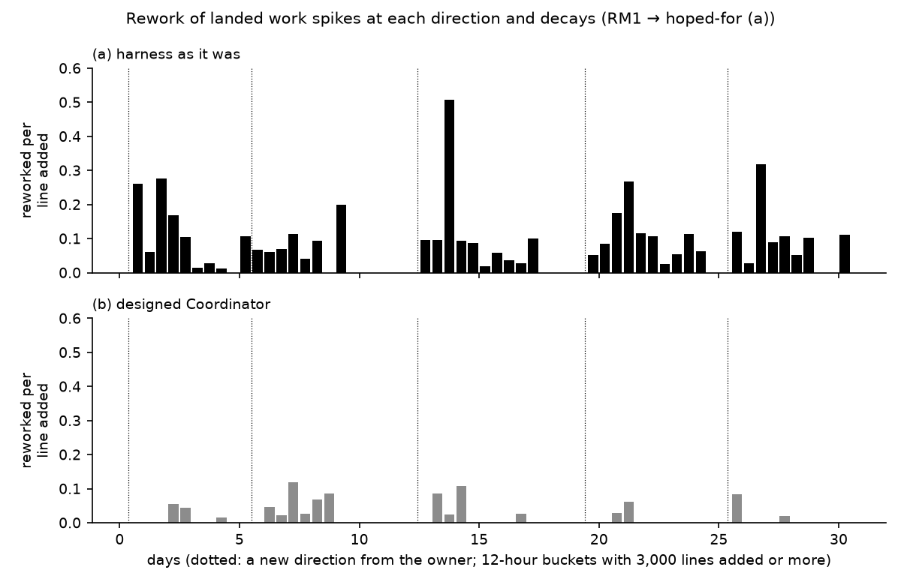

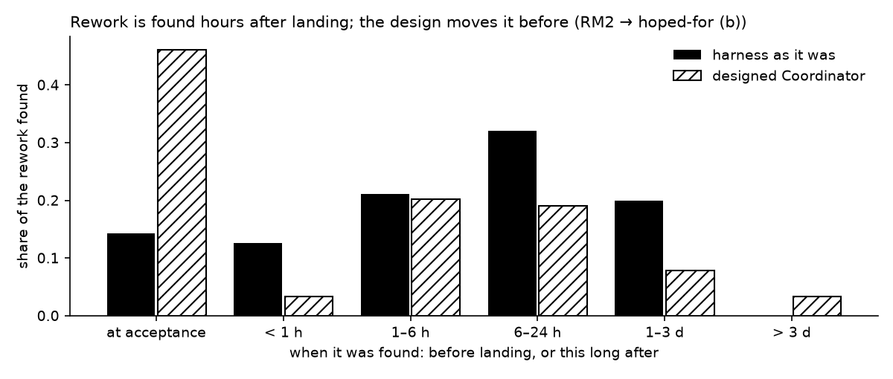

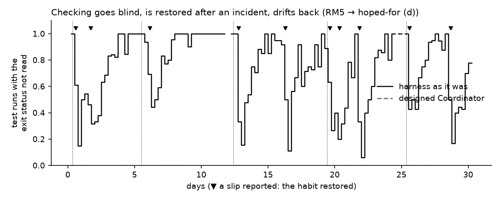

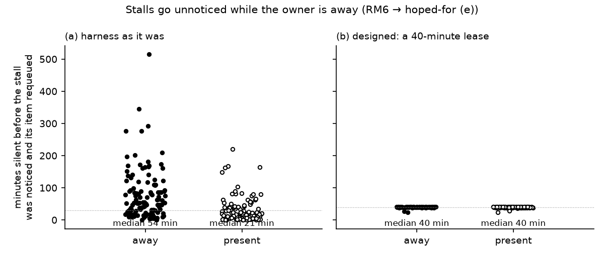

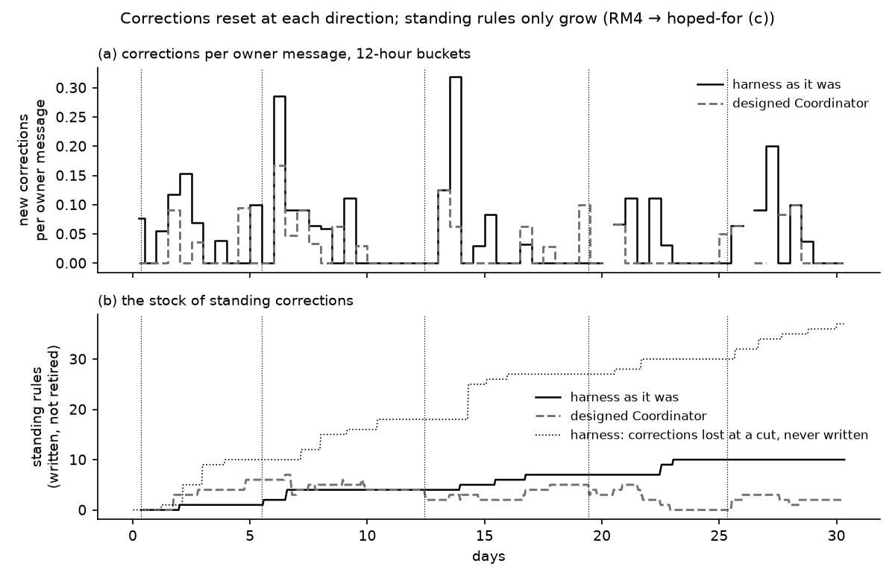

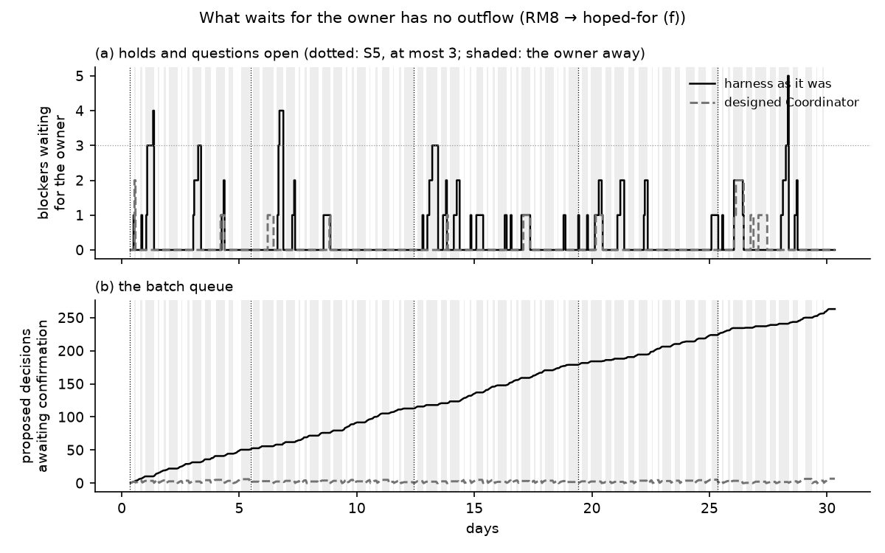

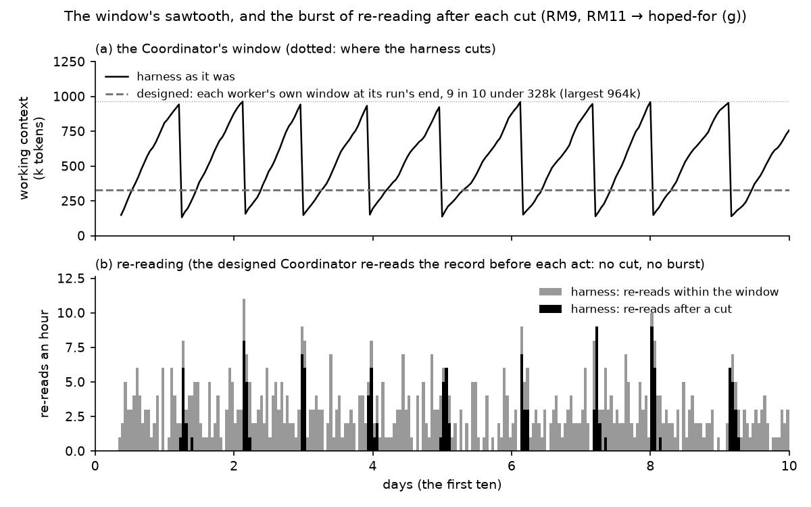

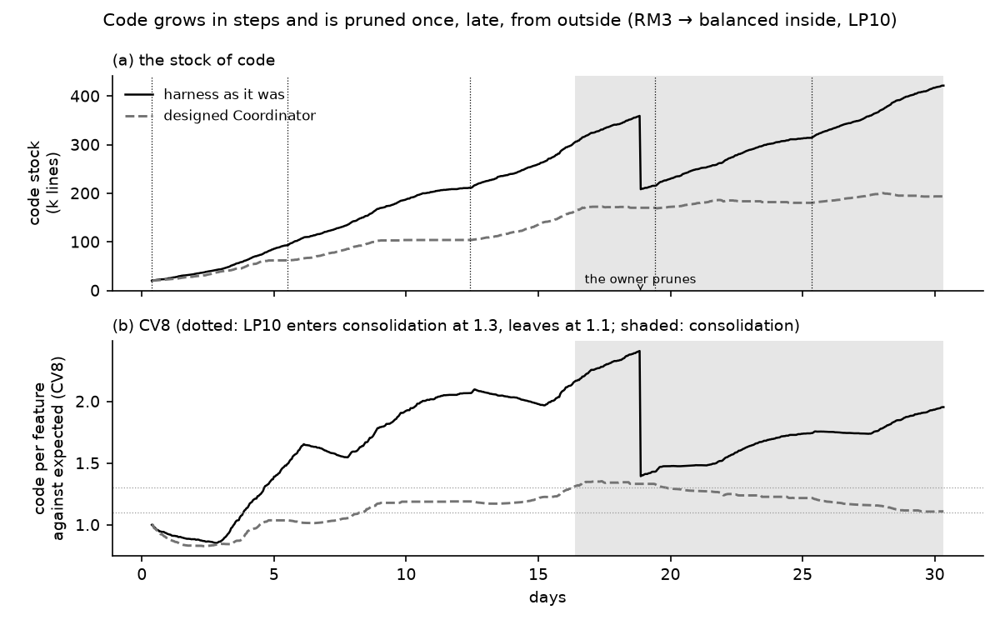

Two differences from the record are the model's, and are said rather than tuned away. The checking habit drifts
further than the record shows: about half the runs unread after three days (the live runs, §6), nearly all in the
quiet stretches between directions, where the record (45 hours) shows a third. Its erosion time (30 hours) is
fitted to one incident, and the record is too short to see a floor, if there is one. And the model loses
corrections at cuts and has the owner repeat a few later (8 a month), which RM12 did not see across a cut in one
session; it is B9's leak, kept because the parity benchmark shows fresh sessions repeating corrected mistakes.

## 5. Controllers on

| Hoped-for mode (02 §4) | The design, in the model (10 seeds) | Moved? |
|---|---|---|
| (a) smaller spikes, gone in hours | reworked per line added 0.03 against 0.07; in a direction's first 36 hours a median 0.04 against 0.12, the largest 0.34 against 0.54; escaped 0.04 of accepted against 0.09 | **yes** |
| (b) discovery moved before landing | 46% of rework caught at acceptance (41 to 60%) against 16%; what escapes is still found a median 10 hours later, half of it by the owner | **partly** |
| (c) corrections fall, learning carries | 19 corrections against 51; none repeated; durable knowledge retired as checks absorb it (2 standing at day 30 against 12) | **yes** |
| (d) checking cannot drift | no unread exit status, in every seed | **yes** |
| (e) a stall noticed within a bound | 40 to 42 minutes, owner or not; never longer | **yes** |
| (f) the owner's queue bounded | at most 3 blockers; 2 to 8 decisions waiting, drained in each handover report; 0.3 interruptions a day | **yes** |
| (g) context | no Coordinator window and no cut; nine in ten worker windows end under 340k tokens, one run in 4,000 reaches the cut | **yes, for the Coordinator** |
| RM3, balanced inside | consolidation entered once (day 16 or 17) and left by day 30 in 3 seeds of 10, CV8 back to 1.1; the owner never prunes | **yes** |

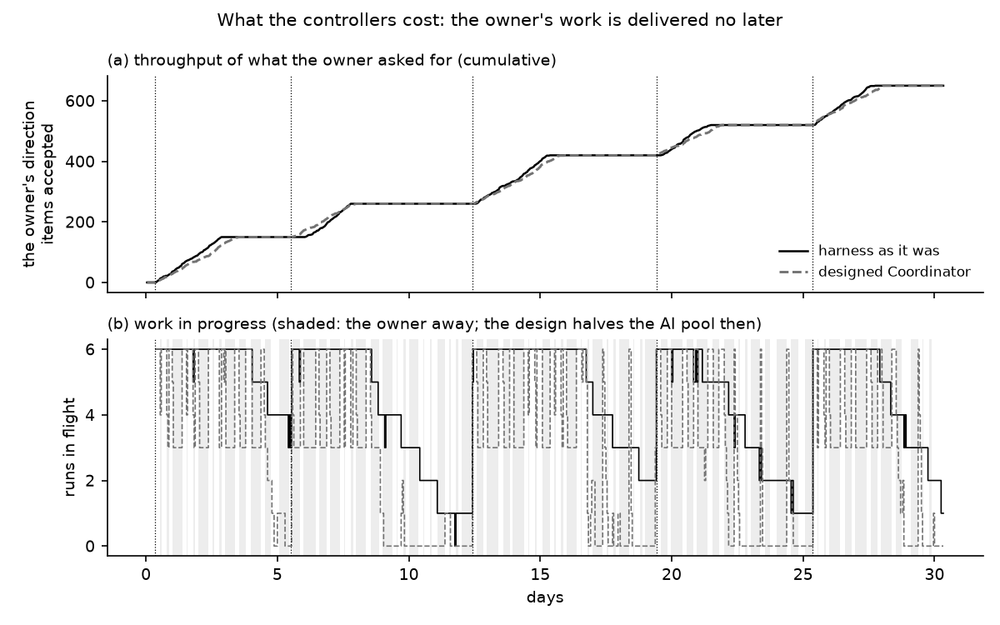

**What the controllers cost.** A direction takes longer to deliver: 61 hours to 90% of its items against 50 (54 to
63 against 47 to 54), from halving the pool while the owner is away and from 500 checks a month deeper than the
tests. The lease expires about 27 sound runs a month, runs silent past 40 minutes while thinking. And with the owner
at the desk the harness notices a stall faster (about 20 minutes) than the lease does: the bound is a ceiling, not
an improvement everywhere.

**A finding about LP2.** With escaped rework well under its limit, LP2's integral loosens review every day, and h*
ends the month at 0.27 to 0.30, the top of its band, in every seed. By then LP1 checks a new direction's work at the
desk with the tests alone, and in the last two directions CV1 peaks at 0.06 to 0.11 against 0.05 to 0.09 with h*
held at 0.1. LP2 does what 07 specifies, holding CV1 at its limit rather than below it, and it saves a tenth of the
deep checks; but the windup is across regimes: what was learnt on mature work is applied to the next new direction.
07's open question 1 now has evidence: schedule h* on direction age (gap 5), or integrate only within a regime.

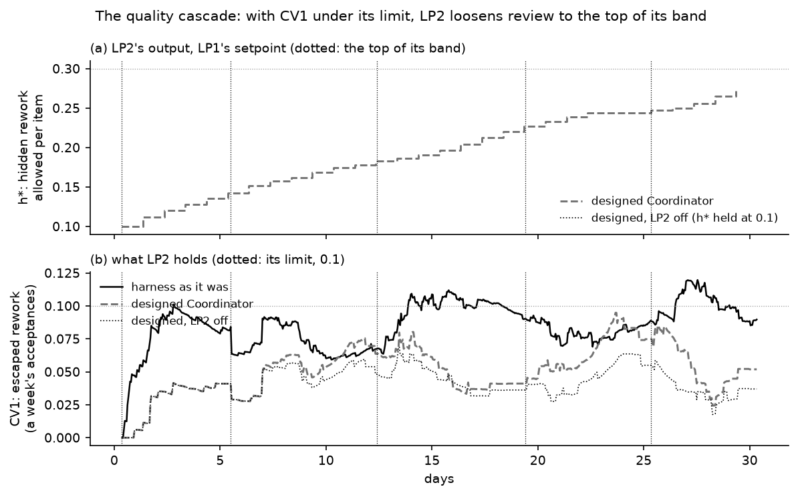

**Loop knockout** (one loop at a time back to the harness's law, five seeds; `world/knockout.py`):

| Policy | escaped / accepted | caught before landing | longest stall away (min) | exit status unread | decisions waiting, day 30 | highest CV8 | hours to 90% of a direction | sound runs expired |
|---|---|---|---|---|---|---|---|---|
| the design, every loop in | 0.045 | 0.48 | 42 | 0 | 6 | 1.34 | 61 | 22 |
| LP1 out (the harness's check) | 0.066 | 0.16 | 42 | 0.82 | 6 | 1.37 | 61 | 24 |
| LP2 out (h* held at 0.1) | 0.043 | 0.55 | 42 | 0 | 6 | 1.37 | 61 | 28 |
| LP3 out (fan-out by pressure) | 0.072 | 0.53 | 42 | 0 | 6 | 1.37 | 52 | 33 |
| LP5 out (no lease) | 0.048 | 0.52 | 225 | 0 | 6 | 1.38 | 59 | 0 |
| LP6 out (everything admitted) | 0.037 | 0.45 | 42 | 0 | 6 | 1.63 | 60 | 29 |
| LP7's handover report out | 0.046 | 0.47 | 42 | 0 | 256 | 1.38 | 61 | 28 |
| LP9 out | 0.053 | 0.47 | 42 | 0 | 6 | 1.37 | 62 | 22 |
| LP10 out | 0.046 | 0.50 | 42 | 0 | 6 | 1.58 | 60 | 26 |
| the harness as it was | 0.089 | 0.14 | 385 | 0.76 | 256 | 2.30 | 50 | 0 |

Each loop carries the mode it was designed for, and little else: LP1 the catch before landing and H1, LP5 the
bound on stalls, LP7 the batch queue, LP10 code per feature, LP9 a fifth of the escaped rework (through learning
kept). LP3 carries both the design's cost and part of its quality: with fan-out by pressure a direction is
delivered in 52 hours, not 61, and escaped rework rises by half (thinner briefs, R10). Knocking out LP6 lowers
escaped rework, because the extra low-value proposals are mature, low-defect work that dilutes the ratio; it is
paid for in code per feature (1.63).

**Sensitivity and the time step.** Five seeds each, the plant's uncertain numbers moved one at a time: discovery
twice as slow and twice as fast, stalls twice as likely, a new direction twice as bad (a peak of 0.9), sound runs'
long silences three times as often. Every conclusion of §4 and §5 holds in every case: the design halves escaped
rework (0.043 to 0.062 against 0.084 to 0.115), catches about half before landing against a sixth, keeps stalls
under 42 minutes, reads every exit status, and keeps the owner's queues bounded. Two numbers move: three times as
many long silences expire 74 sound runs a month instead of 22 (the lease's cost grows with the silence the workers
keep, so the TTL per tier is worth identifying, 10 §1), and twice as many stalls slow both policies' delivery.
Halving the time step (two minutes to one) moves no median by more than the seeds' spread.

## 6. The live run under ergostat

The same model was run by ergostat itself (`ergostat run`), `COORD_POLICY=harness` and `designed` in two fresh
copies, for three factory days each, on a factory hour every 10 seconds. Every block ran without a failure or a
refused line, and ergostat's own record shows the differences of §4 and §5: the harness's unread test runs
settling near half (the record's third, at the same age), stalls silent up to 1.5 factory hours while the owner is
away, and its decisions waiting climbing to 31; the design's stalls caught at 0.7 hours (45 minutes, one block
period past the lease), no unread runs, and decisions drained at each return. Over the three days the harness let
33 items escape against 10, and caught 2 at acceptance against 12.

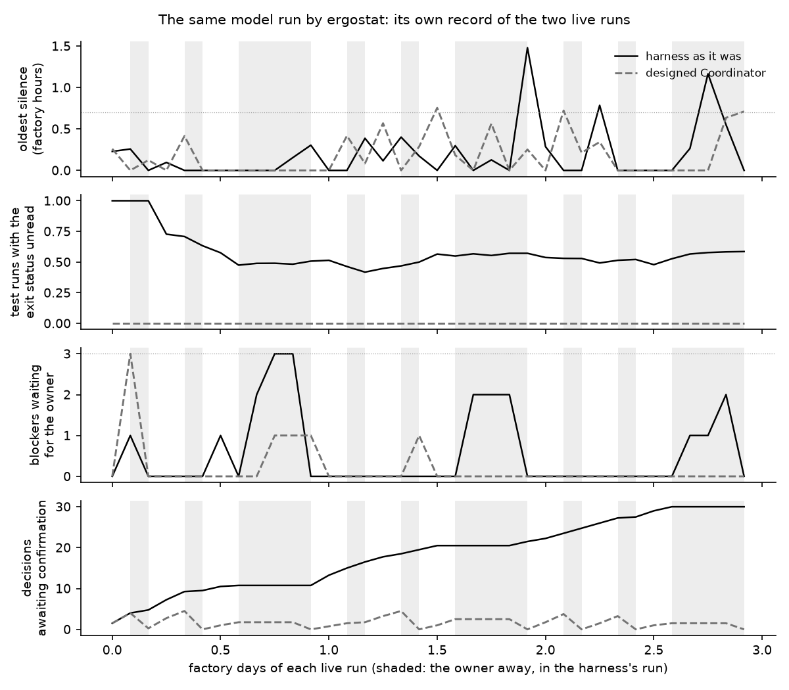

**What the live run found that the headless one could not.** The first live run gave the attention block
`goal: decisions-drained`. That shorthand puts an on/off block in front of it, so it ran only while more than twenty
decisions waited: the handover report, meant to go on the owner's return, went out once in a day and a half, and
S5 stood full of batched hold points all that time. The headless runner calls every law on its clock and could not
see it. The block now reads its goal and runs on its clock (gap 13).

ergostat draws the cascade as 07 does, the integrator's output entering the acceptance check's summing junction:

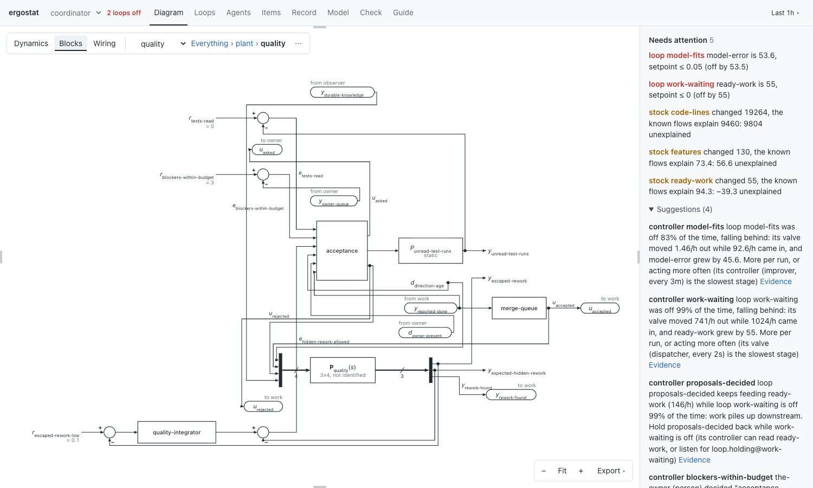

**The fit is poor, and says why.** On the first live run, at the clock its durations are written for, the replay's
scaled error was 0.8. `reported` (runs over a run time) ignores stalls; `reopened` and `rework-found` are first
order where the plant has a fast branch (a red test within the hour) beside a slow one, so they swing less than the
record (U_S near 0.9), which is RM2's shape; `lines-per-item` is half what is written, because rework lands few
lines (calibration proposed 100 against 200). The modelling loop ran as in the-job: the judge turned away four
changes, one of which would have made the fit 20,000 times worse. A discovery of two branches is a structural
change only the residuals can suggest, which 10's milestone 7 (structure from residuals) is for.

## 7. What ergostat could not express

Each gap names the loop that needs it, what was done instead, and a short specification of the feature.

1. **Closed-loop simulation.** Projection holds the blocks still, so no loop can be simulated, no policy compared
   and no what-if run through a controller; 10 §5's policy simulation and 00 SD-18 need it. *Instead*: the laws are
   Python, run headless. *Feature*: a block's law in the model (`law:` as an equation over its inputs, or a
   deterministic program called on the projected state), used by projection, what-if, sensitivity and loop
   dominance; a block without one stays held, and says so.
2. **Templates.** The leased work queue (7 stocks, 13 flows, 4 blocks), the rework cycle and the prioritised queue
   are written out by hand, once each. *Needed by*: LP1 to LP7 (07 §6). *Feature*: `use: leased-work-queue` with
   parameters (the item kind, the TTL, k attempts) expanding into named parts under a prefix, drawn as one module
   that opens.
3. **Event-triggered worker pools with leases.** A machine block runs once at a time, on a clock or a command;
   ergostat runs no block per item, and holds no lease. *Needed by*: LP3, LP5. *Instead*: the workers are an
   external block; the lease, its TTL, attempts and dead letter are in `watchdog`'s program. *Feature*: `pool:` on
   a machine block: one run per item leased from a stock (`items: work, state: ready`), at most `at-once`, each
   lease renewed by any event the run causes and expired past its tier's TTL with a fencing number, the item moved
   back with its attempt counted, dead-lettered after k; a breaker per worker class.
4. **Operating states and modes.** No first-class state of the system or of an actuator. *Needed by*: LP10
   (consolidation), S2 and LP1's away schedule, 08 §2's freeze and incident, ISA-88's held state, the
   automatic, semi-automatic and manual modes of 08 §3.2. *Instead*: `consolidating` is a 0/1 stock moved by a
   two-way flow; presence is an exogenous auxiliary; freeze and incident are not built. *Feature*: `states:` on a
   system (states, the conditions and dwell that move between them, precedence), and a table of the limits and
   setpoints each state schedules; `mode:` per actuator with protective switches that only move toward manual.
5. **Regime-scheduled thresholds.** A goal has one setpoint, set by hand or one block. *Needed by*: S2 by
   presence, LP1's depth by direction age, LP5's TTL per tier, and LP2's h* per regime (§5's finding). *Instead*:
   `wip-schedule` sets S2 through a cascade; the rest is in programs. *Feature*: `hold:` and parameters as a table
   on a scheduling variable (`by: auxiliary.owner-present`) or a tier, drawn and explained as gain scheduling.
6. **Permissives, interlocks and trips.** A block can command another to run, never forbid one act; the `alarm`
   block outputs 1 or 0 and raises no finding, though SPEC §9.2 says it does. *Needed by*: H1 at the merge (LP4), H2
   on outward acts, H3, P3 on dispatch, T2's freeze. *Instead*: H1 is a critical goal on the checking habit, and the
   check reads the exit status itself. *Feature*: `permits:` on a block's output, a condition re-read at the moment
   of the act that holds the act pending until it is true, with a bypass lease, and `check` verifying the cause and
   effect matrix.
7. **The observer's staleness and quality.** A reading has a time but no age as information, no quality (good,
   uncertain, bad) and no rate of going stale; an unobservable stock cannot be estimated between readings.
   *Needed by*: LP8, LP1 (x̂4), CV5. *Instead*: `undiscovered-rework` is read from the simulation's truth and x̂4
   is a sensor. *Feature*: per-sensor staleness (`stale-after:`, or a change rate λ), a quality carried into
   blocks' inputs and drawn, and an `estimated:` stock the model predicts between readings and corrects at each.
8. **Relays and impulses in equations.** The harness's cut (nothing until 965k, then most at once) cannot be
   written: equations have no `IF` or pulse. *Needed by*: B6, H5, LP10's switch. *Instead*: measured, by an
   external block. *Feature*: `IF`, `STEP` and `PULSE`, or a relay flow form with its threshold and reset.
9. **One sign for all of a block's outputs.** A decision that splits a flow (admit or decline, accept or send back)
   moves its outputs opposite ways. *Needed by*: LP6, LP1. *Instead*: LP1 split from LP4; admission keeps both, so
   loops through `declined` carry a sign that is not quite right. *Feature*: a sign per output port.
10. **A project's clock.** ergostat's units are wall-clock hours; a simulated plant's are its own. *Instead*:
    durations written in ergostat's time, the factory's in comments; `factory-hours` as a unit word. *Feature*:
    `clock: {hour: 30s}`, so parameters, rates and charts read in the plant's hours.
11. **Per-item and per-kind goals.** CV1 is per kind, x̂4 per item, CV5 per run; a goal holds one number.
    *Instead*: averages and maxima. *Feature*: `for-each: kind` (or item) on a goal, its status the worst.
12. **Budgets.** S1's token bucket and S5's count are inside programs; `limit`'s `rate` bounds a change, not a
    count in a window. *Feature*: a `budget` block (tokens a day, at most a day's worth saved, a reserve for the
    top priority).
13. **A block run by an event.** A machine block runs on its clock, or while commanded, or (with `goal:`) while its
    goal is off. *Needed by*: LP7's handover report on the owner's return, LP9 on each owner message, LP5's redrive
    on a run's end. *Instead*: the block runs every two seconds and checks for the event itself (§6). *Feature*:
    `on:` on a machine block, a measured transition (`auxiliary.owner-present` rising) or an item event type.

## 8. What the model cannot say

The plant's numbers are the record's, read roughly, and the record is one session of 45 hours: the floor of the
checking habit, whether briefs change quality, and whether corrections recur across sessions are assumptions, said
as such above. The owner is simulated by rules (answers in minutes, prunes after two weeks of bloat), so the model
cannot say how a real owner would treat the handover report. And the design's numbers are 07's *proposed*
defaults, untuned: the results are a test of the structure, not of the tuning.
