# Bundled connectors in the Dynamics diagram

Status: proposal, 2026-11-22. A throwaway prototype was built and measured, and is not merged (see Evidence). The two build
gaps at the end carry it out.

## The problem

The owner wants Blocks' MIMO vectors in Dynamics: where several lines run between the same two places, one line.
Blocks bundles in three places: a collector bus (`ergostat/blockdiagram.py:672-688`), mux/demux around a MIMO process
(`:943-962`), and a vector between two subsystems (`:1325-1341`), drawn bold with a slash and a count
(`blocks.js:932-950`). Dynamics does none of it. Each part a line reaches inside a closed module gets its own port
(`ergostat/fold.py:112-137`), lines are never merged (`dynamics.py:320-432`), and each line has its own sign
(`dynamics.js:186-214`). As measured here (Evidence): on ticket-factory with factory and modelling open,
16 drawn connectors run between two closed modules, up to six side by side into oversight. On software-factory's top
level, six lines and their signs crowd the 90 px between product and factory. Inside product, three connectors reach
churn (from bugs-live, missing-ops and users), and lines on their way to filed-features and signups pass beside it. The owner's decision "one model, three drawings" means Blocks' slash and mux/demux bars cannot be copied
across: the Dynamics answer has to come from system dynamics' own practice.

## Decisions

**(a) Basis and glyph.** Stella Architect draws what passes between two modules as one *bundled connector* (and
flows as one *bundled flow*), opened to list its members. Vensim has no modules and no bundles: a view's
inputs from another view are shadow variables, which ergostat already draws (`dynamics.py` `shadows`). Outside SD tools,
the technique is *confluent drawing* (Dickerson, Eppstein, Goodrich and Meng, 2003: lines that share a way merge
smoothly, with no junction mark, and can be read apart again) and *edge bundling* (Holten, 2006; Holten and van Wijk,
2009). Decision: Stella's idea, drawn confluently. The glyph is a **trunk** in the connector's own tone (`--sd-ink`), about
twice as heavy (2.4 against 1.1). At each end it splits into one **branch** per member, each leaving the trunk on its
tangent, so the join is a smooth curve with no dot, bar or comb. Each branch keeps its member's own arrowhead
and **polarity sign** on its own unshared segment, where every connector's sign is today. Beside the trunk's middle,
the bundle is marked **in words: `3 links: +2 −1`** (`?1` for a member of unknown polarity). There is no slash and
no bare count, because that is Blocks' vector notation and the decision keeps the two notations apart. This is the
default, not an owner question: words read on sight and borrow from no other notation. *Reason:* it is the one
form a system dynamicist knows from Stella, and the only one that keeps each causal link's sign where SD readers look
for it.

**(b) Polarity.** A bundle has **no polarity of its own**. It is not a causal link: it carries several, which can
differ. Signs stay on the members' branches, and the mark only counts them. A loop through a bundle takes the sign
of the member it uses. Filed Q25's acceptance (every connector reads its sign at its head) changes in one place:
*every member branch shows its member's sign at its head, the trunk shows none, and the mark's counts equal the
members' signs.* A test reads both, from the graph and from the drawing. *Reason:* a summed or majority sign would
be a claim about the loop the model does not make.

**(c) Flows against information.** Only **connectors** (information) bundle. **Pipes are never bundled**: a flow is
conserved material, and one pipe per flow is how a reader sees which stock drains into which. Between two
modules there are at most two or three flows, and Stella's bundled flow would hide that. Under **Flows only**
(`sdFlowLinks`, `dynamics.js:499`, a class switch with no re-layout), a bundle keeps the members Flows only would keep
(links whose tail is a flow): their branches stay, the others hide by class, and the trunk hides if none is kept. The
mark has a second wording for Flows only, swapped by the same class (`1 flow link: +1`). *Reason:* Flows only must not
move anything, and a member that carries a rate is still a rate across the boundary.

**(d) Thresholds, no toggle.** Between two closed modules, **2 or more** connectors in the same direction make a bundle.
Opposite directions are two bundles. Fan-in inside an open system: **3 or more** connectors into one part whose tails
lie more than two layout steps away (112 px) make a trunk. That is the second gap (f). **No toggle**: the rule decides,
as it decides where shadows and stubs go. A member is seen by opening its module, by hovering, or in the bundle's panel.
*Reason:* a switch is a new piece of UI and a second drawing of the same model to keep correct; the owner's rule is
no new panels, and one drawing per discipline.

**(e) Unbundling at a closed module.** A bundle ends at the module's **member port rows, kept adjacent** (`portSides`,
`diagram.js:45-46`, ranks each member's row by its bundle). The group is placed **after the module's other rows on
that side**. The trunk is routed by the layout like any line, and the branches part from it within 30 px of the box.
Opening the module dissolves the bundle into its members' real lines (shadows and stubs as today). *Reason:* the
prototype measured it. On ticket-factory, grouped rows placed last gave the fewest crossings of the variants tried
(29, against 35 with rows in main's order, where branches crossed the pipes into neighbouring rows). Over the corpus
it is the one variant with no line through a part (Evidence).

**(f) The one representation.** In the graph, after `shadows` in `dynamics.finish`, the server adds an edge
`{"kind": "bundle", "id": "bundle:<source>><target>", source, target, sourcePort, targetPort, "members": [edge ids],
"signs": {"+": n, "-": m, "?": k}, "loops": union, "causal": union}`. Its ports are its first member's rows: putting the trunk on the middle row measured no better (Evidence). Each
member stays in `g.edges` with `"bundle": <id>`. The layout skips members and lays out the bundle; everything
keyed by edge (loops, Flows only, export, selection) keeps working unchanged. A bundle is a drawing, never in the
YAML and never edited. Its **panel** is the existing connector panel (`openEdgeSD`) listing the members in a table:
from, to, sign, the loops each is in. Each row selects its member. There is no new panel kind. The **member model** is
the members' own connectors: nothing is summed or estimated. `dynamics-module-bundled-connectors` builds this first,
between closed modules. Trunks **inside open sectors and along frames** (R8 piece 8, the fan-in of (d)) use the same
edge kind with a junction inside a sector. That is `dynamics-trunk-bundling-in-open-systems`, **staged after the layout
decision**, because where a trunk may run depends on how sectors are laid out.

**(g) Loop tracing and selection.** Hovering a **branch** traces its member, as a plain connector does today: the
member's branches and the trunk light. Hovering the **trunk** lights every member. A loop traced from the loop list
lights the trunk and only the branches of its own members. Selection keys are the members' (`linkKey`), so a
selected member stays selected when a module is opened and the bundle dissolves. `correspond.py` maps shapes, not lines
(`dynamics_shapes`), and it needs **no change**. A bundle corresponds to the union of its members, which the
causal-loop lists already give.

**(h) R1's goal rows on a closed box.** A closed box lists its goals as rows under its name (R1) and its ports below.
Bundles only reorder **port rows**. Goal rows keep their place and their order. A member port row that is also a
goal's part keeps its goal row where it is: the two are separate rows. *Reason:* goal rows say what the module is held
to, and ports say what crosses. A bundle must not move the first to tidy the second.

**(i) Legend, the Guide, export, keyboard (R9).** The **legend** gets one row, shown only when a bundle is drawn:
*"bundled connectors: several links between two modules on one line, each keeping its own head and sign; the words
count them."* The **Guide's frame** (`guide.js`) gets the same sentence where it explains modules and ports. **Export**
(`sdExportItems`) lists the row when a bundle is in the picture, and SVG/PNG export draws what is on screen. XMILE export,
when built, writes the members and never the bundle. **Keyboard**: the trunk is one tab stop with
`aria-label="3 links from product to factory: +2 −1"`, Enter opens its panel, and arrow keys move between its branches.

## Before and after

Prototype screenshots (`?bundle=1&rows=last`, the prototype's settled form), light and dark:

| View | Before (main) | After (prototype) |
|---|---|---|
| ticket-factory, factory and modelling open | 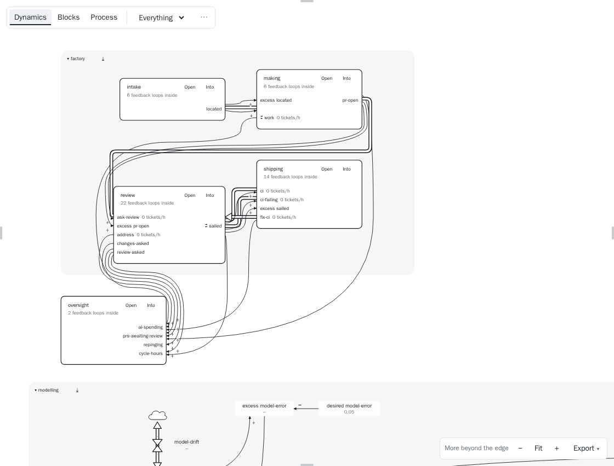 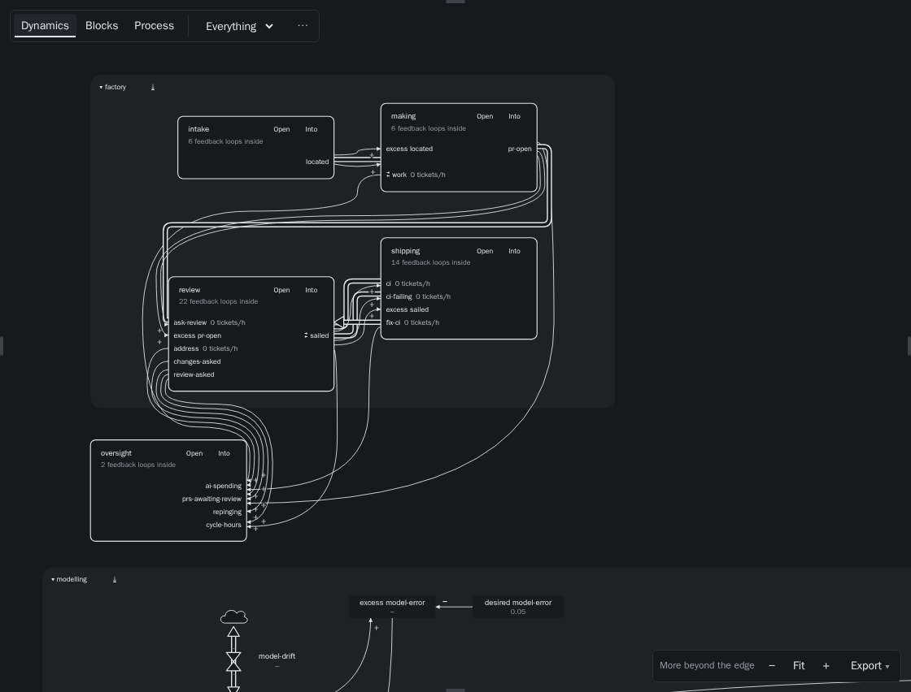 | 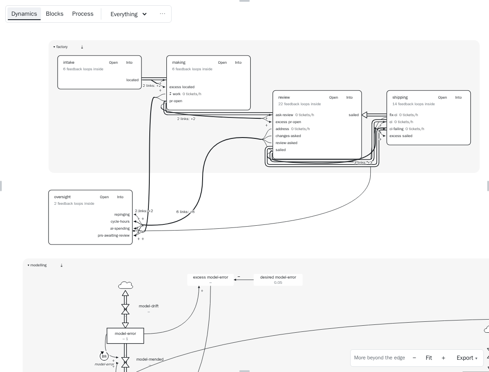 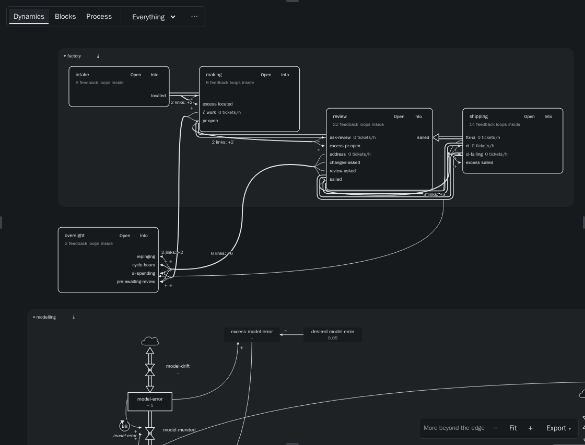 |
| software-factory, top level | 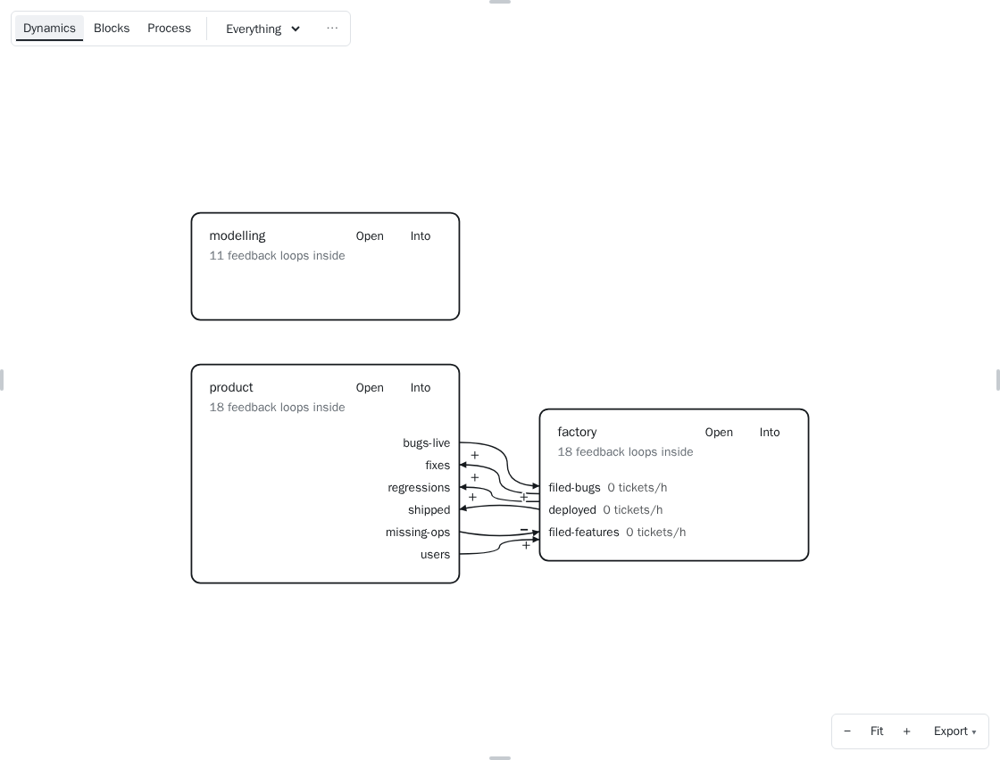 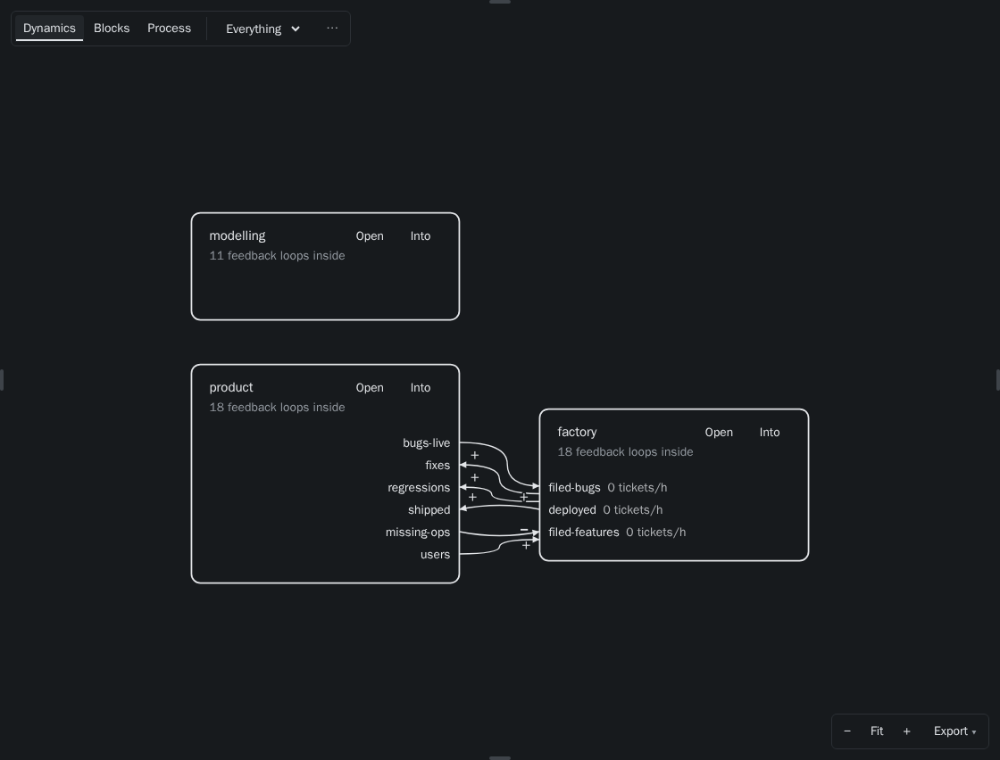 | 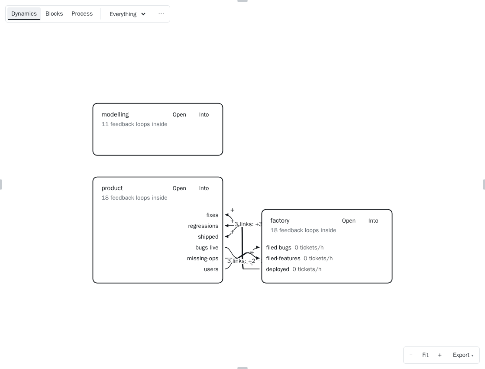 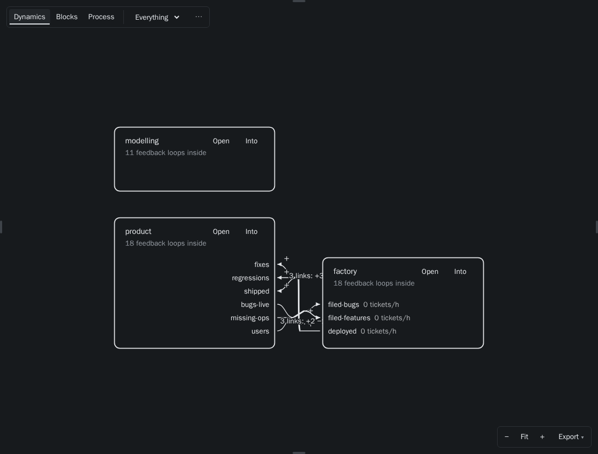 |
| software-factory, product alone | 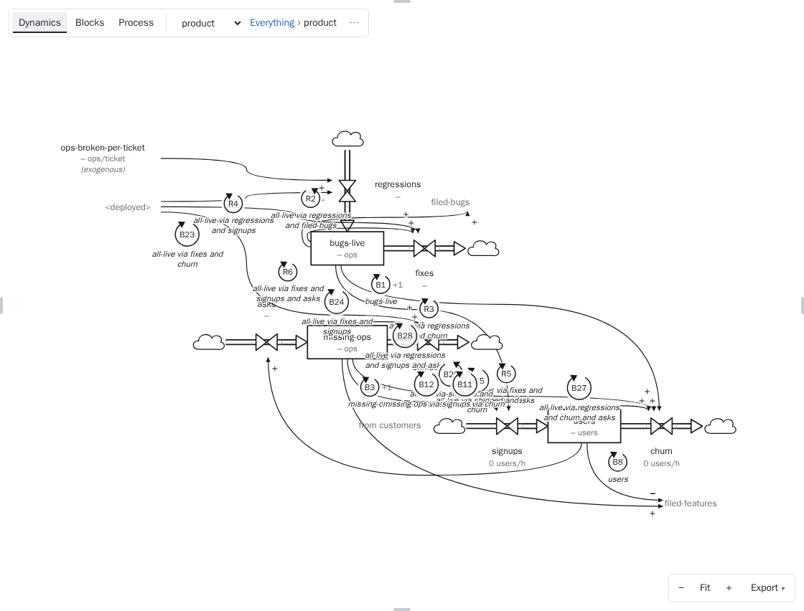 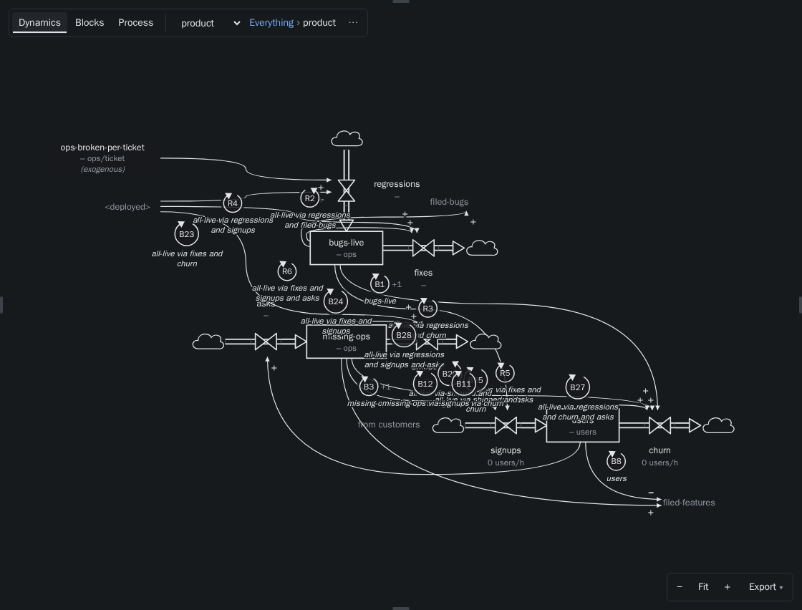 | sketch below: the prototype does not change it |

Inside product nothing runs between two closed modules, so the prototype leaves it as it is. Its fan-in is the
second gap's. Churn itself is reached by two far tails and its own stock, which is below the threshold in (d), so the
rule would leave it alone. The sketch ([bundled-product-fanin-sketch.svg](img/bundled-product-fanin-sketch.svg), light
or dark to match the reader's setting) shows the rule on a part that three far tails do reach.

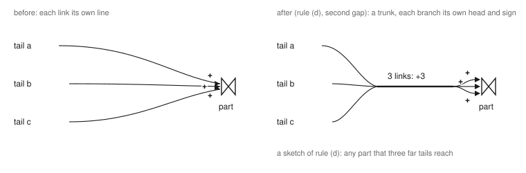

## Evidence

**The prototype.** An off flag, `?bundle=1`, committed at `f903a477` and reverted by the next commit, so nothing
merges. It worked in the page. Connectors between two closed modules, two or more in one direction, became one
edge, laid out and routed like any other. The drawing put the trunk on that route with its ends moved to the
middle of each end's member rows, then added the branches, heads, signs and mark of (a). `rows=last` groups each
bundle's rows after the module's other rows (e). Its test (`tests/test_bundle_prototype.py`, in `f903a477`) drew main
and the prototype in the same browser and counted, on the drawn geometry (`tests/layout_geometry.js`):

- **connector crossings**: a connector, trunk or branch properly crossing any other line, one per crossing point. A
  bundle's own trunk and branches are not counted against each other, and pipe against pipe is `pipe-crossing`'s
  count, not this one. There is no corpus rule for connector crossings yet, so this count was added for the prototype.
- **sign collisions** and **word collisions**: `label-collision` instances on a sign or count (minor) and on words.
- **lines through parts**: `line-through-part`.

**Corpus counts.** These are the views `tests/layout_corpus.py` draws (`views_of`: whole, everything open, each system
open, each system alone) for every example's Dynamics view: 183 views, 29 of them with a bundle (75 bundles). Running
the corpus's own command was refused in this environment, so the same views and rules were run from the test.

| Summed over 183 views | main | prototype, rows last | prototype, rows in main's order |
|---|---|---|---|
| connector crossings | 2385 | **2195** (−190) | 2176 |
| sign collisions | 875 | **861** (−14) | 858 |
| lines through parts | 0 | **0** | 1 |
| word collisions | 1220 | 1278 (+58) | 1277 |
| lines drawn between closed modules | 288 | 99 | 99 |

The 154 views with no bundle sum to the same counts on both. The whole difference is in the 29 views with one, where crossings go
from 472 to 282. Rows last is the settled form: it is the one variant with no line through a part. The rise in
word collisions is the marks themselves, the cost of saying the count in words (the first gap's amendment 4 below
answers it).

**Per view the gain is not uniform.** Crossings rose in 7 of the 29 views. Coordinator with plant open goes from
21 to 41, where rows last packs the rows of six bundles onto one side; in main's order it is 12. Ticket-factory with
factory open goes from 11 to 14, and with factory alone from 0 to 4. Software-factory's top level, and the views with
intake, delivery or modelling open, go up by one each: the two opposite trunks cross in the 90 px between product
and factory. The large falls are image-squeeze with benchmark open (106 to 5), image-squeeze whole (38 to 17) and with
service open (43 to 24), coordinator's top level (6 to 0) and ticket-factory's top level (4 to 0).

**The three named views** (prototype, rows last):

| View | connector crossings | sign collisions | lines through parts | lines between closed modules |
|---|---|---|---|---|
| ticket-factory, factory and modelling open | 26 → 29 | 15 → 15 | 0 → 0 | 16 → 6 |
| software-factory, top level | 0 → 1 | 3 → 3 | 0 → 0 | 6 → 2 |
| software-factory, product alone | 6 → 6 | 21 → 21 | 0 → 0 | 0 → 0 (no bundle) |

On ticket-factory the prototype draws 10 fewer lines, but it does not cut crossings. Where review's rows meet
both pipes and bundles, branches cross pipes 4 times and each other twice, and the re-layout with fewer lines
arranges the modules differently. Variants tried on this view: joins of 16, 20, 30 and 50 px gave 34 to 40 crossings,
rows in main's order 35, rows last with the trunk on the middle row 31, and rows last 29. Drawing-time geometry is not
enough here: the layout has to know about the trunk. That is the first amendment below.

## The build gaps

- **`dynamics-module-bundled-connectors`: confirmed, amended.** It builds (a)-(c), (e)-(i) between closed modules, and
  the threshold of 2 from (d). Amendments from the evidence:
  1. The bundle is made on the server as the `bundle` edge of (f), not in the page as the prototype did. The layout
     lays out the bundle and skips its members.
  2. Member rows are grouped and placed after a module's other rows on that side (e). Opposite bundles between one
     pair of modules are placed in mirror order, so that their trunks do not cross.
  3. The layout leaves room for a trunk: at least two joins (60 px) between the boxes it joins. Software-factory's
     90 px left its two trunks crossing and their marks crowded.
  4. The mark is placed as the layout places a line's label, not beside the trunk's middle, so that the words do not
     add collisions.
  5. Acceptance: a `connector-crossing` count added to `tests/layout_rules.py`. On the corpus: connector crossings
     below main's, and sign collisions, word collisions and lines through parts not above main's. The three views
     above, in screenshots light and dark. Q25's acceptance as changed in (b). The panel, the legend row, export
     and keyboard of (f) and (i).
- **`dynamics-trunk-bundling-in-open-systems`: confirmed, staged after the layout decision.** It covers trunks inside
  open sectors and along frames (R8 piece 8) and the fan-in rule of (d): 3 or more connectors into one part from
  tails over 112 px away. It uses the same edge kind and panel, and depends on the first gap.
