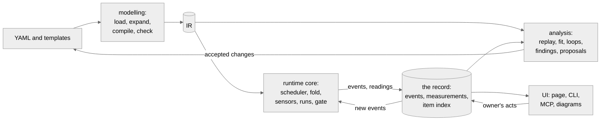
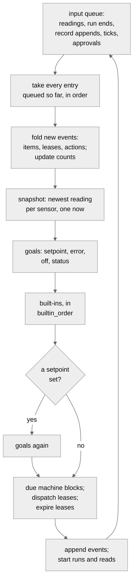
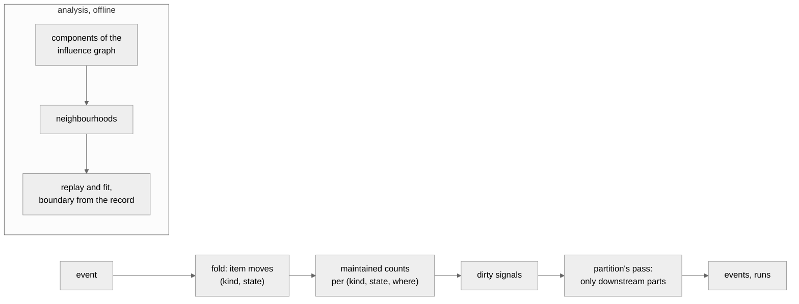
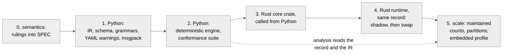

# An intermediate representation and a minimal runtime

Status: proposal, 2026-11-18; nothing here is built. The owner's question: underneath, a running model is equations
and graphs a scheduler uses to pick the next process or message. Could ergostat be a small runtime plus an
intermediate representation (IR), and at 6,000 use cases, 120,000 stocks and 400,000 flows, how hard is replacing the
Python with Go or Rust?

**The short answer.** Yes, and most of the work does not depend on the language. The running part is small: about
10,000 of ergostat's 45,000 lines of Python. It is already separate in practice, because **the engine does not
evaluate equations**: they serve replay, fitting and what-if, not control. What blocks a port is about two dozen
behaviours defined only by Python (`ast`, `str()`, `fnmatch`, `marshal`, YAML 1.1, threads, `time.localtime`). What
blocks scale is polling and whole-model passes, which would block Go or Rust just as much. The plan: write the
semantics down, emit a versioned JSON IR, build a conformance suite in Python, then a Rust core Python calls
in-process, then a Rust runtime writing the same record.

## 1. What a running model is

### 1.1 The graph

After templates are expanded and references resolved (`ergostat/spec/ir.py`, `Spec`), a model is:

| Element | What the runtime needs of it |
|---|---|
| **Stocks, flows, auxiliaries** | Names, `from`/`to`, `two-way`, a declared `rate`, and their sensors. The level is the newest reading. |
| **Parameters and equations** | Nothing at run time today. They feed replay, fit, sensitivity and extreme-conditions tests (`numbers/`). |
| **Sensors** | One of `run`, `query`, `items`, `changes`, `manual`, `builtin`, with `every`/`cron`, `timeout`, `parse`, `averages` |
| **Goals** | `of`, setpoint `op value`, `tolerance`, and the hysteresis rule (`Goal.status`) |
| **Built-in blocks** | Twelve types (`spec/blocks.py`), each with a small state: latch, delay line, count, timer. The `judge` runs on its own clock. |
| **Machine blocks** | `program`, `ai`, `person`, `external`, with `in`/`out` wiring, `max`/`min`, `every`/`cron`, `timeout`, `mode`, `agent` (an `at-once` semaphore) and control-law `params` |
| **Item kinds** | Id glob, states, `on` (event type → state), fold rules, lease terms; six built in |
| **Triggers** | Sensor and block schedules, commands, items reaching a state (`takes`), approvals in the record |
| **Leases** | Terms resolved block → kind → tier → default; fencing; ack/nack/expire; dead letters |
| **Gated actions** | A command template, `gate`, `class`, `args`, `wait`, `timeout` |
| **Templates** | None: expanded away (`library/expand.py`) before compiling; only the `use:` line is kept, for errors |

Derived wiring (`commanders_of`, `blocks.order`, implied `keep-<goal>` blocks, sensors read after a flow moves) is
computed on load; derived *meaning* (loops, polarity, roles, findings) only by analysis.

### 1.2 The record

Two stores, kept apart (invariant 10; SPEC §4b):

- **Events**: append-only `seq, id, time, type, item, source, causedby, data|patch|set`, in segments or SQLite.
  `seq` is the total order; `time` is the wall clock and may run backwards against it (a transcript line carries its
  own timestamp).
- **Measurements**: `series, time, value`, rolled into tiers.
- **The item index**: a SQLite cache of the fold of events by item id (`spec/itemindex.py`), rebuilt when its layout
  or the model's kinds change.

### 1.3 The scheduler

`spec/engine.py` runs several loops on threads:

| Trigger | What is evaluated |
|---|---|
| A sensor's `every` or `cron` | Its read, on its own thread. When the reading lands, a full **pass**. |
| A clock tick (`TICK = 1 s`) | A full pass |
| A machine run ends | The sensors of the stocks its moved flows touch are read at once, then a pass |
| The record grows (polled every 0.25 s) | The dispatcher leases items; every second, the lease watchdog |
| Approvals and stop requests in the record (polled every 0.5 s) | Start a run, run an action, begin a step test |
| Every 5 s | Sweep messages, workspaces, approved actions nobody ran |

A pass (`Engine.evaluate`): the newest reading of every sensor; every goal's setpoint, error, `off` and status
(`loop.off`/`loop.holding` on a crossing); every built-in in topological order (`controller.decided` when one turns on
or off); the goals again if a built-in set a setpoint; then every machine block that is `due()` is started.

### 1.4 The layers



| Layer | Reads | Writes |
|---|---|---|
| Modelling | YAML, templates | The IR, findings |
| Runtime core | The IR, the record | Events (`agent.*`, `valve.opened`, `loop.*`, `controller.decided`, `ergostat.lease.*`, `ergostat.action.*`, item events), measurements, the item index |
| Analysis | The IR, the record | Estimates, model-change items; YAML only when accepted |
| UI | All of it | Owner events only: approvals, messages, readings by hand |

The runtime never reads YAML, and analysis writes to the record only as a model change. Today that is convention;
the IR makes it a boundary.

### 1.5 How others do it, and what we take

| Practice | What it is | What we take |
|---|---|---|
| **IEC 61499** | Event-driven function blocks: an event input fires an execution control chart that runs algorithms on the data inputs; applications are exchanged as XML and mapped onto devices. Eclipse 4diac FORTE is "a small portable implementation of an IEC 61499 runtime environment targeting small embedded control devices (16/32 Bit), implemented in C++" ([4diac FORTE](https://eclipse.dev/4diac/en_rte.php)). | A portable model file and a small runtime is a proven split. But the standard left execution semantics open, and runtimes reading the same XML behave differently (surveyed in Vyatkin, "IEC 61499 as Enabler of Distributed and Intelligent Automation: State-of-the-Art Review", *IEEE Trans. Industrial Informatics* 7(4), 2011). **Write the semantics before the second runtime.** |
| **IEC 61131-3, the PLC scan** | Copy the inputs into a process image, run the program on that frozen image, write the outputs; cyclic or event tasks. PLCopen XML exchanges programs. | A pass reads one consistent snapshot. Today it reads the store sensor by sensor while readings land on other threads. |
| **Modelica, FMI** | An FMU is a zip: `modelDescription.xml` (variables, causality, units) plus compiled code. Model Exchange hands the solver to the importer; Co-Simulation brings its own; FMI 3.0 adds Scheduled Execution, where the importer's scheduler activates model partitions ([FMI 3.0](https://fmi-standard.org/docs/3.0); "The FMI 3.0 Standard Interface for Clocked and Scheduled Simulations", *Proc. 14th International Modelica Conference*, 2021). | A declared interface apart from the computation, and partitions a scheduler activates one by one: the shape of a subsystem (§5). |
| **Simulink code generation** | Fixed-step models generated to C, a `model_step()` per rate; sorted execution order and sample times belong to the model | The block order is part of the compiled artefact, not rediscovered by the runtime. |
| **Incremental view maintenance** | Keeping a query's answer current by applying changes to it: Gupta, Mumick and Subrahmanian, "Maintaining Views Incrementally", SIGMOD 1993; McSherry et al., "Differential Dataflow", CIDR 2013; Budiu et al., "DBSP: Automatic Incremental View Maintenance for Rich Query Languages", PVLDB 16(7), 2023 | An `items:` sensor is a view (a count grouped by kind, state and `where`), to be maintained as events fold, not re-queried on a timer (§5). |
| **XMILE** (OASIS, 2015) | System dynamics interchange: stocks, flows, auxiliaries, equations as XML | A reference for the equation part; its semantics are Vensim's, which ours follow (`ZIDZ`, `DELAY3`). |

## 2. The IR

### 2.1 The format

- **JSON**, described by `schema/ergostat-ir.schema.json` beside the YAML schema: diffable in golden tests, read by
  every language, already the page's format. A binary encoding (CBOR of the same data) can follow for devices.
- **Versioned**: `"ergostat_ir": "1.0"`, semantic versioning; a runtime refuses a major version it does not know. The
  model's version, recorded on every run, becomes the SHA-256 of the canonical IR (RFC 8785), replacing
  `numbers/version.whole`'s hash of Python objects.
- **Emitted** by `ergostat compile --ir`, and written to the state directory on every load the engine takes.

**In it**: every reference resolved and checked; templates expanded; defaults applied (lease terms resolved per
block, `every`, `timeout`); durations in seconds; units normalised; expressions as trees, never text; implied blocks
materialised; the runtime's derived wiring (built-in order, commanders, sensors to read after acting). **Not in it**:
YAML lines (a separate source map, `ir.where.json`), loops, polarities, roles, findings, estimates, proposals.

**Profiles**, as IEC 61499's compliance profiles: **core** (stocks, flows, auxiliaries, goals, built-ins, `items`,
`manual` and `changes` sensors, item kinds and the fold: pure computation), **host** (machine blocks, `run` and `query`
sensors, leases, actions, workspaces, transcripts, messages), **analysis** (parameters, equations, units, ranges). A
device implements core; `ergostat run` core and host.

### 2.2 Its relation to `ir.py`

`ir.py` is already the IR in memory, with references resolved. What keeps it from being portable:
`Block.params` holds "the type's own keys, as written" (a `Setpoint`, parsed tables, `expr` text, the judge's
`Improve` object); `expr` is parsed with Python's `ast` at run time; source locations (`where`, `defined`) are mixed
into the model; kind order and matching are implicit (dict order, `fnmatch`); built-in order, commanders and implied
blocks are computed in the engine. `ir.py` gains `to_ir()` and `from_ir()`, round-trip tested on every example, and
the engine and analysis load from the IR; the dataclasses stay as Python's view of it.

### 2.3 A sketch of the schema

References are canonical strings (`"stock.inbox"`, `"goal.inbox-short.error"`, `"block.decide.urgent"`); each table
is an array sorted by name, so a runtime may intern names as indices.

```jsonc
{
  "ergostat_ir": "1.0",
  "model": {"name": "checkout", "hash": "sha256:…", "compiler": "ergostat 0.4.0",
            "timezone": "Europe/London", "time_unit": "s", "profiles": ["core", "host", "analysis"]},
  "systems":   [{"name": "intake", "within": "factory", "show": ["stock.inbox"]}],
  "parameters":[{"name": "k", "value": 0.45, "unit": {"1/h": 1}, "estimate": false,
                 "table": null, "range": [0.1, 1.0]}],
  "stocks":    [{"name": "inbox", "system": "intake", "unit": {"files": 1}, "limit": 10000,
                 "cumulative": false, "sensors": ["stock.inbox.count"]}],
  "flows":     [{"name": "processed", "from": "inbox", "to": "outbox", "two_way": false,
                 "rate": null, "driven_by": [{"cause": "stock.inbox", "sign": 1, "instant": false}],
                 "equation": {"op": "*", "args": [{"par": "k"}, {"ref": "stock.inbox"}]},
                 "sensors": [], "set_by": "block.worker"}],
  "auxiliaries":[{"name": "quality", "exogenous": false, "equation": null, "sensors": ["auxiliary.quality.main"]}],
  "sensors":   [{"ref": "stock.inbox.count", "of": "stock.inbox", "series": "sensor/inbox.count",
                 "kind": "run", "run": "ls inbox | wc -l", "every": 5, "cron": null,
                 "timeout": 30, "parse": null, "averages": null},
                {"ref": "stock.in-review.main", "of": "stock.in-review", "series": "sensor/in-review.main",
                 "kind": "items", "items": {"kind": "pr", "state": ["review"],
                 "where": [{"path": ["label"], "any": ["bug"]}], "measure": "count"}, "every": 30}],
  "goals":     [{"name": "inbox-short", "of": "stock.inbox", "op": "<=", "value": 20,
                 "tolerance": 5, "critical": false}],
  "blocks": [
    {"name": "keep-short", "type": "onoff", "implied": false, "goal": "inbox-short",
     "until": {"op": "<=", "value": 15}, "min_on": 0, "min_off": 0,
     "in": {}, "out": {"out": ["block.worker"]}},
    {"name": "mix", "type": "expr", "in": {"a": "stock.x", "b": "flow.y"},
     "expr": {"op": "+", "args": [{"op": "*", "args": [{"in": "a"}, {"num": 2}]}, {"in": "b"}]},
     "out": {"out": ["block.worker"]}},
    {"name": "worker", "type": "program", "run": "./process.sh", "parse": null,
     "in": {"cmd": "block.keep-short"}, "out": {"out": ["flow.processed"]},
     "every": null, "cron": null, "timeout": 300, "max": 25, "min": null, "mode": "auto",
     "agent": null, "tier": "program", "params": {"gain": null},
     "takes": null, "pool": 1, "lease": {"ttl": 300, "attempts": 3},
     "actions": [], "workspace": null, "tools": null}],
  "agents":    [{"name": "claude", "kind": "ai", "external": false, "at_once": 2}],
  "item_kinds":[{"name": "pr", "order": 0, "id": {"glob": "github/pull_request/*"},
                 "states": ["open", "review", "leased", "merged", "closed", "dead"],
                 "on": {"pr.merged": "merged"}, "fold": {"reviewers": "union"},
                 "done": ["merged", "closed"], "lease": {"ttl": null, "attempts": 5}}],
  "actions":   [{"name": "git-push", "run": ["git", "push", "origin", {"ctx": "branch"}],
                 "shell": "git push origin HEAD:refs/heads/{branch}", "gate": "approve",
                 "class": "push", "args": {}, "wait": 300, "timeout": 120, "in": null}],
  "sources":   [{"name": "prom", "type": "prometheus", "url": "http://prometheus:9090"}],
  "schedule": {"tick": 1.0, "builtin_order": ["keep-short", "mix"],
               "commanders": {"worker": ["keep-short"]},
               "read_after": {"processed": ["stock.inbox.count", "stock.outbox.count"]}}
}
```

- **Expressions**: one tree for equations and `expr` blocks, extending `equation.tree_json`. Leaves `num`, `par`,
  `ref`, `in` (a block's port); nodes `op` (`+ - * / ^ neg floordiv mod < <= > >= == != and or not if`) and `fn`
  (`MIN MAX ABS EXP LN SQRT ZIDZ XIDZ DELAY1 DELAY3 SMOOTH SMOOTH3 ROUND FLOOR CEIL LOG`, and `lookup` of a
  parameter). A runtime never parses text.
- **`where`** is typed: a JSON path and JSON values, never strings compared by `str()` (§3.6).
- **`done`** on an item kind is declared, or set by the compiler from `messages: done:`; never inferred at run time.
- **Actions** carry an argv template beside the shell form, so a runtime need not reimplement `shlex.quote`.

## 3. The minimal runtime's semantics

Each **Today** is behaviour defined only by Python code; each **Decided** is this proposal's ruling, to move into SPEC
once agreed. *(change)* marks a ruling that changes behaviour.

### 3.1 The evaluation cycle



**Today**: passes run on whichever thread finished a read or a run, under an `RLock`; a reading landing mid-pass may
or may not be seen; dispatch and the watchdog run on threads of their own. **Decided**: one logical thread owns the
state and takes inputs from one queue; reads, runs and actions run on workers that only post results. A pass is a
scan: take every queued input, fold, freeze a snapshot with one `now`, evaluate as drawn, emit. It runs after any input
and at least every `tick` (1 s). The tick is part of the contract, because `timer`, `alarm`, `counter`, `delay`,
`limit`'s rate and `onoff`'s `min-on` are functions of pass times.

**Built, in part** (branch `scale2`, 2026-11-18; numbers in `docs/proposals/scale.md`, "The pass over what changed").
One loop thread (`spec/engine.py: Engine._schedule`) takes the readings asked for since its last round, timed ones
from a heap of when each is due and those a run asked for, as one batch: counts of items (§3.2) and flows read from
their stock's changes are read on the loop itself; commands and queries go to a fixed pool of eight workers
(`READERS`) that post their results back. The batch is written in one transaction, then one pass runs, on a snapshot of
every series' newest reading (`Measurements.changes`). Runs that end, leased or not, wake the loop instead of running a
pass on their own thread; what lands within `BATCH` (50 ms) of a pass waits for the next one together. The pass works
out only what is downstream of what changed: the parts with a new reading, the goals on them, the built-ins reading
what changed and every built-in that keeps time, and the machine blocks commanded by what changed, bearing on a new
reading (`fresh_for`, `after_acting`) or whose run ended; the clock's pass adds the blocks commanded on and not
running. The first pass, and the first after a swap, works out everything (`tests/test_incremental.py` holds the
two against each other). The lock is held only while the signals are worked out: the snapshot is read before it,
the pass's events and the built-ins' outputs are written after it, one write each. Not yet: the dispatcher and the
watchdog keep their own thread, approvals and stop requests theirs, and a pass still runs on the caller's thread
when no loop runs (an engine not started).

**Decided with it** (the order within a batch):

- A batch is one snapshot: readings that land together are evaluated together, and each series counts with its
  newest reading; a value read and replaced within one batch is recorded, never evaluated *(change: each reading had
  a pass of its own, which might or might not see the others landing meanwhile)*.
- Within a pass the order is the model's, as before: goals in the model's order, built-ins in `builtin_order`, machine
  blocks in the model's order. A crossing on a part an after-acting reading of the batch read names that run as its
  cause.
- What only time makes due is seen at the clock's pass: a block paced by `every` whose pace ran out, a block a step
  test stops holding *(change: any reading's pass could start it sooner, by up to a tick)*. Built-ins that keep time
  (`onoff`, `delay`, `schedule`, `timer`, `counter`, `alarm`, `limit` with a `rate`) step at every pass, as before; the
  others step only when what they read changed, which is the same output: they are functions of their inputs, and
  `compare`'s hysteresis is idempotent.
- A pass's events (`loop.*`, `controller.decided`, `person.asked`, `block.advised`) are written after it, in one write,
  in the order it made them, before any run it starts; their `time` is when the pass made them.
- At most eight sensor commands or queries run at once; one that hangs holds a worker until its `timeout`
  *(change: unbounded, a thread each)*.

### 3.2 Signals and sensors

**Today**: a stock's level is the newest reading of any of its sensors (a tie goes to the first in dict order); a flow
with no reading takes its declared `rate`; a machine block's output, as others read it, is its last command, held.
`number_in` takes the last line that Python's `float` accepts, so `nan`, `inf`, `Infinity` and `1_000` are numbers.
**Decided**: ties go to sensor name order. Numbers follow JSON's grammar with an optional `+`; `nan` and `inf` are
refused *(change)*. An `items` sensor is **maintained, not polled** *(a change of cost, not of value)*: the fold keeps
a count per `(kind, state, where)` as items move, and a flow's `entering`/`leaving` is a sliding window over moves;
`every` only says how often the value is recorded. `run`, `query` and `changes` stay sampled.

**Built** (`scale2`): `spec/counts.py` keeps, per fold, the count of each kind in each state, the members of each group a
stock's `where`, `oldest` or `age` needs (with a heap for the oldest), and each flow's window of moves (with whether each
moved item matches `where` now), followed from the item index's `moves` and `items` tables by row number, so what another
process folded counts too. It is rebuilt when the engine starts, the index is made again (its `epoch`), the record's
generation changes (a roll-up or a prune), or the model's kinds or sensors change; `tests/test_counts.py` holds every value
against a fresh count on every example's kinds. One difference, decided: an event stamped later than the reading (another
machine's clock ahead) counts at once, where a count "as of now" leaves it out until its time *(change)*. A `changes`
sensor is read on the loop, not sampled by a thread.

### 3.3 Goals and built-ins

**Today**: status with hysteresis (`Goal.status`: off past the setpoint by more than `tolerance`, holding again only
back within it, half of it for `==`; strict bounds count the bound as off). Built-ins ordered depth-first by sorted
name, `delay` breaking cycles. An `expr` that fails (division by 0, a complex power) outputs nothing, while an
equation's division by 0 is 0, counted. On duplicate x points `blocks.lookup_value` returns the later y and
`equation.interpolate` the earlier. `schedule` and `cron` use `time.localtime`. **Decided**: the status formula goes
into SPEC §8 as it is; the compiler emits `builtin_order`; the two failure rules stay apart, written down (a
controller should not act on a made-up 0); duplicate points take the later y in both *(change for equations)*; time
of day is in the IR's `timezone`, the project's if written, else the compiling host's.

### 3.4 Fold semantics

**Today** (`spec/items.py`, `changes.py`, `leases/fold.py`): events fold in `seq` order; the first event moves the
item into its kind's first state, and the same event's `on` may move it again; a changeset applies whole or not at
all. `union` sorts numbers, then strings, then the rest by `json.dumps(sort_keys=True)`; `min`/`max` compare text in
Python's code-point order; `sum` keeps Python's unbounded integers. The kind is the first whose glob matches in merge
order, by `fnmatchcase`, where `*` crosses `/`. `lease` is ergostat's own field, and fencing refuses a stale holder's
events. "Done" states are inferred from the states no item has left (`itemindex.done_states`). **Decided**: keep the
order, the arrival move and atomicity; match kinds in the IR's `order` with a written glob grammar (`*` crossing `/`,
`?`, `[…]`); sort `union`'s rest by RFC 8785 canonical JSON; compare text by code point; numbers are 64-bit integers
while both sides are and the result fits, else doubles; done states come from the IR, never from the data *(change)*.

### 3.5 Dispatch and leases

**Today**: every 0.25 s when the record grew, and every second, the dispatcher re-folds *every item of the taken
kind*, and leases ready items ordered by `(index of state in at, entered, first)`, ties left to Python's stable sort.
The fence is the last plus one; the `taken` event is folded again to see whether another engine won. Commands are
arbitrated by the largest commander's output (SPEC §15 q3). **Decided**: ties end on the item id; readiness is a
queue per block maintained by the fold (§5); "expires within one tick of its TTL" is the watchdog's contract. Fencing
and the `taken` race stay exactly as they are: the fold is the lock, which makes two runtimes on one record safe.

### 3.6 Output lines

**Today** (`Said`): a program's stdout is read **when the run ends**; `{…}` lines are taken by key in a fixed
precedence (`decision`, `propose`, `claim`, `route`, `answer`, `nack`, `event`, then an output); a bare number counts
only when no JSON line came; a negative `moved` on a one-way flow is refused; the command is clamped to `max`/`min`,
`moved` is not checked against `max`. `where:` (sensors, `takes`) matches by `str(have) == str(want)`, so `true`
matches `True` but `1` does not match `1.0`. **Decided**: keep the end-of-run read and write the precedence as a
table; `moved` above `max` is recorded as said, with a saturation note; `where` compares JSON values by type, numbers
numerically *(change)*, and `check` flags `where` values that are strings looking like numbers or booleans.

### 3.7 Gated actions

**Today**: a `str.format` template of `shlex.quote`d values, run with `sh -c`; each request an item; the same
action, arguments and key answered with the earlier one; "runs once" held by a lock file; requests from an expired
lease denied. **Decided**: run argv directly where the template is plain argv, `sh -c` only where it needs a shell;
"runs once" moves from the lock file to the fold (the first `ergostat.action.started` in `seq` order wins).

### 3.8 Timing and ordering guarantees

`seq` is the only order; `time` is informative, and windows are taken on it. Every event a pass emits names its
`causedby`, earlier in `seq`. A commanded block never runs again before a reading newer than its last run's end, of
the stocks it moves or the goals it serves. Model swaps happen between passes; runs finish under the IR hash they
started under (SPEC §9.1). Latency is not guaranteed: soft real time at one-tick resolution; a PLC's hard deadline is
out of scope for the host profile.

Built (`scale2`): a start that only time makes due (a pace run out, a step test's hold let go) happens at the clock's
pass, so within one tick; everything else a pass decides is decided within `BATCH` (50 ms) of the input that caused it.

## 4. Porting to Go or Rust

### 4.1 What is easy and what is subtle

| Topic | Today | What a port needs |
|---|---|---|
| **`expr` blocks** | `ast.parse` of a Python subset (`blocks.py`) | A written grammar, keeping or deliberately changing Python's: `-2 ** 2` is −4; `not x + 1` is `not (x+1)`; `1 < x < 3` chains; `x if c else y`; `and`/`or` give 1/0. Python's `//` and `%` floor toward −∞ (`-7 // 2` = −4, `-7 % 2` = 1) where Go and Rust truncate. `round()` is half to even (`round(2.5)` = 2) where Go's `math.Round` and Rust's `f64::round` go away from zero: use `RoundToEven` / `round_ties_even`. `round(x, n)` rounds the exact binary value (`round(2.675, 2)` = 2.67): test vectors. `^` is refused here (XOR) but is power in equations. |
| **Equations** | A hand-written parser (`equation.py`): `^` right-associative, tighter than a leading minus; hyphenated names, so `a - b-c` is `a` minus parameter `b-c` | Easy: the grammar is explicit. Write it as EBNF in SPEC §7b, or merge the two languages (question 4). |
| **YAML** | PyYAML, YAML 1.1. `load.py` already reads `yes/no/on/off` as strings, but tested here: `9:30` → 570, `18:00` → 1080, `1:30:00` → 5400 (base 60), `010` → 8 (octal), `0x1f` → 31, `1_000` → 1000, `2026-11-18` → a `date`, and `1e3` → the *string* `"1e3"` | Only the compiler reads YAML. Pin YAML 1.2 core schema; until the loader is 1.2, `check` warns on each plain scalar whose 1.1 and 1.2 readings differ, and says to quote it. A `schedule` table written `9:30` is silently wrong today. |
| **Item index codec** | `marshal` (version-specific) plus zlib (`codec.py`), chosen against JSON and msgpack by a measurement on the demos; the file keyed by `repr()` of a tuple | msgpack or CBOR, with `VERSION` bumped: the index rebuilds itself from the record when its layout changes, so the migration is one fold. Key the file by the IR's kinds hash. |
| **Numerics** | Pure Python (`numbers/`, 7,400 lines) | Keep them; they are analysis. Port only the equation evaluator, a vectorised `rates(ir, state)` Python calls: that is where 400,000 flows hurt. |
| **Subprocesses** | `Popen(shell=True, start_new_session=True)`, `communicate(timeout)`, the group killed, stdout read at the end | Straightforward: Go's `exec.Cmd` with `Setpgid`, Rust's `process_group`. Keep the environment variables and the end-of-run read. |
| **Leases and timers** | Threads; `time.time()` in some 40 places; `uuid4` ids | An injected clock and id source, so the suite runs on virtual time. The lease state machine is pure: the easiest part to port exactly. |
| **Storage** | Segments (gzip blocks, a JSON index, a Bloom filter on blake2b), SQLite | Specify the segment format byte by byte if both runtimes write it; readers port easily. |
| **AI sessions, MCP actions server** | `claude -p` flags; a Python MCP server | Programs the runtime starts; the server can stay Python. |

### 4.2 Size, from the code

Counted in this tree. The ported sizes assume 1.5 to 2.5 times the lines for Go and 2 to 3 for Rust: a rule of thumb,
not a measurement.

| Layer | Modules | Python lines | Port |
|---|---|---|---|
| Scheduler, built-ins | `spec/engine.py`, `spec/blocks.py`, parts of `runner.py`, `cron.py`, `durations.py` | 2,500 | yes |
| Fold | `spec/items.py`, `changes.py`, `jsonpatch.py`, `fold.py` | 1,060 | yes (core) |
| Item index | `spec/itemindex.py`, `codec.py` | 600 | yes |
| Leases | `leases/` | 760 | yes |
| Actions, workspaces | `actions/`, `workspaces/` | 1,430 | yes (host) |
| Record | `store.py`, `segments.py`, `storage.py`, `rollup.py` | 2,330 | yes |
| Transcripts, messages | `transcripts.py`, `session*.py`, `messages/` | 1,620 | later, or kept as Python programs |
| **Runtime** | | **~10,300** | **~15–25k Go, ~20–30k Rust** |
| Compile, IR, templates | `spec/load.py`, `compile.py`, `ir.py`, `equation*.py`, `library/` | 5,900 | no: it emits the IR |
| Analysis | `numbers/`, `control/`, `spec/causal.py` and others, `claims/`, `intent/`, `decisions/`, `recipes/` | ~19,000 | no |
| UI | `web/`, `cli/`, diagrams, MCP | ~7,400 Python, 17,000 JS | no |

The hard part is not the lines: it is the two dozen rulings of §3 and a suite that holds two implementations to them.

## 5. Scale: 120,000 stocks and 400,000 flows

6,000 use cases of about 20 parts each is what templates make (SPEC §2a). Whatever the language, five things must
change:

1. **Incremental counts instead of polled sensors.** At 120,000 stocks an `items` sensor every 30 s is 4,000 indexed
   SQLite queries a second; every pass reads `latest()` for every sensor, 520,000 reads a second; the dispatcher
   re-folds a whole kind on each new event. All three become views maintained as events fold, in the counting style
   of view maintenance: an event touches the counters of the groups its item leaves and enters, so the cost is per
   event, not per part. A pass then evaluates only what is **dirty**, downstream of a changed signal.
2. **Partitions.** Systems nest and their interface is worked out (`Spec.interface`), but by scanning every flow for
   each system. The compiler emits each system's ports; a runtime partition is a system or group of them, its ports
   its inputs and outputs (FMI's scheduled partitions, IEC 61499's resources). Partitions may run as processes
   writing one record; fencing already makes that safe for leases.
3. **Per-system diagrams.** No layout of 520,000 nodes is readable. The page draws closed systems as boxes (SPEC
   §4a); at this size it lays out *only* the open system and its neighbours' boxes, with layouts cached per system.
4. **Loops by strongly connected components.** `causal.loops` enumerates simple cycles capped at 300: here a
   meaningless sample. Find the components first (Tarjan, "Depth-First Search and Linear Graph Algorithms", *SIAM J.
   Computing* 1(2), 1972, linear time): only a part in a non-trivial one is in any loop. Within each, report an
   independent loop set, not every cycle (Oliva, "Model structure analysis through graph theory: partition
   heuristics and feedback structure decomposition", *System Dynamics Review* 20(4), 2004).
5. **Modelling per neighbourhood.** Replay and fit run the whole model in Python closures, one step set by the
   fastest stock anywhere. The replay already drives each input it does not integrate from the record (the
   partial-model test), so a neighbourhood (a component, or a system and its ports) replays alone, its boundary from
   the record and its own step: work in proportion to what changed, and in parallel.



### 5.1 Measured (reserved for `docs/proposals/scale.md`)

*Another agent is measuring this on branch `scaletest`. When it lands, this section takes its numbers (compile and
check time and memory at 1k, 10k and 120k stocks; a pass's time; the events per second the fold and index sustain;
the dispatcher's look; replay time per simulated hour; the page's first paint), and each conclusion above is
confirmed or withdrawn against them.*

## 6. A conformance suite

Golden tests any runtime must pass, built from what the repository has:

1. **Compile goldens**: every `examples/*` model's canonical `ir.json`, checked in, so a compiler change is a diff.
2. **Expression vectors**: `(expression, inputs, result or unknown)` for both languages: precedence, chained
   comparisons, `//`, `%`, `round` (ties and digits), powers of negatives, division by 0, overflow. Generated from
   Python once, then frozen.
3. **Fold vectors**: event logs and the items they fold to, exported from `tests/test_item_index.py`,
   `test_changesets.py`, `test_rollup.py` and `test_leases.py` (every example's kinds, roll-ups, refusals, fencing,
   dead letters).
4. **Runtime traces**: a model, a script of inputs (readings at virtual times, each run's stdout and exit, the owner's
   approvals) and the expected event stream. The coordinator's thirty-day headless runs (`world/experiment.py`) are
   the large trace; `first-loop`, `the-job` and `ticket-factory` the small ones.
5. **Recorded runs**: the demos' records under `~/.ergostat` fold through any runtime to the same item index.

Deterministic, they need: an injected clock; sequential ids; §3.1's single scheduler; machine blocks replaced by a
responder keyed by run order; ties broken by name everywhere; canonical JSON; streams compared with ids renumbered
by first appearance and times relative to the start; the IR's timezone. Today's engine has none of these hooks;
adding them comes first.

## 7. A staged plan



0. **Semantics**: §3's rulings into SPEC; §8 answered.
1. **The IR, in Python**: `ir.json`, its schema, `to_ir`/`from_ir` tested on every example; the model hash from the
   IR; both expression grammars written, the `expr` parser off `ast`; `check`'s YAML warnings; the index on msgpack.
   No behaviour changes but those §3 marks.
2. **Conformance, in Python**: the engine refactored to one queue and one state-owning loop, clock and ids injected;
   §6's vectors and traces as a suite that takes a runtime as a parameter.
3. **A Rust core, in-process**: a pure crate (no I/O, `no_std`-capable) for expressions and equations, built-ins and
   goal status, the fold, changesets and JSON Patch, the lease state machine and dispatch selection. Python calls it
   through PyO3 behind today's functions; the suite runs both. Analysis gains a vectorised equation evaluator.
4. **A Rust runtime, beside Python**: `ergostatd` loads the IR and owns the scheduler, sensors, runs, leases, the gate
   and the record's writers; Python keeps compile, the CLI, the page, MCP and analysis, reading the same record.
   First in shadow (`--shadow`: read a live record, decide what it would have done, diff against the Python engine),
   then in place of `ergostat run`.
5. **Scale and reach**: maintained counts and partitions (§5), landing in the core crate so both runtimes gain them;
   then a core-profile build for a device that reads sensors through drivers and runs no subprocesses.

**Recommendation: Rust.** Go would make step 4 faster to write: the runtime is mostly processes, timers and files,
Go's home ground. Rust wins on what the plan and the owner's question need:

- **In-process with Python.** PyO3 lets step 3 replace modules one at a time, inside the same process and behind the
  same tests, before a second runtime exists. Go embeds in CPython only as a C shared library carrying its own runtime.
- **One core from a microcontroller to a server.** A `no_std` crate runs on the devices the owner named; TinyGo covers
  part of Go.
- **Memory without a collector.** At 520,000 parts and millions of items, dense arrays of plain structs stay compact,
  and a pass's latency does not depend on a collector.
- **Sum types.** The IR's elements, the expression tree, event types and the lease machine are closed sets;
  exhaustive matching makes a missed case a compile error.
- **WebAssembly.** The same core can run in the page, for a fold or a what-if without a round trip.

The cost: slower writing, and borrow-checker friction in the scheduler. Keep the host runtime on plain threads and a
channel (§3.1), with no async framework until a measurement asks for one.

## 8. Open questions for the owner

1. Is running on a microcontroller or network device a requirement now, or a direction to keep open?
2. Do you accept Rust over Go, trading slower writing for one core reaching from Python to a device?
3. May `where:` matching change from Python's string comparison to typed JSON equality, with `check` flagging the
   models it affects?
4. Should `expr` blocks use the equation language (one grammar, `^` for power, `MIN`), retiring Python's `**`, `//`,
   `%` and `and`/`or`?
5. Should `round()` stay half to even, as Python's is?
6. Should the IR be JSON with a JSON Schema, with a binary encoding only for the embedded profile?
7. Should a runtime ever evaluate equations live (an observer's estimate), or do equations stay for analysis only?
8. Is the time zone of `schedule` and `cron` the project's, written in the model, or the host's?
9. Is the one-second tick part of the contract every runtime must honour?
10. May the YAML 1.1 readings (`9:30` as 570, `010` as 8, `1e3` as text) end after one release of `check` warnings?
11. Should the record's formats (segments, item index) be specified and shared by both runtimes, or owned by the
    runtime with Python reading through an API?
12. Should done states always be declared per kind, ending their inference from the record?
