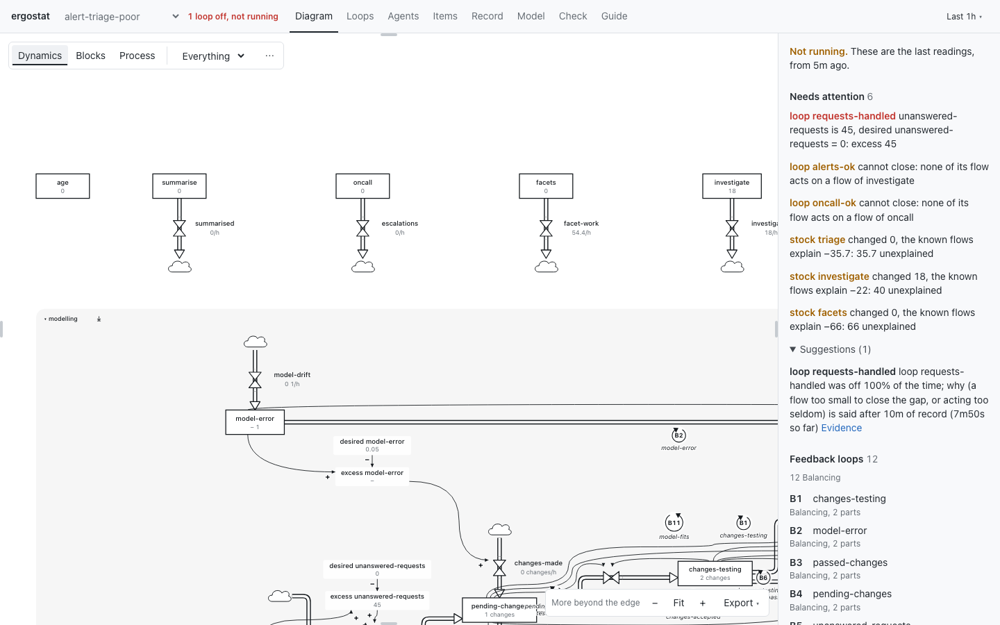
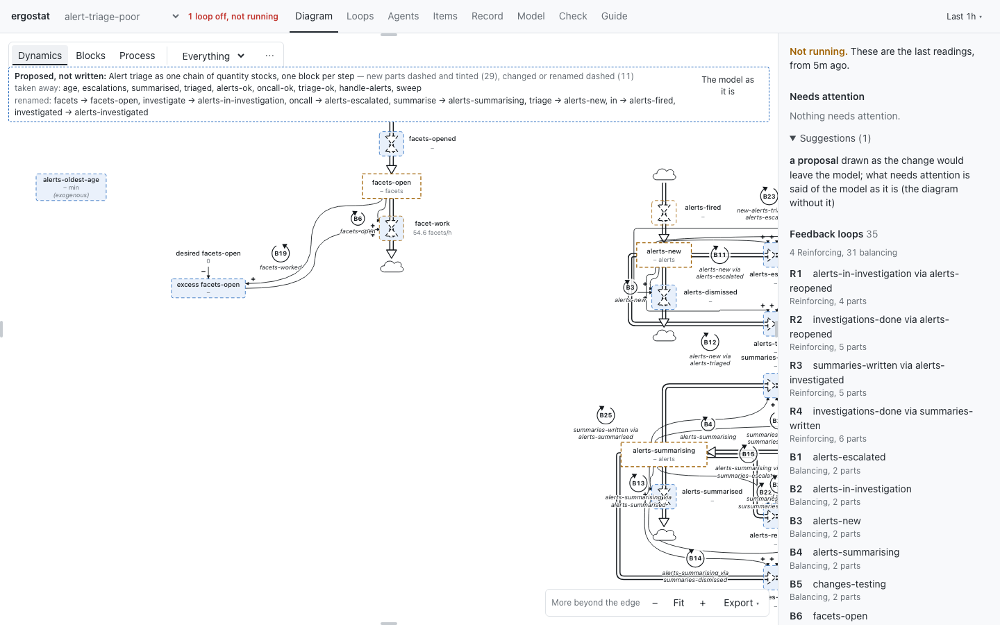
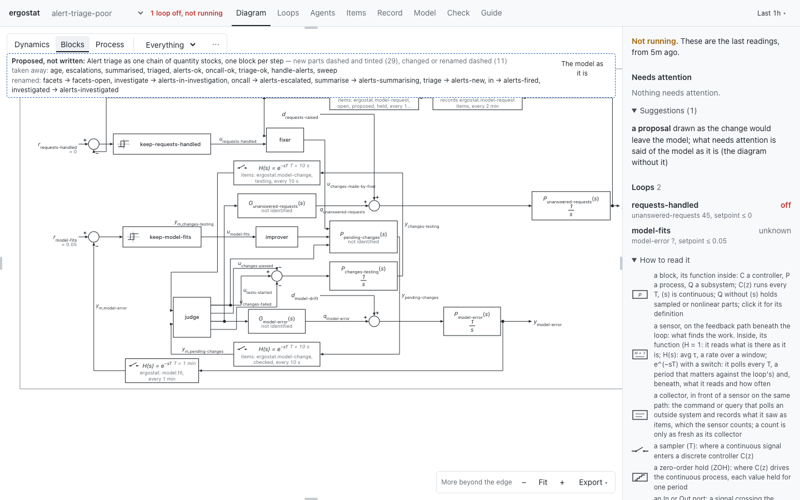

# Redesign: a change set, judged as a whole, beside refinement

Status: built on `redesign` (on `selfimprove`), 2026-11-18; landing on `modelling-core` with the gate review's fixes
(*After the gate review*, below), 2026-11-19. SPEC §12e *Redesign: a change set, judged as a whole*.

## The problem

The automated improver (selfimprove's tiers and judge) refuses nearly every proposal that is not a description, while a
Claude session asked to refine the model "would probably do better". Three causes:

1. **The judge rewards only replay fit.** A change passes when the record shows it better by 2% in every window. Most of
   what a model needs (a chain connected, a collector added, a system split, descriptions) changes no replay error,
   so it cannot prove itself. In selfimprove's final runs the rule tier's equations and structure were failed or
   inconclusive in nearly every example; what got written was descriptions.
2. **Each proposal is judged alone.** A real restructure is a dozen edits that only make sense together (rename the
   stocks, re-point the flows, give each step its block and goal); one at a time, each looks worse or no better, and
   local search cannot cross that valley.
3. **Modelling is deliberately conservative.** Rate limits, and structure waits for the owner.

## What was built

A second mode, **redesign**, beside refinement (which is unchanged).

**A change set** (`ergostat/numbers/changeset.py`). One proposal holding many coordinated edits, made in order on a
scratch copy of the model's files in memory, each on the text the ones before it left; the model need compile only at
the end. Edits: set keys on a part, add an entry, replace lines, and three new ones: `remove` a part, `rename` a part
with every reference following (and `formerly:` written, so its history follows it), and `write` a file whole. A part
taken away and one added that reads exactly the same sensor is taken as the same part renamed, so a whole-file rewrite
keeps history too. Every edit carries its `why`. What it does is then one diff, applied atomically to judge it and on
Accept; what it adds says `inferred:`; on Accept a renamed part's readings are copied to its new series.

**One item**, an `ergostat.model-change` of kind `redesign` (`ergostat/numbers/redesign.py`), with its system, summary,
each edit and why, the parts added, renamed, changed and taken away, its scorecard and cost.

**The scorecard** (`ergostat/numbers/scorecard.py`): the model as it is and the scratch copy, measured on the same
record:

| Measure | What |
|---|---|
| findings | `check`'s findings resolved and introduced (a finding about a renamed part is the same finding) |
| chain pieces | each kind's state stocks in groups no flow joins, beyond one a kind |
| coherence | each kind's score on the record and the mismatches, run again on the scratch copy over the existing record; what the record cannot say of a block the change adds (its runs) is left out |
| craft | craft notes closed and opened |
| fit | the replay's scaled error over the stocks both replay, not worse beyond 10%, where it can be worked out (a renamed part replayed on its old readings) |
| behaviour kept | a stock the old replay followed (scaled error ≤ 0.5) or an equation that explained its flow (R² ≥ 0.5) still there, or renamed, and no worse |

Verdict: **better** when findings, chains and coherence improve (net), none is worse, the fit is no worse and nothing
is lost; **mixed**; **no better**. Craft notes opened (a new flow between stocks wants an equation) are said beside the
verdict, never enough alone to turn it. The judge takes a redesign up at once and works the scorecard out again on the
record as it is. It is written only when the owner promotes the class by name, `accept: {redesign: auto}` (`accept:
auto` leaves it the owner's); promoted and passed, it is written first and alone, unless it takes a part away,
rewires a chain or changes control, which the owner always writes. While a redesign waits, nothing that
touches its lines is written; while one is being made, the judge writes nothing on its own (so the redesigner's model
holds still).

**The redesigner** (`ergostat/numbers/redesigner.py`, the template's block `redesigner`, an `ai` block with `ai: true`).
Given a whole system as written, `check`'s findings and notes, the coherence report, the moves the process map
observed, the record's summary (each stock's fit, the event types seen) and the guides (`redesigner.md`, the modeller's
craft, `MODELLING-WELL.md`'s review checklists; a prompt of 25–40k characters), it answers one change set. Each round
its edits are made on the scratch copy, which is compiled, checked, held against the record and scored; what is left
goes back for the next round, up to `rounds`; the best round's copy is proposed. No call starts once `budget` is spent;
each round says how long its prompt, call and scoring took, and the run's cost is printed as a Claude Code result line
(so `ergostat.cost.*` and `run/redesigner/cost_usd` have it) and kept on the change.

**When it runs**: on its own, a system at a time when it is due (`when: auto`, SPEC §12e), or when the owner asks
(`ergostat improve --redesign [SYSTEM]`, the Model page's Redesign button), taken up by the redesigner block. At most one redesign waits per system. Template parameters:
`redesign: {when: auto|ask|off, model: haiku, budget: 0.5, rounds: 3, daily: 2}` and `redesign-every` (10m).

**On the page**: the review queue's entry for a redesign shows what it changes and why (the summary, each edit with its
why, the parts), the scorecard, and buttons that draw the model as it would leave it, in Dynamics or Blocks: new parts
dashed and tinted, changed and renamed parts dashed, and a banner naming what it takes away
(`/api/graph?proposal=ID`). A redesign judged not better is a model-change item with its scorecard (the Items page).

| As it is | The redesign, drawn as proposed |
|---|---|
|  |  |

## Results

All on haiku. Costs are what Claude Code reported. The runs used the harness that verified selfimprove
(`scripts/self_improve_runs.py` on `selfimprove` and `redesign`, now with `--redesign` and the `thirteen` case): each example on a scratch copy, run on
its stand-ins with the AI tier on, a test policy writing descriptions, units, equations and parameters, and the owner's
approval simulated for the rule tier's structure, renames and goals. The redesign arm adds the redesigner (`when: auto`)
and the owner's promotion (`accept: {redesign: auto}`); the refinement arm sets `redesign: {when: off}`.

### Planted cases: one change set, applied

Each case ran on its stand-ins for 3.5 minutes to make a record, then `ergostat improve --redesign`, then Accept.

| Case | Findings | Chain pieces (beyond one a kind) | Coherence on the record | Craft notes | Fit | Rounds | Cost |
|---|---|---|---|---|---|---|---|
| `alert-triage/poor` | 12 → 0 | 3 → 0 | 6 mismatches → 0 (alert 19/26 → 29/29) | 30 → 2 | not measurable before or after: 3.5 minutes is under 3 time constants | 3 | $0.033, 187 s |
| the 13 disconnected stocks | 14 → 0 | 12 → 0 | 1 → 0 (27/28 → 28/28) | 0 → 0 | no record of moves | 1 | $0.011, 57 s |

Applied, `check` finds nothing in either model's own parts; the only line left is the template's stand-in note (and, for the 13
stocks, one about the template's own modelling chain). Poor keeps 2 craft notes, its event names, which the redesigner
left alone on purpose because `bin/poor.py` emits them. Run 3 more minutes, the redesigned poor model reads alert 26/29
(90%) on its new record, with one real gap the new record showed: items dismissed out of investigation, a move the
design has no flow for (`completion-not-modelled`). The poor model's design is shown above: five stocks draining to
clouds became one chain of quantity stocks in alerts; the age became an auxiliary keeping its sensor; the one AI
block doing three steps became a block per step, each with a goal on its queue and an `out:`; rework is a declared flow;
every flow has an equation over described parameters marked `estimate: true`.

### Refinement only against refinement plus redesign

Findings and coherence mismatches at the start and the end of each run (`check --json`). The first table is 600 s a
case; the second reruns the three hardest at 900 s, after two fixes the first round showed (below).

| 600 s | Refinement only | With redesign | What the redesigner did |
|---|---|---|---|
| `alert-triage/poor` | findings 13 → 13, mismatches 2 → 6 | 12 → 15, 2 → 8 | its change set chained the stocks and cleared 5 of 6 mismatches but its equations named causes their flows did not declare (16 `equation-not-drawn`): judged mixed, not written |
| thirteen | 16 → 2, 1 → 0 | 15 → 1, 1 → 0 | judged better (14 → 0 findings, 12 → 0 pieces), written in its first minutes; refinement got there too, by the rule tier's chain fix and the owner's approval |
| `image-squeeze` | 5 → 5, notes 71 → 38 | 4 → 4, notes 71 → 39 | system `lab`: 67 craft notes closed, but it took away `compress-time`, a stock the replay followed (scaled error 0.405): behaviour lost, judged mixed, not written |
| `roadmap` | 4 → 5, mismatches 0 → 2 (rework-without-flow, acts-undeclared) | 3 → 1, 0 → 0 | system `delivery`, 7 edits: both acting-on-its-own findings and all 6 craft notes resolved; written ($0.016) |
| `the-job` | 2 → 3, 0 → 3 | 1 → 4, 0 → 1 | did not finish within the run (each round about 2 minutes under load, 97 edits); meanwhile the judge's hold kept refinement from writing anything |

| 900 s | Refinement only | With redesign | What the redesigner did |
|---|---|---|---|
| `alert-triage/poor` | findings 13 → 15, mismatches 2 → 7, notes 30 → 2 | **12 → 2, 2 → 3**, notes 30 → 2 | three change sets in a row, each judged better and written: 12 → 7 findings (chain 3 → 0 pieces, 5 mismatches fewer), then 7 → 1, then 1 → 0 in its own scorecard; $0.108 |
| `image-squeeze` | 5 → 5, notes 71 → 30 | 4 → 4, notes 71 → 23 | `lab` again: 4 findings resolved and 67 notes closed, but the fit 64% worse and `paired` lost (0.01 → 1.63): refused |
| `the-job` | 2 → 5, 0 → 3 | 1 → 7, 0 → 4 | 3 rounds of the `job` system, none of which compiled: nothing proposed ($0.027); refinement as in the other arm |

What this says:

- **Where the model was clearly wrong in its shape, redesign did what refinement could not.** Poor (900 s) ended at 2
  findings against refinement's 15; roadmap at 1 against 5 with no mismatches against 2; the 13 stocks at the
  template's note alone. Refinement alone made poor *worse* in both rounds (13 → 15 findings, mismatches 2 → 7): its
  one-at-a-time chain fixes, approved by the simulated owner, connect some stocks and expose more of the record's moves
  as unmodelled.
- **The scorecard refuses what a modeller would refuse.** Of 9 change sets made in the live runs, 5 were written and
  4 refused, each for a reason in its scorecard: equations whose causes were not drawn (poor), a stock the replay
  followed taken away and the fit 64% worse (image-squeeze, twice), and a second change set on the already-clean 13
  stocks that moved no measure ("no better"). None of the refused ones would have been an improvement. The guide now says both things haiku got wrong (an equation's causes are its `driven-by:`; a stock the
  replay follows stays a stock).
- **Big models are where haiku's redesigner is weak.** On the-job (a whole system of 97 edits) three rounds never
  compiled, and on image-squeeze it twice traded fit for craft. The scorecard kept both models as they were; a bigger
  model, more rounds, or a narrower system would be the next things to try.
- **Two fixes the first round showed**, in the code now: locating a part for each edit no longer runs every finding
  (on image-squeeze 22 edits went from minutes to 1.3 s), and the judge's hold while a redesign is made lasts 5
  minutes at most, so a slow redesigner never freezes refinement (the-job at 600 s wrote nothing for 10 minutes).
- **Interference** between the two modes is real: refinement writing while the redesigner works makes its change set
  stale. The hold, writing a promoted redesign first and alone, and never auto-writing over a waiting redesign's
  lines are what made poor's three change sets land in the 900 s run.

### Cost

The redesigner's runs cost $0.01 to $0.045 each (1 to 3 rounds; 25–60k characters of prompt, 13–54k tokens out);
every run of this work together, refinement and redesign, harness and planted, came to $1.26 recorded (the
redesigner's share $0.37), and at most about $0.3 more in runs stopped before they recorded: under the $5 allowed.
Each change set carries its cost (`redesign.cost` on the item; the review page says it), and the block's run prints
it as a Claude Code result line, so `run/redesigner/cost_usd` and `ergostat.cost.usd@redesigner` have it.

## After the gate review

The gate review (2026-11-19) passed redesign with these fixes, made on `modelling-core`:

- no change set may change who decides: one that alters the judge's policy, a block's `accept` or a template
  instance's `with:` is refused (`improve.governs`);
- even under `accept: {redesign: auto}`, a redesign that takes a part away, rewires a kind's chain or changes control
  waits for the owner (`judge.owners`); a promoted redesign that cannot be written is superseded, and the pass goes on;
- the owner's ask is recorded and the redesigner block takes it up: nothing runs in the page server or the command,
  and every run's cost is a result line;
- the first automatic triggers (the whole model at once) were parked; the owner then decided it should review on its
  own (2026-11-19), so `when: auto` is back as the default, per system (a subsystem at a time past 40 parts), with
  bounds (one waiting a system, a rest after one no better, the daily cap charged call by call); a carried redesign
  is scored again;
- the results above were made with `when: auto` and the redesigner run by `ergostat improve --redesign` directly.
  With the fixes, the change sets judged better above that chained a kind (poor, the 13 stocks) wait for the owner.

## What it does not do yet

(It used to be judged only on the record it had when the judge took it up. Now a redesign waiting for the owner is
scored again, at most once every 30 minutes and one a pass, whenever the record its scorecard reads has moved: a mark
of the model's own items' events, its blocks' runs, its valves' openings, its sensors' latest readings and the model
itself, `ergostat/numbers/redesign_record.py`. A promoted one is written only on a scorecard of the record as it is,
scored again under the same lock as the write when the mark moved. What the record cannot show about blocks the
change set adds is still left out rather than predicted.)

- Parts taken away are named in the banner, not drawn as ghosts.
- Splitting a model into systems is in the guide, but not scored.
- The fit stays "cannot be worked out" on a record too short for its time constants; a redesign that adds equations
  with guessed parameters (`estimate: true`) is then judged on structure alone, and calibration comes after.
- haiku's change sets vary from run to run (the same case gave 12 → 0 findings once and was refused once for equations
  naming causes their flows did not declare); the scorecard catches the bad ones, but a bigger model or more rounds would
  catch more of them itself.
