# Scale: what breaks first, and at what size

Status: measured 2026-11-18 on the `scaletest` branch. Nothing in ergostat was changed or optimised; this is
a measurement. The safe fixes (#2, #3, #5, #6, #7, #10, #11, #12) were then made on the `scalefix` branch and
measured again: see [After the safe fixes](#after-the-safe-fixes-caches-and-indexes-2-3-5-6-7-10-11-12). The numbers are in `docs/proposals/scale-results.jsonl` (one line per measurement, with the
load average when it was taken), the charts in `docs/proposals/img/scale-*.png`.

## The question

The owner runs their job on ergostat: today 2 subsystems, 20 stocks, 31 flows, 26 agents and 13 loops for
about 1.5 tasks. What happens at 100 tasks, at 1,000 (thousands of stocks, hundreds of loops, about 80
agents), and at 6,000 use cases with 120,000 stocks and 400,000 flows?

## The answer, short

- **The engine breaks first, at N ≈ 50 workflows** (about 300 stocks and 550 flows; well short of the
  owner's "100 tasks"). At N = 30 it keeps up on 45% of one core; at N = 50 it is on a full core, reads 65%
  of what its sensors declare, and an item waits up to 46 s (p95) to be taken. At N = 100 it reads 6% of
  the readings its sensors declare, an item waits 41 s (median) to 5 minutes (p95) to be taken, and 683 threads queue on
  one lock. At N = 300 it does no work at all after its first 40 seconds; at N = 1,000 it spends 6 minutes
  loading the model and then manages 5 passes and no runs in the 4 minutes left.
- **The cause is one design choice**: after every sensor reading, the engine re-evaluates the whole model
  (`spec/engine.py: Engine.evaluate`), under one lock, in one Python process. The pass is O(N) at best and
  O(N²) as written; the readings are O(N) a second; so the work is O(N²) to O(N³) a second against a
  fixed budget of one core (the GIL).
- **Everything else that reads the whole model is quadratic or cubic**, because the compiled model
  (`spec/ir.py: Spec`) answers "who reads this", "who commands that", "what is this goal's loop" by
  scanning every block, every time, and nothing caches the answers. That makes `ergostat check` take 13 s
  at N = 10 and 54 minutes at N = 100, loading the model 6 minutes at N = 1,000, the Blocks view's API
  51 s at N = 30, and the status answer (the Check page) 148 s at N = 30.
- **Loop finding does not blow up in the product**, because it stops at 300 loops of at most 30 parts
  (`spec/causal.py: loops`). It does blow up without those bounds: once a quarter of the workflows hand
  their work on to others, the number of simple cycles explodes and an unbounded search does not finish
  one starting point in five minutes. With the bound, the loops reported stop being the model's loops
  at N = 10: the model has 333 loops there, and 33,000 at N = 1,000; the product shows 300.
- **120,000 stocks and 400,000 flows cannot be reached as designed** by the engine, the model's
  compile-and-check, the loop finder, the modelling loop or the diagrams. Some of it is constant factors
  and missing indexes (the compile, the check's lookups, the API's graph); the engine, the extreme-
  conditions check, calibration and drawing everything at once each need a design change.

## What was measured

`scripts/scale_model.py N DIR` writes a model of N workflows; `scripts/scale_bench.py` measures it;
`scripts/scale_probe.py` times the engine's parts from outside (it wraps them; ergostat is unchanged).

**The model.** Each workflow is a connected chain like `docs/AGENT-GUIDE.md`'s example and
`examples/ticket-factory`: an item kind with 4 to 8 states, a stock per waiting state, flows chained from
stock to stock (in from outside, out to done and to dropped), a collector, a step block per waiting state
that takes its items under leases (`takes:`), goals on every queue and on the oldest item's age, and a
person who chases late work. Half are plain YAML (with an equation and an estimated parameter on every
step, for the modelling loop); half use the `steps` template (`uses:`), which makes a waiting and a
working stock per step. Workflows are grouped into systems of 10 to 20, systems into areas of five. They
share: a worker pool per system (an agent, `at-once: 6`); an on-call load per system (an auxiliary driven
by every workflow's intake, held by a goal whose person drops work from every plain workflow); a global
on-call load held by an incident lead who sheds work from one workflow in every system; one plain
workflow in ten hands its finished work to another workflow's intake, half the time in another system;
and the-job's modelling subsystem (the built-in fit measure, the change queue, the judge and a stand-in
improver that is a program). Everything that runs is a stand-in: new items arrive at 6 an hour per
workflow, each step works for about 3 s, 5% are dropped and 3% fail and are retried. No block is an AI
block, and `ERGOSTAT_AI=false`.

| N workflows | stocks | flows | auxiliaries | sensors | goals (control loops) | blocks | agents | systems | YAML |
|---:|---:|---:|---:|---:|---:|---:|---:|---:|---:|
| 10 | 55 | 93 | 8 | 156 | 47 | 101 | 6 | 8 | 39 KB |
| 30 | 199 | 353 | 18 | 570 | 146 | 308 | 8 | 20 | 90 KB |
| 50 | 308 | 545 | 31 | 884 | 237 | 502 | 10 | 29 | 155 KB |
| 100 | 615 | 1,071 | 60 | 1,746 | 480 | 1,014 | 17 | 57 | 317 KB |
| 300 | 1,786 | 3,155 | 185 | 5,126 | 1,404 | 2,973 | 47 | 162 | 925 KB |
| 1,000 | 5,860 | 10,306 | 624 | 16,790 | 4,678 | 9,911 | 155 | 531 | 3.1 MB |
| 3,000 | 17,562 | 30,949 | 1,831 | 50,342 | 13,862 | 29,350 | 454 | 1,623 | 9.1 MB |

(The owner's model today, 20 stocks and 31 flows, is about N = 4; `examples/the-job` is about N = 8. The
agents grow faster than the owner guessed, about 155 at N = 1,000 rather than 80, because each system here
has a pool and a lead of its own.
120,000 stocks is about N = 20,000 of these workflows; 400,000 flows about N = 39,000, since the owner's
models have more flows per stock than these.)

**The machine** is a 28-core Mac with 256 GB, shared with other agents' work: the load average was 12 to
29 throughout and never fell lower, so no measurement could be repeated on a quiet machine. Every row in the
results carries its load. Each page server answers alone (`api`) after loading the model itself: 4.6 s at
N = 100, 33 s at 300. The engine and the web server use one core each (Python's GIL), so a load of 20
on 28 cores slows them less than it seems; the single-threaded timings (the tick benchmark) were repeated
an hour apart at N = 30, 100 and 300 and moved by under 4%.

## The measures

### Load and compile: `ergostat check`

| N | `check` wall | peak RSS | read YAML | compile | findings (no run) | extreme-conditions tests |
|---:|---:|---:|---:|---:|---:|---:|
| 10 | 12.7 s | 32 MB | 0.09 s | 0.01 s | 0.03 s | 13 s (95 conditions) |
| 30 | 131 s | 39 MB | 0.12 s | 0.01 s | | |
| 100 | 3,230 s (54 min) | 64 MB | 0.42 s | 0.04 s | 2.4 s | ~2,170 s estimated (783 conditions × 2.8 s) |
| 300 | not run (est. ~1 day) | | 1.1 s | 0.11 s | 21 s | ~57,000 s estimated (2,287 conditions × 25 s) |
| 1,000 | not run (est. ~4 weeks) | | 3.6 s | 0.46 s | 254 s | ~2.4 million s estimated (7,757 conditions × 309 s) |

Loading the model (what every command, the web server and the engine do first; `model.load`, which skips
the extreme-conditions tests): 0.16 s at 10, 0.5 s at 30, 3.8 s at 100, 32 s at 300, **381 s at 1,000**,
and more than 17 minutes at 3,000 (the loop measurement there ran out of time while loading).

- **The bend**: reading and compiling the YAML is linear (4 s at N = 1,000). Everything after it is
  not. Loading goes as N^2.0, `check` as N^2.4.
- **Where**: `check` is almost all the extreme-conditions tests (`numbers/extremes.py: failures`): one
  whole-model replay per condition (`numbers/simulate.py: replay`, after `sim.plan`), and the conditions
  are 3 + 2 per input + 2 per estimated parameter, so O(N) replays of an O(N) model, with `plan` itself
  O(stocks × flows) through `Spec.flows_of`. Loading is the findings without the run (`spec/findings.py:
  find`, `causal.served`) and `spec/legacy.py: to_model`, all of it `Spec.loop` (`spec/ir.py`), called
  once per goal and per block, each call scanning every block several times (`reads`, `downstream`,
  `readers`, `long_way`, `commanders_of`): 26 million calls to `Block.reads` at N = 300.

### Loop finding

| N | causal links | find, as the product does (≤ 300 loops, ≤ 30 parts) | loops found | every simple cycle | time to find them all | control loops (goals) |
|---:|---:|---:|---:|---:|---:|---:|
| 10 | 450 | 0.02 s | 300 | 333 | 0.01 s | 47 |
| 30 | 1,487 | 0.08 s | 300 | 817 | 0.1 s | 146 |
| 100 | 4,736 | 0.76 s | 300 | 3,271 | 0.6 s | 480 |
| 300 | 13,899 | 6.7 s | 300 | 10,158 | 7.7 s | 1,404 |
| 1,000 | 45,972 | 81 s | 300 | 33,325 | 133 s | 4,678 |

And at N = 100, as more workflows hand their work on to others:

| hand-offs (share of plain workflows) | 0.1 | 0.2 | 0.3 | 0.4 | 0.5 | 1.0 |
|---|---:|---:|---:|---:|---:|---:|
| every cycle up to 30 parts (the product's bound) | 3,271 (0.6 s) | | 3,461 (0.6 s) | 3,632 (0.6 s) | 3,758 (0.7 s) | 7,311 (0.7 s) |
| every cycle, any length | 3,271 (0.6 s) | 3,353 (0.7 s) | 4,869 (3.3 s) | | not done in 5 min: no starting point finished | not done: ≥ 64,512 in 5 min |

- **The count is linear** in N (about 33 loops a workflow): no blow-up in this model's shape at the
  usual hand-off rate. **The time is not**: 0.02 s → 81 s, N^2.1, all of it `causal.links` (`spec/
  causal.py: links`, through `served` and `Spec.loop`) before the search starts; the search's own
  `_from` rebuilds a predecessor map from every link for every starting node (O(nodes × links)).
- **The blow-up** is in loops longer than 30 parts. It starts between 30% and 50% of workflows handing
  work on: chains of hand-offs join many workflows' on-call loops into long cycles, and the number of
  simple cycles grows exponentially with the chain length. The product's bounds (`longest=30`,
  `most=300`) keep its time flat; they also mean that **from N = 10 the loops it reports are not the
  model's loops**: 300 of 333 at N = 10, 300 of 33,325 at N = 1,000, chosen by the order of the parts'
  names. Every diagram request recomputes them (`graph.py: causal_loops`).

### The engine, headless

Ten minutes each (`ergostat run --foreground --no-web`, wrapped by `scale_probe.py`), stand-ins at 6
items an hour per workflow. "Declared" readings: every sensor on its schedule (stocks every 10 s, flows
every minute).

| N | started after | readings a second: declared → achieved | pass (`evaluate`) p50 / p95 | dispatcher look p50 / p95 | item ready → taken p50 / p95 | events/s | CPU (cores) | RSS | threads (max) | leases taken |
|---:|---:|---:|---:|---:|---:|---:|---:|---:|---:|---:|
| 10 | 15 s | 7.4 → 7.3 | 2 ms / 27 ms | 2 ms / 9 ms | 0.2 s / 10 s | 0.9 | 0.04 | 73 MB | – | 43 |
| 30 | 15 s | 26 → 26 | 12 ms / 0.4 s | 18 ms / 0.19 s | 0.3 s / 12 s | 3.1 | 0.45 | 110 MB | 42 | 150 |
| 50 | 15 s | 41 → **27** | 26 ms / **3.2 s** | 47 ms / 1.0 s | 2.3 s / **46 s** | 4.6 | **1.0** | 130 MB | **363** | 199 |
| 100 | 15 s | 82 → **5.1** | 98 ms / **35 s** | 0.2 s / 2.2 s | **41 s / 304 s** | 3.2 | **1.0** | 148 MB | **683** | 182 |
| 300 | 45 s | 239 → **3.4** | 2.9 s / 4.5 s | 1.8 s / 2.8 s | none taken | 0.8 (first 40 s only) | 1.0 | 445 MB | **2,032** | **0** |
| 1,000 | **376 s** | 786 → **0.1** | 46 s / 53 s | 38 s / 42 s | none taken | 0.1 | 1.0 | 332 MB | 33 | **0** |

The pass alone, on one thread with nothing contending (`scale_bench.py tick`), shows the cost each
reading pays:

| N | `evaluate` | of it, `measure` | `command_of` for every machine block | dispatcher `tick` | lease `watch` |
|---:|---:|---:|---:|---:|---:|
| 10 | 2.3 ms | 1.3 ms | 2.7 ms | 1.7 ms | 4.1 ms |
| 30 | 12 ms | 4.6 ms | 24 ms | 17 ms | 6.6 ms |
| 50 | 27 ms | 7.0 ms | 64 ms | 44 ms | 11 ms |
| 100 | 94 ms | 14 ms | 257 ms | 184 ms | 36 ms |
| 300 | 773 ms | 42 ms | 2.3 s | 1.6 s | 208 ms |
| 1,000 | 8.7 s | 135 ms | 26 s | 18.8 s | 2.5 s |

CPU by part, in CPU-seconds a second (thread time, so waiting for the lock is not counted):

| N | evaluate (incl. measure) | measure | sensors (items) | item index fold | dispatch tick | lease watch | block runs (ergostat's side) | judge |
|---:|---:|---:|---:|---:|---:|---:|---:|---:|
| 10 | 0.020 | 0.010 | 0.006 | 0.003 | 0.002 | 0.002 | 0.003 | 0.000 |
| 30 | 0.33 | 0.11 | 0.026 | 0.013 | 0.024 | 0.010 | 0.040 | 0.000 |
| 50 | 0.74 | 0.15 | 0.029 | 0.017 | 0.044 | 0.019 | 0.15 | 0.000 |
| 100 | 0.53 | 0.07 | 0.009 | 0.012 | 0.090 | 0.025 | 0.30 | 0.000 |
| 300 | 0.27 | 0.03 | 0.006 | 0.015 | 0.46 | 0.083 | – | – |

- **The bend** is at N ≈ 50, measured: at N = 50 the engine is on a full core and achieves 27 of 41
  readings a second. The pass costs about 0.015 N^1.9 ms; it runs after every reading, and there
  are 0.8 N readings a second, so the engine needs about 0.012 N^2.9 ms of CPU a second against 1,000 ms:
  N ≈ 50. At N = 30 it uses 45% of the core and keeps up; at N = 100 it is saturated, and what it cannot
  do it does late: readings, then decisions, then leases.
- **What breaks, in order**: the pass's p95 jumps from 0.4 s to 35 s (threads wait for the lock); sensor
  readings fall behind (each `read_soon` starts a thread that ends in `evaluate`, so the waiting threads
  pile up: 683 at N = 100, 2,032 at N = 300); the scheduler thread, which also calls `evaluate`, starves,
  so timed blocks (the collectors) stop running and no new work arrives; the dispatcher (`leases/
  dispatch.py: Dispatcher.tick`, which projects every item of a kind for every block that takes items,
  and asks `command_of` of each) takes 1.8 s a look at N = 300 and starts nothing. The process does not
  crash: it is alive, using one core, and doing nothing useful.
- **Dispatch latency** is at least the stock sensor's period even when nothing is loaded: a block that
  takes items and has a goal takes them only once its goal is seen to be off, and that is seen at the next
  reading of the queue (10 s). At N ≤ 30 the median is 0.2 to 0.3 s (the reading after the last run
  catches it) and p95 10 to 12 s (the sensor period). At N = 100 it is 41 s and 5 minutes.
- **Memory** is not the problem: 73 MB to 445 MB, most of the growth the waiting threads' stacks.

### Storage

| N | events (10 min) | events store | measurements store (+ its write-ahead log) | item index | whole state dir | per hour |
|---:|---:|---:|---:|---:|---:|---:|
| 10 | 686 | 0.2 MB | 0.4 MB | 0.1 MB | 1.1 MB | ~6 MB/h |
| 30 | 2,150 | 0.7 MB | 2.1 MB + 5.2 MB WAL | 0.2 MB | 6.5 MB | ~39 MB/h (~20 MB/h without the WAL) |
| 100 | 2,316 | 1.0 MB | 0.4 MB + 4.1 MB WAL | 0.2 MB | 5.6 MB | throttled by the stalled engine |

A reading costs about 92 bytes in `measurements.db` (16,045 readings, 1.48 MB at N = 30) and an event
about 350 bytes in the segments store. Growth is proportional to readings and events, so it is linear in N
while the engine keeps up: at the declared rate, N = 1,000 would write about 2.8 million readings an hour
(~260 MB/h raw, kept 2 days by default before rolling up: ~12 GB) and N = 20,000 about 5 GB an hour. The
write-ahead log of `measurements.db` is never checkpointed while the engine runs (5 MB after ten minutes
at N = 30). Storage is not what breaks first.

### The web UI

The page server on each engine's record (`ergostat web`), API answers timed twice (the second is what a
poll costs), then each page in Chrome (Playwright), timed until drawn and until its lines are routed.

At N = 100 the page server was asked two ways: in turn, as a page would (`web`), and each answer alone from
a server started for it (`api`). In turn, every graph answer after the first ran past five minutes, because
the answers before it, given up by the client, were still being computed (a request is never cancelled).

| API (N = 10 / 30 / 100 / 300 / 1,000) | first answer | again | size |
|---|---:|---:|---:|
| `status` | 13 s / **148 s** / ~54 min (stopped; it runs `check`'s 54-minute tests) | 0.1 s / 0.2 s | 34 KB / 123 KB |
| `graph` (the Diagram page, everything) | 1.1 s / 19 s / > 300 s (in turn) | 1.0 s / 13 s | 0.76 MB / 1.0 MB |
| `graph?view=dynamics` | 1.2 s / 14 s / 74 s (alone) / **584 s** (alone) | 1.1 s / 12 s | 0.76 MB / 1.0 MB / 1.7 MB / 3.5 MB |
| `graph?view=dynamics&system=sys-001` | 2.7 s / 14 s / 151 s (alone) | 1.2 s / 6.5 s | 1.1 MB / 1.5 MB / 1.6 MB |
| `graph?view=dynamics&open=org,area-01,sys-001` | 1.7 s / 7.1 s / > 300 s (in turn) | 1.8 s / 6.6 s | 1.2 MB / 1.7 MB |
| `graph?view=dynamics&open=*` | – / 6.7 s / > 300 s (in turn) | – / 7.1 s | – / 2.5 MB |
| `graph?view=blocks` | 2.2 s / **51 s** / **> 1,500 s** (alone) | 2.3 s / 58 s | 76 KB / 243 KB |
| `loops` | 0.11 s / 0.35 s / 1.7 s / 2.6 s / no answer: the server is still loading the model after 5 min | 0.07 s / 0.002 s | 31 KB / 117 KB / 305 KB / 701 KB |
| `items` | 0.5 s / 0.19 s / 0.005 s / 2.5 s / no answer (the same) | 0.4 s / 0.04 s | 14 KB / 67 KB / 106 KB |

| Page (N = 10 / 30 / 100) | drawn | lines routed | shapes | API bytes while it drew |
|---|---:|---:|---:|---:|
| Diagram, everything (folded to its top systems) | 1.3 s / 6.3 s / **400 s** | same | 2 | 0.8 MB / 1.2 MB / 1.7 MB |
| Diagram, one system (`system=sys-001`) | 12 s / 24 s / **not in 10 min** | 50 s / **190 s** / – | 173 / 280 / – | 9 MB / **22 MB** / – |
| Diagram, one system opened in place | 14 s / 28 s / – | 36 s / 160 s | 175 / 285 | 5 MB / 18 MB |
| Diagram, everything open (`open=*`) | – / 139 s / – | not done in 30 min | | – / **456 MB** in 32 min |
| Blocks | 2.4 s / 58 s / – | | 2 | 0.1 MB / 0.4 MB |
| Loops | 1.8 s / 12 s / not in 10 min | | | 1.4 MB / 4.1 MB |
| Items | 0.7 s / 1.0 s / 129 s (behind the diagram's requests) | | | 0.1 MB / 0.3 MB |
| Check | 0.6 s / 0.7 s (its status already computed) | | | 0.07 MB / 0.4 MB |

For comparison, `examples/the-job` (43 stocks, 61 flows) and `examples/image-squeeze` (42, 48) answer
`graph` in 0.04 s and `status` in 0.5 to 0.75 s with an empty record: what the owner finds slow on their
diagram pages today is the browser's layout and routing, which at N = 10 (173 shapes) already takes 12 s to
draw and 50 s to route one system.

- **The bends**: the server's graph answer goes as N^1.9 to N^2.3 (dynamics: 1.2 s, 14 s, 74 s, 584 s) and N^2.9 (blocks); the first
  `status` as N^2.2; the browser's routing as about shapes^2.8.
- **Polling makes it worse**: the Diagram page asks for its graph every 2.5 s (`static/diagram.js`,
  `poll(tick, 2500)`). Once an answer takes longer than that, every poll is a whole graph computed again
  while the last is still being computed; one system's page pulled 22 MB in the three minutes it took to
  route at N = 30.
- **Where**: `graph.control` computes the causal loops on every request (`graph.py: causal_loops` →
  `causal.loops` → `links`), and matches every edge against every loop (`e["loops"]`, `e["causal"]`:
  O(edges × loops)); the Blocks view's `blockdiagram.py: Diagram.block_fn` calls `Spec.loop(g)` for every
  goal for every block (O(blocks × goals × N): cubic); `status` is the first to ask `Model.problems`,
  which runs the extreme-conditions tests (`model.py: Model.problems` → `spec/findings.py: late`). Items
  and Loops are cheap: the item index pages them.

### Modelling: the improver's and the judge's passes

| N | `fit` (the replay the improver reads) | `proposals` (calibration: what the stand-in improver runs every 3 min) | one change checked (`improve --try`) | `judge` pass (nothing pending) | the fit measure (`measure ergostat.model.fit`) |
|---:|---:|---:|---:|---:|---:|
| 10 | 0.4 s | **178 s** | 29 s | 0.2 s | 0.4 s |
| 30 | 1.3 s | **926 s** | 281 s | 0.6 s | 1.8 s |
| 100 | 12.7 s | > 1 hour (stopped) | > 1 hour (stopped) | 3.9 s | no value: the stalled engine recorded too little |

- **The bend** is already at N = 10. Calibration (`numbers/estimate.py: estimate`) runs a Nelder-Mead
  search per scope, each cost evaluation a whole-model replay (`simulate.py: replay`): 1,483 replays at
  N = 10. Scopes grow with the parameters (O(N)) and each replay with the model (O(N)): N^1.5 to N^2
  observed. Checking one proposed change (`improve.py: validate` → `refit`) refits the parameters it
  touches with the same replays: 29 s → 281 s, N^2.1.
- The improver block runs every 3 minutes with a 15-minute timeout; from N ≈ 10 a pass outlasts its
  period, and from N ≈ 30 its timeout. The judge itself is cheap when nothing is pending, and costs a
  replay per window per change when something is (`numbers/judge.py: compare`).

## The first thing to break

**The engine, at N ≈ 50 workflows** (about 300 stocks, 500 flows, 250 goals, 850 sensors): its pass after
every reading saturates the one core it has, and from there readings, decisions and leases fall behind
without limit. At N = 100 work waits minutes to be picked up; at N = 300 nothing is picked up.

Before it, and not fatal: `ergostat check` passes a minute at N ≈ 20 and the Check page's first answer
with it; calibration outlasts the improver's 3-minute period from N ≈ 10 and its 15-minute timeout at
N ≈ 30. After it: model load passes a minute at N ≈ 400 and an hour (projected) at N ≈ 3,000; one system's diagram routes for minutes from N = 30.

## The bottlenecks, their causes, and the kind of fix

| # | Bottleneck | Where in the code | Grows as | Kind of fix |
|---:|---|---|---|---|
| 1 | The engine re-evaluates the whole model after every reading, under one lock, in one process | `spec/engine.py: Engine._read` → `Engine.evaluate` (also `_run`, `leases/dispatch.py: Dispatcher._work`, and the clock every second) | readings O(N)/s × pass O(N..N²) | **Design**: evaluate incrementally (only what a reading touches: its stock's goals and the blocks that read them), batch readings into one pass per tick, and stop spawning a thread per reading (`read_soon`) |
| 2 | The pass asks `command_of` of every machine block, and that scans every block | `Engine.evaluate` → `Engine.due` → `command_of` → `spec/ir.py: Spec.commanders_of` | O(N²) per pass | Constant: index commanders once per model (`Spec` is immutable between swaps) |
| 3 | The pass reads every sensor's newest value from SQLite | `Engine.measure` → `store.py: Measurements.latest`, one query per sensor | O(N) per pass | Constant: keep the newest value in memory as readings are written |
| 4 | Item counts are polled: every stock sensor re-counts its kind every 10 s | `spec/items.py: measure` per sensor, `itemindex.Index.catch_up` | O(N) readings/s | **Design**: counts are a fold of the record; keep them updated from the events (the index already sees every one) instead of polling |
| 5 | The dispatcher projects every item of a kind for every block that takes items, every look | `leases/dispatch.py: Dispatcher.tick` → `items.project`; `Dispatcher.watch` projects every kind every second | O(blocks × items) per look | Constant to moderate: index ready items by (kind, state) in the item index; watch only leases near expiry |
| 6 | `Spec.loop(goal)` is computed afresh on every call, and each call scans every block several times | `spec/ir.py: Spec.loop`, `downstream`, `readers`, `long_way`, `commanders_of`, `flows_of`, `actuator_of` | O(N) per call, called O(N)–O(N²) times | Constant: cache it per `Spec`; build reverse indexes (reader-of, commander-of, flows-of) at compile time. This alone fixes model load (#7), most of the Blocks view (#10) and `causal.links` (#8) |
| 7 | Loading the model runs the findings and `to_model`, which call `Spec.loop` per goal and per block | `model.py: load` → `spec/findings.py: find`, `causal.served`, `spec/legacy.py: to_model` | N² (381 s at N = 1,000) | Constant (#6); findings could also be deferred like the extreme-conditions tests already are |
| 8 | Causal links and loop search | `spec/causal.py: links` (via `served`), `_from` rebuilds a predecessor map per start node | N² | Constant (#6, and one reverse map); **design** for the reporting: the 300-loop cap hides almost every loop from N = 10; finding loops per system, or only through what a view shows, is a different design |
| 9 | Extreme-conditions tests: a whole-model replay per condition, conditions O(N) | `numbers/extremes.py: failures`, `simulate.py: plan` (O(stocks × flows) via `flows_of`) | N^2.4 (54 min at N = 100) | **Design**: test each condition on the part of the model it can reach (its downstream subgraph), not the whole; run in the background, never on the first `status` |
| 10 | The Blocks view describes every block with every goal's loop | `blockdiagram.py: Diagram.block_fn` → `Spec.loop(g)` for every goal | N³ (51 s at N = 30) | Constant (#6) |
| 11 | Every graph request recomputes the causal loops and matches every edge against every loop | `graph.py: control`, `causal_loops`; `web/server.py: api('graph')` | N² per request, every 2.5 s per open page | Constant: cache per model version; match edges to loops by an index |
| 12 | The page polls the whole graph every 2.5 s whatever it costs | `static/diagram.js` (`poll(tick, 2500)`) | requests pile up once an answer > 2.5 s | Constant: poll the readings, not the structure; back off when an answer is slow |
| 13 | Drawing and routing one system in the browser | `static/layouts.js`, libavoid (`static/libavoid`) | ~shapes^2.8 (190 s for 280 shapes) | **Design** for large views: route only what is on screen, or draw systems as boxes until opened (the folding does this for everything, not for one system) |
| 14 | Calibration: a Nelder-Mead search per scope, every evaluation a whole-model replay | `numbers/estimate.py: estimate`, `solve`, `Problem.runs` → `simulate.py: replay` | N^1.5–N^2 (926 s at N = 30) | **Design**: replay only the scope's subgraph (its stocks and what drives them), and calibrate scopes in parallel processes |
| 15 | One process, one core | the engine, the web server and every command are single CPython processes | – | **Design** at N ≫ 1,000: shard the engine by system (systems are already the model's grouping) |

Fixes 2, 3, 5, 6, 10, 11 and 12 are constant factors or indexes, with no change to what ergostat does. They
would bring model load, the Blocks view and the graph answer to seconds at N = 1,000. They would not save
the engine: #2 and #3 remove the two largest parts of the pass, but what is left (every goal and every
built-in, O(N)) still runs once per reading, O(N) times a second, so its bend moves from N ≈ 50 to perhaps
N ≈ 150 to 300, not past it. Fixes 1, 4, 9, 13, 14 and 15 change how ergostat works.

## Extrapolation to 120,000 stocks and 400,000 flows

That is N ≈ 20,000 of these workflows by stocks, N ≈ 39,000 by flows: 20 to 40 times N = 1,000. With the
exponents measured between N = 300 and N = 1,000:

| Part | at N = 1,000 | grows as | at 120k stocks / 400k flows | Reachable as designed? |
|---|---:|---|---:|---|
| Read and compile the YAML | 4.2 s | N | 1.5 to 3 min | yes |
| Load the model (findings, `to_model`) | 381 s | N^2.0 | 2 to 7 days | no; yes with #6 (minutes) |
| `ergostat check` (extreme conditions) | ~4 weeks (projected) | N^2.4 | a century or more | no (#9 is a design change) |
| Causal links and the capped loop search | 81 s | N^2.1 | 9 to 34 hours | no; with #6 and one reverse map, minutes |
| Every simple cycle (30 parts) | 33,325 in 133 s | count N, time N^2.4 | 0.7 to 1.3 million loops | the count is fine; showing 300 of a million is not an answer |
| Engine pass after a reading | 8.7 s | N^2.0 | 1 to 4 hours a pass | no |
| Readings declared | 786/s | N | 16,000 to 30,000/s | not in one Python process, at any pass cost: a thread and a SQLite write per reading |
| Dispatcher look | 18.8 s | N^2.0 | 2 to 8 hours | no; with #5, seconds |
| Diagram: graph answer, everything | (19 s at N = 30) | N^2.3 | years | no; with #6 and #11, the folded top level is fine |
| Diagram: one system drawn in the browser | 190 s for 280 shapes | shapes^2.8 | a system is still 10 to 20 workflows: unchanged | yes per system; never everything open (a million shapes) |
| Calibration (`proposals`) | (926 s at N = 30) | N^1.5–N^2 | years | no (#14) |
| Storage | ~260 MB/h at the declared rate | N | 5 to 10 GB/h raw; 0.25 to 0.5 TB kept raw for 2 days | yes, with the tiers; the SQLite measurements store would be the limit, and VictoriaMetrics is already a backend |
| Memory | 330 to 450 MB | N | ~10 GB plus threads | yes |

**Plainly: as designed, the engine, `check`, loop finding, calibration and the whole-model diagram cannot
reach 120,000 stocks and 400,000 flows.** The engine cannot reach N = 100 workflows. Indexes and caches
(#2, #3, #5, #6, #10, #11, #12) make model load, links, the dispatcher and the graph answer feasible at
that size, but not the engine: even a pass that touched only one sensor would leave 16,000 to 30,000
polled readings a second for one process, which is why #1 and #4 (event-driven counts instead of polled
ones, incremental evaluation) and #15 (an engine per system or area) are the changes that matter. The
extreme-conditions check and calibration need to work on parts of the model (#9, #14), since any test that
replays the whole model once per parameter is quadratic in a model of 400,000 flows.

## After the safe fixes: caches and indexes (#2, #3, #5, #6, #7, #10, #11, #12)

Measured 2026-11-18 on the `scalefix` branch, each number beside the same measurement of the unchanged code
(`main` at 0772001) taken the same morning on the same machine and the same generated models. The machine was
shared throughout (load average 11 to 20, given with every row); both sides ran with other agents' work and with
each other's. The rows are in `docs/proposals/scale-fix-results.jsonl` (`"side": "before"` or `"after"`).

### What changed

Nothing ergostat does changed: every fix keeps an answer it used to work out again, or finds by an index what it
found by a scan. The API answers, findings, loops (the same 300-loop cap), `Spec.loop` of every goal, the legacy
model's loops, the causal loops and the goals each block serves were compared, answer for answer, between the two
versions on all 18 examples and the generated models at N = 10 and 30 (336 answers, `status` with its extreme-
conditions findings among them) and at N = 100 (15 answers, the Blocks view left out: the unchanged code takes
over 25 minutes for one): all identical (with Python's string hashing fixed, `PYTHONHASHSEED=0`: the Blocks view's
`open=*` frames come out in a different order from one process to the next in both versions).

- **#6, and with it #7 and #10: the compiled model's reverse relations, once per model** (`spec/lookups.py`).
  `Spec.loop(goal)` is kept per goal (each caller given its own copy), and `commanders_of`, `downstream`,
  `readers`, `flows_of`, `actuator_of`, `setter_of`, `agent_blocks` and the long way's driven-by map read
  indexes built on first use, in the model's order. A part added or removed rebuilds them by itself (the tables'
  sizes are the stamp); `Spec.reindex()` for code that rewires a compiled model in place (nothing in ergostat
  does). The same for what is worked out of the whole model: `causal.links`, `causal.served`, `causal.loops`,
  `graph.causal_loops`, the goals each machine block acts for (`Engine.served`), and the legacy model's `loops`,
  `flows_of`, `valve_of` and `members`. The chain findings (`spec/chains.py`), which read every flow, block and
  name of the model for every item kind, read them from one index. The Blocks view works out each block's goals
  and each signal's readers once per diagram instead of once per block (`blockdiagram.py`).
- **#2: `command_of`** asks `commanders_of`, now an index lookup.
- **#3: `Engine.measure`** reads every series' newest reading from `Measurements.newest()`: kept in memory,
  brought up to date at each pass from the rows written since the last (by any process), and read afresh when a
  reading was set aside (`forget`), the record pruned, or a roll-up took the newest row (a `deleted` mark in the
  store's meta). One small query a pass instead of one per sensor.
- **#5: the dispatcher** (`leases/ready.py`) keeps, per kind, the items in a state some block takes from and the
  items held, read whole from the item index once and then only for the items the events since were about; a
  new model, another index, or a record whose generation changed reads them whole again. Its look and the
  watchdog read these instead of every item of every kind (with every move) per block, every second; a look
  brings them up to date once, and again after each lease it takes (so each block still sees what the blocks
  before it took), and the watchdog once a pass.
- **#11: the graph and loops answers** use the kept causal loops, and match each edge to the controllers' loops
  and to the causal loops through an index of nodes and of node pairs.
- **#12: the Diagram page** says which structure it holds (`have=`, a hash of the answer with every value taken
  out, `web/graph_poll.py`); while the structure stands it is sent only the values (each part's value keys, by
  the part's place in a walk both sides make the same way) and puts them into its copy of the last whole answer,
  which then is the answer a whole one would have been. Its next ask waits 2.5 s, or four times as long as the last
  answer took (at most a minute).

Tests: `tests/test_scale_caches.py` holds every lookup against the scan it replaced (on every example and a scale
model), a part added and removed, a wire rewired and reindexed, the newest readings against `latest()` through
ties, back-dated rows, another process's writes, `forget`, a roll that takes the newest row and `prune`, the
engine's measure with and without them, the items the dispatcher looks at against a full read through item
events, a refused lease, an item moved on while held and a model swap, the edges' loops against every pair, and
the values-only answer merged into the whole one on five examples and every view; `tests/test_page_polling.py`
checks the same merge in the browser.

### Before and after

**Loading the model and `check` without its extreme-conditions tests** (`scale_bench.py phases --no-extremes`:
`model.load`, which reads and compiles the YAML and runs every finding but the extremes; the extremes are #9).
At N = 1,000 the unchanged code was not measured again: its numbers there are the first measurement's, above.

| N | model load (= `check` without its extremes) | of it, findings | causal links | loops found (≤ 300) | load avg |
|---:|---:|---:|---:|---:|---|
| 10 | 0.11 s → **0.07 s** | 0.04 s → 0.02 s | 0.009 s → < 0.001 s | 0.02 s → 0.011 s | 11.7 / 15.5 |
| 30 | 0.46 s → **0.15 s** | 0.23 s → 0.03 s | 0.074 s → 0.001 s | 0.086 s → 0.013 s | 11.7 / 15.5 |
| 50 | 1.06 s → **0.23 s** | 0.61 s → 0.04 s | 0.188 s → 0.002 s | 0.198 s → 0.015 s | 11.9 / 15.5 |
| 100 | 3.82 s → **0.46 s** | 2.46 s → 0.07 s | 0.743 s → 0.004 s | 0.76 s → 0.024 s | 11.9 / 15.5 |
| 300 | 31 s → **1.37 s** | 21.6 s → 0.21 s | 6.36 s → 0.013 s | 6.42 s → 0.083 s | 13.5 / 14.9 |
| 1000 | 381 s → **6.08 s** | 254 s → 1 s | – → 0.049 s | 81 s → 0.143 s | first measurement / 15.7 |

**The engine's pass, alone on one thread** (`scale_bench.py tick`, an empty record: the dispatcher's look has no
items to read here; what #5 did to it shows in the running engine below).

| N | `evaluate` | of it, `measure` | `command_of`, every machine block | dispatcher look | lease watch | load avg |
|---:|---:|---:|---:|---:|---:|---|
| 10 | 2.26 ms → **0.15 ms** | 1.27 ms → **0.03 ms** | 2.62 ms → **0.18 ms** | 1.67 ms → **0.12 ms** | 3.65 ms → **2.34 ms** | 13.5 / 16.5 |
| 30 | 12.1 ms → **0.44 ms** | 4.44 ms → **0.1 ms** | 25.2 ms → **0.54 ms** | 16.8 ms → **0.44 ms** | 6.41 ms → **3.7 ms** | 13.5 / 16.5 |
| 50 | 27.1 ms → **0.7 ms** | 6.91 ms → **0.14 ms** | 64.5 ms → **0.85 ms** | 44.6 ms → **0.64 ms** | 11 ms → **3.81 ms** | 13.2 / 16.5 |
| 100 | 94.7 ms → **1.37 ms** | 13.7 ms → **0.27 ms** | 261 ms → **1.77 ms** | 182 ms → **1.26 ms** | 30.6 ms → **5.45 ms** | 12.7 / 16.5 |
| 300 | 758 ms → **4.34 ms** | 40.1 ms → **0.88 ms** | 2,270 ms → **5.32 ms** | 1,582 ms → **3.87 ms** | 210 ms → **14.7 ms** | 12.9 / 16.5 |

**The engine, headless**, ten minutes each (`scale_bench.py engine`, as in the first measurement). "Declared":
every sensor on its schedule. Leases taken: in the ten minutes (stand-ins draw their arrivals at random, so a
run that keeps up takes more). The "after" rows are the final code; the first runs after the fixes, before the
dispatcher's look read the record once a look instead of once per block (one look took 555 s at N = 200), are in
the results file, marked `superseded`. N = 150 and 200 were measured after the fixes only, to find the bend.

| N | side | load avg | readings a second: declared → achieved | pass p50 / p95 | dispatcher look p50 / p95 | item ready → taken p50 / p95 | leases taken | CPU (cores) | threads (max) | RSS |
|---:|---|---:|---:|---:|---:|---:|---:|---:|---:|---:|
| 10 | before | 12.6 | 7.4 → 7.21 | 1.96 ms / 32.7 ms | 1.8 ms / 2.24 ms | 0.19 s / 10.1 s | 12 | 0.04 | 20 | 90 MB |
| 10 | after | 22.5 | 7.4 → **7.24** | 0.37 ms / 0.9 ms | 0.15 ms / 0.88 ms | **0.17 s / 10.1 s** | 23 | 0.02 | 15 | 70.1 MB |
| 30 | before | 15.5 | 26 → 25.8 | 11.2 ms / 175 ms | 17.5 ms / 99.4 ms | 0.32 s / 12.8 s | 95 | 0.399 | 81 | 104 MB |
| 30 | after | 15.8 | 26 → **26.5** | 0.91 ms / 1.93 ms | 0.46 ms / 8.9 ms | **0.2 s / 10.2 s** | 129 | 0.074 | 177 | 84.4 MB |
| 50 | before | 17.5 | 41 → 27.1 | 26.9 ms / 1,875 ms | 47.3 ms / 527 ms | 3.07 s / 46.3 s | 152 | 1.02 | 632 | 127 MB |
| 50 | after | 11.2 | 41 → **41.2** | 1.41 ms / 3.57 ms | 0.73 ms / 19.5 ms | **0.23 s / 10.5 s** | 182 | 0.145 | 364 | 113 MB |
| 100 | before | 18.2 | 82 → 5.3 | 96.8 ms / 62,534 ms | 199 ms / 1,784 ms | 40.3 s / 386 s | 172 | 1.02 | 1,283 | 187 MB |
| 100 | after | 22.5 | 82 → **80.5** | 2.82 ms / 26.1 ms | 1.61 ms / 131 ms | **0.36 s / 11.9 s** | 378 | 0.444 | 752 | 205 MB |
| 150 | after | 14.9 | 120 → **110** | 4.13 ms / 14.5 ms | 4.82 ms / 3,850 ms | **13.2 s / 33.5 s** | 515 | 0.828 | 1,621 | 371 MB |
| 200 | after | 15.8 | 160 → **108** | 6.06 ms / 20.3 ms | 2.72 ms / 2.72 ms | **281 s / 599 s** | 35 | 1.07 | 2,744 | 556 MB |
| 300 | after | 21.3 | 239 → **60.6** | 9.74 ms / 4,193 ms | 4.21 ms / 4.39 ms | **288 s / 502 s** | 5 | 1.09 | 4,647 | 1,067 MB |

**The page server's answers**, each from a server started for it (`scale_bench.py api`, 300 s allowed), on the
record each side's engine run left (at N = 300 on an empty record for both: the unchanged code had no run there).
The records differ: the engine after the fixes kept up and left up to 13 times as many readings (49,000 against
3,800 at N = 100), and the answers read the record's window (`loops`, the snapshot behind every answer, is the
only one not changed here, and pays for it: 1.8 s to 2.3 s at N = 100; at N = 300 on the engine's own record the
graph takes 12 s and `loops` 8 s). `status` is the Check page's first answer: it runs `check`'s extreme-conditions
tests (#9), unchanged, so it was asked only at N = 10 and 30.

| N | `graph` (Diagram, everything) | `graph?view=dynamics` | `…&system=sys-001` | `graph?view=blocks` | `loops` | `status` (its extremes: #9) | load avg |
|---:|---:|---:|---:|---:|---:|---:|---|
| 10 | 1.07 s → **0.093 s** | 1.08 s → **0.104 s** | 1.11 s → **0.115 s** | 2.17 s → **0.075 s** | 0.033 s → **0.058 s** | 12.7 s → **12.7 s** | 12.1–16.5 |
| 30 | 6.98 s → **0.413 s** | 6.35 s → **0.465 s** | 6.48 s → **0.489 s** | 50.4 s → **0.389 s** | 0.283 s → **0.32 s** | 130 s → **129 s** | 12.0–15.9 |
| 50 | 16.7 s → **0.763 s** | 17.4 s → **0.787 s** | 16.9 s → **0.838 s** | 224 s → **0.702 s** | 0.623 s → **0.633 s** | – | 10.5–18.3 |
| 100 | 73.3 s → **2.45 s** | 73.1 s → **2.59 s** | 74.5 s → **2.62 s** | > 300 s → **2.32 s** | 1.77 s → **2.26 s** | – | 10.4–18.3 |
| 300 | > 300 s → **4.98 s** | > 300 s → **6.16 s** | > 300 s → **6.35 s** | > 300 s → **4.57 s** | 2.54 s → **1.8 s** | – | 12.7–18.6 |

**An open page, once drawn**: what it pulls (`scale_bench.py poll`, Chrome, a minute watched once the page is
drawn, every sensor given a reading every 10 s meanwhile, as a running engine would write them; an answer the
browser already has comes back as a 304 and counts nothing). Each page is the first on a fresh server, so the
first of them waits for the first `status`, which runs the extreme-conditions tests (#9): that is the 130 s for the
Diagram at N = 30 and "not in 300 s" at N ≥ 50 in both versions. Where a page drew but asked nothing in its minute,
the browser was still laying out and routing its lines (#13), which holds the page's script. At N = 100 no page
drew within 300 s in either version, though the answers themselves now take 2.3 to 2.6 s: the server was then still
running the extreme-conditions tests the first `status` started (54 minutes at N = 100), which this measurement
does not separate from #13.

| N | page | side | load avg | drawn | graph asks a minute | bytes a graph answer | graph bytes a minute | all API bytes a minute (with the header's `status`) |
|---:|---|---|---:|---:|---:|---:|---:|---:|
| 10 | diagram | before | 13.1 | 15.8 s | 16 | 0.77 MB | 12.29 MB | 12.74 MB |
| 10 | diagram | after | 17.9 | 13.2 s | 23 | 0.13 MB | 2.88 MB | 3.34 MB |
| 10 | diagram-system | before | 15.8 | 13.9 s | 8 | 1.15 MB | 9.20 MB | 9.42 MB |
| 10 | diagram-system | after | 15.5 | 12.8 s | 19 | 0.18 MB | 3.34 MB | 3.79 MB |
| 10 | blocks | before | 15.1 | 2.42 s | 12 | 83 KB | 1.00 MB | 1.40 MB |
| 10 | blocks | after | 12.9 | 0.35 s | 23 | 21 KB | 0.48 MB | 0.93 MB |
| 30 | diagram | before | 14.1 | 137 s | 6 | 1.06 MB | 6.36 MB | 7.28 MB |
| 30 | diagram | after | 16.2 | 130 s | 21 | 0.19 MB | 3.90 MB | 5.43 MB |
| 30 | diagram-system | before | 15.9 | 28.8 s | 6 | 1.54 MB | 9.24 MB | 10.15 MB |
| 30 | diagram-system | after | 16.0 | 17.2 s | 20 | 0.31 MB | 6.20 MB | 7.87 MB |
| 30 | blocks | before | 13.3 | 56 s | 1 | 0.27 MB | 0.27 MB | 0.53 MB |
| 30 | blocks | after | 15.8 | 0.59 s | 18 | 65 KB | 1.17 MB | 2.55 MB |
| 50 | diagram | before | 16.6 | not in 300 s | – | – | – | – |
| 50 | diagram | after | 15.1 | not in 300 s | – | – | – | – |
| 50 | diagram-system | before | 15.9 | 130 s | 0 | – | 0 | 0 |
| 50 | diagram-system | after | 14.6 | 207 s | 0 | – | 0 | 2.42 MB |
| 50 | blocks | before | 15.5 | not in 300 s | – | – | – | – |
| 50 | blocks | after | 16.2 | 1.15 s | 14 | 0.10 MB | 1.45 MB | 3.64 MB |
| 100 | diagram | before | 13.2 | not in 300 s | – | – | – | – |
| 100 | diagram | after | 13.4 | not in 300 s | – | – | – | – |
| 100 | diagram-system | before | 14.7 | not in 300 s | – | – | – | – |
| 100 | diagram-system | after | 12.5 | not in 300 s | – | – | – | – |
| 100 | blocks | before | 16.5 | not in 300 s | – | – | – | – |
| 100 | blocks | after | 12.7 | not in 300 s | – | – | – | – |

### Where the engine breaks now

**At N ≈ 150 workflows** (about 900 stocks and 1,600 flows), three times further than before (N ≈ 50), and short
of 200. At N = 100 it now reads what its sensors declare (80 of 82 readings a second), its pass takes 3 ms (p50)
instead of 97 ms, an item waits 0.4 s (median) to be taken instead of 40 s, and it uses 0.44 of one core instead of
all of it. The p95 of 10 to 12 s at every N up to 100 is the stock sensor's period, as before (a block that takes
items and has a goal takes them once the goal is seen to be off, at the next reading of the queue). At N = 150 it
bends: 110 of 120 readings a second, 0.83 of a core, an item waits 13 s (median) and 34 s (p95). At N = 200 it is
saturated (1.07 cores, 108 of 160 readings, an item waits 5 to 10 minutes) and at N = 300 it takes almost nothing
(5 leases in ten minutes), as before at N = 100 and 300.

What breaks it is no longer the pass alone. Two things share the one core, and the second is new at the top:

- **The pass, still once per reading**: with `measure`, 0.24 of a core at N = 100, 0.47 at 150, 0.68 at 200. It
  costs O(N) now (2.8 ms at 100, 6 ms at 200, p50), and it runs O(N) times a second.
- **The item counts, waiting on one lock.** Every stock sensor counts its kind's items (`spec/items.py: measure`),
  and each count first catches the item index up with the record (`itemindex.Index.catch_up`), under the index's
  one lock and SQLite's write lock. Their CPU is small (0.11 of a core at N = 100, 0.21 at 200), but they queue:
  each reading is a thread of its own (`read_soon`), and a count waited 1.9 s on average at N = 100, 5.8 s at 150,
  14 s at 200 and 52 s at 300 (up to 140 s), with 750, 1,600, 2,700 and 4,600 threads alive and the RSS at 1 GB
  for N = 300. The dispatcher needs the same index for its look, so its looks wait too: up to 24 s at N = 150, and
  2 looks in ten minutes at N = 200.

That is #4 and #1, as the first measurement said: the fixes here took the quadratic work out of the pass and out
of everything that reads the whole model, and what is left is the design: a count per reading that is a fold of
the record, polled, one thread per reading, all through one lock in one process.

### What remains, and what this taught about it

- **#1 (incremental evaluation)**: the pass is now O(N) with a small constant (1.4 ms at N = 100, 4.3 ms at 300
  alone; 10 ms p50 at 300 in the running engine), but it still runs once per reading, and readings are O(N) a
  second: at N = 200 the pass and its `measure` took 0.68 of a core by themselves, which alone puts the bend near
  N ≈ 250 even with the counts fixed. `measure` now looks every series
  up in a dict, yet it still walks every sensor of the model on every pass; evaluating only what a reading touches
  (its part's goals and the blocks reading them) and batching the readings of a tick into one pass is still the
  change that removes the O(N²). **Stop spawning a thread per reading**: with the pass cheap, the threads are what
  pile up (858 at N = 100, 4,600 at 300).
- **#4 (event-driven counts)**: now the first bottleneck, above. The item index already sees every event; a
  count kept by kind and state as events fold (the dispatcher's `leases/ready.py` does this for the items it
  needs) would take the catch-up, its lock and the write transaction out of every reading.
- **The item index's lock** is shared by the counts, the dispatcher's look and the page. A look that read its
  items once per block took 555 s at N = 200 (fixed here: once a look, and again after each lease taken); it still
  waits behind the counts.
- **Leases wait for their agent's slot.** With the dispatcher keeping up, a block takes items up to its `pool`
  and each run then waits for a slot of its agent (`at-once`): the workers of a system share six. No lease
  expired in these runs (the program tier's TTL is five minutes), but every waiting run is a thread, and a slower
  stand-in would have them expire while queued. Taking only as many items as the agent has free slots is a
  design question (it changes what `pool` means), not a cache.
- **#9 (extremes per part)**: unchanged, and now nearly all of `check` and of the first `status`: the model loads
  in 0.5 s at N = 100 and 6 s at N = 1,000, and `status` still takes 12.7 s at N = 10 and 129 s at N = 30, as before.
- **#14 (calibration per part)** and **#15 (an engine per system)**: unchanged; nothing here touched them. Model
  load at N = 1,000 is now 6 s, most of it reading the YAML (3.6 s) and compiling it, so loading a model is no
  longer what would stop a sharded engine from starting.
- **#12, what is left**: a values-only answer is a fifth to a sixth of a whole one (0.13 MB against 0.77 MB for
  the Diagram at N = 10, 0.31 MB against 1.5 MB for one system at N = 30), but now that answers are quick the page
  asks every 2.5 s, three times as often as it could before, so the bytes a minute fell less (12.3 MB to 2.9 MB
  at N = 10; 9.2 MB to 6.2 MB for one system at N = 30). Most of what is left are the sparklines (`points`): every
  stock's readings in the window, sent whole each time. Sending only what changed since the page's last ask needs
  the server to remember what each page holds, or the page to say up to when it has the points: a design choice.
  The header's own `status` poll, every 5 s, is a cost of its own (0.5 to 2.4 MB a minute at N = 10 to 50) and
  unchanged.
- **Two things found on the way, not fixed (each needs a decision):** every process re-reads every model file
  every 10 s to see whether an include glob reaches a new file (`model.py: stamp`, `INCLUDES_EVERY`): 1.3 s of
  parsing at N = 100 and about 3.5 s at N = 1,000, in the engine and in the page server alike. And the Blocks
  view's frames (`open=*`) come out in an order that depends on Python's string hashing, so two processes draw them
  in different orders (both before and after these changes).

The bottlenecks table above stands; after these fixes the order is: #4 and #1 (the engine, N ≈ 150), then #13
(drawing one system, unchanged), #9 (`check`, the first `status`), #14, and #15 at N ≫ 1,000.

## Charts

All plain black and white, log-log against N.

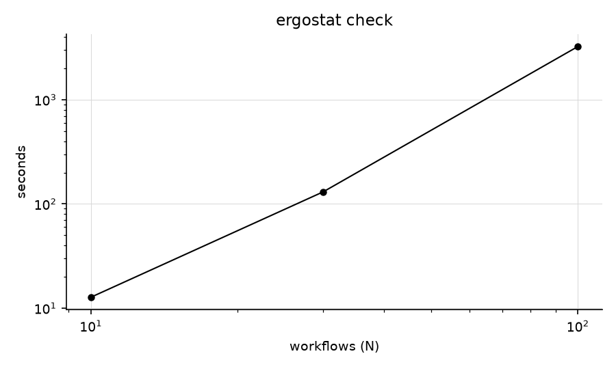 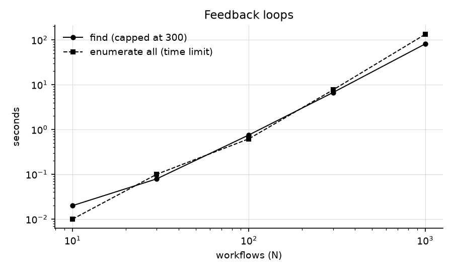 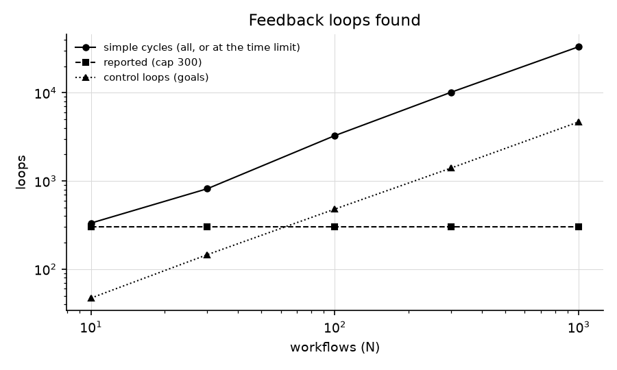
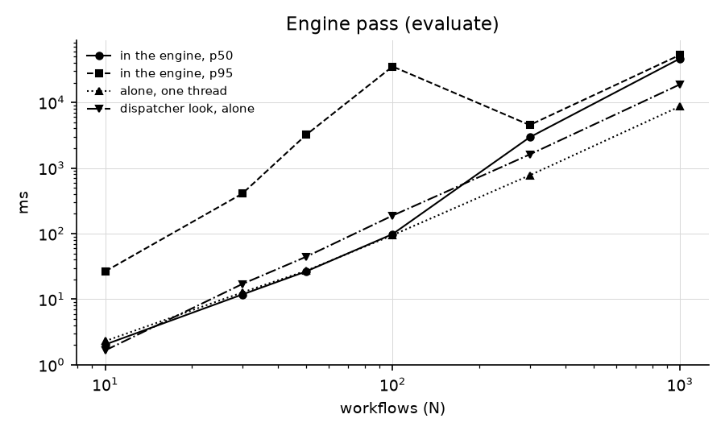 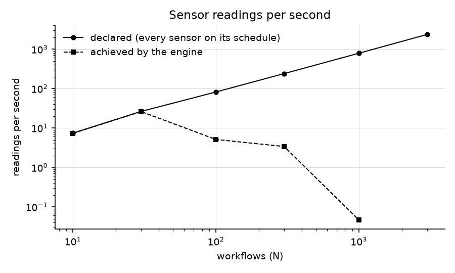 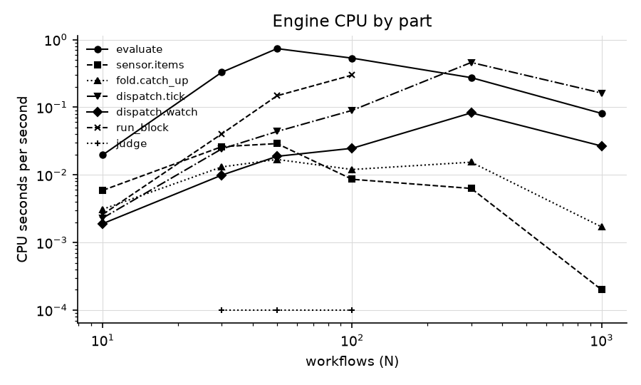
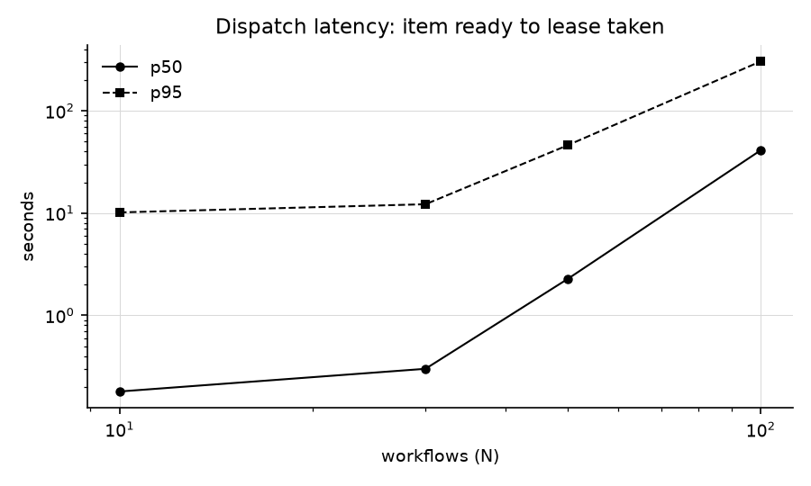 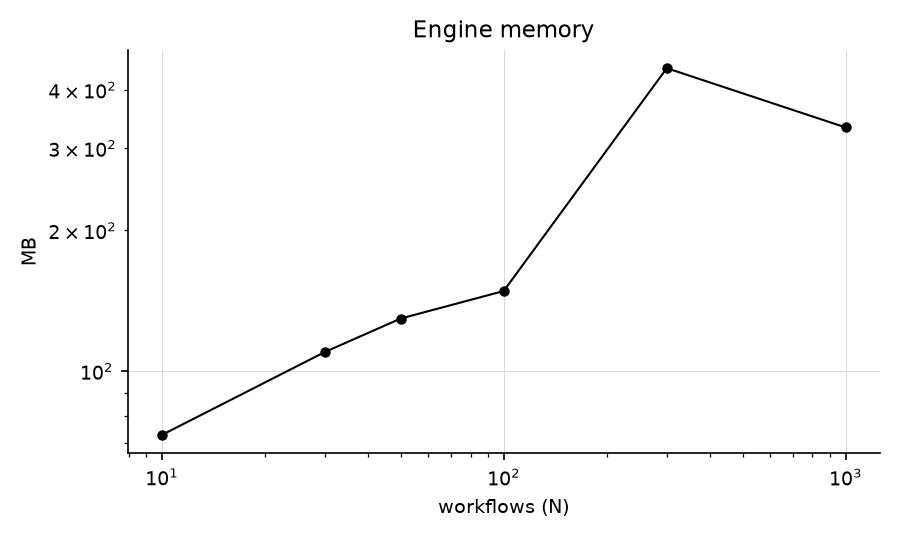 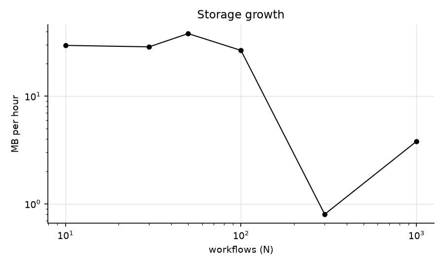
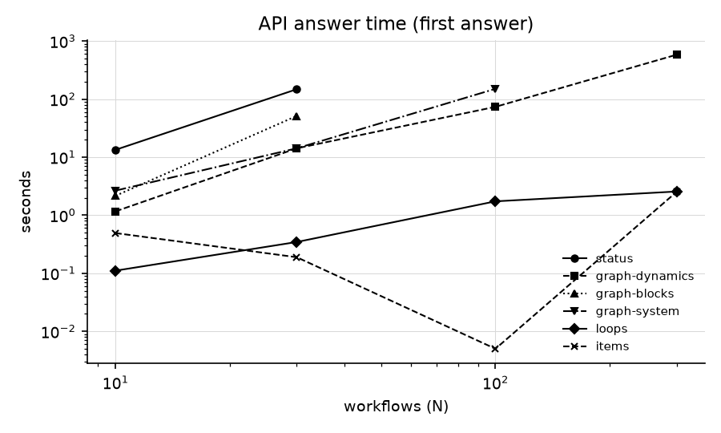 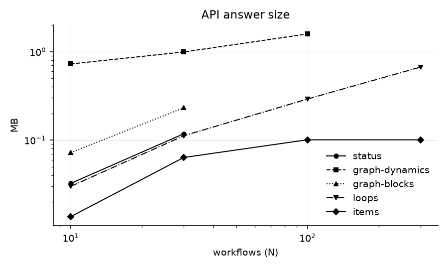 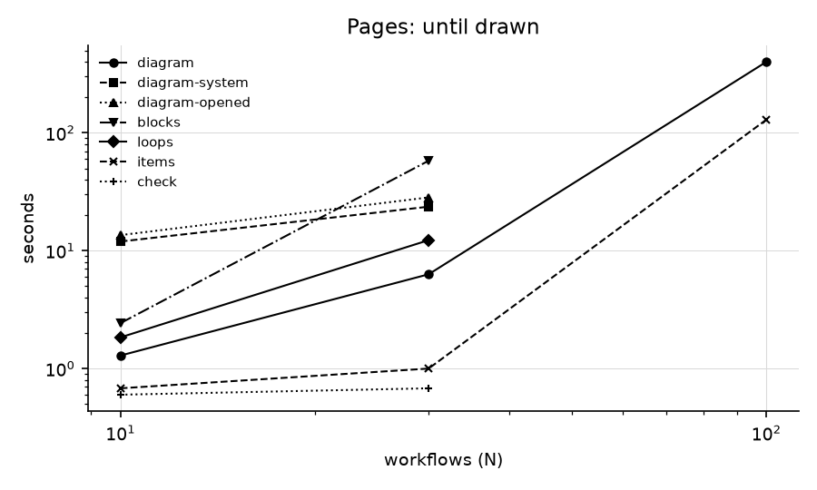
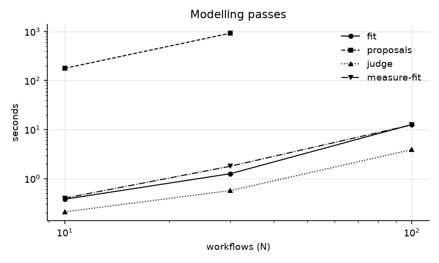

## Doing it again

```bash
uv run python scripts/scale_model.py 100 /tmp/scale/n100              # one model; --handoff 0.5 for denser hand-offs
uv run python scripts/scale_bench.py check  10 30 100                   # and phases, tick, loops, engine, web, model
uv run --with playwright==1.63.0 python scripts/scale_bench.py web 30   # the page needs Chrome
uv run --with matplotlib python scripts/scale_bench.py chart --work /tmp/scale
```

Results append to `WORK/results.jsonl`; `chart` takes, per N, the measurement made at the lowest load.
Ports 8791 to 8799 only.
